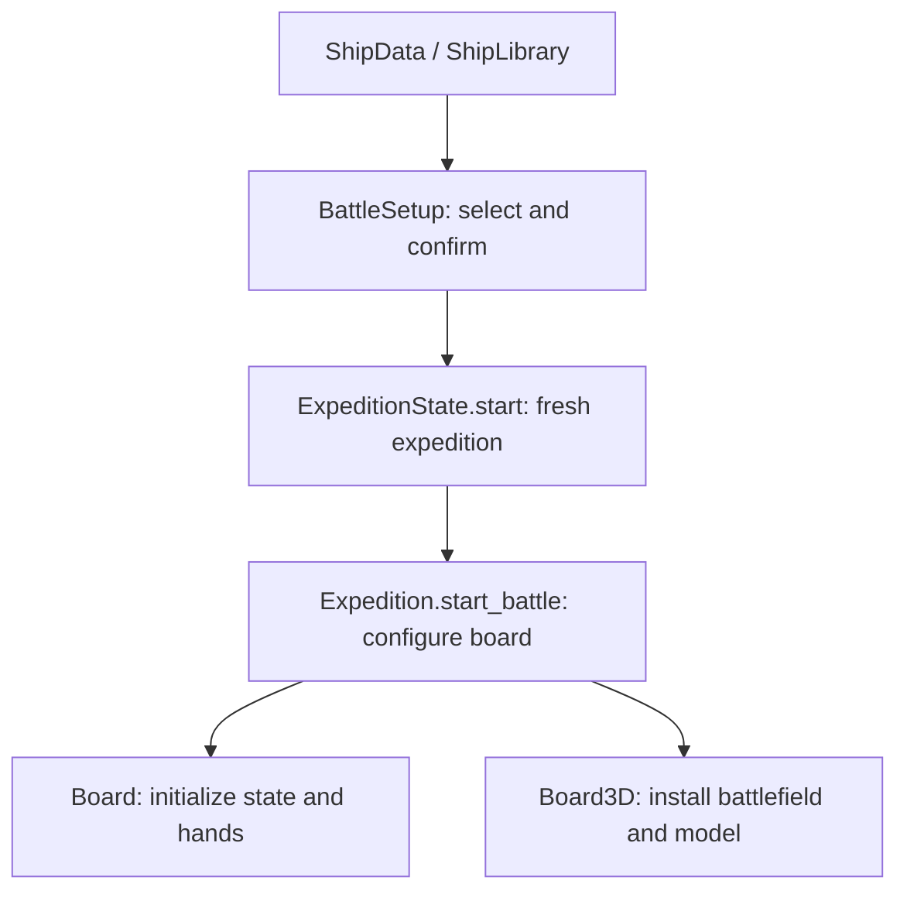
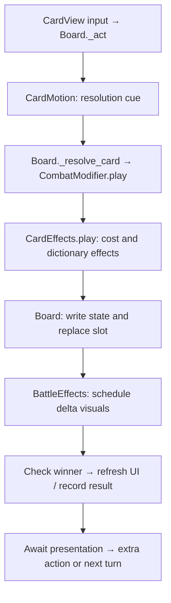
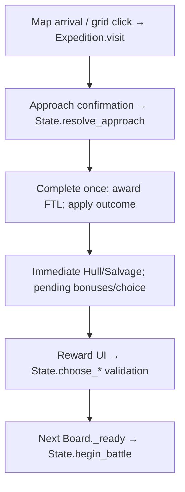

# Arcospace developer guide

This guide describes the current implementation, not a proposed architecture.
Start with the ownership table, then follow the walkthrough for the kind of change you want.

- [Quick orientation](#quick-orientation)
- [Architecture and execution flow](#architecture-and-execution-flow)
- [I want to change X — where do I start?](#i-want-to-change-x--where-do-i-start)
- [Practical walkthroughs](#practical-walkthroughs)
- [Safe modification and testing](#safe-modification-and-testing)
- [Architectural observations](#architectural-observations)

## Quick orientation

| Directory | Responsibility |
|---|---|
| `scripts/` | Gameplay controllers, Resource classes, combat helpers and presentation scripts. Start with `board.gd` for combat and `expedition_state.gd` for persistent expedition rules. |
| `scripts/ui/` | Runtime UI components: card galleries, modals, encounter tiles, resource indicators and the star-map prototype. These display data and send choices to controllers. |
| `scenes/` | Saved node hierarchies for selection, exploration, battles, cards, ships and battlefields. A scene may inherit another scene and use runtime-created children. |
| `cards/` | Individual `CardData` Resources, registered explicitly in `card_library.gd`. |
| `ships/` | `ShipData` Resources for player/enemy starting values, pools, preferences and optional models. |
| `encounters/` | PoI Resources with nested approach/outcome Resources, plus the expedition registry/settings. |
| `shaders/` | Shader code for ship damage, repair, Shields and resource effects; presentation only. |
| `tests/` | Standalone GDScript `SceneTree` runners for rules, integration and layout. Some also save screenshots with a rendering driver. |
| `docs/` | System notes, balance references, UI guidance and build instructions. Older verification reports describe their own historical revisions. |
| `resources/` | Shared tuning Resources for card motion, Power Allocation and expedition progression. |
| `tools/` | Development helpers, including balance-document generation; not the gameplay entry point. |

Godot file types:

- **`.gd`**: GDScript code. A script extending `Resource` defines configurable data; a script extending a node type supplies scene behavior.
- **`.tscn`**: a saved scene/node hierarchy. Instantiating a `PackedScene` creates those nodes; adding it to the running tree triggers lifecycle callbacks.
- **`.tres`**: a saved Resource instance, including property values and links to other Resources. Properties omitted from the file use the script's defaults.
- **`.gdshader`**: shader source used by a `ShaderMaterial`; it changes rendering, not combat statistics.

In C++ terms, a Resource is closer to a shared data object than a fresh value copy.
`preload()` holds a reference; editing that object during a run can affect every user.
The upgrade and enemy-scaling paths deliberately create copies where values change.

## Architecture and execution flow

### Ownership and dependencies

| Owner | Calls / consumes | Boundary |
|---|---|---|
| [battle_setup.gd](../scripts/battle_setup.gd) | [ship_library.gd](../scripts/ship_library.gd), ship previews, `expedition.tscn` | Selection and confirmation; does not run combat. |
| [expedition.gd](../scripts/expedition.gd) | `ExpeditionState`, star map/grid, PoI/reward UI, `board_3d.tscn` | Screen routing and callbacks; does not calculate rewards. |
| [expedition_state.gd](../scripts/expedition_state.gd) | expedition rules/progression, ship/card libraries, outcomes, repair rules | Persistent Hull, Salvage, owned cards, upgrades, generation, completion and pending bonuses. |
| [board.gd](../scripts/board.gd) | `CardHand`, `EnemyAI`, `CombatModifier`, `MatchRules`, `FTLDrive`, motion/effects | Authoritative battle properties, input locks, turns, result recording. |
| [combat_modifier.gd](../scripts/combat_modifier.gd) | `CardEffects` | Round events and modified card copies; its `preview()` also drives Ion card presentation. |
| [card_effects.gd](../scripts/card_effects.gd) | Two ship-state dictionaries | Cost, damage, resources and other effects; no UI or turn advancement. |
| [card_hand.gd](../scripts/card_hand.gd) | Card library/pools, [card_preferences.gd](../scripts/card_preferences.gd), allocation settings | Eligibility, rarity selection, weighted identity choice and replacement. |
| [enemy_ai.gd](../scripts/enemy_ai.gd) | `CardEffects` simulation, [match_rules.gd](../scripts/match_rules.gd), enemy tactical weights | Returns a slot/discard decision; Board executes it. |
| [board_3d.gd](../scripts/board_3d.gd) | Inherits `board.gd`; selects battlefield/model scenes | Connects 3D presentation and responsive placement to existing rules. |
| [battle_effects.gd](../scripts/battle_effects.gd) | State snapshots, [ship_3d.gd](../scripts/ship_3d.gd), shaders, HUD nodes | Animates committed changes; never reapplies them. |

### Ship selected → battle ready

[project.godot](../project.godot) starts [battle_setup.tscn](../scenes/battle_setup.tscn).
`BattleSetup._ready()` reads `Ships.PLAYERS`, fills paged selection panels and creates
model previews. `_select()` updates selection; `_start()` creates
[expedition.tscn](../scenes/expedition.tscn) with the selected index **before** adding it to the tree.



There is no second ship-selection screen between exploration and combat.
`Expedition.start_battle()` passes the encounter's scaled enemy Resource and modifier,
connects continue/restart/exit signals, then adds the board. `Board3D._enter_tree()`
installs the presentation nodes before child `_ready()` methods cache references.
`Board._ready()` applies ship stats and `ExpeditionState.begin_battle()`, configures
modifiers/allocation, deals hands, then calls `_begin_turn("player")` for initial income.

### Card played



`_act()` checks turn ownership, affordability and input locks. The motion callback
commits the action once the displayed card reaches its cue (immediately if motion is
disabled). `_resolve_card()` reads the Board's properties into dictionaries, resolves
through the modifier, writes results back and replaces the slot. Discard follows a
separate refund path instead of `CardEffects.play()`.

**Damage is calculated in `CardEffects.play()`**: shield-breaking precedes damage;
piercing damage bypasses Shields, while the rest is absorbed before Hull loss.
Explicit direct self-damage and regular shield-first self-damage are separate paths.
The damage report lets Board distinguish permanent Hull damage from Ablative Plating
when checking escape-drive disruption. Asteroid damage is separately implemented in
`CombatModifier.asteroid_strike()`.

`_check_winner()` latches a result using `MatchRules.wins()` (including simultaneous
Hull destruction). `refresh_display()` calls guarded `_record_result()` to freeze
rewards and call `ExpeditionState.record_battle()` once. The action still waits for
visual jobs before accepting another action or changing turns.

Enemy turns use `EnemyThinkTimer` → `_on_enemy_timeout()` → `EnemyAI.choose()` → the
same `_act()` path. Unaffordable hands discard; empty hands pass. A `play_again` card
retains the actor without granting another income or escape-charge tick.

### PoI completed → next battle



`resolve_approach()` validates requirements, pays the approach cost, rolls success,
then `_complete_encounter()` guards completion/FTL before `_apply_outcome()` applies
the selected `EncounterOutcome`. The UI flash/reward screen presents an already
resolved result. `next_battle` bonuses/penalties are consumed in `begin_battle()`;
production purchases and card ownership/upgrades last for the expedition.

[star_map.gd](../scripts/ui/star_map.gd) moves the ship and emits `arrived(index)`.
Its `before_travel` callback delegates valid movement initiation to `Expedition._request_travel`;
that is the sole Chasedown roll point, shared with grid travel. State retains the destination
and one hidden ordinary battle entry until resolution; map/grid rendering excludes that entry.
`Expedition._show_star_map()` connects that to `visit()`. Its `map_destination` survives
screen rebuilds; a new system resets it. Set **Use Star Map** off on the Expedition
node to restore the original grid. Both read the same `state.encounters` array.

The Outpost is `state.service`, addressed by `SERVICE_INDEX = -2`, **not** one of the
six progression encounters. `purchase_service()` validates a confirmation revision
to prevent stale/double purchases; free return never awards FTL.

### Two different FTL counters

The resource-draining card is **Drain Beam** (`cards/25_emp_pulse.tres`; legacy path retained for stable card identity). **EMP Pulse** refers to the combat escape system.

- [ftl_drive.gd](../scripts/ftl_drive.gd): battle-only **EMP Pulse**, charged on
  player turns. Ship `ftl_turns`/`ftl_resistance` configure it; `_warp_out()` resolves
  escape without generating another system. The current code/UI still uses this name.
- `ExpeditionState.ftl_charge`: **interstellar** progression. `generate_system()` uses
  [expedition_progression.gd](../scripts/expedition_progression.gd) for carryover (shipping cap **0**),
  system-based enemy scaling and mandatory Boss milestones. `can_jump()` blocks an
  unresolved mandatory Boss even with enough charge. Defeat or successful escape
  resolves that encounter, but their rewards differ.

## I want to change X — where do I start?

| Area / I want to… | Start here | Other affected systems / checks |
|---|---|---|
| **Cards and deck building** — add a card | [CardData](../scripts/card_data.gd), [Laser Burst Resource](../cards/12_laser_burst.tres), [CardLibrary](../scripts/card_library.gd) | Ship starting pools, reward candidates, upgrades, descriptions and registry/count tests. |
| Add a new effect key | [CardEffects.play](../scripts/card_effects.gd) | `CardData.describe_effects`, `CombatModifier._scaled`/`preview`, AI simulation/scoring, card views, gallery filters, preferences and tests. Do not implement damage in UI. |
| Change drawing/allocation | [CardHand](../scripts/card_hand.gd), [Power Allocation Resource](../resources/power_allocation.tres) | Preserve rarity locks/caps, identity duplicates, acquired weights and enemy independence. |
| Add a card category | [CardData.allocation_category](../scripts/card_data.gd) | Allocation mode validation in CardHand, [allocation popup](../scripts/ui/power_allocation_popup.gd) and settings; gallery categories are separately derived from effects. |
| Change acquisition/upgrades | [ExpeditionState](../scripts/expedition_state.gd), [ExpeditionRules](../scripts/expedition_rules.gd) | `random_card_offers`, `choose_card`, `start_upgrade_event`, `choose_upgrade`, `finish_upgrades`, active-hand updates, gallery/inspector previews; shared library must stay unchanged. |
| **Ships and combat statistics** — add a ship | [ShipData](../scripts/ship_data.gd), [ShipLibrary](../scripts/ship_library.gd), [Endeavour](../ships/player/endeavour.tres) | Selection shows three panels per page; enemy registry is separately in expedition rules. Custom models need the existing ship animation API. |
| Change damage/income/wins | [CardEffects](../scripts/card_effects.gd), [MatchRules](../scripts/match_rules.gd), [Board](../scripts/board.gd) | Hull/plating tests, AI simulation, victory/escape and balance docs. |
| **Star systems and PoIs** — add a PoI | [PoiData](../scripts/poi_data.gd), [Mining Operation](../encounters/mining_operation.tres), [expedition_rules.tres](../encounters/expedition_rules.tres) | Approach/outcome Resources, generation bounds, display classification/icon and reward tests. No registration in the map. |
| Change progression | [ExpeditionProgression Resource](../resources/expedition_progression.tres), [ExpeditionState.generate_system](../scripts/expedition_state.gd) | Carryover, Boss gating, six encounter slots, Outpost independence; milestone tests. |
| **Economy and rewards** — change PoI rewards/services | [EncounterOutcome](../scripts/encounter_outcome.gd), [EncounterApproach](../scripts/encounter_approach.gd), [Outpost](../encounters/trading_outpost.tres) | State `_apply_outcome`/`purchase_service`, outcome descriptions, choice UI; [repair_rules.gd](../scripts/repair_rules.gd) is shared by repairs. |
| **UI and layout** — move controls | [UI layout guide](ui_layout.md), relevant `.tscn` and attached `.gd` | Runtime `_fit_*`, `_layout_*`, `_build_ui` and container sizing can override Inspector positions. Simple layout edits should not change CardEffects, EnemyAI or ExpeditionState. |
| Change card rendering | [card.tscn](../scenes/card.tscn), [card_view.gd](../scripts/card_view.gd) | [card_portrait.gd](../scripts/ui/card_portrait.gd), gallery, inspector and deck viewer share the rendering; check all contexts. |
| **Visual effects** — add a presentation cue | [BattleEffects](../scripts/battle_effects.gd), [Ship3D](../scripts/ship_3d.gd), [ship scene](../scenes/ship_3d.tscn), [shaders](../shaders/) | Register tweens with `_job()` so turn locks and cancellation track them. Do not mutate combat state from animation callbacks. |
| **AI and gameplay rules** — change enemy tactics | [EnemyAI](../scripts/enemy_ai.gd), [CardPreferences](../scripts/card_preferences.gd), enemy ShipData | Draw preferences and tactical scores are separate. Verify costs, self-damage safety, RNG simulation and enemy hand tests. |
| Change encounter modifiers / escape | [CombatModifier](../scripts/combat_modifier.gd), [FTLDrive](../scripts/ftl_drive.gd) | Board turn/damage integration, modifier display and matching battlefield scene; escape reward and Boss tests. |

## Practical walkthroughs

These are instructions for future additions; no example feature is added by this documentation pass.

### 1. Create a card using existing effects

1. In Godot's FileSystem, duplicate [12_laser_burst.tres](../cards/12_laser_burst.tres)
   under `cards/` with a new filename. Open it in the Inspector as `CardData`.
2. Edit **Card Name**, **Family** (cost resource), **Cost**, **Tier**, **Allocation Category**,
   **Description**, **Effects** and **Play Again**. Use only keys supported by `CardEffects.play()`;
   `damage` and `energy` in this Resource show a simple attack plus resource-return pattern.
3. Set both **Upgrade Effects** dictionaries and **Max Upgrades**. Each dictionary is the
   complete replacement effect set for that level, not a delta. Keep saved **Upgrade Level**
   at zero. Upgrade copies retain cost, rarity and `identity_key()`; base descriptions are
   authored text, while upgraded descriptions derive from effects.
4. Add a `preload()` entry to `CardLibrary.CARDS`. This explicit registry makes the card
   available to enemy drawing and unowned reward selection. Add it to selected ShipData
   **Starting Cards** only if it should be owned initially; otherwise acquisition finds it.
5. For a focused battle, instantiate `board_3d.tscn` in a test fixture and assign
   the `CardHand` node’s `card_pool` / `starting_hand` before adding it to the tree. Player opening
   dealing enforces two cards per resource family where eligible; Tier 2 is locked through
   round 2. Set the round in a CardHand fixture to test later rarity draws directly.
6. Run `card_progression_test`, `card_tier_test`, `opening_balance_test`, `battle_effects_test`
   and card UI tests. Update tests that intentionally assert the existing 44-card registry
   and explicit upgrade coverage. Check both upgrades, cost, duplicate identities, rewards
   and previews. Update [card balance docs](balance/cards.md) for a future gameplay addition.

Current draw order is rarity roll **then** eligible identity weighting. Player pool =
starting identities + acquisitions, with player-only upgrade replacements. Enemy pool
is the unmodified full library. Gallery filters (`CardGallery.matches`) can overlap and
are not the single Power Allocation category. Do not edit shared Resources to upgrade a card.

### 2. Create a ship using existing models

Current statistics, pool counts, gate changes and diagnostic results: [six-ship balance pass](balance/six-ship-pass.md).

1. Duplicate [endeavour.tres](../ships/player/endeavour.tres). Edit **Ship Name**, **Subtitle**,
   **Role**, **Summary**, Hull/Shields, three starting resources, three production values,
   **FTL Turns**, **FTL Resistance**, **Hull Color** and **Starting Cards**.
2. Leave **Model Scene** empty to use the battlefield's existing ship, or point it to a
   compatible existing model such as [ship_3d.tscn](../scenes/ship_3d.tscn). Selection previews
   use `BattleSetup.preview_model` when no override exists. `Body/Hull`, `Shield`, the
   material setup and `set_*`/`animate_*` API in Ship3D matter to presentation consumers.
3. Register a player in `ShipLibrary.PLAYERS`. Selection duplicates the existing panel
   template for additional entries and displays three ships per page. The six bundled
   ships use two pages; selecting a ship also opens its page and updates the deck.
   Validate both page navigation and narrow landscape layouts after adding profiles.
4. For an enemy, set **Enemy Rank**, encounter weight/rewards, family/effect draw weights,
   tactical weights and variation. Add it to **Enemy Ships** in `expedition_rules.tres`;
   `ShipLibrary.ENEMIES` is also the standard fallback/standalone board registry.
5. Run the selection scene and inspect its deck, stats and preview. Use a Board test
   fixture with `setup_settings.enemy_data` for a chosen enemy Resource. Run
   `ship_variants_test`, `opening_balance_test`, `power_allocation_test`,
   `expedition_milestones_test` and relevant UI tests. Enemy scaling copies the Resource;
   never write scaled values back into the saved ship.

### 3. Create a PoI with rewards

1. Duplicate [mining_operation.tres](../encounters/mining_operation.tres). In its `PoiData`
   Inspector, edit **Title**, **Description**, **Hazardous**, **Encounter Weight** and
   optional **Banner Texture** / **Anomalous Presentation**.
2. Expand **Approaches**. Each `EncounterApproach` defines title, production requirement,
   minimum production, Salvage cost and success chance. Give each a **Success** and
   **Failure** `EncounterOutcome`. Make nested Resources unique when copying/shared data
   would otherwise cause edits to change another approach or PoI.
3. Edit outcome blurb, Salvage/Hull, **Next Battle** dictionary and optionally one choice
   reward. Supported pending keys are documented in `encounter_outcome.gd`. Production
   choice is persistent; temporary production dictionary keys are ignored by State.
   Choice precedence is card → upgrade → resource → production, so do not expect multiple
   choice fields on one outcome to open multiple reward selectors.
4. Add the Resource to **Pois** in `encounters/expedition_rules.tres`. Ordinary/hazardous
   bounds decide which bucket may use it. Do **not** add repeatable Outpost services to
   that list: they use **Trading Outpost** separately. Map/grid need no extra generation code.
5. For a distinct icon, add a filename-basename mapping in
   [encounter_presentation.gd](../scripts/ui/encounter_presentation.gd); unknown keys already
   have a fallback. Check approach icons and header behavior as well.
6. Set **Debug Seed** on expedition rules for repeatable systems. Faster: follow
   `expedition_test.gd` to place a Resource in a test encounter and call
   `resolve_approach(index, slot, forced_roll)` for each branch. Run `poi_reward_overhaul_test`,
   `expedition_test`, `poi_confirmation_test` and `star_map_test`; check repeated completion,
   lethal failures, pending choices and FTL. Use `trading_outpost_test` for service edits.

### 4. Add a simple visual cue through existing presentation

1. Open [battle_effects.gd](../scripts/battle_effects.gd),
   [ship_3d.gd](../scripts/ship_3d.gd) and [ship_3d.tscn](../scenes/ship_3d.tscn).
   Existing Hull repair is a useful model: `play_changes()` detects `hull_delta > 0`,
   `_repair(ship)` dispatches to `ship.animate_repair()`, and a registered tween drives
   the repair material. No card-specific animation registration is needed for that effect.
2. For a simple future repair enhancement, extend `animate_repair()` to animate an existing
   visual property using the **supplied Tween**, restoring its initial value afterwards.
   Or add a presentation branch/helper in BattleEffects for a different state delta.
   Keep rule calculations in CardEffects; use the committed before/after snapshots here.
3. Tune **Repair Seconds**, **Hit Seconds**, **Shield Seconds**, **Shake Pixels** etc. on
   the battle's **BattleEffects** node. Card travel/staging timing is separately configured
   by [resources/card_motion.tres](../resources/card_motion.tres). Shader parameters belong
   to materials, not CardData. Ship3D duplicates per-instance materials to isolate ships.
4. There is no global VFX registry: the delta dispatcher and ship API are the integration
   points. Keep the 2D fallback branches working, respect `enabled`, and register new
   independent tweens through `_job()` so `busy`/`finished` and cancellation stay correct.
5. Run `battle_effects_test`, `card_motion_test` and `board_3d_test`. Play
   `board_3d.tscn` with a rendering driver and trigger the relevant effect for visual review;
   headless success alone does not prove shader appearance or animation framing.

## Safe modification and testing

### Inspector, lifecycle and callbacks

Select a `.tres` in FileSystem to edit its exported properties, or select the relevant
scene node for node exports. `@export` exposes a saved Inspector setting; an omitted
property inherits its script default, while an explicit saved value overrides that default.
Use **Make Unique** / a deliberate copy before changing a shared nested Resource.

`_enter_tree()` runs before `_ready()`; child `_ready()` callbacks run before the parent's.
Set dependencies on an instantiated scene **before** `add_child()`. Board3D replaces models
in `_enter_tree()` for this reason. Do not manually call `_ready()` to refresh a screen.

Signals decouple producers from consumers: a Button emits `pressed`, the map emits
`arrived(index)`, and Board emits `expedition_continue`. `.connect()` chooses the receiver;
`.bind(index)` adds context to the callback. A `Callable` such as CardMotion's `resolve`
lets presentation trigger a rules-owned action at a specific cue. `await` yields execution
until a signal/animation completes; Board's locks prevent input from committing twice.

A position saved in a scene is only a starting value. Containers arrange children,
`BattleSetup._layout_cards()`/`_fit_card()` recompute selection layout,
`Board._fit_combat_controls()` and `Board3D._fit_ftl()`/`_fit_allocation_button()` place
combat controls, and `Expedition._build_ui()` creates exploration controls from code.
For a simple UI edit, inspect these owners rather than changing generation/effect rules.

### Run a focused test without a full expedition

Import the repository's `project.godot` (the configured main scene is ship selection).
Use **F6** to play an open scene such as `board_3d.tscn`, or **F5** for the main scene.
Standalone board defaults differ from expedition initialization; use the integration
fixtures when testing pending bonuses, ownership or encounter rewards.

The current CI pins **Godot 4.7.2**; match [.github/workflows/tests.yml](../.github/workflows/tests.yml)
for reproducible results. With that binary on PATH as `godot`, from the repository root:

```bash
godot --headless --path . --editor --import --quit
godot --headless --path . --script tests/card_progression_test.gd
godot --headless --path . --script tests/expedition_milestones_test.gd
godot --headless --path . --script tests/star_map_test.gd
```

Each test is its own `SceneTree`, not a scene to attach to the running game. Read its
`run()` fixture for direct Board/State setup and seed/forced-roll examples. CardHand,
EnemyAI, modifier and escape RNGs have separate generators; seeding the expedition alone
does not seed an entire combat. Watch both exit status and printed `SCRIPT ERROR`/failure
messages, as CI does. Run related tests after a local edit and all `tests/*_test.gd` before
shipping a cross-system change. CI also runs selected tests under Xvfb with rendering;
those save screenshots in `.godot/testlogs/`. Test Android touch and rendering on a device
when changing gestures/layout; see [Android build notes](android-build.md).

### Commit and undo experiments

Start with `git status` and `git pull --ff-only`; keep unrelated local edits intact.
A short experiment branch (`git switch -c experiment/name`) makes comparison easy.
Review `git diff`, stage only intended files and commit a small coherent change.
Use `git restore -- path` only to discard your own uncommitted experiment after reviewing
it; use `git revert <commit>` to undo a published commit without rewriting shared history.
A Godot re-save can produce incidental `.tscn`/`.tres` changes: review those separately.

Comment convention in critical scripts: **RESPONSIBILITY** identifies the owner;
**DOES NOT** names its boundary; **TUNE** describes an adjustable value's consequence;
**EXTEND** identifies the integration point and neighboring consumers to update.

## Architectural observations

- Selection is currently built around three player slots, and the map has six predefined
  encounter positions. Raising registry/encounter counts is not automatically a UI change.
- Effects are dictionary keys, with consumers in descriptions, modifier scaling/previews,
  AI scoring, filtering and presentation. A new key is a coordinated change, not merely
  a new Resource field. AI simulations use CardEffects directly, not the full modifier
  scheduler; do not assume they predict every battlefield event.
- `Board.refresh_display()` also records a terminal result through an idempotent guard.
  Treat it as more than a pure renderer. Expedition return synchronizes post-battle repairs
  again, after the result was recorded.
- Many controls are runtime-built or repositioned. Scene-only editing will not always
  persist on play/resize; future Inspector-friendly work should account for these owners.
- No root README currently exists; this guide is the developer entry point. For deeper
  context see [expeditions](expeditions.md), [card library](card-library.md),
  [ship variants](ship-variants.md), [balance tables](balance/cards.md) and [UI layout](ui_layout.md).

## Chasedown and combat upgrade events

See [implementation, tuning and validation](chasedown_rewards.md). `ExpeditionRules` owns the 5% chance, per-system limit, four response dictionaries and 1/2/3/3 upgrade counts. `ExpeditionState.try_chasedown` validates real PoI-to-PoI travel and uses an independent seeded RNG. The existing `begin_battle` and `record_battle` pipeline handles scaled ordinary enemies, modifier consumption, exactly-once +1 FTL and non-escape upgrades. No separate battle scene or reward system is used.

`upgraded_this_event` tracks identity keys: one selection per identity per event, even if level 2 is still available. `upgrades_remaining` drives the existing gallery; Finish clears the event, and a later event can select the identity again. Existing card costs, effects, acquisition weights and max levels are untouched. No combat-exhaustion Salvage is added. State is in memory; there is no disk save/load to migrate or validate.
