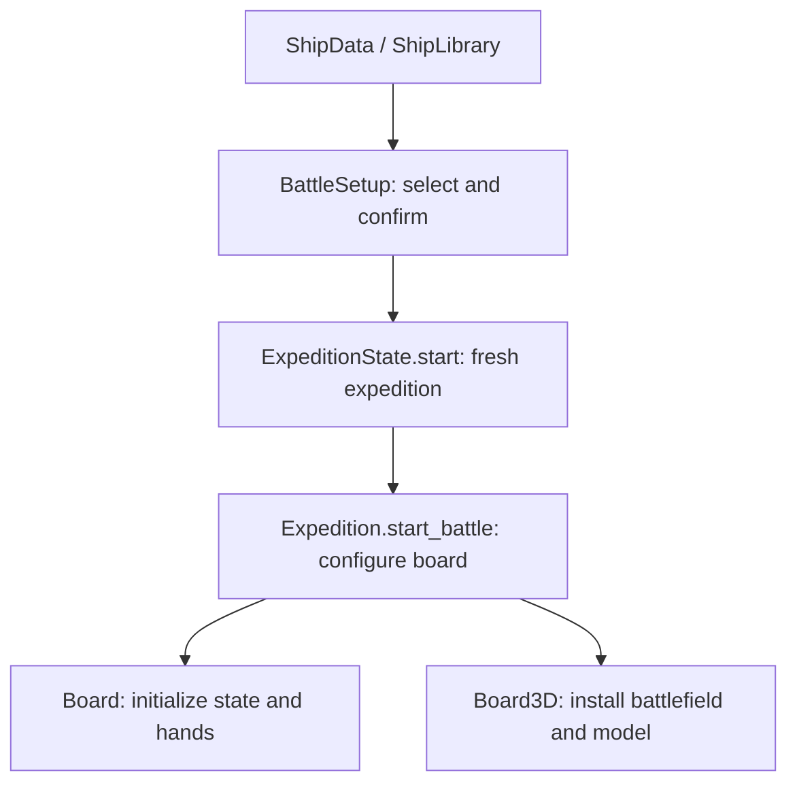
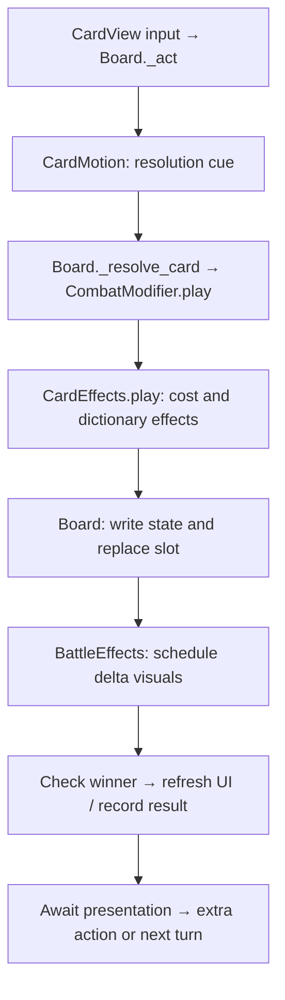
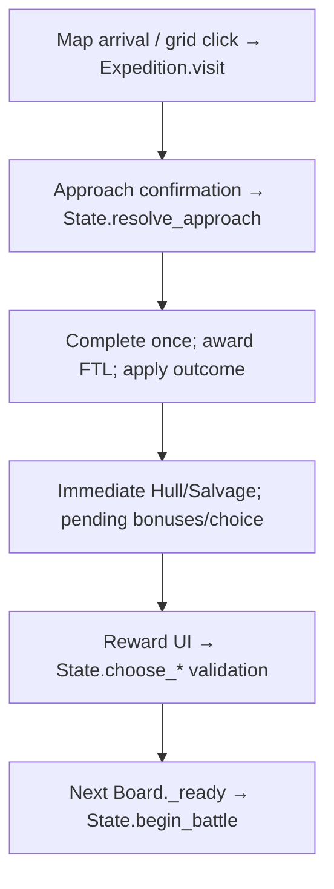

# Arcospace developer guide

This guide describes the current implementation, not a proposed architecture.
Start with the ownership table, then follow the walkthrough for the kind of change you want.

- [Quick orientation](#quick-orientation)
- [Reading and navigating scripts](#reading-and-navigating-scripts)
- [Architecture and execution flow](#architecture-and-execution-flow)
- [I want to change X — where do I start?](#i-want-to-change-x--where-do-i-start)
- [Practical walkthroughs](#practical-walkthroughs)
- [Safe modification and testing](#safe-modification-and-testing)
- [Persistent deck and reward ownership](expedition_deck_ownership.md)
- [Shared local and CI regression runner](regression_testing.md)
- [Battle ending sequence and mandatory upgrade completion](battle_results.md)
- [3D star-system map, camera tuning and fallback](star_system_3d.md)
- [Cinematic menu ownership and Inspector calibration](cinematic_menu.md)
- [Tactical preview, target analysis and Game Reference](tactical_preview.md)
- [Architectural observations](#architectural-observations)

## Quick orientation

| Directory | Responsibility |
|---|---|
| `scripts/` | Main screen/combat controllers and shared combat presentation. Start with `battle_setup.gd`, `board.gd`, `expedition.gd` and `expedition_state.gd`. |
| `scripts/cards/` | Card definitions, registry, ordered effect resolution, hand eligibility/draws, preferences and allocation settings. |
| `scripts/ships/` | Ship definitions/registry and shared procedural model animation scripts. |
| `scripts/expedition/` | PoI/rule/progression Resources and the persistent deck/reward owner. The main state/controller stay at `scripts/`. |
| `scripts/presentation/` | Scene-authored asteroid decoration motion; separate from encounter modifier rules. |
| `scripts/ui/` | Runtime UI components: card galleries, modals, encounter tiles, resource indicators and the star-map prototype. These display data and send choices to controllers. |
| `scenes/` | Saved node hierarchies for selection, exploration, battles, cards, ships and battlefields. A scene may inherit another scene and use runtime-created children. |
| `cards/` | Individual `CardData` Resources, registered explicitly in `card_library.gd`. |
| `ships/player/`, `ships/enemy/` | Saved `ShipData` profiles; these are data, while their class/registry live under `scripts/ships/`. |
| `scenes/ships/` | Independent Rustjack, AXIOM-7 and Hollow Choir procedural model scenes. |
| `encounters/` | PoI Resources with nested approach/outcome Resources, plus the expedition registry/settings. |
| `shaders/` | Shader code for ship damage, repair, Shields and resource effects; presentation only. |
| `tests/` | Standalone GDScript `SceneTree` runners for rules, integration and layout. Some also save screenshots with a rendering driver. |
| `docs/` | System notes, balance references, UI guidance and build instructions. Older verification reports describe their own historical revisions. |
| `resources/` | Shared tuning Resources for card motion/presentation, Power Allocation and expedition progression. |
| `assets/` | Existing fonts, artwork, audio and their import settings. |
| `.github/workflows/` | Regression/rendered test jobs and Android/Web export jobs. |
| `tools/` | Development helpers, including balance-document generation; not the gameplay entry point. |

Godot file types:

- **`.gd`**: GDScript code. A script extending `Resource` defines configurable data; a script extending a node type supplies scene behavior.
- **`.tscn`**: a saved scene/node hierarchy. Instantiating a `PackedScene` creates those nodes; adding it to the running tree triggers lifecycle callbacks.
- **`.tres`**: a saved Resource instance, including property values and links to other Resources. Properties omitted from the file use the script's defaults.
- **`.gdshader`**: shader source used by a `ShaderMaterial`; it changes rendering, not combat statistics.

In C++ terms, a Resource is closer to a shared data object than a fresh value copy.
`preload()` holds a reference; editing that object during a run can affect every user.
The upgrade and enemy-scaling paths deliberately create copies where values change.

## Reading and navigating scripts

The organization follows ownership, with only three new support folders. Root controllers
remain recognizable beside their scenes; `scripts/ui/` still owns reusable controls.
Do not confuse `cards/` (saved card data) with `scripts/cards/` (the code that interprets it),
or `ships/` with `scripts/ships/`. Battle presentation helpers stay beside Board because
splitting them again would add navigation without changing their ownership.

Every runtime script starts with **RESPONSIBILITY**. Existing **DOES NOT**, **TUNE** and
**EXTEND** comments identify boundaries, adjustable consequences and integration points.
Open the attached script from a scene node to find its actual owner; a control may instead
be constructed at runtime in `_build_ui()` or repositioned by `_fit_*()`.

Large controllers use non-nested `#region Name` / `#endregion` sections. Fold a region using
the script editor's gutter, then expand the area you need. Use the script editor's method
list/filter to jump directly to a function, and Find in Files to locate callers and signal
connections. Function definitions are grouped by responsibility rather than alphabetically.
Member/constant initialization order and Inspector export order are retained. CardData's
existing property declarations are now together before its functions. Definition position
does not determine when a function executes: `_ready()`, signals and explicit calls do.

| Script | Folding sections |
| --- | --- |
| `scripts/board.gd` | Initialization; Battle state; Turns and cards; Match control; Display and allocation; Results and repairs |
| `scripts/expedition.gd` | Screen initialization; System navigation; Approaches and outposts; Rewards and decks; Battle handoff; Field repairs |
| `scripts/expedition_state.gd` | Run setup; Systems and navigation; Approaches and modifiers; Repairs and services; Owned cards and rewards; Upgrade events; Battle handoff |
| `scripts/cards/card_hand.gd` | Allocation and opening; Weighted draws; Owned card updates |
| `scripts/cards/card_effects.gd` | Effect resolution; Predicates and random source |
| `scripts/battle_effects.gd` | Delta dispatch; Resource feedback; Ship feedback; Tween lifecycle |
| `scripts/enemy_ai.gd` | Move selection; Scoring and tie breaks |

Short scripts remain unsectioned. A long function is formatted into visible stages before
considering extraction. The pass follows the [Godot GDScript style guide](https://docs.godotengine.org/en/stable/tutorials/scripting/gdscript/gdscript_styleguide.html): tabs, consistent operator/comma spacing, separate statements,
two blank lines between functions and wrapped expressions near 100 columns. Long authored
strings are retained intact to preserve descriptions, labels and generated documentation.
No formatter is needed to run the game. Optional local formatting uses `gdformat -l 100 scripts tools/generate_balance_docs.gd` (the pass used gdtoolkit 4.5.0).

Select a `.tres` in FileSystem for Inspector values; select a scene node for its exported
settings. `@export` declares an editable value, while the saved `.tres`/`.tscn` may override
the default. Keep resource identities/UID files when moving scripts. Searching only a
class name misses literal path dependencies; search both before editing:

```bash
rg 'res://scripts/cards/card_effects.gd' scripts scenes cards ships encounters tests tools
rg 'CardEffects|Effects.play|_apply_effects' scripts tests
```

For an extension, start with the feature-location table below, follow its listed consumers,
then use the corresponding focused tests. Keep descriptions, modifier previews and AI
simulation in mind when changing effect keys; they share data rather than duplicating rules.

### Expedition UI component boundaries

`expedition.gd` keeps screen routing, travel, battle handoff and calls that mutate
`ExpeditionState`. Its runtime UI is split into focused presentation components:

| File | Functions and responsibility |
| --- | --- |
| `scripts/ui/expedition_screen.gd` | `_build_ui()` and its label factory construct the exploration shell: heading, resource bar, scroll area, POI header, ordinary approach confirmation and jump control. Signals report user intent to the controller. Hull pulse tuning still comes from the Expedition Inspector fields. |
| `scripts/ui/outpost_screen.gd` | Owns outpost service tiles and its confirmation window, repair/plating selector, selection highlighting and price previews. Reads state queries and emits `purchase_requested(slot, amount, revision)`; never applies purchases. |
| `scripts/ui/expedition_text.gd` | Static `compact_text()`, `compact_outcome()`, `highlight_outcome()` and `approach_text()` format descriptions. State is an explicit read-only argument where needed. |
| `scripts/ui/deck_replacement.gd` | `configure()` builds the incoming-card explanation, owned-card gallery and replacement actions. `select_card()` owns the selected identity and button state. Signals request inspection, replacement or decline; this component never spends rewards or changes ownership. |

The controller retains small forwarding methods and control references for existing
callers. `_show_replacement()` mounts the panel; `_replace_card()` and `_decline_card()`
still call the authoritative state methods. `_clear()` removes screen content and
resets the panel reference. Card inspection, drag suppression and state validation
remain in their existing components. Field repairs remain in
`scripts/ui/field_repair_controls.gd` from the earlier extraction.

Outpost lifecycle: `show_outpost()` mounts a new component and connects its request
to `_purchase_outpost_service()`. The controller rejects requests from any replaced
screen before calling `ExpeditionState.purchase_service()`, which retains all price,
availability and revision validation. `_clear()` disables and releases the component's
state reference before detaching it. Existing controller control references remain
for compatibility; ordinary POIs use the exploration shell's separate confirmation.
To add a service, author its rules/data in the existing state/resource layer and extend
the outpost presentation as needed; no purchase mutation belongs in the UI component.

### Shield-collapse damage timing

See [shield_shatter.md](shield_shatter.md) for the revised staged-damage contract.
Board determines results once through the existing rules, applies Shields at impact,
and releases held Hull damage at the fragment-burst cue through
`scripts/combat/pending_hull_damage.gd`. The reusable effect under `scripts/effects/`
only renders; cosmetic Tweens never commit damage. Keep these ownership boundaries
when adding new damage sources or visual effects.

### Combat HUD boundary and extension rules

`board.gd` owns combat decisions and state transitions. `refresh_display()` commits
results once, normalizes the repair selection and chooses any standalone next
modifier before building `_display_snapshot()`. It also retains the result-music
latch. `scripts/ui/battle_hud.gd` binds existing controls once and renders that
snapshot through `refresh_results()`, `refresh_emp()` and
`refresh_ships_and_cards()`. It does not retain the Board controller or read live
combat state. Card preview Resources remain presentation references; do not mutate
their definitions in a renderer.

Generic hand/line/EMP layout lives in the HUD. Board keeps forwarding methods so
`board_3d.gd` can retain its projection overrides. EMP button fitting is stateless
because the 3D scene calls it before the base Board initializes the HUD.

For future features, extend the component that owns the responsibility. Add display
facts to the snapshot and render them in the relevant HUD method; keep user-action
validation and state changes in Board or the existing rules component. Use signals
for new interactive components. Keep mutable state under one owner, preserve shared
Resource isolation, and avoid passing an entire controller into update methods.
Extract a new component when it has a coherent responsibility, rather than splitting
functions solely to meet a line count. Apply the same boundaries to Expedition's
existing screen, formatting, deck replacement and repair components.

## Architecture and execution flow

### Ownership and dependencies

| Owner | Calls / consumes | Boundary |
|---|---|---|
| [battle_setup.gd](../scripts/battle_setup.gd) | [ship_library.gd](../scripts/ships/ship_library.gd), ship previews, `expedition.tscn` | Selection and confirmation; does not run combat. |
| [expedition.gd](../scripts/expedition.gd) | `ExpeditionState`, star map/grid, PoI/reward UI, `board_3d.tscn` | Screen routing and callbacks; does not calculate rewards. |
| [expedition_state.gd](../scripts/expedition_state.gd) | expedition rules/progression, ship/card libraries, outcomes, repair rules | Authoritative run coordinator: Hull, Salvage, generation, completion, bonuses; delegates card ownership to ExpeditionDeck. |
| [expedition_deck.gd](../scripts/expedition/expedition_deck.gd) | Card library; explicit profile/rules/RNG inputs | Sole card ledgers, reward selection, acquisition/replacement and upgrade events; no Board or State back-reference. |
| [board.gd](../scripts/board.gd) | `CardHand`, `EnemyAI`, `CombatModifier`, `MatchRules`, `FTLDrive`, motion/effects | Authoritative battle properties, input locks, turns, result recording. |
| [combat_modifier.gd](../scripts/combat_modifier.gd) | `CardEffects` | Round events and modified card copies; its `preview()` also drives Ion card presentation. |
| [card_effects.gd](../scripts/cards/card_effects.gd) | Two ship-state dictionaries | Cost, damage, resources and other effects; no UI or turn advancement. |
| [card_hand.gd](../scripts/cards/card_hand.gd) | Card library/pools, [card_preferences.gd](../scripts/cards/card_preferences.gd), allocation settings | Eligibility, rarity selection, weighted identity choice and replacement. |
| [enemy_ai.gd](../scripts/enemy_ai.gd) | `CardEffects` simulation, [match_rules.gd](../scripts/match_rules.gd), enemy tactical weights | Returns a slot/discard decision; Board executes it. |
| [board_3d.gd](../scripts/board_3d.gd) | Inherits `board.gd`; selects battlefield/model scenes | Connects 3D presentation and responsive placement to existing rules. |
| [battle_effects.gd](../scripts/battle_effects.gd) | State snapshots, [ship_3d.gd](../scripts/ships/ship_3d.gd), shaders, HUD nodes | Animates committed changes; never reapplies them. |

### Direct dependents to check before editing

These are current direct runtime references, not a complete transitive dependency graph.
The `tests/` fixtures and balance-document generator also preload many of these files.

| Script | Direct runtime caller / attachment |
| --- | --- |
| `scripts/board.gd` | `scenes/board.tscn`; inherited by `scripts/board_3d.gd` |
| `scripts/expedition.gd` | `scenes/expedition.tscn` |
| `scripts/expedition_state.gd` | `scripts/expedition.gd` creates the shared run state |
| `scripts/cards/card_effects.gd` | Board, CombatModifier and EnemyAI preload the same resolver |
| `scripts/cards/card_hand.gd` | Both CardHand and EnemyHand in `scenes/board.tscn` |
| `scripts/battle_effects.gd`, `scripts/enemy_ai.gd` | Attached to their corresponding children in `scenes/board.tscn`; Board calls them |
| `scripts/ships/ship_data.gd` | Saved profiles under `ships/player/` and `ships/enemy/` |
| `scripts/expedition/expedition_rules.gd` | `encounters/expedition_rules.tres`; Expedition and State consume the instance |

### Ship selected → battle ready

[project.godot](../project.godot) starts [battle_setup.tscn](../scenes/battle_setup.tscn).
`BattleSetup._ready()` reads `Ships.PLAYERS`, fills paged selection panels and creates
model previews. `_select()` updates selection; `_start()` creates
[expedition.tscn](../scenes/expedition.tscn) with the selected index **before** adding it to the tree.



There is no second ship-selection screen between exploration and combat.
`Expedition.start_battle()` passes the encounter's scaled enemy Resource and modifier,
connects continue/restart/exit signals, then adds the board. `Board3D._enter_tree()`
installs the presentation nodes before child `_ready()` methods cache references.
`Board._ready()` applies ship stats and `ExpeditionState.begin_battle()`, configures
modifiers/allocation, deals hands, then calls `_begin_turn("player")` for initial income.

### Card played



`_act()` checks turn ownership, affordability and input locks. The motion callback
commits the action once the displayed card reaches its cue (immediately if motion is
disabled). `_resolve_card()` reads the Board's properties into dictionaries, resolves
through the modifier, writes results back and replaces the slot. Discard follows a
separate refund path instead of `CardEffects.play()`.

**Damage is calculated in `CardEffects.play()`**: shield-breaking precedes damage;
piercing damage bypasses Shields, while the rest is absorbed before Hull loss.
Explicit direct self-damage and regular shield-first self-damage are separate paths.
The damage report lets Board distinguish permanent Hull damage from Ablative Plating
when checking escape-drive disruption. Asteroid damage is separately implemented in
`CombatModifier.asteroid_strike()`.

`_check_winner()` latches Hull outcomes first, then `MatchRules.wins()` for expired
Systems Failure. `combat/systems_failure.gd` owns the independent per-ship clocks;
Board `_finish_turn()` is the sole full-turn tick point. Extra actions never tick.
See [Systems Failure](systems_failure.md) for timing, Inspector settings and AI ownership. `refresh_display()` calls guarded `_record_result()` to freeze
rewards and call `ExpeditionState.record_battle()` once. The action still waits for
visual jobs before accepting another action or changing turns.

Enemy turns use `EnemyThinkTimer` → `_on_enemy_timeout()` → `EnemyAI.choose()` → the
same `_act()` path. Unaffordable hands discard; empty hands pass. A `play_again` card
retains the actor without granting another income or escape-charge tick.

### PoI completed → next battle



`resolve_approach()` validates requirements, pays the approach cost, rolls success,
then `_complete_encounter()` guards completion/FTL before `_apply_outcome()` applies
the selected `EncounterOutcome`. The UI flash/reward screen presents an already
resolved result. `next_battle` bonuses/penalties are consumed in `begin_battle()`;
production purchases and card ownership/upgrades last for the expedition.

[star_map.gd](../scripts/ui/star_map.gd) moves the ship and emits `arrived(index)`.
Its `before_travel` callback delegates valid movement initiation to `Expedition._request_travel`;
that is the sole Chasedown roll point, shared with grid travel. State retains the destination
and one hidden ordinary battle entry until resolution; map/grid rendering excludes that entry.
`Expedition._show_star_map()` connects that to `visit()`. Its `map_destination` survives
screen rebuilds; a new system resets it. Set **Use Star Map** off on the Expedition
node to restore the original grid. Both read the same `state.encounters` array.

The Outpost is `state.service`, addressed by `SERVICE_INDEX = -2`, **not** one of the
six progression encounters. `purchase_service()` validates a confirmation revision
to prevent stale/double purchases; free return never awards FTL.

### Two different FTL counters

The resource-draining card is **Drain Beam** (`cards/25_emp_pulse.tres`; legacy path retained for stable card identity). **EMP Pulse** refers to the combat escape system.

- [ftl_drive.gd](../scripts/ftl_drive.gd): battle-only **EMP Pulse**, charged on
  player turns. Ship `ftl_turns`/`ftl_resistance` configure it; `_warp_out()` resolves
  escape without generating another system. The current code/UI still uses this name.
- `ExpeditionState.ftl_charge`: **interstellar** progression. `generate_system()` uses
  [expedition_progression.gd](../scripts/expedition/expedition_progression.gd) for carryover (shipping cap **0**),
  system-based enemy scaling and mandatory Boss milestones. `can_jump()` blocks an
  unresolved mandatory Boss even with enough charge. Defeat or successful escape
  resolves that encounter, but their rewards differ.

## I want to change X — where do I start?

| Area / I want to… | Start here | Other affected systems / checks |
|---|---|---|
| **Cards and deck building** — add a card | [CardData](../scripts/cards/card_data.gd), [Laser Burst Resource](../cards/12_laser_burst.tres), [CardLibrary](../scripts/cards/card_library.gd) | Ship starting pools, reward candidates, upgrades, descriptions and registry/count tests. |
| Add a new effect key | [CardEffects.play](../scripts/cards/card_effects.gd) | `CardData.describe_effects`, `CombatModifier._scaled`/`preview`, AI simulation/scoring, card views, gallery filters, preferences and tests. Do not implement damage in UI. |
| Change drawing/allocation | [CardHand](../scripts/cards/card_hand.gd), [Power Allocation Resource](../resources/power_allocation.tres) | Preserve rarity locks/caps, identity duplicates, acquired weights and enemy independence. |
| Add a card category | [CardData.allocation_category](../scripts/cards/card_data.gd) | Allocation mode validation in CardHand, [allocation popup](../scripts/ui/power_allocation_popup.gd) and settings; gallery categories are separately derived from effects. |
| Change acquisition/upgrades | [ExpeditionState](../scripts/expedition_state.gd), [ExpeditionRules](../scripts/expedition/expedition_rules.gd) | `random_card_offers`, `choose_card`, `start_upgrade_event`, `choose_upgrade`, `finish_upgrades`, active-hand updates, gallery/inspector previews; shared library must stay unchanged. |
| **Ships and combat statistics** — add a ship | [ShipData](../scripts/ships/ship_data.gd), [ShipLibrary](../scripts/ships/ship_library.gd), [Endeavour](../ships/player/endeavour.tres) | Selection shows three panels per page; enemy registry is separately in expedition rules. Custom models need the existing ship animation API. |
| Change damage/income/wins | [CardEffects](../scripts/cards/card_effects.gd), [MatchRules](../scripts/match_rules.gd), [Board](../scripts/board.gd) | Hull/plating tests, AI simulation, victory/escape and balance docs. |
| **Star systems and PoIs** — add a PoI | [PoiData](../scripts/expedition/poi_data.gd), [Mining Operation](../encounters/mining_operation.tres), [expedition_rules.tres](../encounters/expedition_rules.tres) | Approach/outcome Resources, generation bounds, display classification/icon and reward tests. No registration in the map. |
| Change progression | [ExpeditionProgression Resource](../resources/expedition_progression.tres), [ExpeditionState.generate_system](../scripts/expedition_state.gd) | Carryover, Boss gating, six encounter slots, Outpost independence; milestone tests. |
| **Economy and rewards** — change PoI rewards/services | [EncounterOutcome](../scripts/expedition/encounter_outcome.gd), [EncounterApproach](../scripts/expedition/encounter_approach.gd), [Outpost](../encounters/trading_outpost.tres) | State `_apply_outcome`/`purchase_service`, outcome descriptions, choice UI; [repair_rules.gd](../scripts/repair_rules.gd) is shared by repairs. |
| **UI and layout** — move controls | [UI layout guide](ui_layout.md), relevant `.tscn` and attached `.gd` | Runtime `_fit_*`, `_layout_*`, `_build_ui` and container sizing can override Inspector positions. Simple layout edits should not change CardEffects, EnemyAI or ExpeditionState. |
| Change card rendering | [card.tscn](../scenes/card.tscn), [card_view.gd](../scripts/card_view.gd) | [card_portrait.gd](../scripts/ui/card_portrait.gd), gallery, inspector and deck viewer share the rendering; check all contexts. |
| **Visual effects** — add a presentation cue | [BattleEffects](../scripts/battle_effects.gd), [Ship3D](../scripts/ships/ship_3d.gd), [ship scene](../scenes/ship_3d.tscn), [shaders](../shaders/) | Register tweens with `_job()` so turn locks and cancellation track them. Do not mutate combat state from animation callbacks. |
| **AI and gameplay rules** — change enemy tactics | [EnemyAI](../scripts/enemy_ai.gd), [CardPreferences](../scripts/cards/card_preferences.gd), enemy ShipData | Draw preferences and tactical scores are separate. Verify costs, self-damage safety, RNG simulation and enemy hand tests. |
| Change encounter modifiers / escape | [CombatModifier](../scripts/combat_modifier.gd), [FTLDrive](../scripts/ftl_drive.gd) | Board turn/damage integration, modifier display and matching battlefield scene; escape reward and Boss tests. |

## Practical walkthroughs

These are instructions for future additions; no example feature is added by this documentation pass.

### 1. Create a card using existing effects

1. In Godot's FileSystem, duplicate [12_laser_burst.tres](../cards/12_laser_burst.tres)
   under `cards/` with a new filename. Open it in the Inspector as `CardData`.
2. Edit **Card Name**, **Family** (cost resource), **Cost**, **Tier**, **Allocation Category**,
   **Description**, **Effects** and **Play Again**. Use only keys supported by `CardEffects.play()`;
   `damage` uses Shield-first damage; `pierce: 1.0` makes it direct Hull damage. See the [effect schema](balance/cards.md#generic-conditionals-exchanges-and-production) for generic conditional, exchange and production keys.
3. Set both **Upgrade Effects** dictionaries and **Max Upgrades**. Each dictionary is the
   complete replacement effect set for that level, not a delta. Keep saved **Upgrade Level**
   at zero. Upgrade copies retain cost, rarity and `identity_key()`; base descriptions are
   authored text, while upgraded descriptions derive from effects.
4. Add a `preload()` entry to `CardLibrary.CARDS`. This explicit registry makes the card
   available to full-library enemy drawing and unowned reward selection. Explicit enemy
   starting pools require their own deliberate membership update. Add it to selected ShipData
   **Starting Cards** only if it should be owned initially; otherwise acquisition finds it.
5. For a focused battle, instantiate `board_3d.tscn` in a test fixture and assign
   the `CardHand` node’s `card_pool` / `starting_hand` before adding it to the tree. Player opening
   dealing enforces two cards per resource family where eligible; Tier 2 is locked through
   round 2. Set the round in a CardHand fixture to test later rarity draws directly.
6. Run `card_progression_test`, `card_tier_test`, `opening_balance_test`, `battle_effects_test`
   and card UI tests. Update tests that intentionally assert the current 74-card registry
   and explicit upgrade coverage. Check both upgrades, cost, duplicate identities, rewards
   and previews. Update [card balance docs](balance/cards.md) for a future gameplay addition.

Current draw order is rarity roll **then** eligible identity weighting. Player pool =
retained starting identities + acquisitions, with player-only upgrade replacements. Removed starting keys are excluded by `removed_starting_cards`; reacquisition is a new base-level acquired identity. Enemy pool
is its explicit profile `starting_cards` when supplied, otherwise the unmodified full library. Gallery filters (`CardGallery.matches`) can overlap and
are not the single Power Allocation category. Do not edit shared Resources to upgrade a card.

### 2. Create a ship using existing models

Current statistics, pool counts, gate changes and diagnostic results: [six-ship balance pass](balance/six-ship-pass.md).

1. Duplicate [endeavour.tres](../ships/player/endeavour.tres). Edit **Ship Name**, **Subtitle**,
   **Role**, **Summary**, Hull/Shields, three starting resources, three production values,
   **FTL Turns**, **FTL Resistance**, **Hull Color** and **Starting Cards**.
2. Leave **Model Scene** empty to use the battlefield's existing ship, or point it to a
   compatible existing model such as [ship_3d.tscn](../scenes/ship_3d.tscn). Selection previews
   use `BattleSetup.preview_model` when no override exists. `Body/Hull`, `Shield`, the
   material setup and `set_*`/`animate_*` API in Ship3D matter to presentation consumers.
3. Register a player in `ShipLibrary.PLAYERS`. Selection duplicates the existing panel
   template for additional entries and displays three ships per page. The six bundled
   ships use two pages; selecting a ship also opens its page and updates the deck.
   Validate both page navigation and narrow landscape layouts after adding profiles.
4. For an enemy, set **Enemy Rank**, encounter weight/rewards, family/effect draw weights,
   tactical weights and variation. Add it to **Enemy Ships** in `expedition_rules.tres`;
   `ShipLibrary.ENEMIES` is also the standard fallback/standalone board registry.
5. Run the selection scene and inspect its deck, stats and preview. Use a Board test
   fixture with `setup_settings.enemy_data` for a chosen enemy Resource. Run
   `ship_variants_test`, `opening_balance_test`, `power_allocation_test`,
   `expedition_milestones_test` and relevant UI tests. Enemy scaling copies the Resource;
   never write scaled values back into the saved ship.

### 3. Create a PoI with rewards

1. Duplicate [mining_operation.tres](../encounters/mining_operation.tres). In its `PoiData`
   Inspector, edit **Title**, **Description**, **Hazardous**, **Encounter Weight** and
   optional **Banner Texture** / **Anomalous Presentation**.
2. Expand **Approaches**. Each `EncounterApproach` defines title, production requirement,
   minimum production, Salvage cost and success chance. Give each a **Success** and
   **Failure** `EncounterOutcome`. Make nested Resources unique when copying/shared data
   would otherwise cause edits to change another approach or PoI.
3. Edit outcome blurb, Salvage/Hull, **Next Battle** dictionary and optionally one choice
   reward. Supported pending keys are documented in `encounter_outcome.gd`. Production
   choice is persistent; temporary production dictionary keys are ignored by State.
   Choice precedence is card → upgrade → resource → production, so do not expect multiple
   choice fields on one outcome to open multiple reward selectors.
4. Add the Resource to **Pois** in `encounters/expedition_rules.tres`. Ordinary/hazardous
   bounds decide which bucket may use it. Do **not** add repeatable Outpost services to
   that list: they use **Trading Outpost** separately. Map/grid need no extra generation code.
5. For a distinct icon, add a filename-basename mapping in
   [encounter_presentation.gd](../scripts/ui/encounter_presentation.gd); unknown keys already
   have a fallback. Check approach icons and header behavior as well.
6. Set **Debug Seed** on expedition rules for repeatable systems. Faster: follow
   `expedition_test.gd` to place a Resource in a test encounter and call
   `resolve_approach(index, slot, forced_roll)` for each branch. Run `poi_reward_overhaul_test`,
   `expedition_test`, `poi_confirmation_test` and `star_map_test`; check repeated completion,
   lethal failures, pending choices and FTL. Use `trading_outpost_test` for service edits.

### 4. Add a simple visual cue through existing presentation

1. Open [battle_effects.gd](../scripts/battle_effects.gd),
   [ship_3d.gd](../scripts/ships/ship_3d.gd) and [ship_3d.tscn](../scenes/ship_3d.tscn).
   Existing Hull repair is a useful model: `play_changes()` detects `hull_delta > 0`,
   `_repair(ship)` dispatches to `ship.animate_repair()`, and a registered tween drives
   the repair material. No card-specific animation registration is needed for that effect.
2. For a simple future repair enhancement, extend `animate_repair()` to animate an existing
   visual property using the **supplied Tween**, restoring its initial value afterwards.
   Or add a presentation branch/helper in BattleEffects for a different state delta.
   Keep rule calculations in CardEffects; use the committed before/after snapshots here.
3. Tune **Repair Seconds**, **Hit Seconds**, **Shield Seconds**, **Shake Pixels** etc. on
   the battle's **BattleEffects** node. Card travel/staging timing is separately configured
   by [resources/card_motion.tres](../resources/card_motion.tres). Shader parameters belong
   to materials, not CardData. Ship3D duplicates per-instance materials to isolate ships.
4. There is no global VFX registry: the delta dispatcher and ship API are the integration
   points. Keep the 2D fallback branches working, respect `enabled`, and register new
   independent tweens through `_job()` so `busy`/`finished` and cancellation stay correct.
5. Put a new shader in `shaders/` and assign it through the existing scene material or
   the relevant presentation owner. Shader uniforms change appearance; rule amounts
   stay in CardEffects/Resources. Duplicate per-instance materials when animating
   parameters so one ship does not affect another. Preserve the shader UID on moves.
6. Run `battle_effects_test`, `card_motion_test` and `board_3d_test`. Play
   `board_3d.tscn` with a rendering driver and trigger the relevant effect for visual review;
   headless success alone does not prove shader appearance or animation framing.

## Safe modification and testing

### Inspector, lifecycle and callbacks

Select a `.tres` in FileSystem to edit its exported properties, or select the relevant
scene node for node exports. `@export` exposes a saved Inspector setting; an omitted
property inherits its script default, while an explicit saved value overrides that default.
Use **Make Unique** / a deliberate copy before changing a shared nested Resource.

`_enter_tree()` runs before `_ready()`; child `_ready()` callbacks run before the parent's.
Set dependencies on an instantiated scene **before** `add_child()`. Board3D replaces models
in `_enter_tree()` for this reason. Do not manually call `_ready()` to refresh a screen.

Signals decouple producers from consumers: a Button emits `pressed`, the map emits
`arrived(index)`, and Board emits `expedition_continue`. `.connect()` chooses the receiver;
`.bind(index)` adds context to the callback. A `Callable` such as CardMotion's `resolve`
lets presentation trigger a rules-owned action at a specific cue. `await` yields execution
until a signal/animation completes; Board's locks prevent input from committing twice.

A position saved in a scene is only a starting value. Containers arrange children,
`BattleSetup._layout_cards()`/`_fit_card()` recompute selection layout,
`Board._fit_combat_controls()` and `Board3D._fit_ftl()`/`_fit_allocation_button()` place
combat controls, and `Expedition._build_ui()` creates exploration controls from code.
For a simple UI edit, inspect these owners rather than changing generation/effect rules.

### Run a focused test without a full expedition

Import the repository's `project.godot` (the configured main scene is ship selection).
Use **F6** to play an open scene such as `board_3d.tscn`, or **F5** for the main scene.
Standalone board defaults differ from expedition initialization; use the integration
fixtures when testing pending bonuses, ownership or encounter rewards.

The current CI pins **Godot 4.7.2**; match [.github/workflows/tests.yml](../.github/workflows/tests.yml)
for reproducible results. With that binary on PATH as `godot`, from the repository root:

```bash
godot --headless --path . --editor --import --quit
godot --headless --path . --script tests/card_progression_test.gd
godot --headless --path . --script tests/expedition_milestones_test.gd
godot --headless --path . --script tests/star_map_test.gd
```

Each test is its own `SceneTree`, not a scene to attach to the running game. Read its
`run()` fixture for direct Board/State setup and seed/forced-roll examples. CardHand,
EnemyAI, modifier and escape RNGs have separate generators; seeding the expedition alone
does not seed an entire combat. Watch both exit status and printed `SCRIPT ERROR`/failure
messages, as CI does. Run related tests after a local edit and all `tests/*_test.gd` before
shipping a cross-system change. CI also runs selected tests under Xvfb with rendering;
those save screenshots in `.godot/testlogs/`. Test Android touch and rendering on a device
when changing gestures/layout; see [Android build notes](android-build.md).

### Commit and undo experiments

Start with `git status` and `git pull --ff-only`; keep unrelated local edits intact.
A short experiment branch (`git switch -c experiment/name`) makes comparison easy.
Review `git diff`, stage only intended files and commit a small coherent change.
Use `git restore -- path` only to discard your own uncommitted experiment after reviewing
it; use `git revert <commit>` to undo a published commit without rewriting shared history.
A Godot re-save can produce incidental `.tscn`/`.tres` changes: review those separately.

Comment convention in critical scripts: **RESPONSIBILITY** identifies the owner;
**DOES NOT** names its boundary; **TUNE** describes an adjustable value's consequence;
**EXTEND** identifies the integration point and neighboring consumers to update.

## Architectural observations

- Selection uses three panels per page and duplicates a panel template for more profiles;
  the six players occupy two pages. The map has six predefined encounter positions.
  Raising encounter counts is not automatically a UI change.
- Effects are dictionary keys, with consumers in descriptions, modifier scaling/previews,
  AI scoring, filtering and presentation. A new key is a coordinated change, not merely
  a new Resource field. AI simulations use CardEffects directly, not the full modifier
  scheduler; do not assume they predict every battlefield event.
- `Board.refresh_display()` also records a terminal result through an idempotent guard.
  Treat it as more than a pure renderer. Expedition return synchronizes post-battle repairs
  again, after the result was recorded.
- Many controls are runtime-built or repositioned. Scene-only editing will not always
  persist on play/resize; future Inspector-friendly work should account for these owners.
- Future refactoring candidates, deliberately not implemented here: separate presentation
  construction from `Expedition._build_ui()` only when a specific UI change needs it;
  consider an explicit completion boundary around `Board.refresh_display()` and its
  result-recording side effect; consider named generation stages within
  `ExpeditionState.generate_system()` only with seed-by-seed regression coverage.
- No root README currently exists; this guide is the developer entry point. For deeper
  context see [expeditions](expeditions.md), [card library](card-library.md),
  [ship variants](ship-variants.md), [balance tables](balance/cards.md) and [UI layout](ui_layout.md).

## Chasedown and combat upgrade events

See [implementation, tuning and validation](chasedown_rewards.md). `ExpeditionRules` owns the 5% chance, per-system limit, four response dictionaries and 1/2/3/3 upgrade counts. `ExpeditionState.try_chasedown` validates real PoI-to-PoI travel and uses an independent seeded RNG. The existing `begin_battle` and `record_battle` pipeline handles scaled ordinary enemies, modifier consumption, exactly-once +1 FTL and non-escape upgrades. No separate battle scene or reward system is used.

`ExpeditionDeck.upgraded_this_event` tracks identity keys: one selection per identity per event, even if level 2 is still available. `upgrades_remaining` drives the existing gallery; Finish cannot clear an event while eligible awarded selections remain; a later event can select the identity again. Existing card costs, effects, acquisition weights and max levels are untouched. No combat-exhaustion Salvage is added. The version-1 single-slot codec persists these ledgers through the state facade; see [ownership and compatibility](expedition_deck_ownership.md).

## Conditional cards and capped decks

The current library contains 74 identities, with the [catalogue and all three effect levels](balance/cards.md). Each player pool retains its original 25 identities and appends three [targeted sabotage cards](targeted-sabotage.md), for 28 total. All unowned identities remain acquisition candidates. Emergency Power Cell retains `cards/08_energy_cell.tres` and consumes a turn.

Use the existing CardData Inspector **Effects** / **Upgrade Effects** Dictionaries. For example, Reactor Synchronization uses this condition (a full branch resolves without paying a second cost):

```gdscript
{"conditional": {
    "target": "enemy", "attribute": "reactor", "comparison": "above",
    "compare_target": "self", "compare_attribute": "reactor",
    "then": {"reactor": 1}, "else": {"materials": 7}
}}
```

`CardEffects._apply_effects` applies ordinary effects, then evaluates the condition against current state. Put the whole action in `then`/`else` for a check before healing/attacking, or put `conditional` alongside the main effect for a follow-up check afterward. Predicate keys and Ion scaling rules are documented in [Cards](balance/cards.md#generic-conditionals-exchanges-and-production). `Board._read_state` supplies both ships' original Hull capacities for percentage checks. Shared conservative effect simulation already supplies tactical AI valuation, including resource exchanges and production reductions. No second AI system exists.

Tune **Max Deck Identities** on `encounters/expedition_rules.tres` (script `ExpeditionRules`, default 36; shipping Inspector range 25–100). The effective capacity never excludes a larger custom starting pool. Existing acquired draw weight and reward-tier odds remain in the same Card rewards group. Change capacities before starting a run; no automatic trimming is performed.

`choose_card()` acquires normally below capacity; at capacity it stores `pending_card`, consumes the original offers and sets `pending_choice = "replace"`. `_show_replacement()` reuses the existing outcome view, portrait, gallery, colors and scrolling. The incoming Resource stays fixed across rebuilding. A gallery selection changes only the UI; `replace_card(identity_key)` validates current ownership and incoming uniqueness, removes that identity/upgrade, then acquires the new card. `decline_card()` closes without modifying the deck or refunding Salvage. Both paths consume the event once. The existing Outpost return path is retained. `player_pool()` and `acquired_draw_weights()` rebuild the authoritative draw pool; active held copies of a removed identity are replaced without changing hand size.

`upgraded_this_event` continues to enforce one selection per identity in a combat reward event. Removed upgrade state cannot transfer to another identity or survive reacquisition. The current Deck Viewer caption shows owned identities / capacity. All deck ledgers have one owner in `ExpeditionDeck`; version-1 saves retain their existing fields and identity keys. Starting a new expedition clears removal, acquisition, upgrade and pending-replacement ledgers.

Focused validation: `card_expansion_test.gd`, `deck_replacement_ui_test.gd`; existing modifier, card progression/tier/UI, Power Allocation, PoI, station, combat and expedition tests remain relevant. Regenerate only the card reference with `godot --headless --path . --script tools/generate_balance_docs.gd -- --cards-only`, leaving the independently maintained progression references intact.

## Change card layout or read-only inspection

Start with [card presentation settings](../resources/card_presentation.tres) and [UI layout / inspection](ui_layout.md#compact-cards-and-universal-inspection). Normal cards and inspection copies both use [card.tscn](../scenes/card.tscn); do not create another renderer. The fixed 174×74 artwork area and 14 px derived summaries are owned by [card_view.gd](../scripts/card_view.gd) and [card_summary.gd](../scripts/ui/card_summary.gd). Full effects/upgrades remain CardData dictionaries and use `describe_effects` in inspection.

[card_hold.gd](../scripts/ui/card_hold.gd) binds the same gesture adapter to combat Buttons and gallery portraits, including disabled cards and the discard footer. [card_inspection.gd](../scripts/ui/card_inspection.gd) owns a single read-only root overlay, with a noninteractive original-scene copy and adjacent scrollable information panel. The adapter cancels holds on scrolling, movement, hiding, removal or card changes. The overlay cancels pending release activation, suspends background gesture adapters and preserves focus/scroll/selection. Parent inspectors/viewers defer Escape while inspection is open. This presentation never calls gameplay or reward mutation methods.

Tune all nine properties in the shared Resource; card instances can override their `Presentation Settings` reference if needed. `inspection_base` metadata on upgrade/temporary preview copies retains the original definition for display; it does not affect card identity, cost, effects or draws. Existing acquisition and upgrade confirmations remain in CardInspector; detailed green comparisons now sit below the two cards. Test `card_inspection_test`, `card_upgrade_ui_test`, `ui_overhaul_test`, `card_motion_test` and deck/acquisition/replacement regressions when changing these paths.

Enemy-specific optional `ShipData.starting_cards` applies to both standalone and expedition battles. Empty retains the existing full library. See [ship profiles](ship-variants.md#additional-regular-enemies) for the six-enemy registry, exact added decks, weights, model contract and diagnostic.

## Readability pass scope and validation

Moved scripts retain their basenames and companion `.gd.uid` contents. Previous folder for
all entries below was `scripts/`; no card/ship data Resources or scenes moved.

| New folder | Moved basenames (`.gd` and `.gd.uid`) |
| --- | --- |
| `scripts/cards/` | `card_data`, `card_effects`, `card_hand`, `card_library`, `card_preferences`, `power_allocation_settings` |
| `scripts/ships/` | `ship_data`, `ship_library`, `ship_3d`, `enemy_ship_model` |
| `scripts/expedition/` | `encounter_approach`, `encounter_outcome`, `poi_data`, `expedition_progression`, `expedition_rules` |

Path updates include script preloads/extends, scene attachments, Resource class references,
fixtures, tools and documentation. `project.godot`, startup configuration, node paths,
artwork, shader code, gameplay data and Inspector values are preserved. Scenes/Resources
change only where a script attachment path moved. Tests retain their fixtures and behavior;
their literal script references are updated. Existing UI and presentation folders are kept.

Verification compares all 111 original GDScript parse trees after normalizing only path
relocation, formatting parentheses and top-level function definition order. Declarations
remain ordered, and function statements remain identical and ordered. Scene/Resource/shader/
configuration text is also compared with the original after normalizing moved script paths.
The 360-match seeded diagnostic must remain identical to the original output. These checks
complement imports and tests; they do not claim mathematical proof of all possible behavior.

The renderer-only `enemy_models_visual_test.gd` waits for `frame_post_draw` and must run
with a rendering driver rather than headless. Other regression scripts support headless
execution; selected UI tests additionally run under Compatibility/software OpenGL. Android
resource paths are checked with the rest of the resource graph; physical Android input,
performance and an APK export require a device/export environment separately.

Validation results for this pass: eight focused integration tests passed in an isolated
checkout of the original revision; all 51 headless-compatible regression scripts passed
on the reorganized project, and all 111 scripts passed Godot `--check-only`. Six rendered
runners passed: six-ship profiles, card inspection, star map, 3D board, deck replacement
and enemy models. A hull-flash timing assertion failed once under load, then the unchanged
baseline and cleaned revision both passed in isolation; no test/timing adjustment was made.
Existing MP3 shutdown warnings remain. Godot import and formatting checks pass; the 105
relative documentation file links resolve. Local Android APK export/device testing was not
performed. No runtime or export dependencies were added.

## Replaceable SFX

See [sound_effects.md](sound_effects.md) for event mappings, volume/mixing,
Inspector replacement (`resources/audio/sound_catalog.tres` → Events → Streams),
scene ownership, regeneration and audio regression tests. Presentation requests
stable sound IDs; combat rules and the existing Music transition owner are separate.
