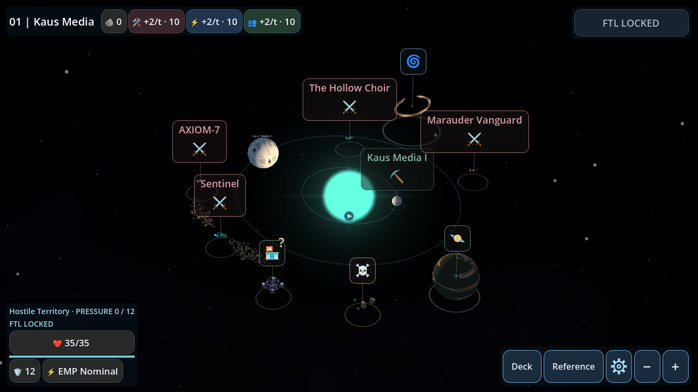
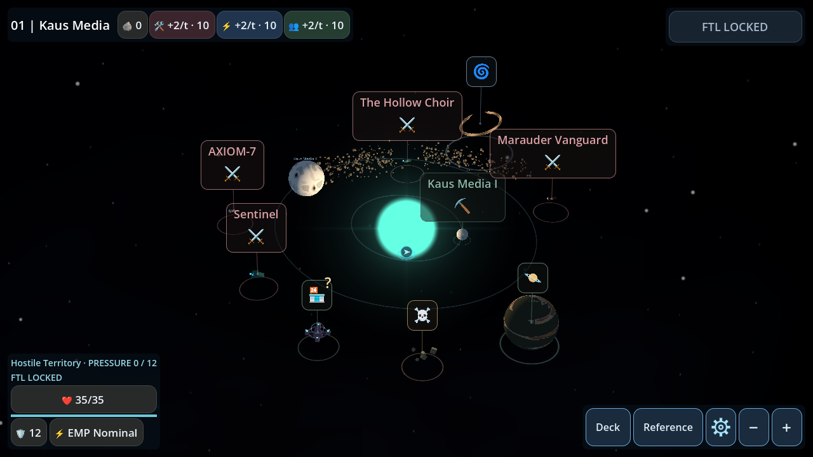

# Phase 2.1: asteroid formations and selectable PoIs

Based on main including PR #49. Newly generated systems contain exactly one
ASTEROID_FIELD, chosen with equal probability from a circumstellar belt, localized
collision remnant, or extended curved remnant. The dedicated environmental RNG
channel is unchanged; gameplay, encounter, loot and cosmetic streams are untouched.
Exploration formations use an existing battle anchor without moving the encounter.
Defense formations occupy the same system plane and can be crossed by moving units.

Belts vary in width, ellipticity, orientation and angular coverage. Angular thinning
is presentation only: the saved annulus remains authoritative. Clusters use three
overlapping ellipse pockets; extended remnants use seven along a curved tangential
axis. Size, thickness, density and placement vary. Spawn probability remains 100%
for testing. Generation metadata is version 2; save and snapshot schemas are unchanged.

Asteroid radii now range from 0.045 to 0.125 world units before irregular scaling
(previously 0.07 to 0.20). Desktop sample budgets are 1100/340/620 for belts/clusters/
extended formations; Android uses 440/136/248. One low-poly MultiMesh per formation,
shared mesh/material, and disabled shadows are retained. Android accepted positions
are a prefix of desktop positions for the same exclusions.

Mesh construction runs after the map has committed final celestial positions and
scales, including defense placement. It rejects individual samples whose conservative
bounding sphere overlaps a celestial radius plus a 0.22-unit margin. Planet radii
include the scaled atmosphere; star clearance includes the shader core; other PoIs
use existing model radius metadata. There are currently no separately generated
moons. No per-frame collisions, raycast objects or saved mesh transforms are added.
Planet centers are static; surface rotation cannot invalidate clearance. Moving
ships are not static celestial obstacles. Mesh exclusion never changes containment
or frozen battle snapshots.

Each selectable PoI has a thin softly shaded circle beneath its visible surface,
aligned with X/Z. It reuses icon accent colors and hover/focus/selection states,
and hides with the label or on completion. It has no input or collision nodes,
lights, animation timers, or extra touch targets. Existing navigation and hit-testing
code is unchanged.

Saved version-1 fields (including multiple formations), legacy modifier IDs, and
already-entered battle snapshots remain authoritative and are not regenerated.
Missing arc coverage defaults to a full ring. All formations still resolve through
the existing spatial evaluator to modifier ID 1; combat code and card effects are
unchanged.

## Regression coverage

- `asteroid_regions_test.gd`: one formation, all subtypes, deterministic records,
  sampled containment, modifier 1, CPU mesh clearance and scale, Android prefix,
  and collider-free MultiMesh construction.
- `asteroid_render_test.gd`: all three formations in the production map, actual
  GPU mesh clearance, selectable ring placement/highlighting, battle entry, and
  screenshots on GL Compatibility and Mobile Vulkan.
- Existing asteroid battle, save/resume and snapshot suites retain lifecycle,
  legacy modifier, unrelated RNG and combat parity checks. Controlled fixtures
  explicitly set their geometry/center rather than assuming a generated belt.

Screenshots below are captured from the production map at 1280×720 using GL
Compatibility. The same fixtures are exercised in the Mobile rendered CI job.

Validation results are recorded in the PR. Renderer/touch regression coverage does
not substitute for physical Android device performance measurement.
