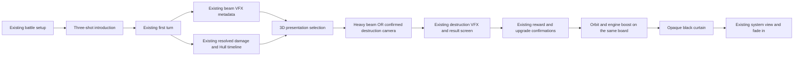
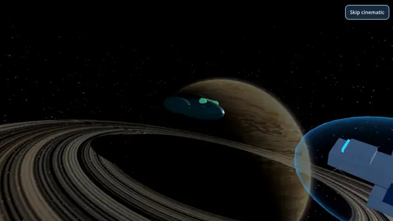

# Battle cinematics

The 3D board borrows its existing camera, ships, engine effects and background for short camera sequences. Combat execution, cards, modifiers, battle seeds and saved fields are unchanged. The 2D board retains its immediate presentation.

## Ownership and integration

- `scripts/presentation/battle_cinematic_director.gd` owns one camera tween and a temporary input/Skip overlay. It never reads expedition state, awards rewards or draws random numbers.
- `scripts/presentation/battle_cinematic_settings.gd` and `resources/presentation/battle_cinematics.tres` expose shot durations, ship-relative offsets, framing margin, FOV and the heavy-beam threshold. Assign a different settings resource on the 3D board to tune a scene.
- `scripts/board_3d.gd` connects confirmed presentation events and delays the first turn until the introduction ends. Resize updates the eventual gameplay FOV/background scale while the director controls the current shot.
- `scripts/battle_effects.gd` reports `weapon_presented(side, "beam")` at the existing beam-delivery site. A description or card name cannot select a camera shot.
- `scripts/board.gd` exposes narrow presentation hooks after real resolution and deferred Hull commits. Its existing damage timeline, VFX busy/finished waits and destruction/result sequencing remain authoritative.
- `scripts/expedition/expedition_battle.gd` can retain the completed, hidden board through required card upgrades, with processing and its viewport disabled. It disconnects hand synchronization from that completed board. No ship or viewport is cloned.
- `scripts/expedition.gd` starts departure only at the final return-to-system action, then rebuilds the map under a scene-owned black instance of the existing transition curtain. Map input/time resumes after the fade. Reward, encounter, upgrade and checkpoint transactions remain at their original boundaries.



## Shot parameters and framing

The default introduction lasts 3.45 seconds: elevated establishing sweep (1.15), lower front-quarter flyby (1.05), then a two-ship confrontation settling into the default camera (1.25). Ship roots never travel during introduction or attacks.

The director measures transformed mesh bounds beneath each model's `Body`; shield geometry is excluded. Offsets are expressed in measured hull radii and the model's local axes. The minimum distance also accounts for FOV and framing margin. Existing ship models face **local +X**. Future models should preserve the existing `Body`, `Shield` and engine interfaces.

High-damage beams default to at least **12 actual resolved damage**, including damage absorbed by Shields. Zero damage, unrelated resource changes and description text cannot trigger them. Deferred Hull damage must commit first. Confirmed Hull destruction takes precedence over the optional beam shot; the same attack starts only one camera sequence. Its final framing is held until the original destruction animation completes. Environmental destruction without an attacker uses the victim's framing. Existing VFX are neither replayed nor rescheduled.

Attack shots last 1.25 seconds unless the destruction animation owns the hold. Victory departure uses a 2.25-second partial orbit and an accelerating 0.85-second boost. The orbit finishes behind the model’s forward axis. Boost changes only the local `Body.position` and matching `Shield.position`, in local +X, and the existing `engine_boost` flag; all restore under black. The authored root, combat anchors and saved state never move. The existing background quad follows the cinematic camera and is restored afterward; its material/environment is reused.

## Cancellation, settings and accessibility

`Skip Cinematics` bypasses introduction, optional attack cameras and victory orbit/boost. The short black transition remains. Battle VFX remains a separate preference. No new settings are added.

The 140×48 Skip button supports mouse and emulated Android touch, with keyboard/controller Accept or Cancel and native Android Back. Repeated Skip is harmless. Cancellation kills camera tweens, releases pending presentation waiters, restores the viewport, camera/FOV, background, UI visibility and previous valid keyboard focus. Skipping destruction does not skip or repeat its existing damage/VFX transaction. App suspension during departure cancels the visual return and saves the already committed expedition normally.

## Validation and captures

`tests/battle_cinematic_test.gd` exercises measured light/heavy/mothership framing, all modifier arenas, action locking, real touchscreen Skip at four viewport sizes, resize ownership, first-turn/RNG/save equivalence, actual beam damage, both attacker directions and lethal priority/result synchronization.

`tests/battle_departure_test.gd` exercises the real expedition win → upgrade → final return flow, same-board retention, each skip stage, the preference bypass, opaque scene replacement, restored map input and equality with the original return's serialized expedition. Ordinary EMP escape retains its original path.

The standalone `ship_models_test.gd` audit explicitly dismisses the optional introduction through normal Skip before projecting geometry into the authored gameplay camera. All original geometry assertions remain; a restoration assertion guards that handoff.

Both are registered in the GL Compatibility and Mobile Vulkan rendered suites. Capture files are written to `.godot/testlogs/battle-camera/` and uploaded by CI. Legacy timing-sensitive scene tests explicitly disable the new optional camera presentation through the regression runner's `ARCOSPACE_BATTLE_CINEMATICS=0` environment default; these two tests explicitly enable it. This does not change user preferences, existing assertions, result animations or fixtures. Outside that test environment cinematics are enabled normally.

```sh
python3 tools/run_regressions.py --godot godot --script battle_cinematic_test --script battle_departure_test
python3 tools/run_rendered_regressions.py --godot godot --renderer gl_compatibility --script battle_cinematic_test --script battle_departure_test
python3 tools/run_rendered_regressions.py --godot godot --renderer mobile --script battle_cinematic_test --script battle_departure_test
```

Android device frame pacing and each faction model's art direction still warrant a device review; Mesa GL/Vulkan captures validate the render paths, not physical Android performance. No new lights, models, particle systems, continuously rendered viewports or postprocessing passes are added.

## Rendered gallery

These are actual Godot production-scene captures, with no generated artwork. [Motion sequence](battle_cinematics_screenshots/cinematic-motion.webp) contains sampled frames encoded at **8 fps**, downscaled from 1280×720 to 640×360 for review. Playback is normalized: the software-renderer wall time is not an Android performance measurement. The reproducible capture helper is `tests/battle_cinematic_capture.gd`; it stages a real Missile Barrage against a 3-Hull, unshielded target with sufficient Crew to demonstrate confirmed destruction, then completes the normal result/upgrades and return.

| Stage | Capture |
| --- | --- |
| Wide approach, light hull | [Establishing](battle_cinematics_screenshots/establishing.webp) |
| Lower close flyby, heavy hull | [Flyby](battle_cinematics_screenshots/flyby.webp) |
| Both ships, Command Nexus | [Confrontation](battle_cinematics_screenshots/confrontation.webp) |
| Actual nonlethal beam confirmation | [Attack pan](battle_cinematics_screenshots/heavy-beam.webp) |
| Existing destruction fragments | [Destruction hold](battle_cinematics_screenshots/impact_hold.webp) |
| Surviving player showcase | [Victory orbit](battle_cinematics_screenshots/victory_orbit.webp) |
| Acceleration with shield, fading out | [Boost and fade](battle_cinematics_screenshots/fade_to_black.webp) |


