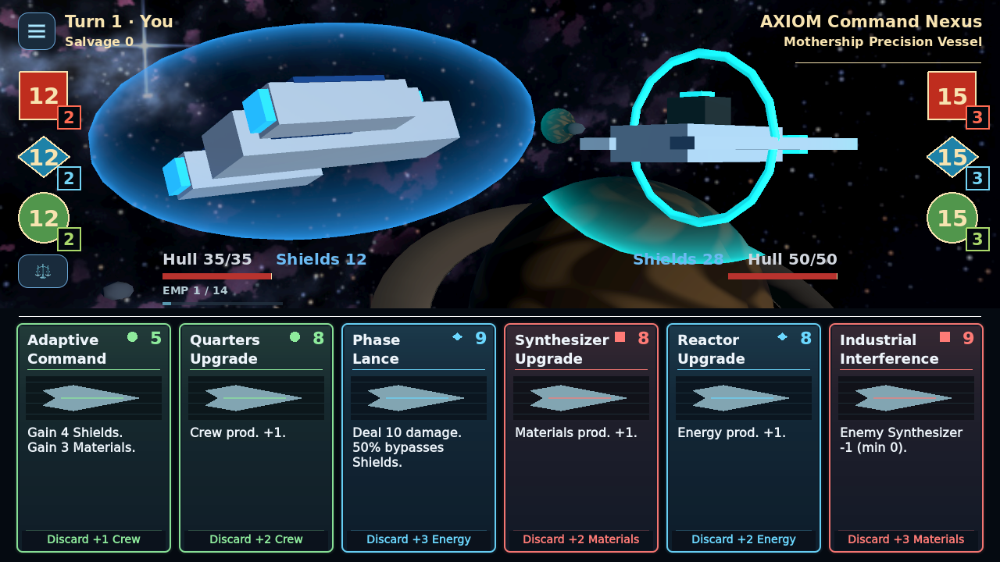

# Standard battlefield depth and cinematic pacing

Only `scenes/battlefield_3d.tscn` and `scenes/battlefield_planetary_orbit.tscn` opt into the new background projection. The seven modifier scenes and their shaders are unchanged.

## Rendering

`shaders/battle_space_sky.gdshader` samples the existing galaxy panorama using the world-space viewing ray. A stationary, inward-rendered 600-unit sphere supplies coverage. Its UVs and distance do not determine the sampled direction. Camera rotation reveals another part of the panorama; camera translation leaves infinitely distant stars unchanged. Horizontal sampling repeats, with wrapped derivatives for stable mip selection at the longitude seam.

`scripts/presentation/battlefield_depth.gd` freezes the authored camera basis once on scene entry. It never updates that basis during shots or resize. Each scene owns its shader material. The existing `MeshInstance3D` name is retained for board compatibility; `infinite_panorama` metadata tells the board/director to leave that enclosing mesh stationary. Modifier quads retain their existing projection, resize and camera-following code.

The existing galaxy texture supplies distant stars and nebulae in both standard arenas. The former orbit panorama contained a baked-in planet, so it is replaced by that existing space-only texture to avoid a second, flat planet. The orbital landmark is now actual amber/brown spherical geometry using the existing planet-surface shader, a flattened low-poly torus ring, and a small distant moon. Scene lighting and ship lighting are unchanged.

Deep Space uses eight stationary low-poly rocks; Planetary Orbit uses five. Each group is one `MultiMeshInstance3D`, with fixed authored transforms at multiple distances beyond the clear central camera/ship envelope. No random stream is used. Rocks, planet, rings and moon have no collision, shadow casting, animation or simulation hooks. The result is subtle finite-distance parallax against the infinite sky.

Native geometry costs: one unshaded enclosing sphere replaces the original single backdrop draw; one instanced debris draw per standard arena; orbit adds planet, ring and moon draws. There are no new lights, viewports, postprocessing passes or artwork assets. The sky uses one panorama texture lookup instead of the previous procedural overlay calculations.

## Pacing and synchronization

`BattleCinematicSettings.playback_speed` defaults to **0.5**. `duration(authored_seconds)` converts existing Inspector timings to presentation seconds. Authored paths, offsets, easing, travel distance, FOV endpoints and original duration fields are preserved.

| Sequence | Previous | New default |
| --- | ---: | ---: |
| Establishing sweep | 1.15 s | 2.30 s |
| Close flyby | 1.05 s | 2.10 s |
| Confrontation | 1.25 s | 2.50 s |
| Total introduction | 3.45 s | 6.90 s |
| Heavy attack pan + hold | 1.25 s | 2.50 s |
| Victory orbit | 2.25 s | 4.50 s |
| Accelerating boost / covered fade | 0.85 s | 1.70 s |
| Short transition fade | 0.30 s | 0.60 s |

Confirmed destruction previously held its camera until the existing terminal destruction tween completed. That specific tween now uses the same playback speed when a destruction cinematic is active, doubling both the pan and the VFX-owned hold. No shared ship-animation implementation or resource is changed. With Skip Cinematics enabled, destruction keeps its original VFX timing. Skipping an already running destruction camera still leaves its existing terminal effects to finish safely.

Beam discharge and damage resolution remain at their original boundaries: the optional camera is still selected only after actual damage is committed. Beam damage, impact rules and combat RNG are unchanged. Engine boost starts with departure acceleration; only the local presentation timeline stretches. The blackout covers map replacement, and fade-in uses the same converted transition duration.

`Engine.time_scale`, strategic time, turn calculations, card animation settings, ordinary ship animations, modifiers, rewards, checkpoints and save schemas are untouched. The existing Skip button/preference and camera restoration remain in place.

## Validation

`tests/battlefield_depth_test.gd` checks:

- Default doubled durations, unchanged authored timings and actual tween stage progression at half/full duration.
- Actual light, heavy and mothership profile binding in both standard arenas.
- A clear camera envelope, static instanced scenery at several depths, and real translational parallax.
- Rendered sky changes under rotation, invariance under translation, full-turn restoration and seam continuity.
- Stationary sky transforms through introduction and departure; resize/card geometry remains covered by existing suites.
- Real beam attacks in both directions, confirmed destruction and victory departure in each standard arena.
- Unchanged combat snapshots/RNG during camera-only sequences and legacy modifier projection support.

The headless dummy renderer cannot read back MultiMesh transforms, so it validates the authored positions; rendered runs additionally verify every actual instance transform against those positions. No baseline fixtures are regenerated.

The suite is registered for GL Compatibility and Mobile Vulkan. Existing cinematic, departure, environment, combat, card VFX, resume and UI regressions run separately. Captures are written to `.godot/testlogs/battlefield-depth/` for CI artifacts and visual review.

Physical Android/Windows hardware remains a manual verification step. Software GL/Vulkan covers rendering and input compatibility but cannot establish device frame pacing. See the PR for exact commands, results and capture gallery.

## Production-rendered gallery

Actual Mobile Vulkan captures from the production board, at 1280×720 unless marked otherwise. Camera paths and models are real; automated attack/departure captures use shorter test timings. Default half-speed timing is checked separately through actual tween progression. No generated imagery or new game artwork is used.

| View | Capture |
| --- | --- |
| Deep Space, normal hand and visible debris | [Gameplay](battlefield_depth_screenshots/deep-gameplay.webp) |
| Planetary Orbit, real planet/ring/moon | [Gameplay](battlefield_depth_screenshots/orbit-gameplay.webp) |
| Deep Space, light-ship flyby | [Flyby](battlefield_depth_screenshots/deep-flyby.webp) |
| Orbit, heavy-ship flyby | [Flyby](battlefield_depth_screenshots/orbit-heavy-flyby.webp) |
| Orbit, mothership framing | [Mothership](battlefield_depth_screenshots/orbit-mothership.webp) |
| Actual destruction camera | [Impact hold](battlefield_depth_screenshots/orbit-destruction.webp) |
| Victory orbit, different world background direction | [Departure](battlefield_depth_screenshots/orbit-departure.webp) |
| Full six-card hand at 960×540 | [Compact view](battlefield_depth_screenshots/compact-hand.webp) |

