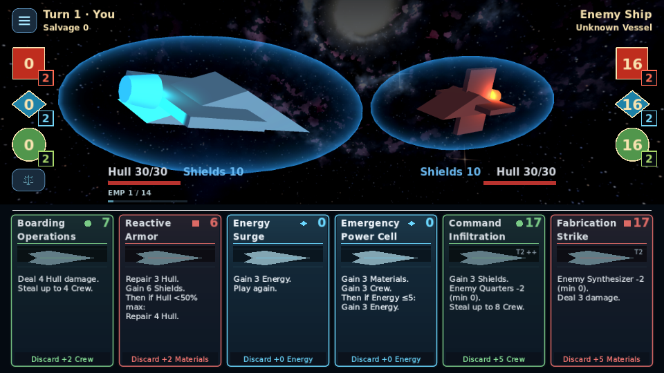
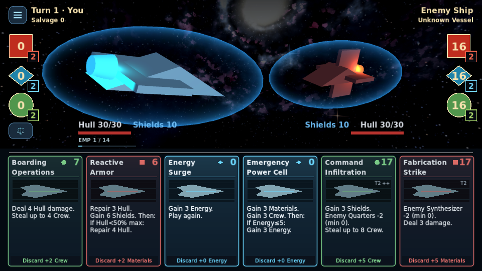

# Card layout and readability

Base: main `86a49e3` / PR #71. This changes the shared card's internal allocation
and presentation copy, without changing its **198 × 294** dimensions, six-card
hand, order, spacing, scaling, placement, inspection scaling or input behavior.
Resource colors/icons, 2px/3px borders, bounded glow and compact discard remain.

| Element | Before | After |
|---|---|---|
| Artwork/placeholder | 174×48 at (12,60) | **174×60** at (12,64), 25% taller |
| Effect typography | Shared 15px, embolden 0.55 | **Shared 16px, embolden 0.65** |
| Effect text width | 173px | **180px**, consistent 9px insets |
| Effect start | y116 | y130; 6px below artwork |
| Title / cost | Bold 18 / 23 | Unchanged; cost stays upper right |
| Discard | Existing full-width button | Same bounds, touch target and return |

Artwork retains a 12px inset so its existing hover/selection zoom stays clear of
the 3px frame. Tests measure its transformed bounds against the divider, frame
and effects. Its backdrop now fills the whole artwork band: the native primitive
placeholder uses its original 174×74 design surface before fitting, avoiding a
second shrink of the background. Existing artwork, vectors and fonts are reused;
no new art, icons, shaders, materials or decorative effects are introduced.

There is one effect font size for every card. No per-card shrinking, truncation,
ellipsis, text stretching or dynamic artwork sizing is used. Short cards keep
breathing room. Long cards get consistent natural wrapping and explicit effect
rows, with at least the existing 6px clearance above the discard hit area.

## Accurate compact statements

The formatter still reads authoritative effects. To avoid wrapping long
conditional headers twice, the explicit **Then:** cue ends the preceding base
statement, followed by a separate **If …:** row. This preserves the important
base-before-condition timing. Nothing is factored out of either branch.

Else statements omit a redundant verb where the action remains explicit:

```text
Else: Gain 11 Materials.   → Else: +11 Materials.
Else: Deal 11 Hull damage. → Else: 11 Hull damage.
```

Full resource names, amounts, damage type, Hull bypass, targets, strict/inclusive
conditions, probabilities, duration/exception data and replay actions remain.
Negative gains, repair, drain and other actions retain their own verbs. The
existing inspector still shows complete mechanical details and upgrade levels.
Gameplay definitions, values, costs, discard calculation, RNG, saves and combat
resolution are untouched.

## Validation

Official Godot **4.7.2**, Linux software GL Compatibility and Mobile Vulkan:

- **480 states / 12,420 layout checks pass** in headless, GL and Mobile: all
  80 cards × 3 upgrade states plus each actual matching-family storm ×2 preview.
  The preview comes from the existing modifier implementation; it is not a
  fabricated multiplier or fixture rewrite.
- Every state checks fixed geometry, complete titles/cost separation, enlarged
  artwork and backdrop fill, one 16px font, text/foot clearance and full discard
  text. Maximum body: **five lines / 95px**, within the tightest 98.5px area.
- **192 production-hand checks pass** in each renderer at 1920×1080, 1280×720,
  960×540 and 1280×573: short/long/conditional text, upgrades, unaffordable cards,
  mouse/native-touch play and discard, keyboard/controller preview, inspection,
  neighboring glow separation, visible lower borders and selected artwork bounds.
- Existing full inspection: **1,023 checks pass** in GL and Mobile. Existing
  alpha-visual, card upgrade, motion/VFX timing, tactical resize and HUD ownership
  checks remain passing. Face-copy semantics include new compact-branch cases.
- Combat parity matches **2,220 exact baseline checkpoints**; card definitions,
  mechanics and baseline fixtures were not changed. Python runner tests: 22 pass.
  Editor import has no parsing/import errors. The existing runner separately
  records Godot shutdown ObjectDB warnings in some processes.

Representative commands, with GODOT pointing to the official 4.7.2 binary:

```sh
python3 tools/run_regressions.py --godot GODOT --skip-import --script card_face_text_test --script minimal_card_layout_test --script card_theme_test --script card_inspection_test --script ui_overhaul_test --script card_icon_cue_test --script discard_test --script player_hand_test --script card_effect_parity_test --script card_effect_contract_test --workers 2
python3 tools/run_rendered_regressions.py --godot GODOT --skip-import --renderer gl_compatibility --script minimal_card_hand_test --script minimal_card_layout_test --script card_inspection_test --script card_theme_test --script alpha_visual_test
python3 tools/run_rendered_regressions.py --godot GODOT --skip-import --renderer mobile --script minimal_card_hand_test --script minimal_card_layout_test --script card_inspection_test --script card_theme_test
python3 tools/run_regressions.py --godot GODOT --skip-import --script tactical_cards_test --script tactical_resize_test --script hud_ownership_test --script card_upgrade_ui_test --script card_motion_test --script card_vfx_timing_test --workers 2
```

The final expanded audit and hand checks were repeated after the backdrop-fill
correction. [Complete measured report](card_layout_readability/layout-audit.json).
Existing GitHub CI runs the full matrix, including exported startup; remote tests
may remain unmonitored per the user's instruction. Their completion is not claimed.
No physical Android/Windows hardware was available; device readability, touch
comfort and GPU performance still require review.

## Matched before/after evidence

Both revisions use the real production battle scene, the same actual card sets,
viewport dimensions, renderer/settings and deterministic test seeds (global 7331,
player hand 1042, enemy hand 1043). Before is merged main `86a49e3`; after is this
branch. The harness seed changes are test-only. Images are raw in-game captures,
not mockups or resized/composited comparisons. All eight pairs have matching
pixel dimensions.

| View | Before | After |
|---|---|---|
| GL 1920×1080 | [Image](card_layout_readability/before-gl_compatibility-hand-1920x1080.webp) | [Image](card_layout_readability/after-gl_compatibility-hand-1920x1080.webp) |
| GL 1280×720 | [Image](card_layout_readability/before-gl_compatibility-hand-1280x720.webp) | [Image](card_layout_readability/after-gl_compatibility-hand-1280x720.webp) |
| GL 960×540 | [Image](card_layout_readability/before-gl_compatibility-hand-960x540.webp) | [Image](card_layout_readability/after-gl_compatibility-hand-960x540.webp) |
| GL complex upgrades | [Image](card_layout_readability/before-gl_compatibility-complex-upgrades-960x540.webp) | [Image](card_layout_readability/after-gl_compatibility-complex-upgrades-960x540.webp) |
| Existing selection | [Image](card_layout_readability/before-gl_compatibility-held-selection.webp) | [Image](card_layout_readability/after-gl_compatibility-held-selection.webp) |
| Existing inspector | [Image](card_layout_readability/before-gl_compatibility-inspected-upgrade.webp) | [Image](card_layout_readability/after-gl_compatibility-inspected-upgrade.webp) |
| Mobile 1280×573 | [Image](card_layout_readability/before-mobile-hand-1280x573.webp) | [Image](card_layout_readability/after-mobile-hand-1280x573.webp) |
| Mobile complex upgrades | [Image](card_layout_readability/before-mobile-complex-upgrades-960x540.webp) | [Image](card_layout_readability/after-mobile-complex-upgrades-960x540.webp) |

Before at 960×540:



After at 960×540:


