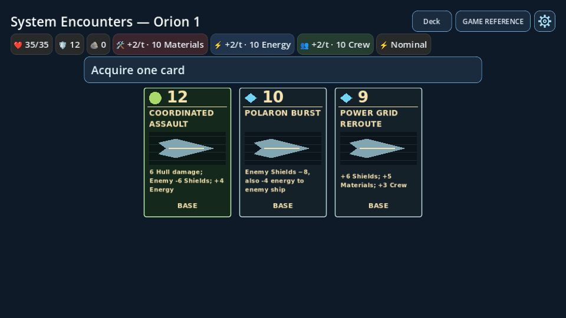
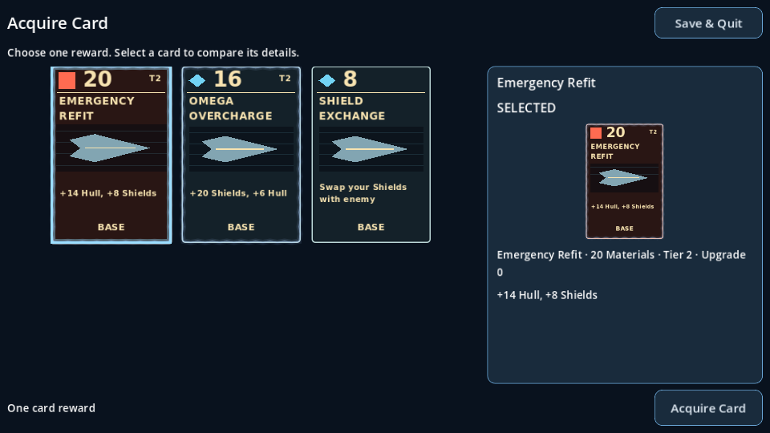
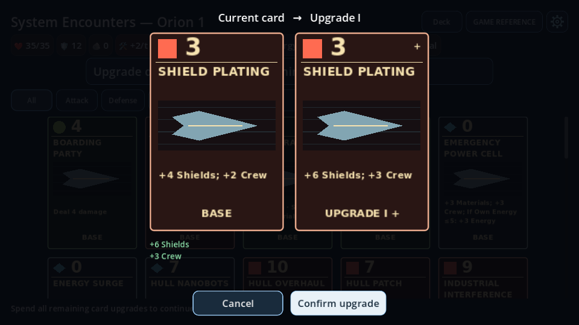
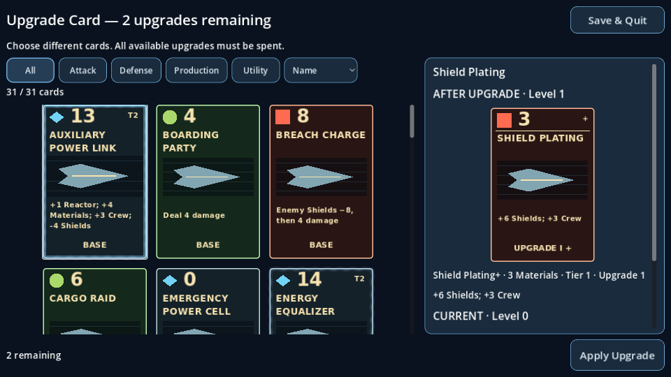
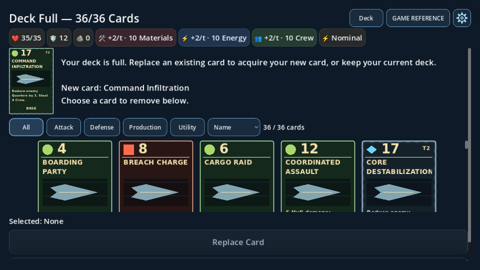
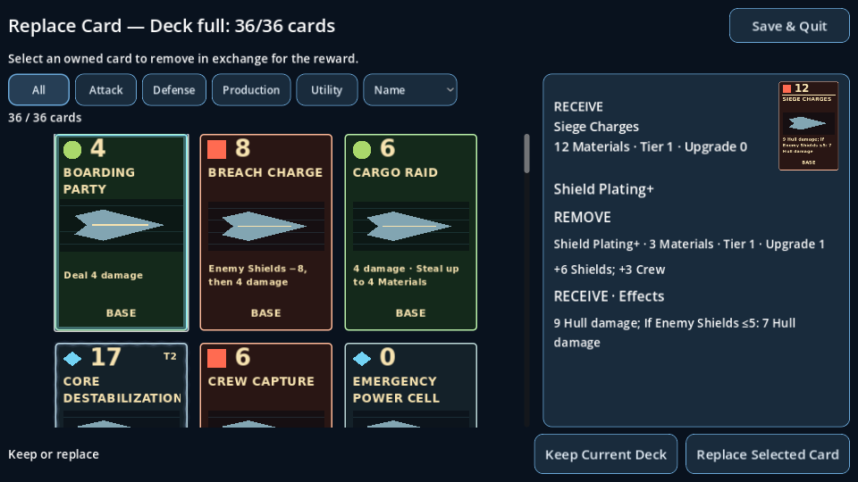

# Expedition card management — Phase 1

Starting revision: `fbec1714dc9a`. This is a presentation change; State, Deck,
card Resources, combat rules and the version 1 save codec are unchanged.

## Layout audit and ownership

| Concern | Before | After |
|---|---|---|
| Acquisition | Nested expedition gallery, then confirmation modal | Full viewport gallery, immediate details, fixed Acquire action |
| Upgrades | Gallery, separate comparison modal, rebuild outcome after each upgrade | Inline CURRENT / AFTER UPGRADE comparison; refresh the same overlay |
| Replacement | Incoming portrait, explanation, deck and actions vertically stacked | Deck at left, pinned incoming portrait at right, scrollable REMOVE / RECEIVE effects, fixed actions |
| Selection | Split between controller, inspector and replacement panel | CardManagementScreen owns only ephemeral selection and button state |
| Transactions | ExpeditionState facade / ExpeditionDeck | Unchanged |
| View routing and autosave | Expedition controller | Unchanged; routes emitted intent to existing state methods |

`CardManagementScreen` (`scripts/ui/card_management_screen.gd`) is one retained
CanvasLayer child of Expedition, at layer 140. It owns layout, mode, selection,
details, fixed footer and cancellable 0.22-second opening/closing tweens. It has
no inventory, eligibility, progression or serialization responsibility.

Reused components: CardGallery (filtering, sorting, touch scrolling),
CardPortrait (the original battle-card scene), CardEffectText (existing upgrade
comparison formatting), EncounterScroll, EncounterPresentation styling and the
shared read-only CardInspection hold/middle-click overlay. The independent
read-only deck viewer still uses CardInspector. No renderer was replaced.
The superseded DeckReplacement layout/script is removed.

## Transactions and lifecycle

- `show_outcome()` routes pending `card`, `upgrade` and `replace` choices directly
  into this overlay. It preserves the expedition screen and map nodes underneath.
- While open, the underlying screen subtree is disabled and the full viewport
  ColorRect blocks pointer input. The map input predicate also checks the modal.
  Focus moves from the covered HUD into the gallery. The settings menu remains
  available through the existing Android Back handling; Save & Quit is also in
  the modal header. Back/Escape cannot skip a mandatory choice.
- Gallery taps update inline details without a confirmation modal. A persistent
  bright border identifies the selected portrait. Holds/middle-click retain
  read-only detailed inspection. EncounterScroll retains drag/release suppression.
- The modal emits `confirmed(mode, card, revision)` or `declined(revision)` once
  per selection. Expedition checks the presentation revision, state owner, phase,
  modal revision and pending-choice discriminator before routing the intent.
- Acquisition calls `choose_card()` exactly as before. A full deck refreshes the
  same overlay into replacement mode with State's pending incoming card.
- Upgrade confirmation calls `choose_upgrade()`. State supplies the refreshed
  candidates and remaining count. There is no skip action. Existing
  `finish_upgrades()` rules handle exhaustion/no eligible candidates.
- Replacement calls `replace_card(selected_identity)`; Keep Current Deck calls
  `decline_card()`. Neither the UI nor a delayed animation grants rewards.
- On completion the controller restores the existing result/outpost view beneath
  a short fade. Input is released only after that fade. Opening again cancels an
  obsolete closing tween. Battle/FTL entry dismisses synchronously; scene exit
  cancels tweens and invalidates confirmations.
- Existing progress-commit signals still drive saves at the original boundaries.
  Save & Quit/Continue rebuilds the modal from committed State/Deck data. Temporary
  selection, scroll positions, fades and camera data are never serialized.

## Responsive calibration

The body uses Container stretch ratios 0.63 gallery / 0.37 details, with a
20-logical-pixel gutter. Header and footer are siblings of the expanding body;
neither belongs to either scroll area. Gallery and details scroll independently.
Replacement keeps a compact 0.45-scale original incoming portrait outside the
details scroll; upgrade details show the actual next-level card at its original 198×294 logical
size, followed by current effects and highlighted changes. Acquisition details
retain a 0.65-scale portrait. The right panel scrolls independently.

Margins are 12 logical pixels plus Android display-safe-area insets where
reported. The expedition's top-bar height is not reserved. The project retains
its existing viewport stretch policy. CardGallery chooses columns from its
actual available width using the existing 198×294 portrait size and 18-pixel gaps.
No new camera or map calibration is introduced.

Measured upgrade/replacement geometry with Save & Quit visible:

| Window pixels | Logical viewport | Gallery | Details panel | Footer | Columns |
|---|---|---|---|---|---|
| 1280×720 | 1280×720 | 778×528 | 458×528 | y=648, h=60 | 3 |
| 960×540 | 1280×720 | 778×528 | 458×528 | y=648, h=60 | 3 |
| 1680×720 | 1680×720 | 1030×528 | 606×528 | y=648, h=60 | 4 |

The 960×540 window uses the existing 0.75 stretch: gallery 583.5×396,
details 343.5×396, footer y=486 with 45-pixel-high actions and a 9-pixel
bottom margin. These are measured layout values, not a claim of device testing.

Primary verification sizes: 1280×720, 960×540 and 1680×720 (wide phone aspect).
The existing replacement/layout suites additionally exercise smaller landscape
windows. Full effects remain available through independent details scrolling;
two full-size portraits are deliberately not squeezed into the replacement pane.

## Validation

Baseline before editing: clean Godot 4.7.2 import and five existing scripts passed:
Deck ownership, deck determinism, replacement UI, expedition save and UI overhaul.
This is newly run baseline evidence, not a prior feature's report.

Focused UI coverage verifies selection without mutation, one-shot confirmation,
full-deck transition, fixed footer, HUD input exclusion, all three target sizes,
independent scrolling, pinned incoming artwork, mandatory upgrades, exact effect
comparison, stale callback rejection, drag suppression, reopen during closing,
and scene teardown. Lifecycle coverage uses the real Save & Quit button and
version 1 disk codec for offers, incomplete upgrades and pending replacement.
Existing UI assertions for the removed second confirmation modal are updated to
assert inline details and the fixed confirmation action instead; gameplay fixtures
are not regenerated.

Final verification on Godot 4.7.2:

- Shared `tools/run_regressions.py`: **103 scripts + import, all 104 runs passed**.
- Focused UI test after adding explicit overflowing-text/fade assertions:
  **105 checks passed**; disk save/resume lifecycle: **21 checks passed**.
- Rendered Mobile/Vulkan (llvmpipe): **105 checks passed**, all three modes at
  1280×720, 960×540 and 1680×720. Screenshots were visually inspected.
- Existing 2,220 card-effect checkpoints, 72 exact combat traces, 43 deck ownership
  checks and 1,044 deck/expedition checkpoints matched unchanged fixtures. The last
  fixture retains its established historical six-modifier sampler.
- Card inspection (951 checks), UI overhaul (910), Trading Outpost UI (2,112),
  expedition lifecycle, mandatory upgrades, fresh-process saves and map suites passed.
- `git diff --check` passed. State/Deck/save/card/combat/camera-settings source and
  existing JSON fixtures are byte-unchanged.

These are newly verified results. Early UI test runs needed their old second-modal
expectations and immediate-close assumptions updated for the new interface; final
runs have no script/import errors or assertion failures. Several scene tests still
emit ObjectDB shutdown warnings, recorded separately by the shared runner. No
physical-device or exported-package results are inferred from these runs.

Run the focused UI checks with:

```sh
godot --headless --path . --script tests/card_management_test.gd
godot --headless --path . --script tests/card_management_lifecycle_test.gd
python tools/run_regressions.py --godot /path/to/godot --timeout 360
```

## Limitations

No physical Android device, display cutout, Windows binary or export-package test
was performed. Rendered tests use desktop Vulkan Mobile through software rendering;
touch coverage injects Godot input events. Long effect descriptions intentionally
scroll instead of reducing text size. This first pass has no new filtering rules,
card animation, card art or gameplay behavior.

## Screens before and after

These are actual Godot Mobile/Vulkan captures at 960×540, not mockups. Before
captures use the unmodified starting revision; card offers differ between captures.
Images are documentation only and excluded from Godot import/export via `.gdignore`.

| Mode | Before | After |
|---|---|---|
| Acquire |  |  |
| Upgrade |  |  |
| Replace |  |  |

## Files and code size

Created: `scripts/ui/card_management_screen.gd` and its UID,
`tests/card_management_test.gd`, `tests/card_management_lifecycle_test.gd` and UIDs,
this document, six documentation screenshots and their `.gdignore`.
Modified: `scripts/expedition.gd`, `scripts/ui/expedition_screen.gd`,
`scripts/ui/card_gallery.gd`, `scripts/ui/card_portrait.gd`, developer/lifecycle
documentation, and seven existing UI tests (inspection, Chasedown, replacement,
expedition, reward feedback, outpost and UI overhaul).
Removed: `scripts/ui/deck_replacement.gd` and its UID.

Initial Phase 1 runtime comparison, excluding unchanged shared CardInspector/EffectText/scroll code:

| Script | Before lines | After lines |
|---|---:|---:|
| Expedition | 1217 | 1214 |
| ExpeditionScreen | 423 | 410 |
| CardGallery | 171 | 181 |
| CardPortrait | 66 | 81 |
| DeckReplacement | 83 | 0 |
| CardManagementScreen | 0 | 330 |
| Combined | 1960 | 2216 |

The added code implements the new layout and its lifecycle, rather than adding
another gameplay owner or global manager. Remaining coupling: the controller still
supplies State snapshots, chooses the post-reward view and exposes existing
read-only presentation aliases used by integration tests. Large descriptions are
scrollable rather than guaranteed to fit simultaneously with all comparison text.

## Original-size upgrade preview follow-up

Selecting an upgrade candidate now shows its actual next-level CardPortrait first,
at scale 1.0 (198×294 logical pixels), using the same renderer and dimensions as
the gallery. Current effects and the existing highlighted comparison follow below
in the independently scrolling right panel. The fixed Apply Upgrade footer is
unchanged. No card definitions or transactions changed.

New verification: import, card-management (107 checks), save/lifecycle (21 checks)
and UI overhaul (910 checks) passed. Rendered Mobile/Vulkan card-management checks
also passed (107), including all three target landscape sizes. The full shared
suite above describes the preceding Phase 1 release and was not repeated for this
small presentation adjustment. Physical Android display was not tested.
