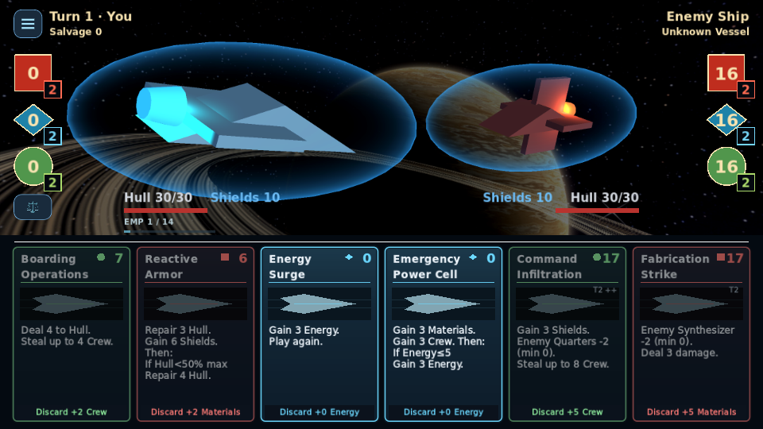

# More padding and stronger unaffordable-card dimming

Base: main `a793d23` / PR #72. Cards remain 198×294, with unchanged hand geometry,
scaling, input, inspection and discard availability.

- Header/effect side insets increase from 10 to **14 units**. Title top inset
  increases 7→10 and cost top inset 3→6. Footer text receives more bottom inset,
  while its original full-width touch area is retained.
- Titles remain bold 18; effects remain the same shared **16**. Costs use a
  shared 22 (previously 23) to maintain upper-right clearance. The artwork band
  gives four units back to header breathing room (60→56), retaining its assets
  and existing zoom behavior.
- Unaffordable surfaces are darker; text uses 58% brightness, cost/icon/divider
  62%, artwork 42%, with a subdued border/glow. This restores a clear disabled
  appearance. The discard footer stays clear and usable because it is still an
  available action. Affordable cards restore full brightness.
- The narrower text column preserves every rule: direct Hull damage reads
  **Deal N to Hull**; condition rows use their existing line breaks without a
  trailing colon. No effects, values, thresholds or gameplay behavior change.

Validation with Godot 4.7.2: **480 states / 12,432 layout checks pass**, covering
every card/upgrade and actual storm-amplified preview. Shared font size, full
effects, title/cost clearance, artwork fit and footer separation remain checked.
Semantic, inspection, upgrade-gallery and native hand tests pass headless.
GL Compatibility and Mobile Vulkan hand/theme/layout checks pass, including
unaffordable-card inspection, mouse/touch play and discard. Existing gameplay
assertions remain; presentation assertions now require the stronger dimming.
No baseline fixtures were changed.

Physical Android/Windows hardware was unavailable. Full GitHub CI is triggered
by the PR and may remain unmonitored per the user's instruction.

| View | Before | After |
|---|---|---|
| GL 960×540 | [Image](card_padding_unaffordable/before-gl_compatibility-hand-960x540.webp) | [Image](card_padding_unaffordable/after-gl_compatibility-hand-960x540.webp) |
| Mobile 1280×573 | [Image](card_padding_unaffordable/before-mobile-hand-1280x573.webp) | [Image](card_padding_unaffordable/after-mobile-hand-1280x573.webp) |

