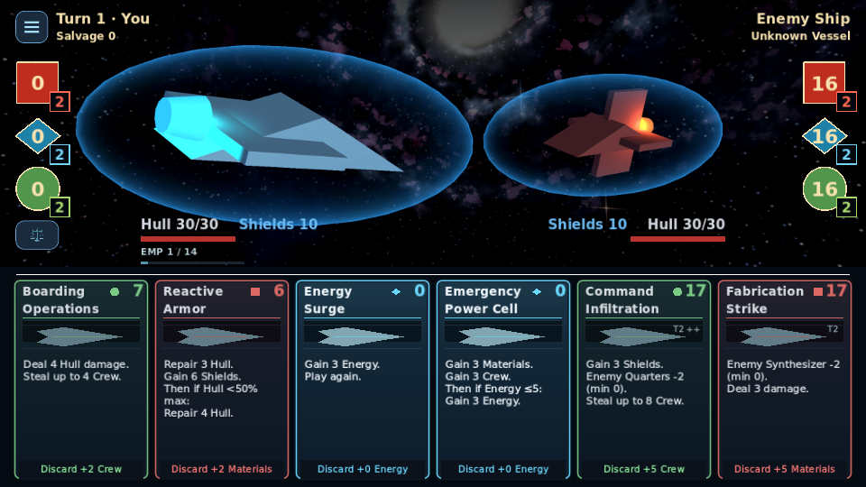
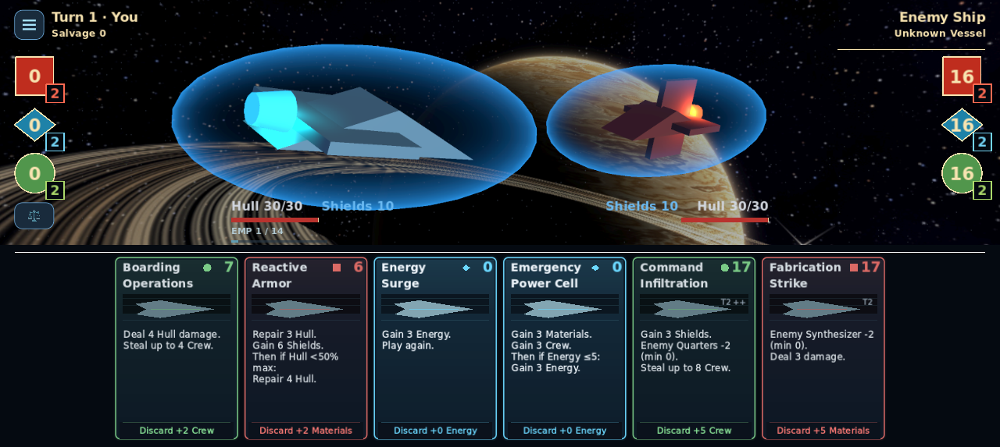

# Fixed-size card visual refinement

For the subsequent artwork/text-space refinement, see
[Card layout and readability](card_layout_readability.md).

Base: main `0c0e51a` (PR #69). PR #70 has not merged; this independent branch
reuses its measured shared-card foundation and supersedes its visual proposal.
There is still one `scenes/card.tscn`, used by the hand, galleries, motion and
existing inspector. No new battle interface is introduced.

## Styling and geometry

Cards remain **198 × 294**. The six-slot hand, order, spacing, scaling formulas,
normal placement, inspection scaling, controls and input handlers are unchanged.
The existing tactical preview retains its original raise/restore calculations;
two calls only communicate its selected appearance to the card renderer.

| Treatment | Implementation |
|---|---|
| Background | Navy `#0B1724`, with a subtle shared family-tinted gradient |
| Materials | Warm coral `#FF7B76` |
| Energy | Electric cyan `#6BD8FF`; no general-purpose gold decoration |
| Crew | Soft green `#8EEB9C` |
| Normal outline | 2px, bright family color, 7px rounded corners |
| Selected outline | 3px, same family color |
| Normal glow | Native StyleBox shadow, 3px / low opacity |
| Selected glow | Native StyleBox shadow, 4px / restrained opacity |
| Typography | Title 18, cost 23, effects 15, footer 14 |

There are **no StyleBox expansion margins** and no new card translation/scale.
The maximum halo is 4px at base scale: even two adjacent selected halos fit
inside the unchanged 10-unit hand gap with clear space remaining. Existing
environmental cue colors remain functional; their halos are also bounded to
4px. This changes no environmental mechanics or modified card values.

`CardPresentationSettings` owns the palette. `card_theme.gd` provides shared
4×64 gradient textures and native StyleBoxes. A state stamp avoids rebuilding
styles on unchanged refreshes. No lights, new shaders, postprocessing, animated
particles, expensive layers or per-frame node construction were added.

The licensed DejaVu card fonts prepared in PR #70 are reused and bundled because
main previously relied on platform font substitution. The existing font family
gets a modest stroke-weight increase: regular-body FontVariation embolden 0.55,
bold-title/cost FontVariation embolden 0.2. Descriptions remain lighter than
headings, with consistent line height and no individual card font shrinking.
The bundled license is in `assets/fonts/cards/`.

Main's primitive artwork placeholder (including its ship and grid) is retained,
as is the optional texture slot. The original placeholder geometry is fitted
to the card's artwork band. No artwork was generated or imported.

## Text, icons and discard

The face formatter reads authoritative effects and upgraded/modifier-preview
resources. It preserves base-before-condition ordering, comparisons, targets,
random ranges/exclusions, bounded theft, production floors, full Shield bypass,
Hull-only versus absorbed self damage, backlash probabilities and replay actions.
Full mechanical inspection still uses the original descriptions and all upgrade
levels. No card definitions, effects, costs, RNG or save data were changed.

Only existing functional resource shapes are used; no damage, Hull, Shield,
condition, risk, production or rarity icons were added. Repository terminology
matters: the cost families are **Materials / Energy / Crew**; **Quarters** is
the production attribute for Crew. Main already uses a Materials square, Energy
diamond and Crew circle. These required functional bindings are retained under
the brief's preservation exception; Materials is not relabeled as Quarters.
Tier/upgrade information remains text.

The original full-width `DiscardButton` keeps its existing hand-scale-adjusted
touch area and availability rules, including unaffordable cards. Its narrow,
darker footer now says **Discard +N Resource**, using `floor(cost / 3)` and the
actual resource name. There is no second button or additional discard icon.
Unaffordable cards retain high-contrast text and resource identity.

## Validation

Official Godot **4.7.2**, Linux software GL Compatibility / Mobile Vulkan:

- **240 card/upgrade variants, 5,490 layout checks, zero failures.** Real Label
  shaping checks complete titles, cost clearance, glyphs, refunds, full footer
  text width, effect/footer separation and exact base geometry. The longest
  body is six lines / 108px within the tightest measured 112.5px space.
- The [complete measured library report](card_ui_refinement/layout-audit.json)
  records every identity, upgrade, displayed effect, line count and font size.
- **74 theme checks pass**: palette, weight, gradient sharing, preserved
  placeholder, border widths, bounded glow, zero expansion, selection lifecycle,
  environmental cue compatibility, readable unaffordable states and unchanged
  card data/RNG.
- **190 production-hand checks pass** in both renderers: 1920×1080, 1280×720,
  960×540 and 1280×573; original six-card placement; no neighboring halo overlap;
  native mouse/touch play and discard; hold/inspection; keyboard/controller;
  correct existing Energy Surge effect and extra action, each applied once.
  Rendered pixel assertions verify the lower frame remains visible beneath the
  footer; its paint/focus styles are inset while its input bounds stay unchanged.
- Existing inspection passes **1,023 checks** in both renderers. One initial GL
  run failed its fixed-delay Escape-close assertion; the complete unchanged test
  passed on rerun. No assertion or animation timing was relaxed.
- Focused headless groups (10 and 7 executions) pass, including upgrades,
  card motion/VFX timing, tactical resizing and HUD ownership. Combat parity
  matches **2,220 exact baseline checkpoints**. Fixtures were not changed.
- Editor import has no parse/import errors. Python regression-runner tests:
  **22 pass**. Some Godot runs report ObjectDB warnings during shutdown; these
  remain recorded separately by the existing runner policy.

Representative commands (GODOT is the 4.7.2 executable):

```sh
python3 tools/run_regressions.py --godot GODOT --skip-import --script card_theme_test --script minimal_card_layout_test --script card_face_text_test --script card_icon_cue_test --script card_inspection_test --script discard_test --script player_hand_test --script ui_overhaul_test --script card_effect_parity_test --script card_effect_contract_test --workers 2
python3 tools/run_regressions.py --godot GODOT --skip-import --script tactical_cards_test --script tactical_resize_test --script hud_ownership_test --script card_upgrade_ui_test --script card_motion_test --script card_vfx_timing_test --script card_theme_test --workers 2
python3 tools/run_rendered_regressions.py --godot GODOT --skip-import --renderer gl_compatibility --script card_theme_test --script minimal_card_layout_test --script minimal_card_hand_test --script card_inspection_test --script alpha_visual_test
python3 tools/run_rendered_regressions.py --godot GODOT --skip-import --renderer mobile --script card_theme_test --script minimal_card_layout_test --script minimal_card_hand_test --script card_inspection_test
```

Rendered commands used Xvfb and Mesa; Mobile explicitly used Lavapipe. New tests
are registered in the existing rendered suites and auto-discovered headless.
The PR triggers the full existing GitHub Actions matrix, including exported
startup checks. Remote runs may remain unmonitored per the user's instruction;
their completion is not claimed here. A previously documented `star_map_test`
service-arrival assertion also reproduces on unchanged main; strategic/navigation
code is outside this change.

No physical Android or Windows device was available. Actual phone readability,
touch comfort and GPU frame time still require device review. Software-renderer
success is not a hardware performance measurement.

## Actual production captures

These use the real battle scene and definitions. Empty reserves deliberately
demonstrate unaffordable-but-discardable cards; zero-cost cards remain playable.
The reference mockup's HUD, expanded hand and inaccurate values were not copied.

| View | Capture |
|---|---|
| GL 1920×1080 | [Six-card hand](card_ui_refinement/gl_compatibility-hand-1920x1080.webp) |
| GL 1280×720 | [Six-card hand](card_ui_refinement/gl_compatibility-hand-1280x720.webp) |
| GL 960×540 | [Six-card hand](card_ui_refinement/gl_compatibility-hand-960x540.webp) |
| GL complex upgraded cards | [Full hand](card_ui_refinement/gl_compatibility-complex-upgrades-960x540.webp) |
| Existing held selection | [Raised card](card_ui_refinement/gl_compatibility-held-selection.webp) |
| Existing inspector | [Complete details](card_ui_refinement/gl_compatibility-inspected-upgrade.webp) |
| Mobile Vulkan, Android-shaped viewport | [1280×573 hand](card_ui_refinement/mobile-hand-1280x573.webp) |
| Mobile Vulkan complex upgrades | [960×540 hand](card_ui_refinement/mobile-complex-upgrades-960x540.webp) |



