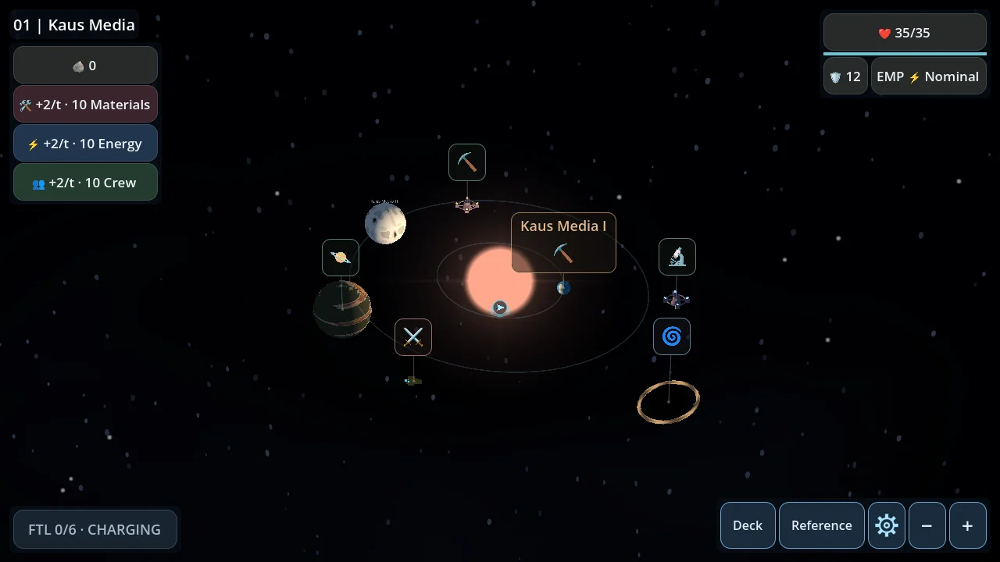
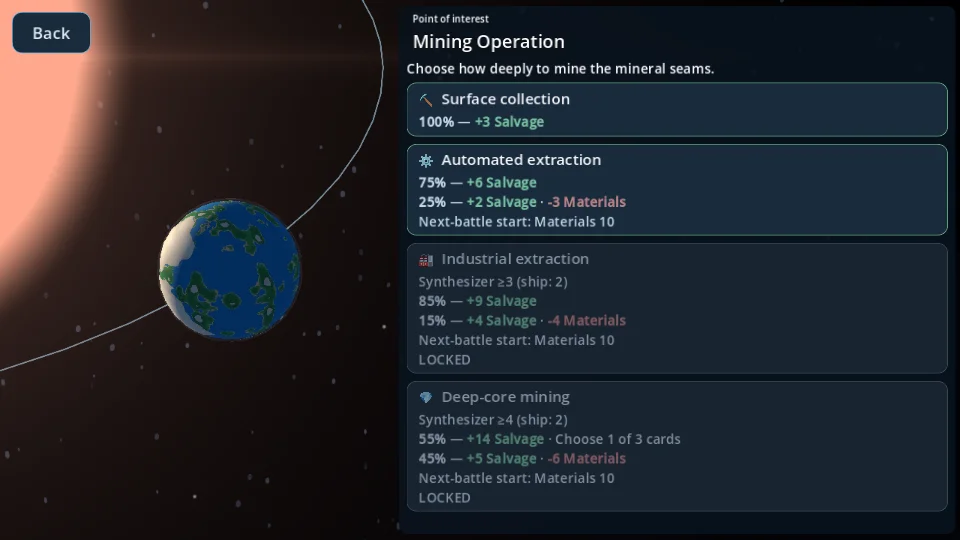
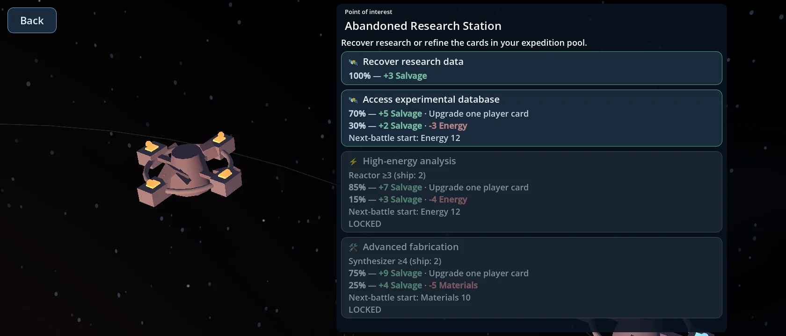
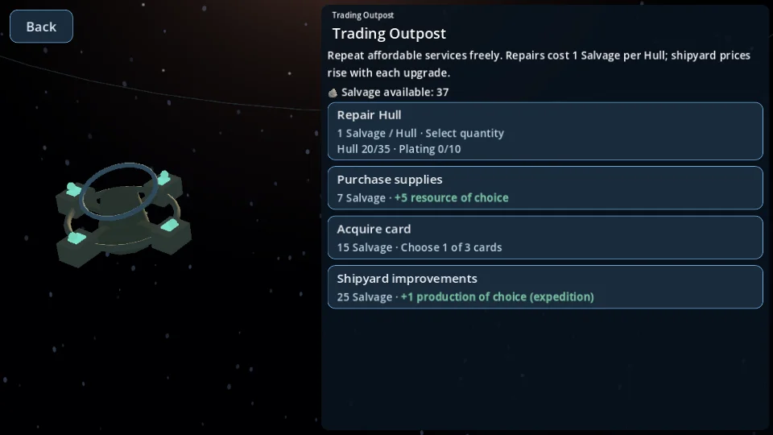
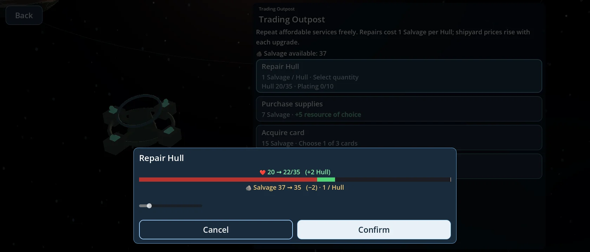
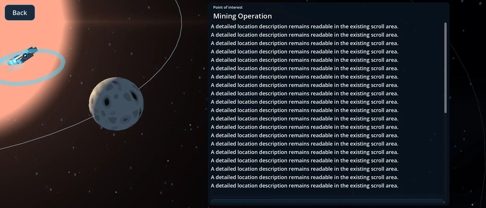
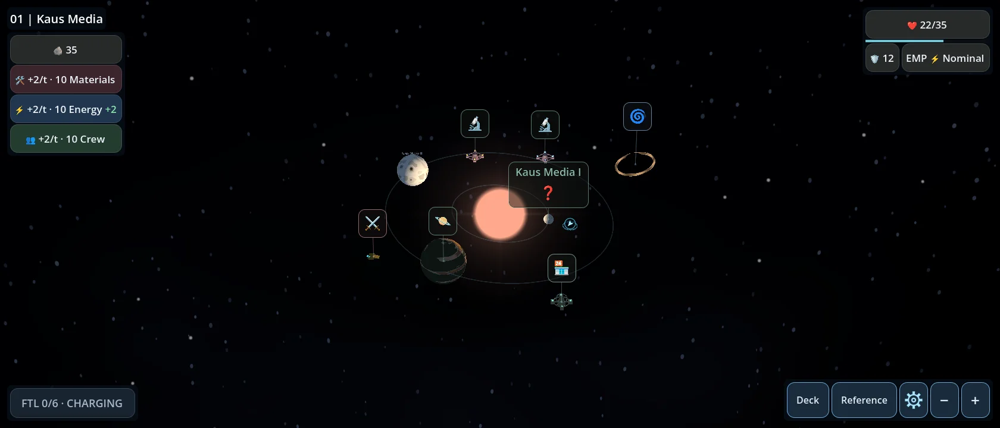

# Compact PoI Focus Mode

Starting revision: `4d6f4ca23b14c0c5473ec67ad2e3ad34497c1a7e`.

The existing overview HUD, introduction, map generation, camera calibration and gameplay owners are preserved. Focus Mode adapts the existing ExpeditionScreen sidebar/header/scroll container rather than creating another screen framework or HUD.

## Presentation

- The map stays full screen in focus. Its existing camera places the selected model on the left.
- The usable UI composition is centered and capped at 1,440 logical pixels. The left/right split is 42%/58%, yielding an interaction sidebar of about 724px at a 1280px logical viewport and 817px on wider screens. The backing adds 10px per side.
- The legacy heading row, global resource bar and corner HUD are hidden. Map input/zoom and destination markers remain suspended by existing focus ownership.
- The actual existing Return button is temporarily moved to the upper-left, labelled Back, and restored to its original owner on exit. No duplicate return signals or HUD buttons are created.
- Header height is 58px with a 24px title and 13px category caption. Option titles are 20px; effect/requirement details are 18px. Descriptions and choices share the existing touch-safe scrolling area.
- One reusable, restrained dark-blue panel sits behind the interaction controls. The PoI headline's TextBacking remains transparent. All authored descriptions, options, chances, costs and locked reasons remain present.
- Entry fades the panel over 0.24 seconds; return fades the existing HUD over 0.24 seconds. Input is consumed during those short fades. Existing camera duration, focus calculations, pan/zoom calibration and return transform are unchanged.

The original grid/2D fallback keeps its previous presentation. Battles explicitly restore the borrowed Back control before hiding exploration UI, so no floating Back or panel remains over battle.

## Contextual balances

The authoritative state remains the only owner of resources and transactions:

- Paid approaches show their existing Salvage cost and `state.salvage` nearby.
- Hull-affecting approaches show current Hull/capacity.
- Affected Materials, Energy, Crew or Shields show their current next-battle starting value through `state.starting_value()`; original success/failure deltas and probabilities remain unchanged. These are current contextual balances, not a second outcome simulation.
- Outposts show available Salvage above existing service choices. Existing repair tiles retain Hull/plating, unit cost and eligibility. Purchase confirmation retains authoritative costs and the existing balance-after-purchase/repair preview.
- Resource/production reward choices show their relevant starting/current values locally. Mandatory choices disable Back and retain the existing state guards. Card acquire/replace/upgrade still use the existing full-screen overlay.

A pending non-card reward resumed from save reconstructs the existing 3D map from authoritative navigation data before entering Focus Mode. It does not grant a reward or resume travel. No save-codec or schema changes were made.

## Files

| File | Change |
|---|---|
| `scripts/ui/expedition_screen.gd` | Focus layout, reused Back, bounded sizing, fade/input guard and battle cleanup |
| `scripts/ui/poi_header.gd` | Compact title/category layout; legacy mode unchanged |
| `scripts/ui/encounter_tile.gd` | Opt-in compact typography; default tiles unchanged |
| `scripts/ui/outpost_screen.gd` | Opt-in compact services and local Salvage balance |
| `scripts/ui/expedition_text.gd` | Optional read-only contextual balances |
| `scripts/expedition.gd` | Context forwarding, non-card focus/resume, mandatory Back guard |
| `scripts/presentation/star_system/star_map_3d.gd` | Hide destination input even when a focus target is unavailable |

New focused coverage is in `tests/compact_poi_focus_test.gd` (with its UID). Updated existing tests are `field_repairs_ui_test.gd`, `map_zoom_fade_test.gd`, `star_system_transition_test.gd` and `ui_overhaul_test.gd`; they were adapted to the requested compact layout and timing. No source files were removed. `star_system_hud.gd`, camera/settings, procedural generation, ExpeditionState/Deck, persistence, combat, cards, music and SFX are unchanged.

## Verification

Shared runner: 115 scripts plus import executed (116 runs). Four initial failures concerned scripted clicks before the new return fade ended, old assumptions that ordinary content must overflow, and the former bottom-aligned options. Tests now wait for the intended transition and use explicit long-content fixtures for overflow. Their focused reruns passed: field repair 102 checks, map zoom/fade zero failures, transitions 106 checks and UI overhaul 914 checks. There was no second complete shared-suite invocation after these updates; the result JSON retains initial statuses and rerun output.

The final focused test passed 71 checks under Mobile/Vulkan and Compatibility/OpenGL at 960×540, 1280×720 and 1680×720. It verifies compact layout, same Back/HUD instances and signal counts, unchanged overview transform, contextual balances, actual repair purchase/cost, mandatory choices, pending reward resume, long-content scrolling and battle cleanup. Existing gameplay fixtures still match 2,220 card-effect checkpoints, 72 combat traces and 1,044 expedition checkpoints; no fixtures were regenerated.

Rendering used Godot 4.7.2 with Linux software Mesa/llvmpipe. Physical Android/Windows hardware and native touch-device performance were not tested. The project's existing canvas stretch uses a 1280×720 logical UI at 960×540 output. Existing ObjectDB shutdown warnings remain visible in test logs.

## Renders

Larger planet captures are also included. Screenshot assets are excluded from export with `.gdignore`.

## Calibration and limitations

Proportions, spacing and fade timing are localized in ExpeditionScreen's focus helpers; header/tile compact typography remains with those existing components. Ordinary short PoIs can fit without scrolling; long descriptions and extra actions intentionally scroll. The panel backing is one simple panel, with no new rendering viewport or postprocessing. Existing sun/background brightness may vary behind models; illumination and framing were deliberately not retuned in this pass. Native Android display-cutout validation remains outstanding.
