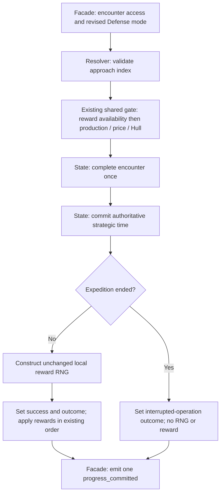

# Defense PoI reward transactions

`scripts/expedition/defense_poi_resolver.gd` extracts Defense-specific eligibility, reward seed policy and application from `ExpeditionState`. It has no mutable service fields, persistent records, scenes or singleton. Every operation borrows the authoritative state explicitly; it does not preload the state script.

## Ownership and API

- `defense_poi_approaches.gd`: existing declarative approach/reward definitions; unchanged.
- `DefensePoiResolver.reward_requirement(state, approach)`: pure reward availability query. Returns an unavailable `ApproachRequirement`, or `null` to continue shared gates. Keeps reason precedence, including card availability/capacity, decoys, extraction, free turrets, research and secured systems.
- `DefensePoiResolver.resolve(state, index, slot)`: validates the selected approach, completes the encounter, commits activity time, then applies rewards if the expedition survives. Returns a detached `Resolution` with `resolved` and `interrupted` facts. Rejection leaves both false. Interruption consumes the encounter and reports resolved without granting its reward.
- `DefensePoiResolver.reward_rng(state, index)`: creates the existing transaction-local RNG. The namespace remains `%d:%d:%d:defense-poi-reward:v1`, using expedition seed, system number and encounter index.
- `ExpeditionState`: remains the sole authority for Salvage, Hull, encounter completion and outcome text. Existing deck, temporary-effect and Defense components retain their own ledgers. Shared approach gates, generic encounter access, strategic-time simulation and the final `progress_committed` signal stay in the facade.

The public `resolve_approach()`, `approach_requirement()` and `locked_reason()` signatures/return values are unchanged. `_resolve_defense_poi()` and `_defense_poi_reward_rng()` remain compatibility adapters. Exploration and historical Defense systems without revised PoI rules still take the original resolution path.

## Transaction order



All eligibility checks occur before mutation. The formerly repeated card/turret/research checks are now covered once by the same synchronous availability query; no RNG or mutation occurs between that query and encounter completion. Shared production, Salvage and full-Hull gate order is untouched.

Reward application remains ordered: ranged/fixed Salvage; production, Pressure, fuel and research effects; card batch; next-battle modifiers; Hull repair; turret; decoy; extraction. The original success/outcome initialization and randomized Salvage wording are retained. Existing deck/effects/installation methods perform the actual transactions; the resolver does not reimplement their ownership or duration rules.

Strategic time can emit `defense_advanced` before the reward is granted. Its observers see a completed encounter with the pre-reward ledger, just as before. The final progress notification occurs after the resolver returns, including when the operation ends the expedition. The resolver emits no signals and calls no persistence API. Checkpoint boundaries, deferred strategic time and interrupted activities therefore retain their existing paths.

## Compatibility and verification

No save codec, version, serialized field, approach Resource, reward amount, cost, duration, gameplay RNG call or UI is changed. The resolver introduces no saved state. Existing revised and historical Defense saves, pending card batches and Exploration saves use the existing codec unchanged.

`tests/defense_poi_resolver_test.gd` executes every current Defense approach with three seeds, actual save/resume before and after, failed eligibility, duplicate claims, fatal time advancement, production stacking, duration refresh and full-deck batch replacement. It records full save/outcome/RNG snapshots at both strategic and progression signals.

To compare against unchanged main, copy the same test script into that checkout and run it in both checkouts:

```sh
godot --headless --path /path/to/checkout \
  --script tests/defense_poi_resolver_test.gd -- /tmp/transactions.json
```

Compare the resulting case-to-SHA256 dictionaries. The extraction comparison matched all **404 transactions** exactly, with **1,716 assertions passing** on both implementations. These are generated comparison outputs, not committed golden fixtures. The test rebuilds derived construction sites after substituting a PoI fixture, and keeps stationary-enemy tuning in the supplied rules so restored runs use identical configuration. Save comparisons normalize JSON numeric types without excluding any fields.

Existing Defense reward/effect/card/combat, Starfront, persistence, deck and Exploration PoI regressions remain the broader coverage for the extracted paths. This is an architecture change only; faction-specific rewards are not introduced.
