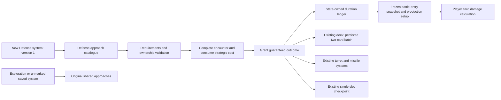
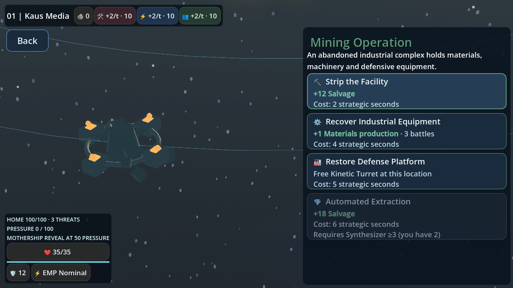
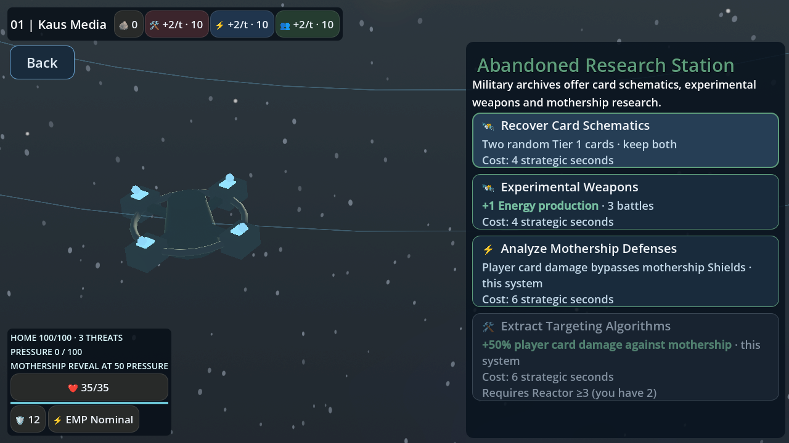
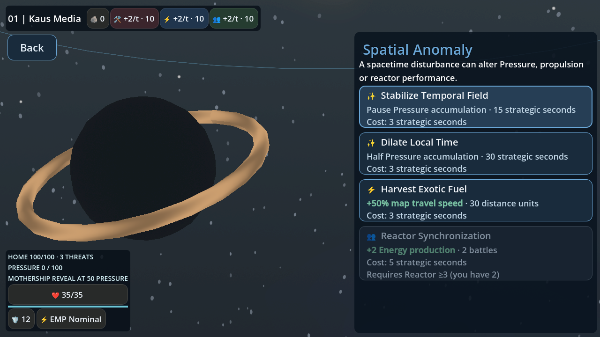
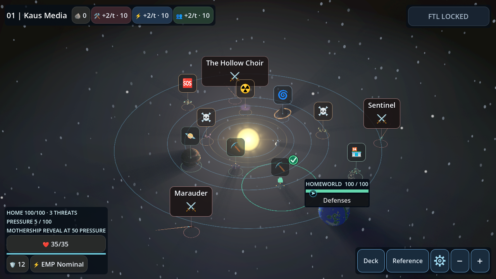

# Strategic Points of Interest — Defense Phase 1

New Starfront Defense systems replace approach success rolls with guaranteed rewards
and explicit strategic-time costs. Exploration resources and resolution remain intact.
Existing saved systems without `defense_poi_version: 1` retain their old choices until
entering a newly generated system. No PoI count, layout, orbit, fleet or environmental
placement rule is changed; opting in consumes no generation RNG.

## Approaches

The following table is generated from the reviewed Defense-only catalogue. Requirements
use permanent production, not temporary combat bonuses. A listed prerequisite means
level 3. Trading Outpost retains its separate service interface.

| PoI | Approach | Guaranteed reward | Strategic seconds | Prerequisite |
|---|---|---|---:|---|
| mining_operation | Strip the Facility | +12 Salvage | 2 | — |
| mining_operation | Recover Industrial Equipment | +1 Materials production · 3 battles | 4 | — |
| mining_operation | Restore Defense Platform | Free Kinetic Turret at this location | 5 | — |
| mining_operation | Automated Extraction | +18 Salvage | 6 | synthesizer ≥3 |
| research_station | Recover Card Schematics | Two random Tier 1 cards · keep both | 4 | — |
| research_station | Experimental Weapons | +1 Energy production · 3 battles | 4 | — |
| research_station | Analyze Mothership Defenses | Player card damage bypasses mothership Shields · this system | 6 | — |
| research_station | Extract Targeting Algorithms | +50% player card damage against mothership · this system | 6 | reactor ≥3 |
| spatial_anomaly | Stabilize Temporal Field | Pause Pressure accumulation · 15 strategic seconds | 3 | — |
| spatial_anomaly | Dilate Local Time | Half Pressure accumulation · 30 strategic seconds | 3 | — |
| spatial_anomaly | Harvest Exotic Fuel | +50% map travel speed · 30 distance units | 3 | — |
| spatial_anomaly | Reactor Synchronization | +2 Energy production · 2 battles | 5 | reactor ≥3 |
| gas_giant | Atmospheric Sampling | +6 Energy next battle | 2 | — |
| gas_giant | Gas Harvesting | +1 Energy production · 2 battles | 4 | — |
| gas_giant | Precision Skimming | +8 Energy next battle · +4 Salvage | 4 | reactor ≥3 |
| distress_signal | Recover Supplies | +8 Salvage | 2 | — |
| distress_signal | Rescue Crew | +1 Crew production · 2 battles | 4 | — |
| distress_signal | Salvage Equipment | Two random Tier 1 cards · keep both | 4 | quarters ≥3 |
| derelict_starship | External Salvage | +10 Salvage | 2 | — |
| derelict_starship | Recover Armaments | Two random Tier 1 cards · keep both | 4 | — |
| derelict_starship | Engineering Recovery | +1 Materials production · 2 battles | 4 | synthesizer ≥3 |
| radiation_nebula | Collect Isotopes | +6–10 Salvage | 3 | — |
| radiation_nebula | Charge Capacitors | +8 Energy next battle | 3 | — |
| radiation_nebula | Shielded Sampling | +1 Energy production · 2 battles | 4 | reactor ≥3 |
| pirate_debris_field | Recover Cargo | +8–12 Salvage | 3 | — |
| pirate_debris_field | Recover Munitions | +8 Materials next battle | 3 | — |
| pirate_debris_field | Sort Wreckage | Two random Tier 1 cards · keep both | 4 | synthesizer ≥3 |
| raider_cache | Open Supply Crates | +8–12 Salvage | 3 | — |
| raider_cache | Recover Weapons | Two random Tier 1 cards · keep both | 4 | — |
| raider_cache | Restore EMP Cells | +2 EMP Pulse charge next battle | 4 | reactor ≥3 |
| quarantined_colony | Recover Emergency Stores | +8 Salvage | 3 | — |
| quarantined_colony | Recruit Specialists | +1 Crew production · 2 battles | 4 | — |
| quarantined_colony | Medical Assistance | Repair 8 Hull | 4 | quarters ≥3 |
| fuel_depot | Recover Fuel Reserves | +6–10 Salvage | 2 | — |
| fuel_depot | Refill Capacitors | +8 Energy next battle | 3 | — |
| sensor_relay, ancient_navigation_array | Recover Navigation Archives | +8 Salvage | 2 | — |
| sensor_relay, ancient_navigation_array | Decode Tactical Archives | Two random Tier 1 cards · keep both | 4 | quarters ≥3 |
| unstable_wormhole | Recover Displaced Cargo | +8–12 Salvage | 3 | — |
| unstable_wormhole | Tap Exotic Energy | +8 Energy next battle | 3 | — |

## Ownership and transaction order

`ExpeditionState` owns one `DefensePoiEffects` ledger. `DefenseState` borrows that
same ledger for Pressure rates/expiry; neither map nor combat owns a mutable copy.
`DefensePoiApproaches` builds fresh existing EncounterApproach resources with typed
reward metadata. State, controller and existing PoI screen use the same mode-aware
accessor. Shared `.tres` files are unchanged.

Selection validates requirements and reward eligibility before completion. It marks
the encounter resolved, spends its time through the existing authoritative strategic
loop, then grants the reward and emits the existing progress/save signal. Effects
never discount their own acquisition cost. Terminal homeworld loss stops reward
application. New Defense loot uses a per-PoI deterministic fork (run seed, system, encounter and a versioned namespace) passed into the existing reward APIs. It consumes no world-generation or combat RNG; resolved results are saved instead of regenerating them. Legacy/Exploration keep their prior reward RNG. Random loot rolls only its quantity at resolution; completion and stored
outcome prevent reopening/rerolling. No interface or animation advances strategic time.
The existing activity path advances enemies, reinforcements, missiles and turrets.



## Durations and stacking

Production bonuses apply to detached player battle setup, leaving permanent ship and
upgrade eligibility unchanged. Idempotent card-battle result recording
consumes one duration charge; entry, Retry, missile interception and ordinary PoIs do
not. Production and fuel survive FTL. Effects in separate production categories coexist.
The same category retains the greater magnitude and remaining duration, capped at +2
and three battles; bonuses do not add or multiply. Battle completion includes the
existing card-battle escape resolution. A lost expedition cannot reuse its charges.

Pause and half-rate timers count committed strategic seconds, concurrently. Pause
wins while both exist. The event loop splits at expiry and applies the multiplier to
the effective v2 Pressure rate; enemy/missile/reinforcement clocks retain normal spans.
Neither effect reverses reveal/advancement. Timers expire on system departure.

Propulsion has one nonmultiplying 30-unit fuel reserve. A travel command splits into
boosted and normal tween segments at fuel exhaustion. The renderer queries a pure
speed plan, and the coordinator samples actual motion at the boundary. Only actual
consumed movement depletes fuel; PoI activity never does. Strategic seconds per distance
are unchanged. The existing HUD adds a compact active-fuel indicator. Existing EMP
status details list all active effects, and resource details show production duration.

## Research combat rules

A system has at most one Research mothership advantage. It is selected only for the
actual mothership and frozen in the existing battle-entry environment record. Loading
an unfinished battle reuses that marker; later world changes cannot replace it.
The advantage expires when the system is secured or left.

The board passes this explicit context only for player card execution. The authoritative
CardEffects damage site applies it after environmental card scaling and to selected
conditional attack packets as well. Damage boost rounds each nonnegative integer packet
half upward (5 → 8). Penetration bypasses Shields without deleting them. Healing,
production, self-damage, enemy attacks and non-damage effects are unscaled. Friendly
turret/environmental hits use their existing separate path. Default parameters preserve
ordinary combat, card definitions, scheduling and combat RNG draw order.

## Two Tier 1 cards

The full eligible pool is every unowned non-signature Tier 1 identity, with uniform
selection and no rarity weights/recommendations. The existing deck supports unique
identities, so duplicates are not offered. Both cards are shown in the existing gallery
with a single **Keep Both Cards** confirmation. Capacity invokes mandatory replacement
for each incoming card; the first reward is protected from replacement by the second.
The offer/queue/protected identity records persist before confirmation and between
replacements. Completion cannot award again. If fewer than two eligible identities
remain, that approach is disabled with a reason; other guaranteed approaches remain
available. This preserves ownership instead of silently substituting higher tiers.

## Free Mining turret

One stable `mining_free_<encounter>` installation uses the Mining Operation's actual
stored anchor, no Salvage and no site picker. Purchased capacity remains two and the
free slot is independent, for three total. Existing model/range rendering, combat
support and missile scheduling consume the same turret record. Only the free weapon
mesh is raised above the rocky body for visibility; the authoritative root and range
center remain exactly at the anchor. No PoI is moved to improve its tactical value.
Saved positions must match an eligible Mining anchor; duplicate sources and shifted
records are rejected. System generation clears all installations as before.

## Persistence

Save schema remains version 3. Optional records: `defense_poi_version`,
`defense_poi_effects`, and active `card_batch` state. Missing system version means
historical approaches. Missing effect/batch data means no new benefits. Completed
historical PoIs never acquire effects retroactively. Exploration keeps its original
wire state except existing shared fields; no active Defense batch is accepted there.

Validation rejects unknown effect IDs, negative/nonfinite/fractional charges, invalid
scope/version, non-Tier-1 batch cards, duplicates, owned queued cards, invalid protected
identities and over-capacity decks. Boss advantages in saved battle markers require
an actual Defense mothership encounter. Normal purchased turret validation and all
existing save failure/retry behavior remain in the existing codec/persistence owners.

## Validation and review limits

Focused headless tests cover catalogue/resource isolation, effect bounds and duration,
real state/codec roundtrips, deterministic Pressure partitions, continuing fleet/missile
motion, production charges, free/purchased turrets, missile support, card batches with
full decks and saves between replacements, exact transaction costs, randomized bounds,
legacy/Exploration approaches, boss damage rounding/conditionals/default parity and
frozen battle restoration. Production presentation tests exercise real touch selection,
three special interfaces, free turret rendering and one journey crossing fuel expiry.
They are registered in both GL Compatibility and Mobile Vulkan.

Local Godot 4.7.2 focused checks and Python contracts pass; renderer/full-CI status and
commands are reported in the PR. Software Mesa renderer checks do not replace physical
Android testing. Review 960×540 and real-device text sizing, touch selection, effect
inspection and mid-travel Save & Quit/Continue. The free turret is not repositioned to
ensure usefulness. The catalogue values are initial balance choices; strong stacking
refreshes and repeated card replacements merit playtesting. Large randomized workloads
and baseline fixtures were not reduced or regenerated.

## Production renderer captures

Seed 1042, 1280×720, Mobile Vulkan using the existing production renderer. Special PoIs
are staged at an existing generated PoI anchor for repeatable interface capture. Their
natural generation frequency is unchanged. No image post-processing.

| Mining | Research |
|---|---|
|  |  |

| Anomaly | Free turret at the Mining PoI |
|---|---|
|  |  |

### Local execution record

Godot binary: `/workspace/godot-4.7.2/Godot_v4.7.2-stable_linux.x86_64`.

```sh
python3 -m unittest discover -s tools -p 'test_*.py' -v
python3 tools/run_regressions.py --godot "$GODOT" --workers 2 --skip-import
python3 tools/run_regressions.py --godot "$GODOT" --skip-import --script defense_poi_catalog_test --script defense_poi_effects_test --script defense_poi_state_test --script defense_poi_cards_test --script defense_poi_resolution_test --script defense_poi_combat_test --script defense_poi_presentation_test
# Existing display / software Mesa, separately for each renderer:
python3 tools/run_rendered_regressions.py --godot "$GODOT" --renderer gl_compatibility --skip-import --script defense_poi_presentation_test --timeout 300
python3 tools/run_rendered_regressions.py --godot "$GODOT" --renderer mobile --skip-import --script defense_poi_presentation_test --timeout 300
```

All seven new focused suites pass, alongside targeted deck ownership, ordinary combat
modifier/parity, Starfront defense/quality and persistence suites. Python: 22 passed.
Production presentation passes GL and Mobile, including actual touch and physical
travel. Local render budgets were 300 seconds for cold software shader compilation;
the new recurring CI test retains the runner's normal 120-second limit. Observed
focused GL/Mobile runs completed inside 120 seconds.

The preliminary full headless run completed 170 scripts while integration was still
in progress: 167 passed and three failed. Its obsolete fixed-cost quality assertion
was revised to assert the new declared cost with the same precision, and an additional
check retains the legacy 1.5-second behavior. A Defense-only encode mode gate fixed
the unchanged v1 Exploration migration test. Both then passed. The unrelated existing
hull-flash timing assertion passed on isolated rerun without code/assertion changes.
This preliminary mixed-development run is not presented as a final green full suite.
CI at the committed PR revision is the final complete-matrix check; its status is in
the PR. Shutdown leak/font-cache warnings occurred in some local runs.
