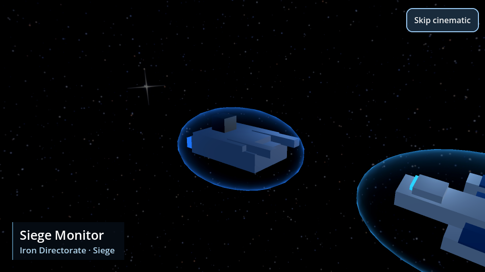
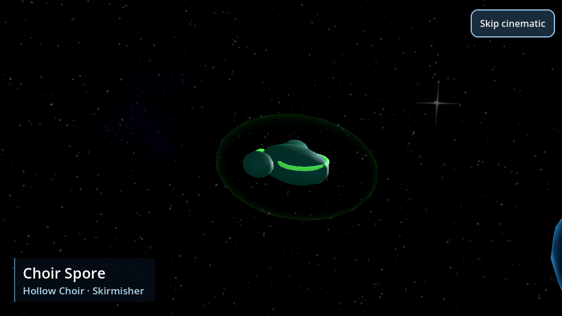
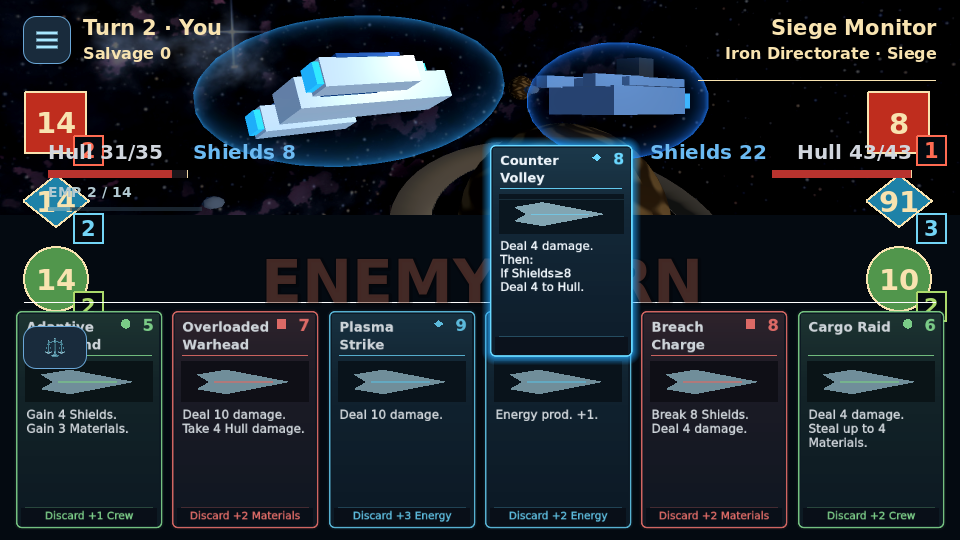
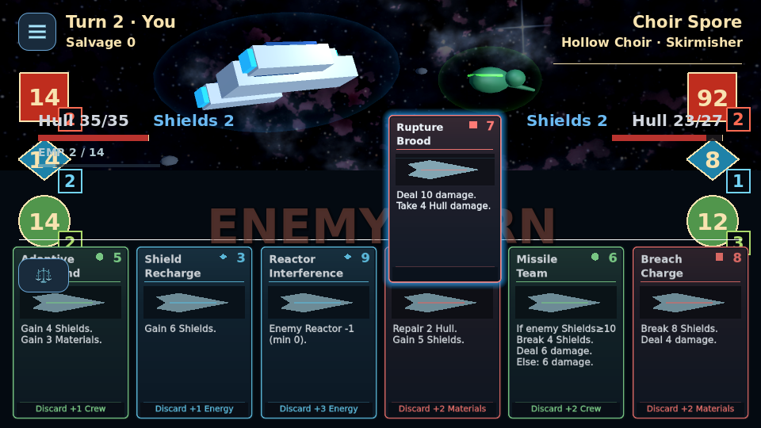
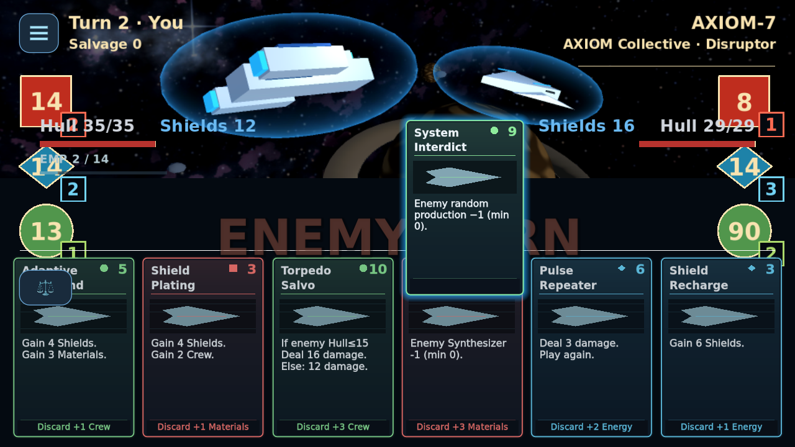
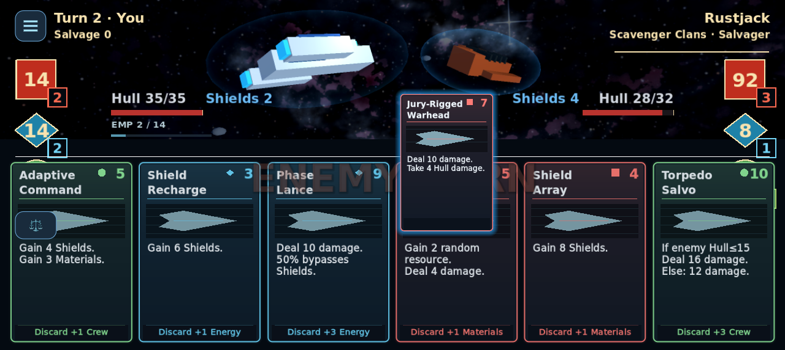
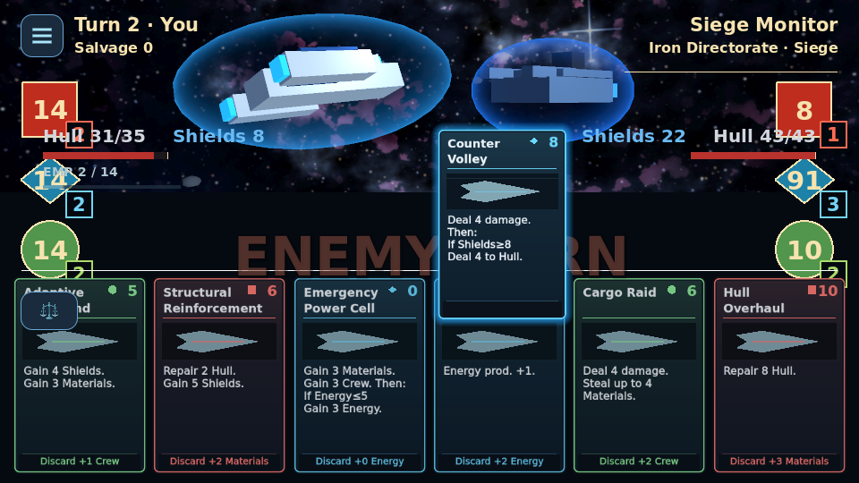
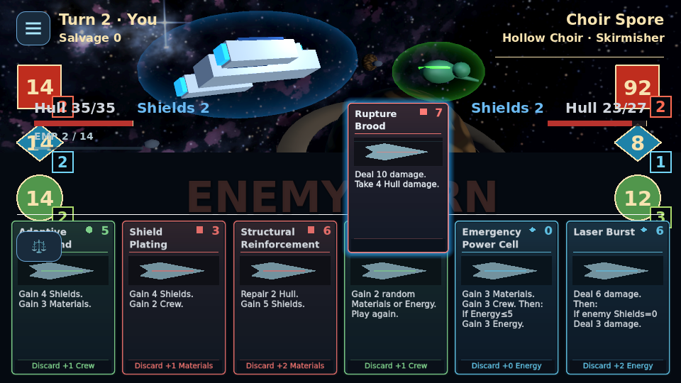

# Enemy card flavor and encounter identity

Presentation only, based on main after the enemy balance passes (#89–91).
No card effects, costs, AI weights, decks, stats, progression, RNG or save format
change. No new artwork, icons, panels or purchased asset dependencies.

## Card names and copy

The sole production enemy-exclusive card, `cards/enemy/iron_counterbattery.tres`,
now displays **Counter Volley** instead of Iron Counterbattery. Its compact copy
is: “Deal 4 damage. If your Shields ≥8, deal 4 more Hull damage.” The resource path,
8 Energy cost, 4 normal damage + conditional 4 piercing damage and upgrade limit
are unchanged. The shorter name leaves space beside the cost at mobile scale.

Overloaded Warhead and Siege Charges are shared cards, not enemy-exclusive cards.
Their canonical names and descriptions remain unchanged. Only enemy reveal and
last-action presentation use faction aliases:

| Faction | Canonical card | Enemy presentation | Reason |
| --- | --- | --- | --- |
| Hollow Choir | Overloaded Warhead | Rupture Brood | Organic burst; retains the self-damage warning |
| Hollow Choir | Siege Charges | Ravenous Lunge | Predatory Hull attack, with the exact Shield condition retained |
| Hollow Choir | Salvage Cannibalization | Flesh Regrowth | Living restoration rather than industrial salvage |
| Hollow Choir | Missile Team | Spinal Volley | Organic weapon vocabulary, same conditional attack |
| Iron Directorate | Salvage Cannibalization | Armor Salvage | Disciplined recovery, same Shield/Hull/resource trade |
| AXIOM Collective | System Disruption | System Interdict | Clinical disruption; the random production target stays explicit |
| AXIOM Collective | Shield Disruptor | Shield Nullifier | Precision shield-breaking vocabulary |
| Scavenger Clans | Overloaded Warhead | Jury-Rigged Warhead | Improvised weapon; self-damage remains visible |
| Scavenger Clans | Salvage Strike | Scrap Strike | Opportunistic raiding; random resource gain is unchanged |

`enemy_card_flavor.gd` is a small read-only title map keyed by faction ID and card
resource identity. Faction membership comes from existing catalog ship names so
scaled copies retain identity. Unknown/custom profiles and unmapped cards fall
back to their original names. Upgrades and storm previews retain their aliases.

`CardMotion` supplies an optional `CardView.display_title` on the reveal node.
It never clones or renames CardData. The last-action label uses the same helper;
player actions always use canonical names. Inspection propagates the displayed
title while retaining full authoritative effects/upgrade details. Player card
names, the six-card hand, 198×294 geometry, typography, footer and input remain
unchanged. No faction chip is added inside the already compact card face.

## Encounter text

All 19 enemy profiles use the existing `subtitle` field for faction + short role
or trait. A one-sentence `summary` describes verified strengths from their actual
stats and decks, including the recent aggressive Bastion tuning. “Regeneration”
refers to repair cards, not a new passive ability.

The current cinematic caption reads ship name + subtitle. The normal battle
header persists that subtitle, including when Skip Cinematics is enabled. The
existing tactical briefing reads the same subtitle and short summary alongside
its existing class/stats. No controls, timing or layout are introduced.

These identify the enemy profile's native faction. A legacy/fallback Sentinel
Dreadnought retains its Iron identity rather than pretending to be a new faction
boss. Keep subtitle faction prefixes synchronized with FactionProfile names when
renaming faction lore.

| Enemy | Existing subtitle, revised copy | Tactical summary |
| --- | --- | --- |
| AXIOM-7 | AXIOM Collective · Disruptor | Breaks Shields and disrupts production to expose your Hull. |
| AXIOM Command Nexus | AXIOM Collective · Command | Command vessel combines shield-breaking weapons with disruption. |
| AXIOM Enforcer | AXIOM Collective · Enforcer | Shield breaking and system disruption set up precise strikes. |
| AXIOM Scout | AXIOM Collective · Scout | Light disruptor attacks Shields and production systems. |
| Bastion Frigate | Iron Directorate · Assault | Reactor-fed volleys turn layered Shields into an aggressive opening. |
| Choir Guardian | Hollow Choir · Regenerator | Repairs Hull and sustains pressure with Crew attacks. |
| Choir Leviathan | Hollow Choir · Leviathan | Living flagship uses repair cards to sustain repeated Crew attacks. |
| Choir Spore | Hollow Choir · Skirmisher | Fragile predator repairs itself and strikes at a cost. |
| Clan War Barge | Scavenger Clans · Flagship | Raiding flagship combines theft with heavy ordnance. |
| The Hollow Choir | Hollow Choir · Predator | Repair cards sustain the hunt while piercing attacks reach your Hull. |
| Marauder | Scavenger Clans · Raider | High Energy reserves fuel an aggressive opening. |
| Marauder Vanguard | Scavenger Clans · Vanguard | Elite raider with reinforced Hull and stronger reserves. |
| Reclaimer | Iron Directorate · Harvester | Thick Hull and Materials production sustain heavy ordnance. |
| Rustjack | Scavenger Clans · Salvager | Steals supplies and turns unstable weapons into salvage. |
| Scrap Skiff | Scavenger Clans · Skirmisher | Fast raider mixes theft with unstable weapons. |
| Sentinel | Iron Directorate · Bulwark | Heavy Shields and a strong Reactor sustain a drawn-out fight. |
| Sentinel Dreadnought | Iron Directorate · Fortress | Armored flagship combines heavy defenses with siege weapons. |
| Siege Monitor | Iron Directorate · Siege | Builds Shields to enable piercing counterfire. |
| Wreckbreaker | Scavenger Clans · Breaker | Heavy raider trades Hull for explosive strikes and salvage. |
## Validation

`enemy_identity_test.gd` measures actual title text against the 120-pixel header
space beside the cost, checks description height and exact 198×294 dimensions,
and covers every alias at all supported upgrade levels. It also checks storm
previews, canonical-name fallback, scaled profiles, tactical briefing copy,
real cinematic captions, Skip, unchanged intro state/RNG, actual enemy actions,
reveal Resource identity and matching last-action text.

Godot 4.7.2: **984 checks, zero failures**, headless, GL Compatibility and Mobile
Vulkan. Captures cover 960×540, 1280×720 and 1280×573. Existing enemy exclusivity,
card-effect parity, card descriptions, card motion/inspection, faction expansion,
expedition resume and battle cinematics pass unchanged. A separate diff audit
compared all 20 edited Resources against main: only `subtitle`/`summary` or the
exclusive card's `card_name`/`description` changed. Baseline fixtures are untouched.

```sh
python3 tools/run_regressions.py --godot godot --script enemy_identity_test --script enemy_card_exclusivity_test
python3 tools/run_rendered_regressions.py --godot godot --renderer gl_compatibility --script enemy_identity_test
python3 tools/run_rendered_regressions.py --godot godot --renderer mobile --script enemy_identity_test
```

Full CI runs on the PR and is left unmonitored as requested; pending CI is not
claimed passed. Non-fatal engine ObjectDB shutdown warnings remain in the scene
test logs. No physical Android-device performance validation is claimed. Existing
fonts/styles and models are reused; no third-party files or licenses change.

## Actual production captures

The same battle scenes and enemy action queue used by the game produce these
frames. Enemy reveals intentionally keep their existing compact placement.

| Iron intro | Hollow Choir intro |
| --- | --- |
|  |  |
| Counter Volley — existing enemy-only card | Rupture Brood — shared mechanics, enemy title |
|  |  |
| AXIOM identity and precision card | Scavenger identity and improvised card |
|  |  |
| Mobile Vulkan — Iron | Mobile Vulkan — Choir |
|  |  |
