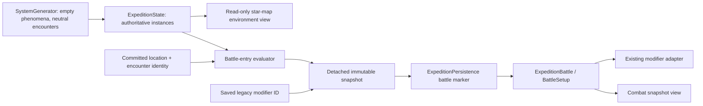

# Environmental battles — Phase 1

## Current flow (analysis before implementation)

Inspected main at `1b28116ff0d3f04815a19d74bb3e47e0e0e7c1d7`, including the merged controller composition refactor.
Its baseline regression workflow [passed](https://github.com/RPGMaster2000/arcospace/actions/runs/42100444711).

SystemGenerator assigns `State._roll_battle_modifier()` to exploration enemies,
defense attackers/mothership and reserve enemies. That hook calls the existing
eight-way CombatModifier roll on the gameplay RNG. Chasedowns already use zero.
Encounter dictionaries persist the integer `modifier`; the version-3 codec validates
IDs 0–7 and preserves them through older schema migrations.

ExpeditionPersistence encodes pre-entry State and saves the encounter index and
independent battle seed before ExpeditionBattle calls State.prepare_battle.
BattleSetup carries the modifier to BattleAdapter and Board. Board configures the
existing scheduler with the battle seed; hand/AI/EMP RNGs use their separate derived
seeds. Scheduler context affects card resolution, forecasts/AI, shields, draws and
round effects. Board3D selects existing arenas from that same modifier ID.
TacticalBriefing, map/grid descriptions and BattleModifierPanel display that ID.
The standalone Board continuation mode also rolls a next modifier; it is a legacy
non-expedition pathway and remains unchanged in this phase.

NavigationState owns the committed player position/target. DefenseState owns physical
hostile positions and PoI anchors; swept contact records the player's contact point.
Exploration map anchors come from VisualSystem's separate cosmetic seed channels and
can move with planet orbits. Camera/tactical ship transforms are not authoritative
combat coordinates. Grid/direct entry may have no physical position. The Phase 1
snapshot records the committed navigation point (or an empty unknown location),
plus system and encounter identity; it never substitutes a cinematic transform.

Tests explicitly inject all legacy modifier IDs, verify eight-way helper distribution,
compare frozen combat/AI fixtures and exercise fresh-process resume. Those fixtures
and legacy helpers must remain intact. Tests which expect a visible neutral modifier
label will be updated to assert the intentional absence of that label.

## Design and ownership

A small shared environment data module defines NONE, ASTEROID_FIELD,
SOLAR_INTERFERENCE, SPACE_STORM and TEMPORAL_RIFT. Instance records carry an ID,
type, position/region, visual configuration, intensity/parameters, simulation state
and deterministic generation metadata. No phenomenon instances or effects are generated.

ExpeditionState alone owns mutable environmental instances. Presentation receives
detached read-only views. The evaluator takes State, battle location and instances,
and returns a detached recursively read-only snapshot. Phase 1 selects NONE without
RNG calls or spatial/precedence behavior. A separate legacy_modifier field retains
an existing encounter's modifier ID; NONE refers to physical phenomena, and a nonzero
legacy ID is explicitly a compatibility effect, not a newly generated phenomenon.

Persistence captures the snapshot at battle initiation in the existing battle marker.
The controller passes it to the battle component; BattleSetup exposes the snapshot
to gameplay/visual consumers. Saved/retried battles reuse that snapshot without
evaluating the world again. Legacy markers without a snapshot reconstruct from the
saved encounter ID and saved State without advancing RNG.

The save change is additive: optional world environment records and an optional
battle-marker snapshot, validated when present. Version 3 and existing migrations
stay unchanged. Missing world records mean no phenomena; existing encounter IDs
are never rewritten. Terminal cleanup and checkpoint-before-bonus-consumption
ordering remain unchanged.

New encounters retain the exact old modifier RNG draw and discard its value before
storing zero. This preserves later enemy, pressure, objective, loot and shuffle draws.
The legacy roll helper stays available for explicit compatibility tests.

## Phase 2 integration

Add deterministic instance generation using a dedicated environment stream; never
borrow battle/gameplay RNG. Establish authoritative exploration geometry before
evaluating spatial regions; unknown grid locations must have an explicit policy.
Implement spatial selection and precedence inside the evaluator, then map its frozen
configuration to existing combat and visual consumers. World simulation may mutate
State instances, never an active battle snapshot. Add migrations/validation for new
snapshot semantics before enabling them. Do not generate a fresh environment on resume.

## Validation plan

Compare generated states using the unchanged SystemGenerator with the historical
modifier-assignment hook in tests, excluding
only encounter modifier IDs; include exploration/defense, reserves and boss systems.
Test neutral behavior, snapshot purity/immutability, RNG preservation, write failure,
Quit/Resume, legacy markers and invalid save data. Run the unchanged headless,
GL/Mobile rendered and exported-startup CI jobs. No local Godot or physical-device
execution is claimed; this work is performed through GitHub.
