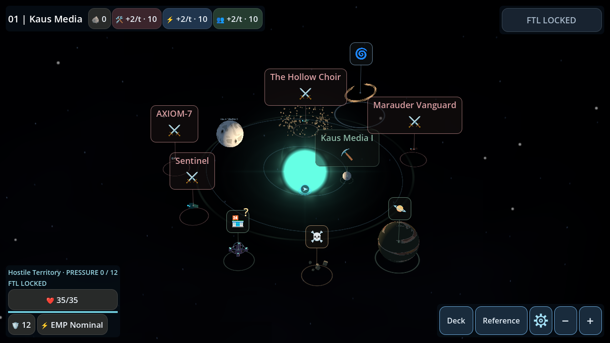
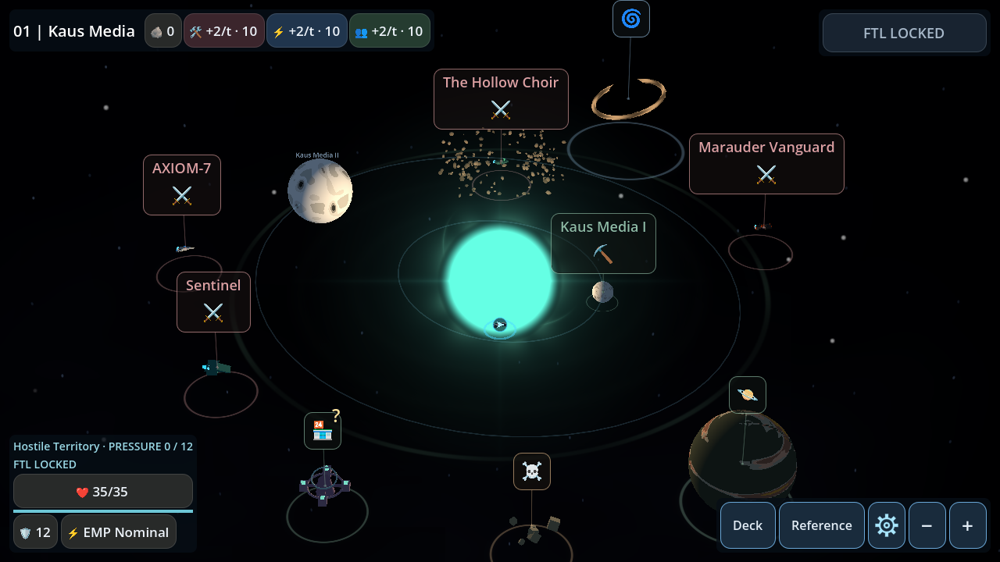
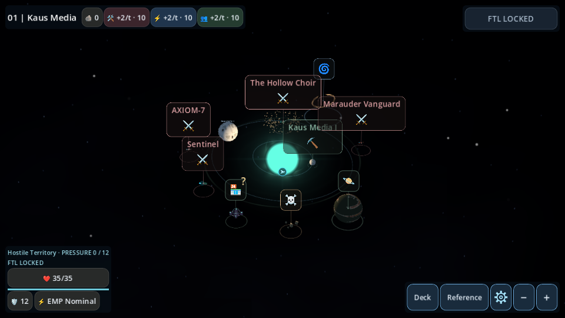
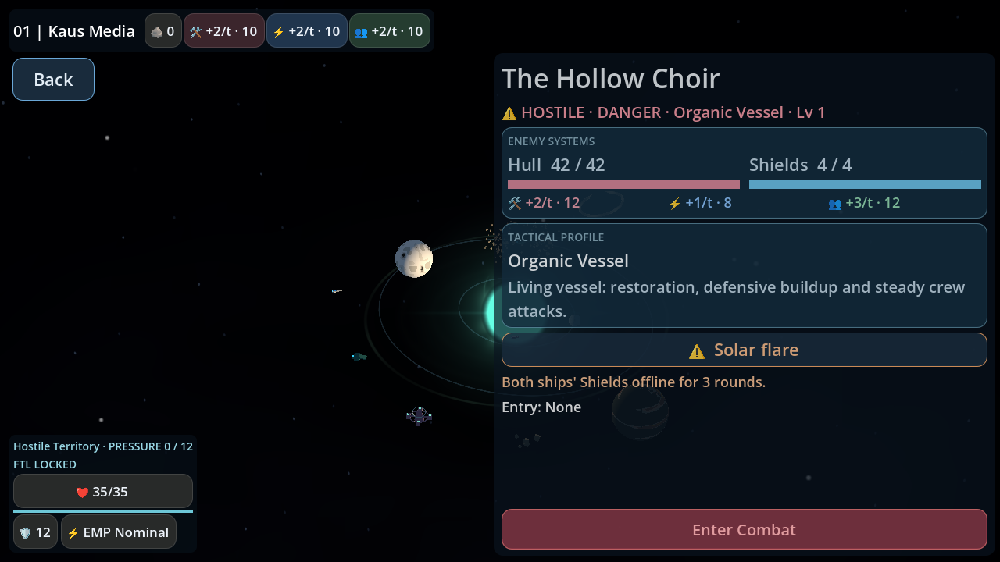
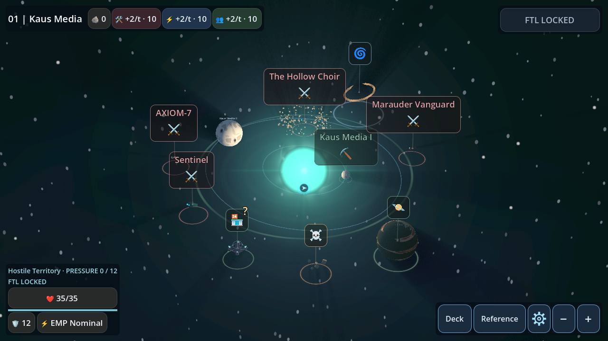

# Phase 3: physical solar interference

Based on main including merged PR #50 (`34dfd67`). This extends the existing
[environment instance/snapshot architecture](environmental_battles_phase_one.md)
and [physical asteroid selection](environmental_battles_phase_two.md).

## Generation and authoritative geometry

`ExpeditionState.generate_system()` appends one SOLAR_INTERFERENCE record after
unchanged asteroid generation. A dedicated `solar-interference:v1` RNG channel
varies radius, intensity, activity, phase and pulse rate. It does not consume or
change encounter, station, chasedown, asteroid, planetary, background or combat RNG.
The regression baseline reproduces PR #50's transition and compares all persisted
state after removing only the new solar record, across exploration/defense modes
and consecutive systems.

The region is a stationary sphere centered on the physical star (currently the
system origin). Containment uses inclusive squared 3D distance, not the player's
camera, ship animation, corona phase, or a future intercept estimate. Exploration
uses committed encounter centers; defense uses the hostile's actual current center.
There is no random activation roll: encounters within the radius are hazardous.

`ExpeditionRules.solar_influence_radius_range` configures the center-to-boundary
radius for new systems (default 8-13 world units). Generation ensures at least one
world unit beyond the stellar surface. The star radius is derived from the existing
18-unit procedural sun quad, shader surface extent 0.14, and `sun_core_scale`:
`9 * 0.14 * sun_core_scale` (2.52 units with the current scale of 2).
The center and stellar radius are persisted. Map reconstruction anchors the sun,
corona, influence indicator and existing light position to that definition, so
subsequent presentation tuning cannot silently move a saved hazard's surface.
The star's lighting energy, base shader, color streams and lens effects are retained.

Each record saves stable ID, type, center, sphere radius, stellar radius, intensity,
visual seed/activity/phase/pulse rate and generation identity. No scene nodes, mesh
transforms, animation clocks or moving solar events are stored.

## Selection and overlap

Only one modifier is selected. Priority is explicit and independent of record order:

1. Explicit legacy encounter modifier, preserving every historical ID.
2. Containing SOLAR_INTERFERENCE, adapted to existing modifier **3 (Solar flare)**.
3. Containing ASTEROID_FIELD, adapted to existing modifier **1 (Asteroid belt)**.
4. NONE, adapted to **0**.

Lexical instance ID breaks ties within the same physical type. Overlap never moves,
removes or regenerates asteroid formations. Empty Phase-1 reserved records and
unimplemented future phenomena remain loadable and neutral.

Preview/inspection queries are read-only. Battle entry captures the selected
record once through the existing checkpoint adapter. Its position, geometry,
visuals and selection identity are recursively frozen. Combat uses the frozen
snapshot even if the live world changes; a failed checkpoint returns the attempted
snapshot for Retry rather than evaluating again. Save & Quit / Continue follows
the existing marker pipeline. `combat_modifier.gd`, cards, combat balance, arena
scenes, event scheduling, shield behavior, RNG, notifications and descriptions
are unchanged.

## Visual presentation and Android cost

`SolarInterference` adds only two meshes: a small billboard corona and a plane
showing a faint, broken interference boundary with low-opacity ripples. The corona
uses smooth emission fluctuations and intermittent analytic prominence arcs.
Animation uses shader TIME plus saved phase/activity/pulse parameters. It has no
bearing on containment or combat scheduling.

There is no transparent enclosing sphere, extra light, particle system, collision
object, input target or per-frame GDScript animation. Both meshes disable shadows;
no textures or compute effects are required. GL Compatibility and Mobile share
these lightweight shaders. Existing lens rendering remains a separate unchanged
feature. PoI rings, labels, hitboxes, touch gestures, inspection and navigation are
retained, and existing modifier UI shows the Solar Flare name and description.

## Compatibility and validation

Save version remains **3**, snapshot version remains **1**. Physical solar records
and snapshots validate finite geometry/visual parameters and a positive stellar
radius within the influence radius. Loading never calls generation: asteroid-only
systems, old multiple-formation systems, old asteroid battle snapshots and legacy
unfinished battles keep their saved definitions. Only newly generated systems gain
solar interference. Reserved empty solar records are not upgraded on load.

Focused regressions:

- `solar_regions_test.gd`: deterministic generation, translated/scaled star geometry,
  inclusive distance boundaries, invalid input, overlap ordering and legacy priority,
  full PR #50 generation/RNG comparison, saved world validation, old-system loading,
  frozen snapshots and legacy Solar Flare combat/card/RNG parity.
- `solar_entry_test.gd`: overlapping physical entry, single evaluation, Save & Quit /
  Continue, unchanged combat arena and UI, snapshot identity, failed-checkpoint retry
  after both physical regions move, and legacy unfinished-battle restoration.
- `solar_render_test.gd`: production exploration and defense maps, shader parameters,
  saved stellar anchoring, two-mesh budget, collider/light-free effects, PoI targets,
  read-only inspection, unchanged description modal, briefing/combat agreement,
  1280x720 and 960x540 captures. Registered in both rendered CI suites; entry also
  runs rendered in GL. Existing Android touch/lens/asteroid regressions are retained.

The PR records complete CI results. Software Mobile rendering and touch regressions
do not constitute physical Android device performance measurements.

## Screenshots

Production map fixtures keep encounter and star positions intact. The solar radius
is enlarged only when necessary to include the nearest encounter for overlap/UI
coverage (especially incoming defense units); the asteroid cluster is a controlled
fixture at that encounter. Default production generation remains independent.
Cosmetic animation clocks can differ between captures.

