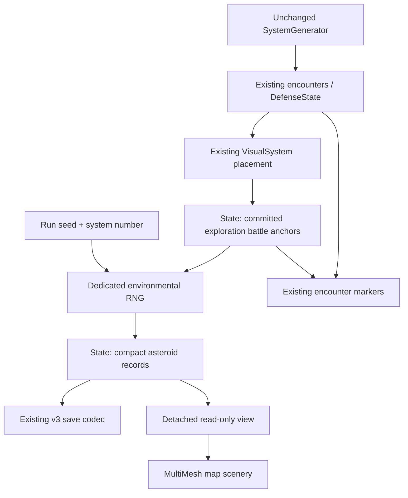
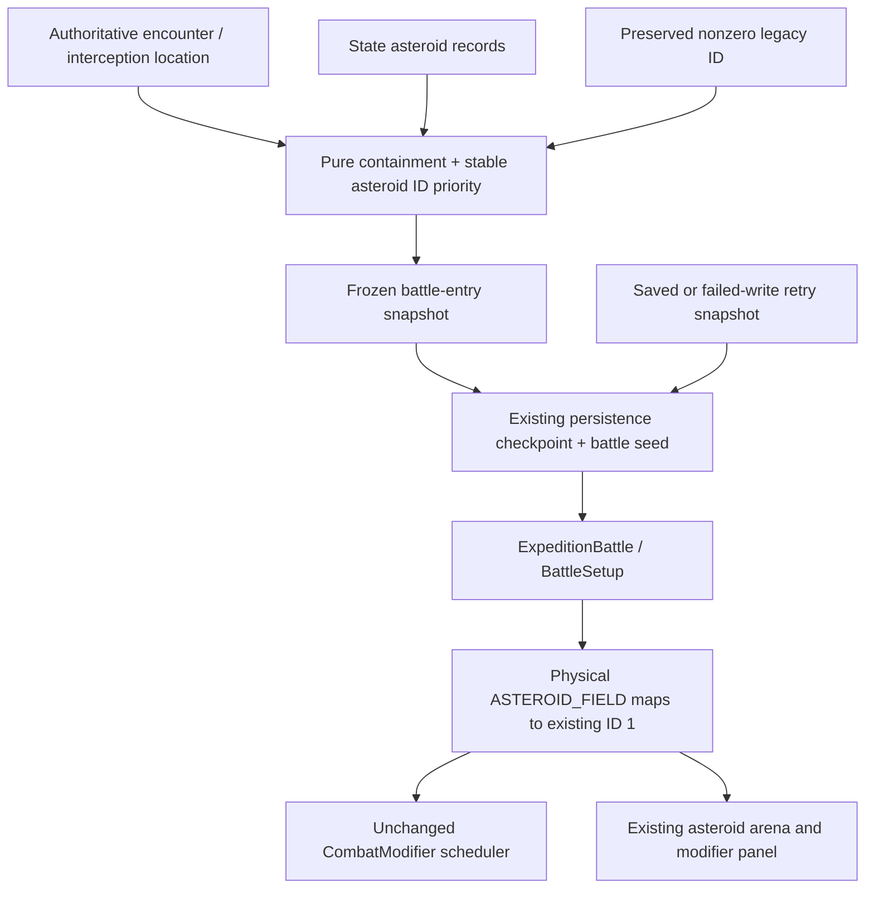

# Environmental battles — Phase 2: physical asteroid fields

[Phase 3](environmental_battles_phase_three.md) adds solar interference and defines
legacy > solar > asteroid overlap priority.

Generation and rendering refinements in [Phase 2.1](asteroid_poi_polish.md) supersede
the original formation counts and mesh scale described below.

## Baseline and architectural assessment

Inspected main `f7ca94cc7a10402cc6c58dd5e09dc07b0be1a585` (merged PR #48),
including [Phase 1](environmental_battles_phase_one.md).
The [main baseline workflow](https://github.com/RPGMaster2000/arcospace/actions/runs/42457216259)
passed all jobs.

The actual map script is `scripts/presentation/star_system/star_map_3d.gd`,
instanced by `scenes/star_system_3d.tscn`. VisualSystem generates deterministic
exploration anchors with separate cosmetic channels. In this revision planets rotate
their surfaces; their centers do not orbit in the live process loop. Battle entries
have enemy profiles and are not assigned to planetary PoIs. DefensePresentation
already replaces cosmetic anchors with DefenseState's moving units and fixed PoIs.

Phase 1 already owns environmental instances in ExpeditionState, captures immutable
snapshots in ExpeditionPersistence before preparing combat, saves snapshots in the
battle marker, and passes them through ExpeditionBattle/BattleSetup. Board3D chooses
an arena from the same modifier integer that configures CombatModifier.
Those lifecycle and checkpoint paths are reused.

## Generation and ownership

ExpeditionState remains the sole mutable owner of `environmental_instances`.
On **new system generation only**, it invokes AsteroidRegions after the unchanged
SystemGenerator. It also owns `encounter_positions`, a compact dictionary of static
exploration battle anchors keyed by decimal encounter index. DefenseState remains
the existing authority for moving defense units; no duplicate defense coordinates
are stored.

AsteroidRegions owns no runtime state. Its parameters are centralized constants:
one belt, at most two localized concentrations, belt radius/width ranges and system
radius. Each record contains stable ID `asteroids-SYSTEM-SLOT`, ASTEROID_FIELD type,
center, region geometry, intensity, subtype, visual seed/density/tint, and generation
version/run seed/system number. No individual mesh transforms are saved.

The circumstellar belt is a star-centered elliptical annulus with independently
varied width, axis ratio, orientation, vertical half-height and rendering density.
For exploration its radius is based on an existing battle anchor within the configured
radius limits. It does not move encounters. Defense attackers can cross the annulus
on their existing paths. Sparse angular sectors and irregular sizes provide visual
density variation; sparse sectors remain part of the physical region.

Localized concentrations are unions of three overlapping, offset, rotated ellipses
under one region rotation. They can form elongated or curved clusters. Bounded placement
attempts keep them within the navigable area and away from the belt/other clusters.
If a requested concentration cannot fit, it is omitted; the resulting count is 0–2.
Regions are scenery, never movement obstacles or progression gates.

## Coordinates

Coordinates use the map's existing world axes: X/Z is the system plane, Y is height,
and the star is at the origin. Wire positions are three-number arrays.

* Exploration: VisualSystem's existing placement algorithm, seed channels and default
  map calibration compute static battle anchors at generation. State commits those
  anchors at JSON precision. Screen passes them as `world_position`; the map uses them
  even if a later cosmetic calibration changes. Grid/direct entry uses the same known
  encounter center. Planetary PoIs remain cosmetic and are not battle locations.
* Defense: the hostile unit's current authoritative center is the battle location,
  including at swept contact. The player can be an interception radius away; neither
  the player's cinematic ship transform nor an estimated future intercept point
  substitutes for the visible hostile. Tactical inspection pauses the existing
  simulation; live map tooltips query current conditions as units move.
* Chasedowns: an existing three-coordinate saved interception point is authoritative.
  A two-dimensional legacy interception or missing location produces NONE.
* Old exploration saves without committed anchors remain unknown/neutral physically.
  Their old visual placement and explicit legacy modifiers remain supported.

Ship motion, destinations, selection, raycasts, touch gestures, pinch zoom and camera
controls are unchanged. The map only copies committed positions into its presentation
objects. It never writes back cosmetic transforms as encounter authority.

## Geometry and selection

Containment subtracts the saved center and applies the inverse region rotation.
For a belt, the elliptical radius is `sqrt(x*x + (z/ratio)*(z/ratio))`; it must be
between the inclusive inner and outer radii. For a concentration, the point must lie
inside at least one offset/rotated ellipse. Both use the saved vertical half-height.
Meshes are never used as colliders.

BattleEnvironment.evaluate is RNG-free. Explicit nonzero legacy IDs take precedence
and yield a NONE physical snapshot with their original `legacy_modifier`. Otherwise,
the lexically smallest containing asteroid instance ID wins. This makes same-type
overlap independent of array ordering (the generated belt's slot 0 wins over local
slots). Unknown/outside positions yield NONE. Other types remain reserved; there is
no cross-type precedence policy.

The frozen snapshot records type, instance ID, intensity, detached region/position/
subtype configuration, visual parameters, location, and expedition/encounter identity.
BattleEnvironment.modifier_id maps ASTEROID_FIELD to **existing ID 1**, NONE to 0,
or returns the preserved nonzero legacy ID. This adapter runs at the setup boundary.
Preview queries use the same geometry/mapping but do not commit a snapshot.

## RNG and persistence

Region RNG seed: `hash("RUN:SYSTEM:asteroid-regions:v1")`.
Rendering starts a separate RNG using the compact record's saved visual seed.
Neither stream reads or advances gameplay, station, chasedown, combat or global RNG.
Changing platform instance counts cannot change geometry or battle selection.
SystemGenerator and the historical discarded encounter-modifier draw remain unchanged.

Version 3 is retained. Environmental records already have an optional field; the only
new top-level wire field is optional `encounter_positions`. Geometry, bounded numeric
values, visual data and position references are validated. Missing fields mean empty
state, never regeneration on decode. Existing reserved empty Phase 1 records remain
valid and inactive. Existing migrations, checksums, atomic writes and terminal cleanup
are unchanged.

ExpeditionPersistence captures once before combat setup consumes bonuses. A failed
write returns the attempted frozen snapshot and seed to the existing retry adapter.
Retry and Continue reuse that snapshot, even if the live world changes. Save & Quit
during combat saves the pre-entry checkpoint and marker, not a newly evaluated world.
Snapshot validation does not require the live region still to contain the battle:
the frozen entry is authoritative. Existing unfinished Phase 1 snapshots remain NONE;
legacy markers without snapshots retain their old effects.

## Presentation and Android

AsteroidFields builds one MultiMeshInstance3D per region using a shared low-poly
procedural mesh. Sampling uses the exact saved containment geometry. Randomized
scales/rotations and angular/pocket density variation avoid a solid wall.
There are no physics bodies, input controls or individual asteroid scene nodes.

Nominal desktop counts are 1,100 belt / 180 concentration; Android uses 440 / 72,
scaled by saved density (0.8–1.2). Android is a deterministic prefix of the same
visual stream. Shadows are disabled; geometry and evaluation are identical on all
platforms. Physical-device frame time and readability still require manual testing.

Combat reuses `battlefield_asteroid_belt.tscn`, its existing assets, effects and
notifications through Board3D's existing ID-1 selection. Snapshot tint uses the same
rocky brown/gray family; exact transforms intentionally differ. No combat scene,
modifier, card UI, damage effect or ship animation was edited. Briefing/grid/map
labels use the existing modifier name/description; neutral labels stay hidden.

`combat_modifier.gd` is unchanged: periodic showers, independent 50% ship hits,
10 damage, shields before Hull, event timing and combat RNG all remain authoritative.

## Pipelines

## Tests and validation limits

Added:
* `asteroid_regions_test.gd`: seed/count/bounds, annulus/ellipse/pocket containment,
  rendered-center containment, deterministic transforms, Android prefix counts and
  absence of collision nodes.
* `asteroid_snapshot_test.gd`: wire precision, read-only snapshots, legacy mapping,
  and existing ID-1 scheduling/hits/damage/RNG comparison.
* `asteroid_battle_test.gd`: Phase 1 generation comparison, committed coordinates,
  defense movement, overlap, unknown locations, v3 round trips and malformed data.
* `asteroid_entry_test.gd`: production checkpoint, arena/panel wiring, actual Save &
  Quit / Continue, physical failed-write retry, and legacy unfinished battles.
* `asteroid_render_test.gd`: production map/marker/arena wiring and screenshots of
  belt plus concentration in existing CI artifacts.

The Phase 1 foundation assertions now allow physical fields. Neutral UI and legacy-ID
matrix tests explicitly use empty physical-world fixtures. No baseline combat fixtures
or damage expectations were regenerated.

Local command:
`XDG_DATA_HOME=/workspace/asteroid-validation/userdata XDG_CACHE_HOME=/workspace/asteroid-validation/cache godot --headless --path /workspace/asteroid-validation --script res://tests/asteroid_regions_test.gd`
passed **22,203 checks / zero failures** on installed Godot **4.6.3** using the actual
geometry/renderer/navigation sources. The snapshot test was attempted with its actual
dependency closure but hit an existing 4.7-only constant-array expression in
`ship_combat_state.gd`; it is **not counted as a clean pass**. Full local project
validation was unavailable because repository checkout could not reach the network
proxy. No engine-version compatibility changes were made to production code.

The existing PR workflow runs Godot 4.7.2 headless regressions, GL Compatibility,
Mobile Vulkan, exported-pack checks and exported startup. Both rendered matrices
include the new map test; GL also includes the entry/resume test. Results are left
**unmonitored**, per the user's instruction; no green-result claim is made.
Screenshots are emitted to `.godot/testlogs/asteroid-fields-RENDERER.png` in the
existing rendered artifacts.

Before merging, review those CI results. Manually test Windows and Android travel,
hostile interception at field boundaries, tap/hold/pinch input, briefing/arena agreement,
Save & Quit inside a field, and low-end Android rendering cost.

## Limitations and next phase

Static region volumes approximate concentrations, not collisions with individual rocks.
Sparse sections still have the field's effect. No orbital simulation, obstacles,
cross-type overlap or extra asteroid combat rules exist. Old current systems stay
without newly generated fields; their next generated system adopts this model.
The default exploration placement calibration is now the creation-time coordinate
contract; presentation adjustments must continue honoring saved battle anchors.

Phase 3 can add deterministic SOLAR_INTERFERENCE records and geometry within the
same owner, evaluator, snapshot and codec. Map that selected type to existing Solar
Flare modifier **ID 3** at the same boundary, reuse its arena, and keep its mechanics
untouched. Define/test cross-type precedence explicitly before enabling overlapping
phenomena. Never reevaluate an active or restored battle.
