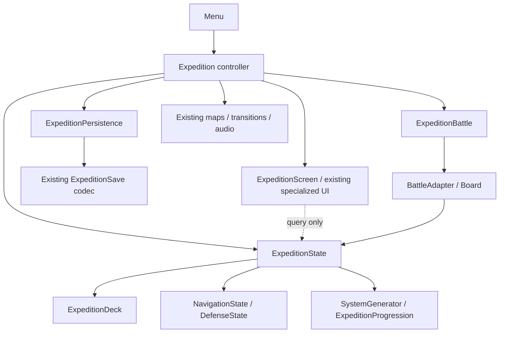

# Expedition controller composition

## Assessment before implementation

Source: main at `9a2a9b7218dda3946149aba36330f98c653777a1`. The actual controller is
`scripts/expedition.gd` (about 1,500 lines), attached to the unchanged
`scenes/expedition.tscn`. Older lifecycle documentation describes an earlier
controller and version-1 saves; the current save codec writes version 3.

- Gameplay ownership: ExpeditionState owns the run, resources, encounters, progression
  and RNGs. Its ExpeditionDeck owns cards and pending choices; NavigationState owns
  world position/target; DefenseState owns moving threats. SystemGenerator consumes
  the existing State RNG. ExpeditionProgression is already a tuning Resource.
- Creation/resume: the menu saves a candidate before handing it off through
  resume_data; direct controller entry creates and saves a candidate before replacing
  the live state. Continue decodes the saved state and optionally restarts a battle
  with its stored seed. No system regeneration happens during restoration.
- Mutations: navigation, survey, approaches, services, cards, repairs and combat
  command State. Its progress_committed signal synchronously drives autosave.
  Deck changes notify live hands through BattleAdapter before autosave.
- Combat: save the encoded pre-entry State and battle seed before prepare_battle
  consumes bonuses. Board records BattleResult exactly once; Continue synchronizes
  post-battle repairs before releasing the board. Unfinished board removal uses
  checkpoint_exit to prevent deferred damage from recording phantom results.
- Persistence: the single-slot codec owns validation, migrations, atomic replacement,
  recovery and terminal tombstones. During unfinished combat, saves use the entry
  checkpoint, not live combat state. Ended/dead runs clear the slot before considering
  the battle checkpoint. Failed writes leave the session active.
- Presentation: ExpeditionScreen, OutpostScreen, CardManagement, map/camera,
  WhiteTransition and OutcomeFlash already own controls and animations. The controller
  still constructs encounter panels and map descriptions. Phase/revision checks,
  source-bound signals and deferred-resume guards prevent obsolete work from routing.
- Platform behavior: Back opens settings, pause saves, and close saves before quitting.
  Movement sampling excludes pauses, modals and cosmetic transforms. 3D map settings
  retain touch confirmation, hold and double-tap timing. Music remains at route changes.

## Proposed boundaries

Reuse existing State/Deck/Navigation/Defense/Generator/Progression and UI components.
Do not add a progression manager or a navigation state copy.

| Owner | Responsibility |
| --- | --- |
| Expedition controller | State reference, lifecycle, routing, commands, cinematic guards, platform notifications and map integration |
| ExpeditionScreen | Existing control ownership plus encounter/reward construction and map-entry descriptions; query-only State inputs |
| ExpeditionPersistence | Save-store reference, enabled flag and pre-battle checkpoint/marker; delegates encoding and disk writes to existing codec |
| ExpeditionBattle | Live board handle, typed setup/adapter configuration, source-bound signal wiring and safe removal |
| Existing State / Deck / Navigation / Defense | All authoritative gameplay state and progression |
| Existing maps / transition / audio | Movement visuals, gestures, animation and sound |

Components receive explicit arguments; none holds a controller reference or adds an
autoload. Controller compatibility accessors forward to the single component owner.
The scene and controller callable surface remain compatible.

## Compatibility constraints

Keep checkpoint and autosave calls at their existing positions, including navigation
checkpointing before saving, pre-entry encoding/seed selection before board setup,
and terminal cleanup precedence. Preserve all RNG call sites and sequence. Do not
change save schema, migration, resource paths, generation, gameplay rules or fixtures.
Panel extraction must preserve text, styles, control hierarchy, callbacks, signal
guards and construction order. Retain public controller methods and property adapters.

## Regression plan

Existing tests cover new runs, deterministic generation/decks, movement, travel,
interception, battle boundaries, rewards/upgrades, save migration/recovery, fresh
process resume, terminal cleanup, lifecycle cancellation and touch interactions.
Add focused tests for persistence checkpoint selection/failure and presentation
query purity; retain existing end-to-end battle/lifecycle tests.

Unchanged PR CI runs:
- Python runner tests: `python3 -m unittest discover -s tools -p 'test_*.py' -v`.
- Godot editor import and all discovered headless scripts:
  `python3 tools/run_regressions.py --godot Godot_v4.7.2-stable_linux.x86_64 --workers 3`.
- Rendered regressions under GL compatibility and Mobile/Vulkan, including packed lens effects.
- Source and exported-pack startup, plus independent ship-model checks.

This work is performed via the GitHub connector because local clone access failed.
No local Godot execution is claimed. CI results and outstanding device checks must be
reported in the PR. Windows and physical Android validation remain manual unless
actually executed.
