# Faction expansion: fleet classes and strategic overview

## Fleet content and tuning

Eight standard profiles and three motherships are added in `ships/enemy/`, with corresponding native primitive scenes in `scenes/ships/`. Existing ship Resources, cards, AI implementation, rewards and progression rules are unchanged. These are provisional tuning values for new content, before existing expedition scaling:

| Faction | Ship | Class | First system | Hull / Shields | Materials / Energy / Crew | Production S/R/Q |
| --- | --- | --- | --- | --- | --- | --- |
| Scavenger | Scrap Skiff | Light | 2 | 20 / 3 | 14 / 8 / 10 | 3 / 1 / 2 |
| Scavenger | Wreckbreaker | Heavy | 3 | 40 / 9 | 14 / 8 / 10 | 3 / 1 / 2 |
| Scavenger | Clan War Barge | Mothership | 2 | 60 / 14 | 15 / 15 / 15 | 3 / 3 / 3 |
| Iron | Bastion Frigate | Light | 2 | 25 / 13 | 8 / 12 / 10 | 1 / 3 / 2 |
| Iron | Siege Monitor | Heavy | 3 | 43 / 22 | 8 / 12 / 10 | 1 / 3 / 2 |
| AXIOM | AXIOM Scout | Light | 2 | 22 / 10 | 8 / 14 / 10 | 1 / 3 / 2 |
| AXIOM | AXIOM Enforcer | Heavy | 3 | 39 / 19 | 8 / 14 / 10 | 1 / 3 / 2 |
| AXIOM | AXIOM Command Nexus | Mothership | 2 | 50 / 28 | 15 / 15 / 15 | 3 / 3 / 3 |
| Choir | Choir Spore | Light | 2 | 27 / 2 | 12 / 8 / 12 | 2 / 1 / 3 |
| Choir | Choir Guardian | Heavy | 3 | 51 / 5 | 12 / 8 / 12 | 2 / 1 / 3 |
| Choir | Choir Leviathan | Mothership | 2 | 72 / 6 | 15 / 15 / 15 | 3 / 3 / 3 |

Iron retains Sentinel Dreadnought. Other factions use that existing fallback in system 1. The original standard rosters retain their order and weights; system 1 introduces no new profile. New light/heavy pairs share their faction baseline's production and starting resources. New bosses use the existing boss production/resource baseline. New 20-card starting pools reference existing cards only: raiding/theft for Scavengers, armor/recovery for Iron, disruption/precision for AXIOM and regeneration/crew attacks for Choir. No new card, effect, signature, reward rule or enemy AI algorithm is introduced.

`ShipData.minimum_defense_system` gates standard roster selection; `FactionProfile.mothership_minimum_system` gates bosses. Catalog registration still includes every profile for save validation, regardless of current tier. A custom roster with no eligible early ship falls back to its own valid pool rather than failing generation; built-in factions always have original early-game ships.

Faction choice retains its independent `faction:v1` stream and no-repeat policy. Roster slot choices retain `faction-enemy:v1`. Historical shared-pool RNG draws remain untouched, so changes in fleet identities cannot shift PoIs, deployment, environments or other gameplay RNG. System archetype and invasion/progression policy remain separate.

## Authoritative strategic attributes

`ShipData` adds Inspector-editable `strategic_class`, `strategic_speed_multiplier`, `homeworld_damage_multiplier` and `minimum_defense_system` fields. Defaults are Medium, 1×, 1× and system 1, preserving every original profile and active legacy fleet.

| Class | Ordinary movement | Homeworld arrival damage |
| --- | --- | --- |
| Light | 1.20 × existing enemy speed | round(0.65 × base damage) |
| Medium | 1.00 × existing enemy speed | round(1.00 × base damage) |
| Heavy | 0.80 × existing enemy speed | round(1.40 × base damage) |

With base damage 20 these yield 13, 20 and 28 damage. Arrival damage rounds to the nearest integer with a minimum of 1. Motherships retain the existing stationary/reveal/advance speed and expedition-ending arrival; their class does not turn that event into ordinary damage. Missiles and player movement remain unchanged.

`DefenseState.encounter_ledger` borrows the state-owned encounter Array. It does not copy ship attributes into units or save records. `ship_profile()`, `speed_multiplier()` and `arrival_damage()` read the referenced Resource. `_speed()` remains the common source for simulation, swept interception, pursuit and temporal-rift route prediction. Generation and restore bind the same ledger, including reserve ships when they spawn.

## Models and performance

Each new `.tscn` is independently editable, preserves `Body`, `Body/Hull`, `Body/Details`, `Shield` and the existing `enemy_ship_model.gd` animation API. Models use boxes, low-segment spheres/rings and cylindrical tendrils with existing materials and shield/damage/repair shaders. There are no external meshes, generated illustrations, new shaders, lights, physics or scene-specific gameplay scripts.

The silhouettes distinguish asymmetric scavenged assemblies, layered Iron armor, angular AXIOM structures and lobed Choir hulls. Model sizes increase by class. Each assembly has at most 12 visible body mesh nodes; organic spheres use 12 radial segments/6 rings. Shields use 24 segments/12 rings. Accent materials are shared within a scene until the existing per-instance VFX initialization duplicates them. Shield-envelope checks cover every authored primitive's bounding corners.

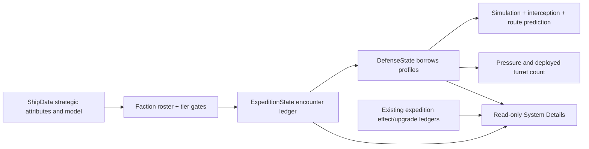

## HUD and System Details

The existing lower-left edge panel now contains a numerical Pressure label, thin normalized bar, a 44-unit System Details button and an authoritative deployed-turret counter. Existing Hull/Shield/EMP controls remain in that same panel. The bar uses green below 50%, orange below 80%, and red thereafter; numerical current/maximum values convey danger without color. It updates directly with state and adds no gameplay smoothing, clocks or per-frame effects. Critical mothership warnings and an active +50% travel indicator remain visible.

`system_details.gd` builds a detached read-only text view. `ExpeditionScreen` owns a separate instance of the existing `info_overlay.gd` component: scrolling, mouse/touch, focus, Close and Back handling reuse established UI. Opening the panel blocks map gestures through the existing input gate and never commits strategic time. It is rebuilt on opening and refreshed on progression changes while visible. No second HUD/gameplay state is maintained.

Enemy rows include only available deployed vessels with unresolved encounters. Reserves are excluded until spawned; hidden mothership identities and neutralized/secured ships are excluded. Rows show profile name, controlling faction (unassigned for historical mixed systems), class, deployment status, actual relative speed and arrival damage. Mothership rows describe their expedition-ending arrival rather than a misleading damage number.

Temporary effects show next-battle bonuses/penalties, remaining production battles, Pressure/fuel/research/extraction durations, and turret/environment previews by visible encounter. Environmental previews are labelled as current-location previews fixed at battle entry; they never assign or replace the frozen snapshot. Research/Pressure/extraction are identified as system-scoped. Persistent entries show acquired production/card upgrades, excluding baseline ship production. Current integrity, actual deployed turrets, Pressure and revealed mothership status are also available in the panel.

## Persistence and compatibility

No save schema, field name, checkpoint, migration or frozen battle-entry state changes. Existing stable enemy Resource paths identify all new profiles through `FactionCatalog.ships()`. Restore reuses those profiles, positions and reinforcement state without generation. Original ships inherit neutral class multipliers. Already saved systems retain their original fleet and boss paths even though faction definitions now include additional ships. Old Exploration pools and the shared `Ships.ENEMIES` registry are unchanged; new profiles are Defense-only.

## Verification

- `faction_expansion_test.gd`: 600 seeded faction systems (4 × 25 seeds × systems 1–6), twins, eligibility, all eight variants, all bosses, exact save roundtrips, strategic speed/damage, interception, reinforcement activation, destruction/EMP victory, duplicate result prevention and fatal mothership arrival.
- `faction_expansion_visual_test.gd`: all eleven actual combat models/decks, primitive/shield/animation checks, production overview/details at 1920×1080, 1280×720, 960×540 and 1280×573; real mouse/touch input and no-clock/no-RNG modal checks. Registered in both GL Compatibility and Mobile Vulkan suites. A 240-second bound allows all eleven combat assemblies plus four viewport/input cases on software renderers.
- `tools/faction_expansion_signature.gd`: copy unchanged into pre-feature main, run both with `-- /tmp/signatures.json`, and compare output. All 120 generated-system hashes matched after excluding only intended enemy identity/title changes. Faction IDs, counts, deployment, PoIs, navigation, environmental records and RNG states were retained in comparison. No fixture was regenerated.

Software rendering cannot establish physical Android frame rates or Windows device behavior. Recommend device checks for large-fleet model cost, long-list scrolling and timed double-tap interception. New matchups should be playtested separately for balance, especially repeated light ships in system 2 and heavy ship homeworld damage. No balance claims beyond preserved baseline values and documented new tuning are made.

## Actual production captures

Screenshots in `faction_expansion/` come directly from the running game, including unobstructed hull views obtained by hiding only the presentation shield after capturing its normal state. No artwork or screenshot content was generated or composited. Overview/details captures include a representative authoritative temporary/permanent modifier fixture and an actual purchased turret.

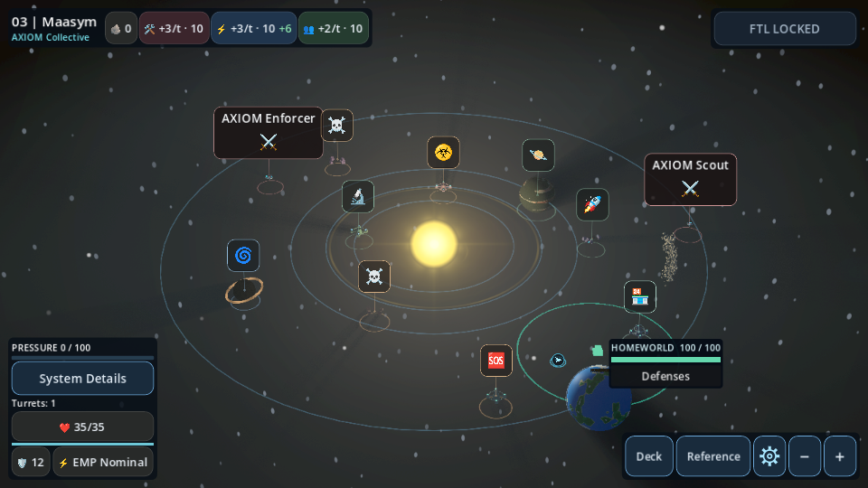
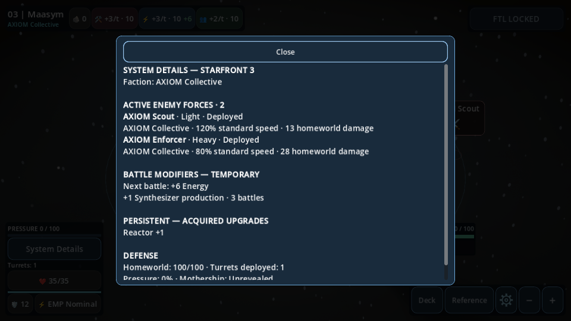

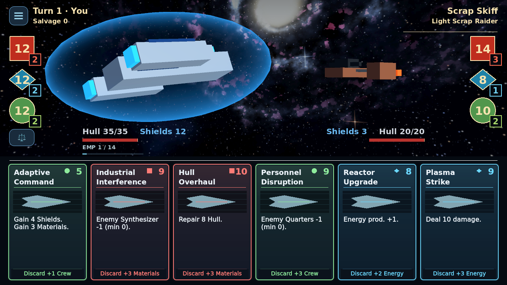

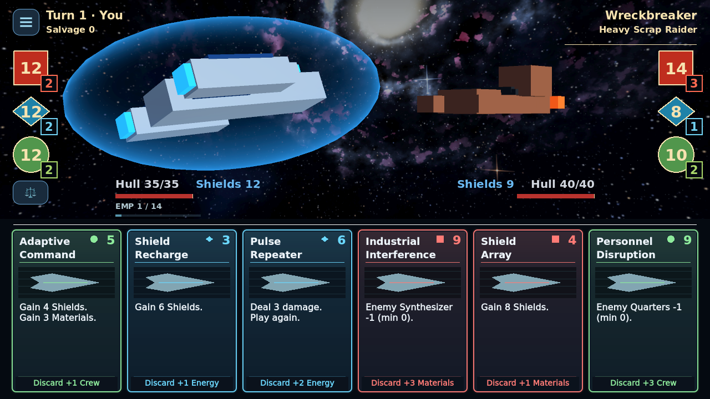

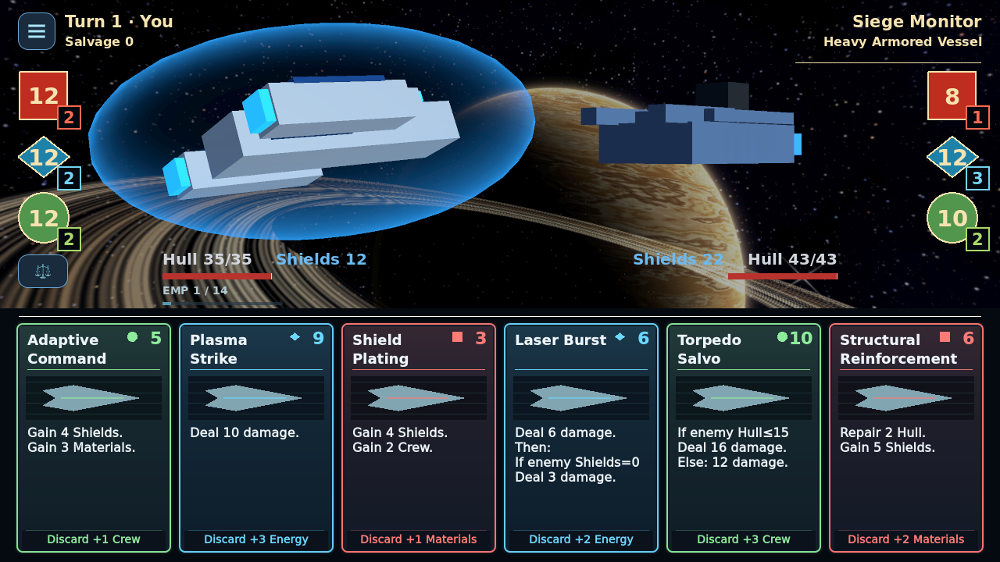

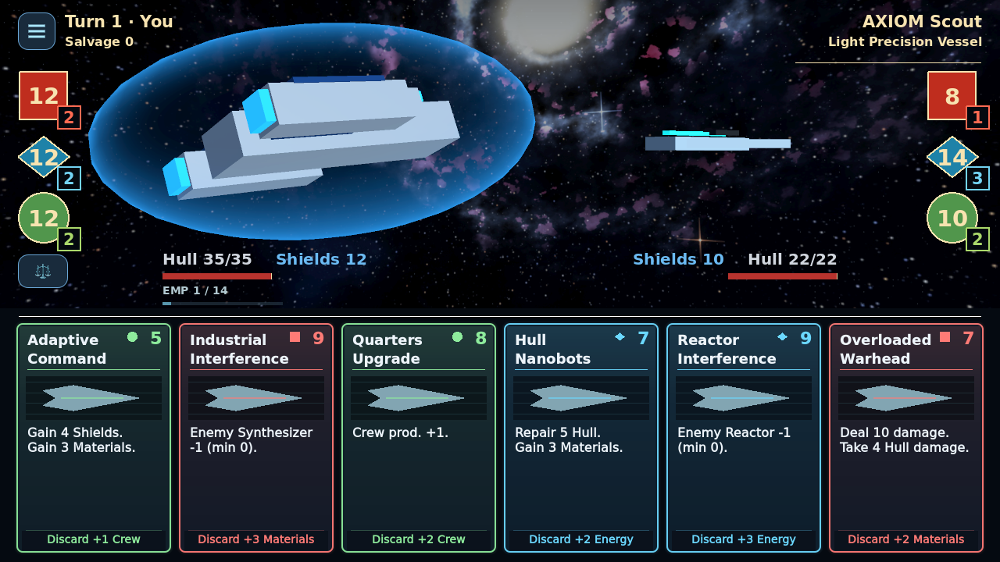

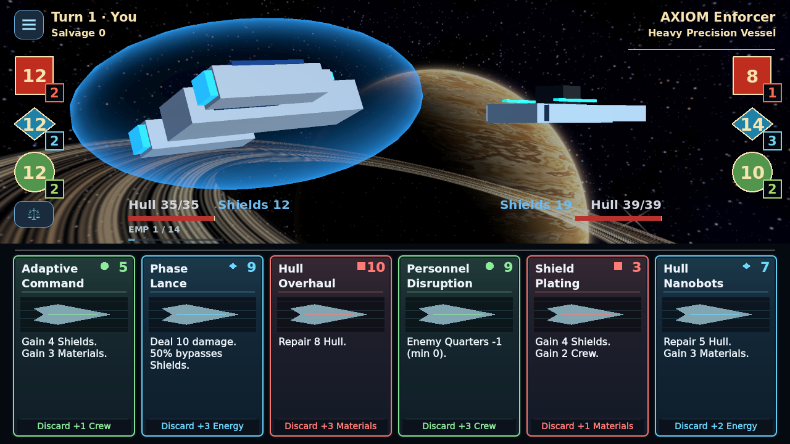

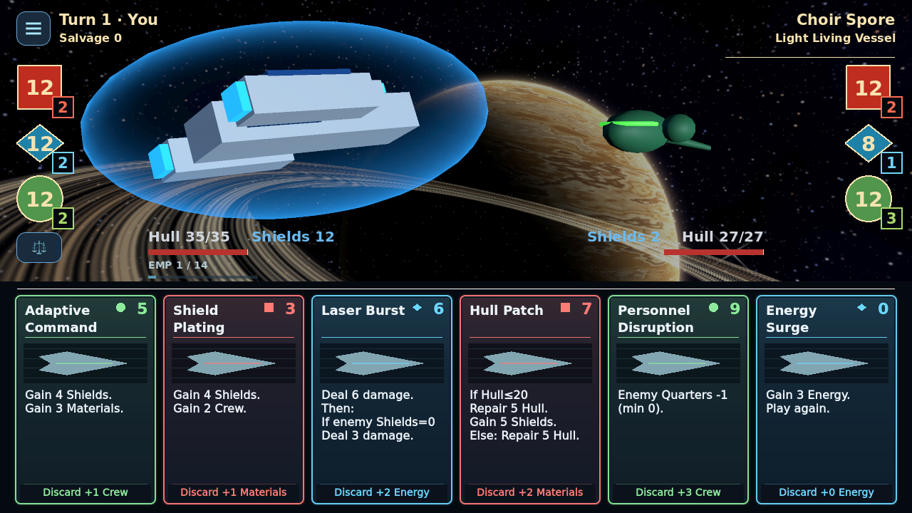

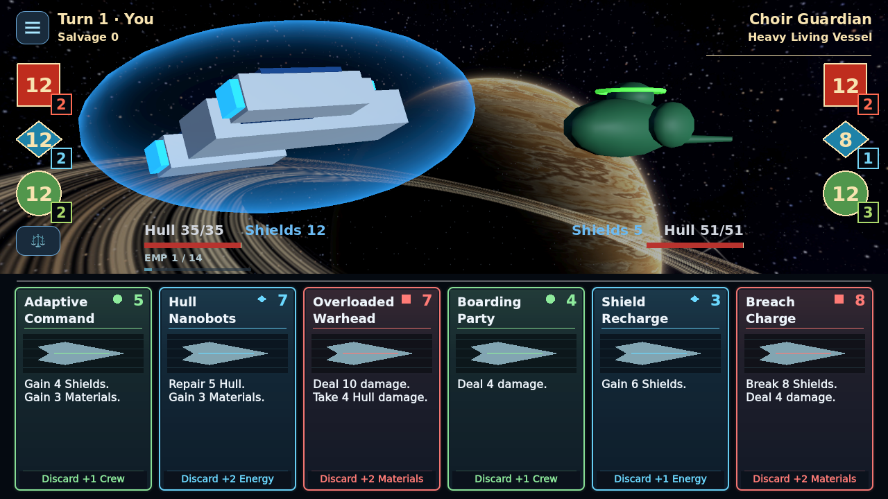

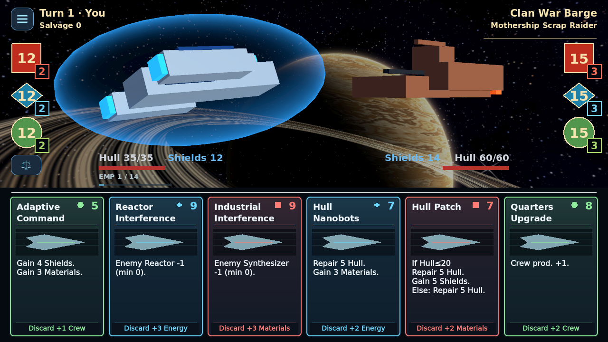

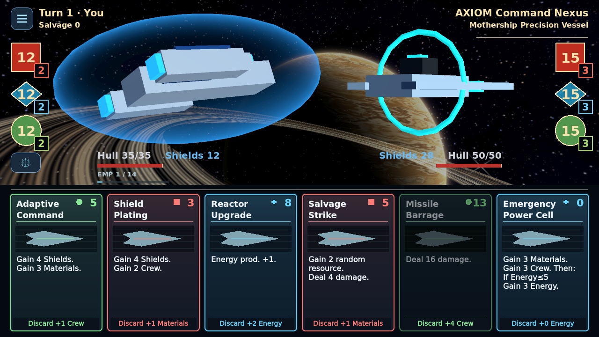

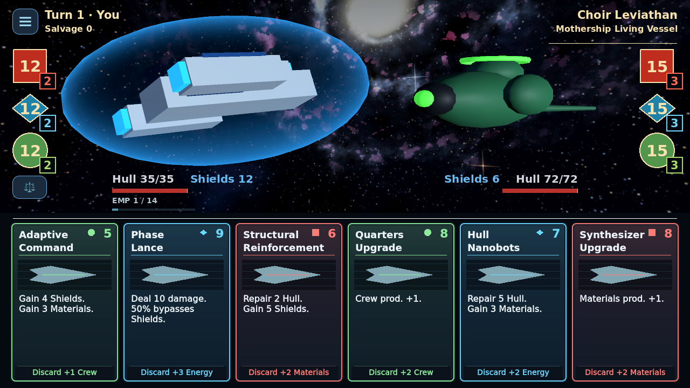

Local results: 18,698 fleet/strategy assertions passed; 14 relevant headless suites and four additional HUD/readability checks passed; The 906-check model/HUD/input matrix passed in both GL Compatibility and Mobile Vulkan; the final 911-check headless version additionally verifies successful turret purchase and restored-count refresh. The Python regression-runner tests passed 22/22. A pre-expansion main system-3 save was also loaded with identical encoded state and neutral legacy strategic multipliers.

The existing `starfront_touch_gesture_test` passes headless, but its frame-separated double-tap assertion failed in local software GL/Mobile runs; the same Mobile assertion failed on unchanged main. The new real-input expanded-fleet selection/travel checks pass in both renderers. No existing assertion, input timing or baseline fixture was changed. Device validation and the full GitHub CI matrix remain the appropriate follow-up for that existing timed test.
