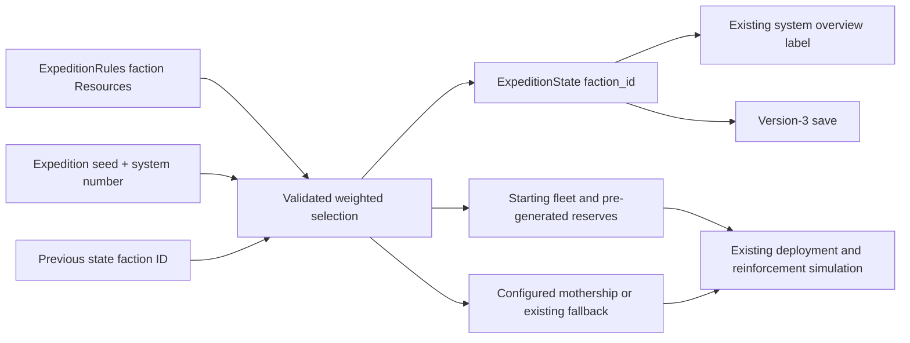
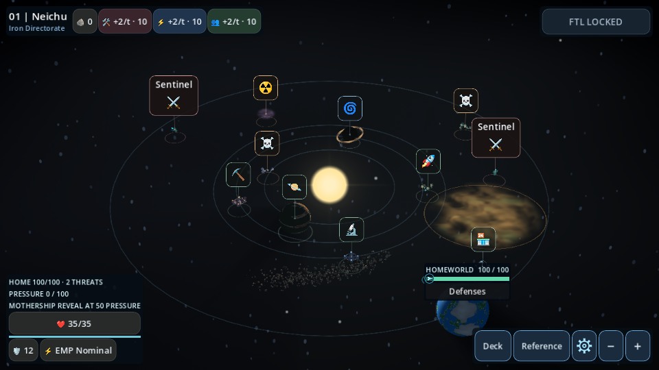

# Starfront Defense faction foundation

## Configuration and ownership

`FactionProfile` (`scripts/expedition/faction_profile.gd`) is Inspector-editable, immutable-by-convention configuration. `ExpeditionRules.factions` references the eligible profiles; the defaults are `factions/*.tres`. `ExpeditionState.faction_id` is the sole mutable owner of the controlling identity. Display names and colors come from the Resource, never from save data.

| Stable ID | Standard roster | Elite roster | Configured mothership |
| --- | --- | --- | --- |
| `scavenger_clans` | Marauder, Rustjack; Scrap Skiff (2+), Wreckbreaker (3+) | Marauder Vanguard | Clan War Barge (2+) |
| `iron_directorate` | Sentinel, Reclaimer; Bastion Frigate (2+), Siege Monitor (3+) | — | Sentinel Dreadnought |
| `axiom_collective` | AXIOM-7; AXIOM Scout (2+), AXIOM Enforcer (3+) | — | AXIOM Command Nexus (2+) |
| `hollow_choir` | The Hollow Choir; Choir Spore (2+), Choir Guardian (3+) | — | Choir Leviathan (2+) |

All entries reference ShipData Resources. Original profiles remain unchanged. The Phase 2 additions, strategic roles and HUD are documented in [faction_expansion.md](faction_expansion.md). Defense previously filtered ordinary attackers to rank 0; this policy remains intact. Elite references are a data extension point, **not a new elite spawn chance**. Limited rosters may repeat the same existing ship.

## Generation

`faction_catalog.gd` validates definitions and provides selection. Every faction is eligible from system 1; selection uses `selection_weight` and excludes the previous faction whenever alternatives exist. A single eligible faction can repeat. Missing/invalid definitions, empty rosters and invalid weights fall back to the four built-in profiles. Duplicate stable IDs use the first valid definition.

`system_generator.gd::_generate_defense()` selects one profile before creating the starting fleet and reserve encounters. All ordinary and reserve ships use its standard roster filtered by `minimum_defense_system`, weighted by existing `encounter_weight` unless a path-keyed `enemy_weights` override is supplied. Mothership selection uses a valid configured rank-2 profile once its `mothership_minimum_system` is reached, otherwise the existing `expedition_progression.gd::mandatory_boss_profile()` fallback. No unrestricted neutral/cross-faction mixing is added.



Faction choice uses a local RNG seeded from `seed_used`, system number and the `faction:v1` namespace. Ship choices use a separate local stream per faction and encounter slot (`faction-enemy:v1`). Neither touches gameplay or combat RNG. The generator still consumes each historical shared-pool enemy-selection draw at its original point. This preserves subsequent PoI, modifier, deployment and gameplay RNG sequencing. Rendering has no selection responsibility.

The industrial **system archetype** remains unchanged. **Invasion strategy** remains the existing deployment/time simulation. **Progression tier** remains the existing system-number scaling. These dimensions are independent of faction identity.

## Persistence and historical systems

`scripts/persistence/expedition_save.gd` writes an optional `faction_id` only for Defense. Version 3 and all migrations/checkpoints remain unchanged. IDs must be strings of at most 128 characters. Encounter ship paths, positions, completion state and pre-generated reserves continue to be serialized normally; loading never selects a faction or regenerates ships.

Missing IDs remain empty, including historical mixed-roster systems. Unknown string IDs are retained and their label is hidden when no matching profile exists. Both cases acquire a current faction only on the next newly generated system. Removing a definition cannot silently rewrite an active fleet. Registered faction ship/boss Resources extend the existing safe save catalog; saves still cannot load arbitrary paths. Exploration generation and save fields are unchanged.

## Adding content

1. Duplicate a faction `.tres`, assign a unique stable ID, name, description and readable accent. Add it to `ExpeditionRules.factions` (or the built-in catalog defaults).
2. Assign existing rank-0 ShipData references to `standard_roster`; no minimum roster size beyond one. Add a ship simply by extending this array. Optional `enemy_weights` keys are full Resource paths, e.g. `res://ships/enemy/marauder.tres`.
3. Set `mothership` to an existing rank-2 ShipData when a faction boss is ready. The generator needs no change. Keep IDs stable when renaming display names.
4. Future rank/elite policies can select from `elite_roster` at the same roster boundary; explicitly validate their balance separately.
5. Future faction card pools/abilities should extend faction configuration and be consumed at existing deck/battle-setup boundaries, without modifying shared ShipData at runtime. They are not implemented here.
6. Future invasion strategies belong at the deployment/reinforcement policy boundary, independent of roster selection. Future progression weights can filter/weight eligible profiles before selection, while ship scaling remains in `expedition_progression.gd`. Neither requires combining faction and system archetype Resources.

## Validation and limits

`tests/faction_generation_test.gd` exercises 120 seeded systems (20 seeds × systems 1–6), deterministic twins, exact save roundtrips, roster membership including reserves, boss resolution, no consecutive repeats, all four forced limited-roster runs, invalid definitions and legacy mixed fleets. `tests/faction_presentation_test.gd` opens the production expedition scene for all factions at 960×540 and 1280×573; it checks label visibility, input filtering and separation from map controls. It runs in both recurring rendered suites.

For baseline comparison, copy `tools/faction_generation_signature.gd` into both checkouts and run:

```sh
godot --headless --path /path/to/checkout --script tools/faction_generation_signature.gd -- /tmp/signatures.json
```

The utility hashes complete save records for the same 120 systems after excluding only the intended faction field and enemy identity/title changes. Against pre-feature main, all 120 signatures matched: gameplay RNG, encounter/deployment counts, PoIs, navigation, environments and other saved state were identical. It does not replace gameplay tests or establish a new golden fixture.

Actual production GL captures (no new artwork):




Roster grouping intentionally changes which enemies are encountered. Its balance impact should be assessed separately without altering ship statistics in this foundation pass. Physical Android and Windows device testing remains recommended; software GL/Mobile renderer validation does not replace device validation.
