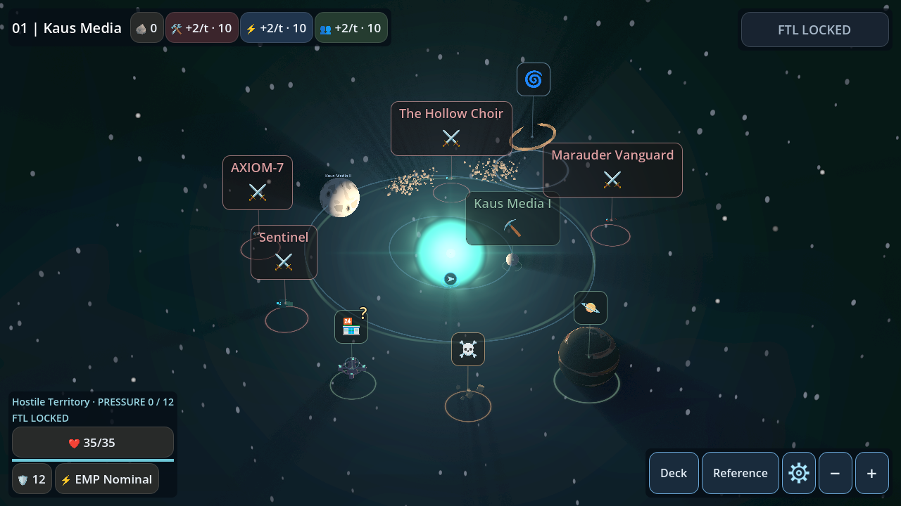
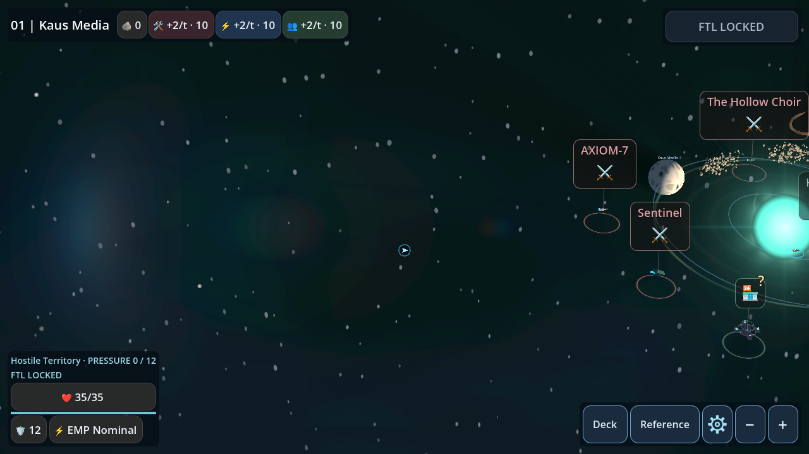
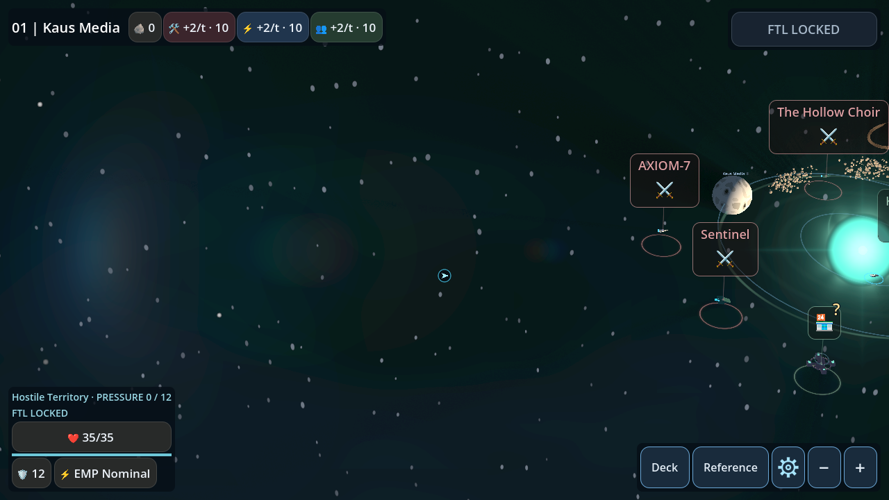
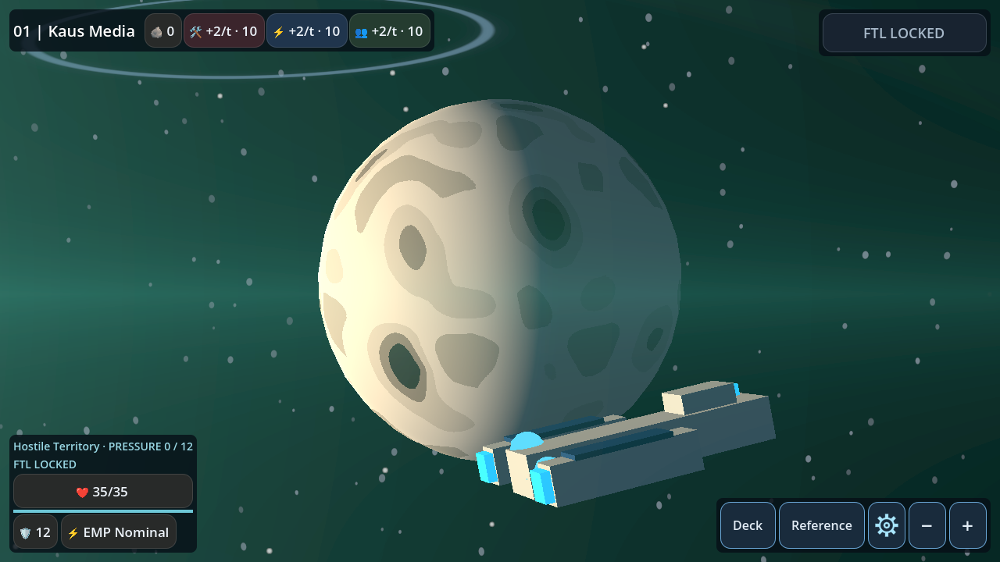
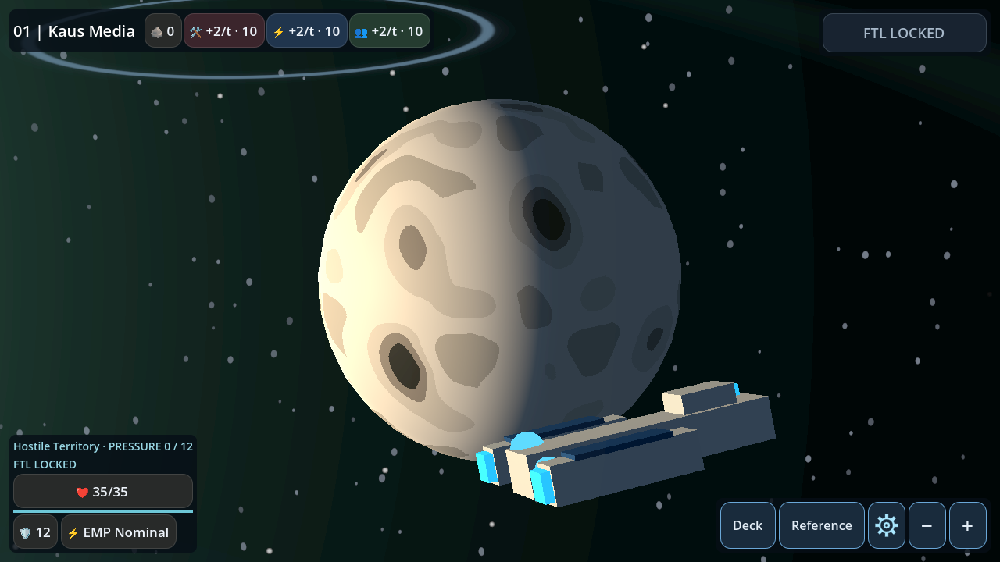
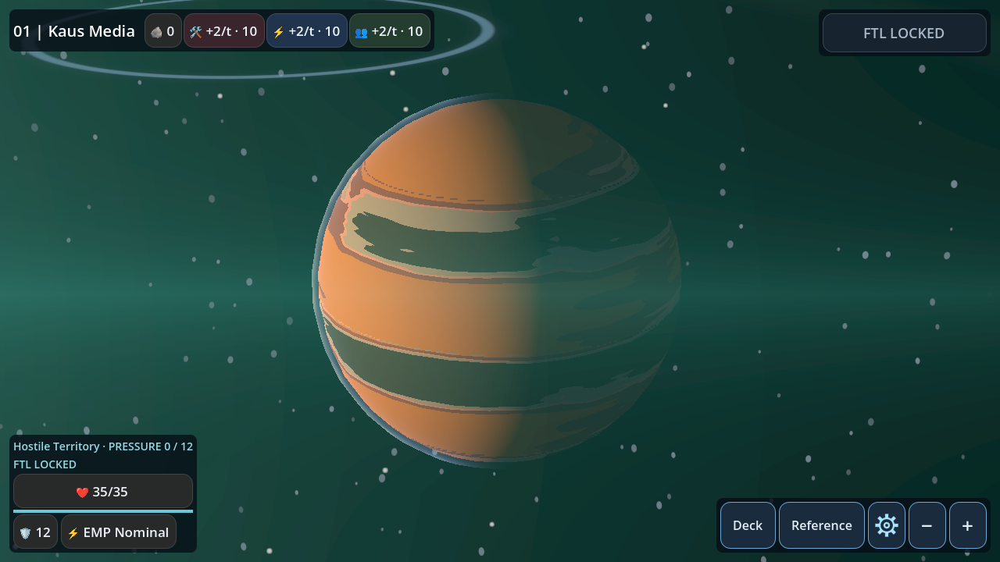
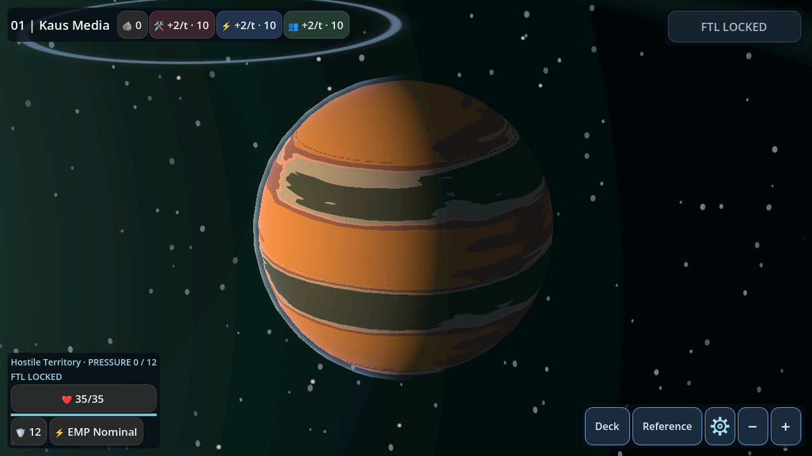
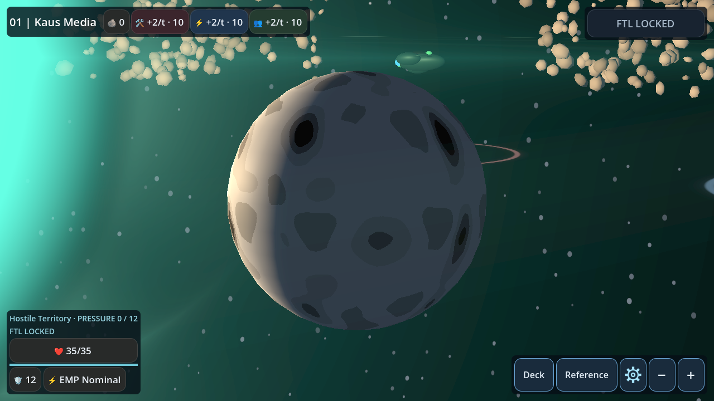
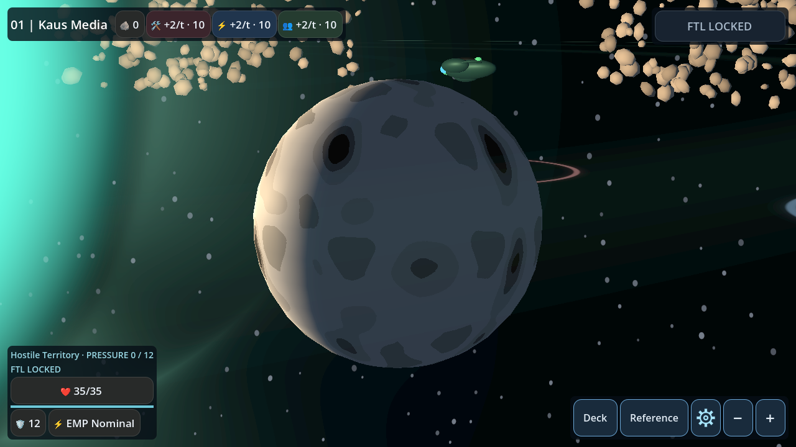

# Visual impact investigation (pre-experiment findings)

Reviewed main de58e952 and open draft PR #53 a538b86. No additional production
lighting adjustments have been selected or applied in this investigation.

## Diagnosis before selecting a solution

PR #53's centered pair is nearly identical at normal viewing size. The gas close-up
has a more noticeable color/terminator change, but this does not establish a better
normal overview. Its offscreen fixture moves almost every celestial object out of
frame: it compares predominantly empty background. That fixture cannot validate
improved planetary lighting with the sun offscreen.

The lens compute shader synthesizes sun, ghost and anamorphic terms, multiplies
them by an approximate radial depth mask, and adds the result across the frame.
It does not illuminate geometry. The compositor has no local atmospheric density,
planet-relative scattering distance or material identity. Its broad colored lift
can cover foreground planets, explaining the green veil in the gas close-up.
The adapter correctly disables this optical contribution when the source leaves
the viewport. Surface illumination remains world-directed; losing the compositor
is not equivalent to losing the actual stellar light.

PR #53 changes rocky day gain to 1.10, gas/cloud gain to 1.06 and contrast to 1.28.
These are modest albedo multipliers on objects occupying small areas of an overview.
They cannot reproduce frame-scale rays, ghosts, color layering and depth cues.
Its directional limb-opacity change is useful for reducing a face-wide atmospheric
veil, but the proposed sun whitening/corona and contrast tweaks do not, by themselves,
meet the stated ordinary-size offscreen visual acceptance criterion.

## Alternatives to evaluate

- More scalar gain/contrast: reject as the primary approach; it risks crushing night
  detail or clipping the sunward side without adding spatial structure.
- Always-on optical flare or camera fill: reject; wrong physical dependency.
- Strong rim on every object: reject; artificial outlines and unrelated halo clutter.
- Local, depth-aware atmospheric scattering on atmospheric bodies: promising, but
  must be evaluated on screen-visible planets with the star genuinely offscreen.
- Better surface-scale structure/roughness and resolved limb silhouette: promising
  for local readability, but requires art/shading work rather than another global
  contrast adjustment. Rocky bodies should not receive invented atmospheric shells.

A lens-on/lens-off ablation with identical camera/material/light state follows.
This is diagnostic evidence, not a claimed improved rendering implementation.

## Experimental correction and chosen fix

The initial green-veil hypothesis was incomplete: disabling the lens compositor
changes the centered overview dramatically, but does NOT remove the close-up gas
veil. Hiding only the sun billboard removes it; hiding only sky decorations does
not. Thus two bottlenecks coexist: the cinematic centered overview is dominated
by screen-space optics, while the close-up veil comes from the large transparent
sun billboard and its broad corona crossing the visible image when the source is
offscreen. This distinction was established before changing production rendering.

Chosen correction: map-only source visibility for the billboard's optical corona
and streaks. Project the actual star center in the vertex shader, compute distance
to the nearest viewport boundary, and smoothly attenuate only the corona/streak
terms over normalized edge distance -0.03 to +0.04. The opaque physical disc,
centered appearance, actual illumination and lens compositor remain intact.
Behind-camera sources produce no billboard optical term. Shared menu/battle users
default to the old behavior through map_corona_visibility=false.

This is not more contrast or atmospheric opacity tuning. It removes a diagnosed
foreground optical wash without increasing lights, exposure or material emission.
No new pass, texture, light, geometry, shadow map or per-frame CPU work is added.
Existing PR #53 directional limb opacity is retained; its scalar gains are not
claimed as the source of the perceptible improvement. No further scalar gain has
been stacked on it. Solar interference shaders/geometry and physical star radius
are untouched.

### Visual assessment and limits

The corrected gas close-up is visibly different at ordinary 1280x720 size: orange
bands and the dark hemisphere separate from a dark background instead of a green
screen-wide wash. The centered overview remains effectively unchanged. The empty
legacy offscreen fixture remains uninformative; use the planet close-up comparisons
for offscreen-source object assessment. This does not make a mostly empty starfield
cinematic or add surface detail to low-resolution procedural palettes. Large-world
compositional hierarchy still depends on object size and content; no camera or
layout changes are proposed. Physical Android performance is unmeasured.

### Exact files changed in this follow-up

- menu_sun.gdshader: map_corona_visibility opt-in; source_visibility varying;
  projection and smoothstep(-0.03,0.04,edge); multiply only corona and streak alpha.
- star_map_3d.gd: enable the map-only shader flag.
- Lighting regression: require map opt-in. Existing assertions remain in place.
- tools/lighting_lens_ablation.gd: reproducible on/off/no-sun/no-sky experiments.

The before side below is the exact open PR #53 rendering, not a simulated reversal.
The parent main comparisons remain in its original gallery. Both sides use the
same capture harness, seed 1042, 1280x720, camera transforms and renderer settings.
Windows Mobile was explicitly run with --rendering-driver vulkan. PNGs are original
renderer output and have not been manipulated. Procedural shader TIME remains live;
small cloud/band/background animation differences must not be mistaken for lighting.

| View (Mobile Vulkan) | PR #53 before | Corrected |
|---|---|---|
| Centered |  |  |
| Edge |  |  |
| Rocky terminator |  |  |
| Gas giant |  |  |
| Multiple objects/dark background |  |  |

GL equivalents and diagnostic ablations are in the same screenshot directory.
Full regression/CI status is recorded in PR #53; passing tests alone do not establish
that every overview meets the art-direction goal. The remaining empty-frame and
procedural-detail limitations above are intentionally not marked solved.
