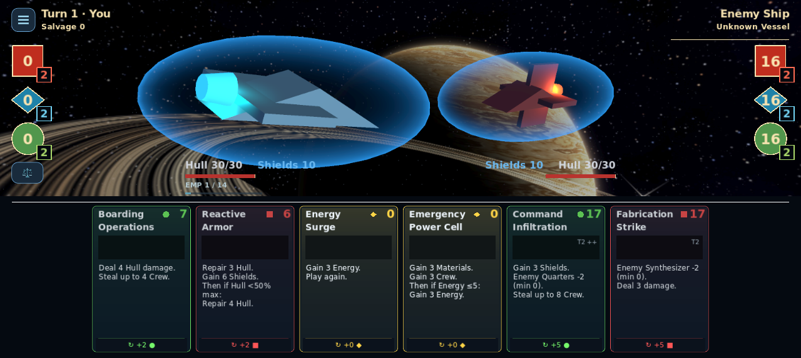
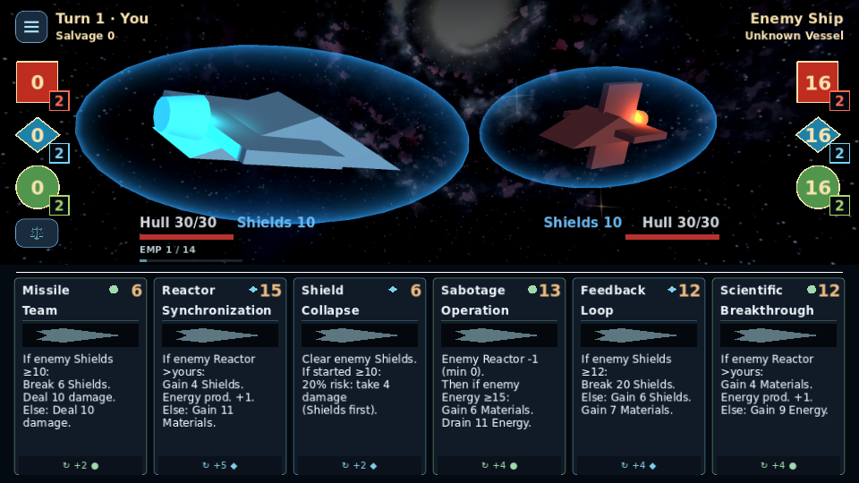

# Minimal Mobile cards

The shared card scene remains **198 × 294**. Six-slot hand spacing, scaling,
placement, motion, hold gestures and discard eligibility are unchanged. This pass
changes card presentation and display copy; no card definitions, combat rules,
RNG streams, save data or artwork assets change.

## Shared template

| Region | Base coordinates / typography |
|---|---|
| Name | x12–186, y8–62; bundled DejaVu Sans Bold 18 |
| Cost | upper right, bold 25; original resource polygons beside it |
| Art | x12–186, y68–104; existing art or primitive placeholder |
| Effects | x13–186, y112 onward; shared medium 16, line spacing 0 |
| Discard | bottom 28px visual strip, shared 14; original full-width Button |

The first title line reserves 126px before the resource/cost corner; the second
uses the full width below it. Titles retain their natural case. No card gets an
individual font reduction. The small artwork band gives the rules more room;
optional textures retain aspect-cover rendering and existing placeholders remain.
Family accents use coral, cyan and green with the existing square, diamond and
circle vocabulary. Text stays neutral, high contrast and left aligned.

The discard face displays `↻ +N [resource symbol]`, with its full resource name
in the tooltip. It uses the same `floor(cost / 3)` calculation as combat. Its
original 44px screen-space hit area remains intact, including the space above the
slim visible strip. There is no additional discard control. An unaffordable card
keeps readable rules and a usable discard button; its cost turns amber and its
artwork softens. Selection changes an inset outline and existing artwork tween,
never the hand geometry. Tier/upgrades remain visible without continuous border
animation. Bundled fonts include their redistribution license and avoid
platform-dependent wrapping or missing symbols.

## Accurate compact copy

`scripts/ui/card_face_text.gd` formats the actual card effects, including upgraded
and modifier-preview resources. It replaces the unused length-threshold summary
formatter. Written descriptions and full `CardData.describe_effects()` inspection
remain unchanged. Every face uses gameplay data even when old prose is short.

The resolver's ordering matters: base effects happen before conditional branches.
The face uses **Then if** when appropriate and never factors common damage or
repair out of branches. It preserves strict/inclusive thresholds, enemy/own
comparisons, relative Hull capacity, random ranges and excluded resource families,
bounded theft, production floors, full Shield bypass, Hull-only versus absorbed
self-damage, backlash probability and replay actions. `prod.` means production;
**Drain** removes enemy reserves, **Steal** transfers up to the available amount,
and **Break Shields** targets enemy Shields. Full inspection retains all three
upgrade levels and the existing temporary combat preview.

PR #37 was reviewed, not merged or cherry-picked. Its data-driven effect grouping
and semantic categories informed the formatter; its nested panels, scrolling card
face, 10px text and optional external icon package were superseded. Existing
resource-symbol mappings are reused. There are no new decorative input layers,
new artwork, per-card lights, shaders or animated particles.

## Validation and reproduction

Use Godot **4.7.2**. The new tests are discovered by the headless runner; both
rendered suites explicitly include the layout and production-hand tests. Mobile
also runs the existing complete inspection test. CI uploads their captures and
audit reports with the usual test logs.

```sh
python3 tools/run_regressions.py --godot GODOT_4_7_2 --script card_face_text_test --script minimal_card_layout_test --script discard_test --script card_effect_parity_test
xvfb-run -a python3 tools/run_rendered_regressions.py --godot GODOT_4_7_2 --renderer gl_compatibility --script minimal_card_layout_test --script minimal_card_hand_test --script card_inspection_test
xvfb-run -a python3 tools/run_rendered_regressions.py --godot GODOT_4_7_2 --renderer mobile --script minimal_card_layout_test --script minimal_card_hand_test --script card_inspection_test
```

The layout audit instantiates all **80 cards × 3 upgrade states**, measures actual
Godot Label shaping, checks complete names/cost separation, glyph availability,
resource identity, exact refunds, body/footer clearance and unmodified base size.
It tests the original 960px hand scale as well as scale 1, including the larger
local footer hitbox required to preserve its physical size. **5,244 checks pass**;
the longest body is six lines / 114px, within the tightest measured 116.5px area.
The [complete 240-variant report](minimal_mobile_cards/layout-audit.json) records
every identity, upgrade state, displayed effect text and measured height.

The real `board_3d.tscn` test checks 1920×1080, 1280×720, 960×540 and 1280×573,
selection geometry, native touch hold, full inspection, keyboard/controller
inspection, and mouse/native touch discards through the original hit area. It
checks the actual refund and unchanged state/RNG during presentation. Existing
combat parity retains **2,220 exact baseline checkpoints** without fixture edits.
Legacy visual tests now assert the new exact template and refund text, while
retaining their gameplay and input assertions.

The screenshots below come from the production battle renderer, using actual
definitions and deliberately empty player reserves to demonstrate unaffordable
cards. Zero-cost cards correctly stay playable. No mockups are used.

| View | Capture |
|---|---|
| GL, complete six-card hand, 1920×1080 | [Image](minimal_mobile_cards/gl_compatibility-hand-1920x1080.webp) |
| GL, three resource families, 1280×720 | [Image](minimal_mobile_cards/gl_compatibility-hand-1280x720.webp) |
| GL, minimum requested viewport | [Image](minimal_mobile_cards/gl_compatibility-hand-960x540.webp) |
| GL, six complex Upgrade II cards | [Image](minimal_mobile_cards/gl_compatibility-complex-upgrades-960x540.webp) |
| Selected card, stable positioning | [Image](minimal_mobile_cards/gl_compatibility-selected-conditional.webp) |
| Existing full inspector | [Image](minimal_mobile_cards/gl_compatibility-inspected-upgrade.webp) |
| Mobile Vulkan, Android-shaped viewport | [Image](minimal_mobile_cards/mobile-hand-1280x573.webp) |
| Mobile Vulkan, complex upgraded effects | [Image](minimal_mobile_cards/mobile-complex-upgrades-960x540.webp) |




Rendered verification uses Mesa software GL/Vulkan on Linux, not a physical Android
device. Physical phone readability, touch comfort and GPU performance still need
device review. The implementation introduces no per-frame card rebuild; the new
work is shared font shaping and event-driven copy/style updates. This is not a
claim of measured Android frame-time improvement. See the PR for full run results,
timeouts/retries and GitHub CI status.
