# Modifier battlefield environments

All seven modifier scenes retain `Camera3D`, `MeshInstance3D`, `PlayerShip`,
`EnemyShip`, `Sun` and `RimLight`. Deep Space and Planetary Orbit are unchanged.
No modifier/card rules, damage, AI, strategic time, generation, rewards, saves or
production cinematic settings were changed.

## Construction

`EnvironmentGeometry` uses `scripts/presentation/modifier_environment.gd` to
construct scenery once when its scene enters the tree. `environment_meshes.gd`
provides low-poly rocks, instancing, curved tubes and industrial wreckage meshes.
The scene's exported `environment_kind` chooses its construction. Metal and
Psionic still inherit Ion's existing combat scaffold, but override this selector
before `_ready`; they never construct the Ion clouds/lightning.

| Scene / kind | Middle distance and foreground | Additional draw nodes* |
| --- | --- | --- |
| `battlefield_asteroid_belt.tscn` / asteroid | Instanced irregularly scaled rocks, three distant pockets, three larger formations; original six visible editable drifting rocks retained farther behind combat | 5 + original 6 |
| `battlefield_ion_storm.tscn` / ion | Three faint cloud banks at different depths, three asynchronous tubular discharges, glowing discharge endpoints and sparse charged concentrations | 8 |
| `battlefield_solar_flare.tscn` / solar | Stationary distant spherical stellar limb, three plasma loops and three radial plasma streams | 7 |
| `battlefield_nebula.tscn` / nebula | Four fixed world-space cloud sheets with varying depths, tilts, colors, density and an irregular denser knot | 4 |
| `battlefield_temporal_rift.tscn` / rift | Animated spatial opening, five broken gold/blue arcs at differing depths/tilts, suspended fragments | 7 |
| `battlefield_metal_storm.tscn` / metal | Instanced hull plates, bent girders, broken rectangular frames and a larger abandoned hull section | 4 |
| `battlefield_psionic_storm.tscn` / psionic | Three differently oriented energy rings, geometric shards, large luminous monoliths and restrained magenta haze | 8 |

\* Scenery nodes, excluding the existing ships/sky. Each MultiMesh group is one
instanced draw; shared mesh/material construction avoids one Node per fragment.
No environment adds a light, shadow map, collider, viewport or compositor pass.

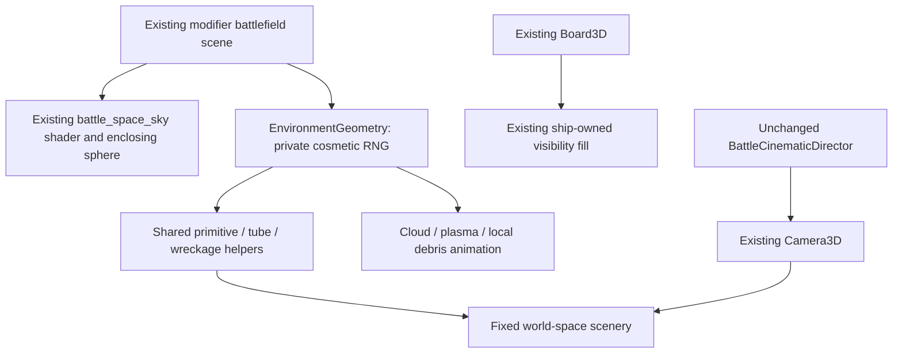

## Depth and composition

Every modifier sky now uses the existing direction-sampled `battle_space_sky`
shader on a 600-unit enclosing sphere, matching the standard arenas' established
approach. Its opaque depth writes preserve transparent beam rendering; foreground
hulls still occlude beams. The authored-camera panorama basis is frozen once.
Existing panorama textures are reused (the previously procedural asteroid/solar
backdrops reuse the project's existing spiral-galaxy panorama).

Scenery is placed in an authored-camera frame centered on the combatants. That
frame remains fixed while the camera moves. Most middle-distance elements are
32–110 units behind the fight; distant pockets/clouds extend to about 190. The
star has radius 38 at local `(-30, -3, -102)`. The rift opening is at `(15, 5, -64)`.
World-space cloud sheets retain their initial orientation, rather than rotating
with the active camera. Parallax and occlusion therefore change naturally across
intro, impact, destruction and orbit shots.

Repeated objects use one private `RandomNumberGenerator` seeded by the scene's
`scenery_seed`. No gameplay/combat/environment-generation RNG is read. Objects
near the player's +X departure corridor are displaced vertically at construction;
fragment shaders never translate their origins into the fight. The old asteroid
drift interface/count/wrapping remains intact. Camera choreography is untouched.

## Lighting and animation

Authored Sun/RimLight colors establish each scene's identity: subdued neutral,
cool cyan/violet, warm solar, diffuse nebula, contrasting gold/blue, cold metal,
and purple/magenta. The Solar Sun's energy is 2.1. The remaining authored light
energies are retained.

A small Board3D capability check enables its **existing** two isolated,
shadowless hull-visibility fills when `EnvironmentGeometry` is present. Each
fill affects its own hull layer only, with the existing 2–5.5-unit range. Standard
arenas keep their previous fill behavior. The unchanged fragmentation lifecycle
hides each destroyed ship's fill with its hull; scenery stays independently lit.

- Asteroids keep their existing local drift/rotation script.
- Ion/Nebula clouds reuse `space_storm.gdshader` with low material density.
- `battle_environment_energy.gdshader` supplies slow, bounded pulses. Electrical
  arcs have independent phases and a roughly 29-second cycle, without strobing.
- `battle_stellar_surface.gdshader` uses two bounded 3D noise scales on the actual
  sphere, with limb darkening and slow surface drift; no ray marching.
- `battle_wreckage.gdshader` slowly rotates individual fragments locally by at
  most 0.2 radians. Their centers remain fixed.
- The existing rift shader animates the opening; psionic geometry adds at most
  0.04 local units of vertex displacement, not screen-space distortion.

There is no new per-frame mesh, material or scene-node construction. Environmental
animation uses shader time and never advances gameplay or strategic clocks.

## Tuning

Select `EnvironmentGeometry` in a modifier scene:

| Inspector property | Default / purpose |
| --- | --- |
| `environment_kind` | Scene-specific builder; inherited Metal/Psionic override it |
| `scenery_seed` | Fixed per-scene deterministic visual variation |
| `instance_budget` | 72; limits repeated small pieces |
| `cloud_opacity` | 0.18; low-density cloud material baseline |
| `motion_scale` | 1.0; energy pulses, stellar surface and debris motion |
| `android_density` | 0.55; visible fraction of distant small instances |
| `reduced_density` | Preview Android's count reduction on desktop |

These parameters build once; restart the scene to preview changes. Large
landmarks/cloud layers remain on Android, while instanced small-object counts
use a deterministic prefix. Clouds retain their existing shader's animation
rate. The original asteroid group exposes its existing count, drift and spin
controls separately. Landmark shapes/positions live in the named builder
functions; keep departure clearance and camera audits passing when tuning them.

The immutable CPU transform metadata on instanced groups supports clearance and
determinism audits. Godot's headless dummy renderer does not preserve queried
MultiMesh transform buffers; the same construction values are uploaded to the
real renderer. This metadata is scene-local presentation data, never save data.

## Validation

`tests/modifier_environment_test.gd` uses the production board for all seven
modifier IDs with light, heavy and mothership profiles. It checks:

- Deterministic geometry, no global RNG consumption and reduced Android counts.
- Shadowless scenery without colliders/lights; distinct Metal/Psionic node trees.
- Intro/flyby/attacker/victim/orbit positions and motion against actual mesh bounds.
- The existing three-shot intro, attack pan, destruction HUD and departure/fade.
- Combat state/RNG and ship anchors unchanged; default camera and UI restored.
- Actual beam pixels over each environment and opaque foreground occlusion.
- Hull-fill shutdown through the existing destruction lifecycle.
- Six-card hand geometry at 1280×720, 960×540 and 1280×573.

The existing cinematic test's old “modifier fills must be absent” assertion was
updated to the intentional new contract: bounded ship-owned fills plus preserved
shadowless authored directional lights. No baseline fixtures, combat expectations
or cinematic timing parameters were changed.

The first full CI run exposed two further obsolete test contracts: the depth
suite required all seven modifiers to retain flat UV quads, and the storm
presentation suite required the old panorama shader. The updated tests verify
direction-aware enclosing skies, opaque depth writes, fixed world geometry and
panorama orientation, plus rendered translation/rotation/seam behavior for every
modifier. Metal/Psionic checks also require their distinct constructed geometry
and absence of Ion clouds/lightning. Custom legacy quad projection remains
covered by an isolated scene instance. Existing standard-arena, combat, card,
HUD and timing assertions remain intact; no fixtures were changed.

Local Godot 4.7.2 checks include the new headless/GL Compatibility/Mobile Vulkan
suite, existing battlefield environment integration, cinematic/departure suites,
GL beam-depth pixels, combat trace/state, asteroid snapshot and storm parity.
The new test is registered for both rendered matrices with a 360-second software
rendering budget and measured scheduling costs (30 seconds headless, 205 GL,
239 Mobile). The full GitHub matrix is requested with the PR and left unmonitored. Pending CI
is not claimed passed. Physical Windows/Android hardware performance has **not**
been measured; GL/Vulkan captures use Mesa software rendering. Review cloud
fill-rate, solar HDR/contrast and industrial silhouettes on target phones.

```sh
python3 tools/run_regressions.py --godot godot --script modifier_environment_test
python3 tools/run_rendered_regressions.py --godot godot --renderer gl_compatibility --script modifier_environment_test
python3 tools/run_rendered_regressions.py --godot godot --renderer mobile --script modifier_environment_test
```

## Actual production captures

Full stage/size matrices are generated under `.godot/testlogs/modifier-environments`
and included in CI artifacts. The committed gallery uses identical normal camera
framing and the same enemy profile; these are Godot renders, not concept images.

| Asteroid Belt | Ion Storm |
| --- | --- |
| 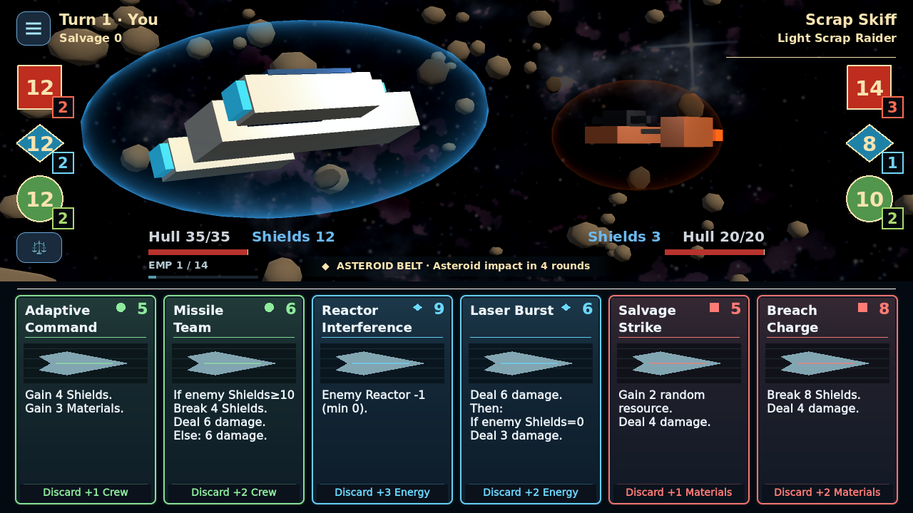 | 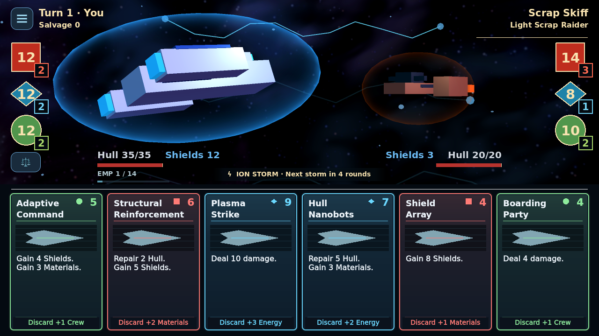 |
| Solar Flare | Nebula |
| 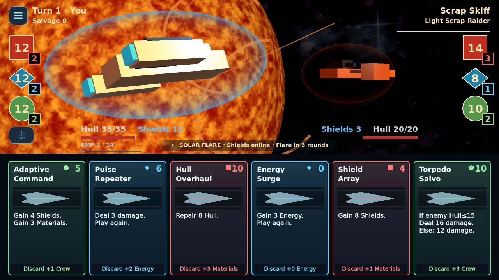 | 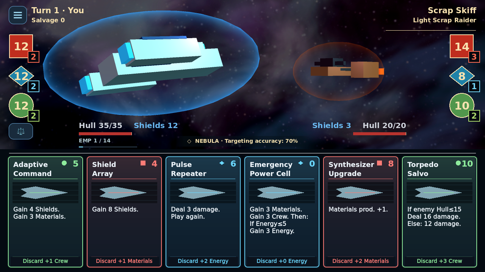 |
| Temporal Rift | Metal Storm |
| 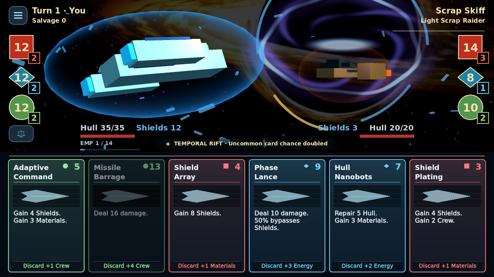 | 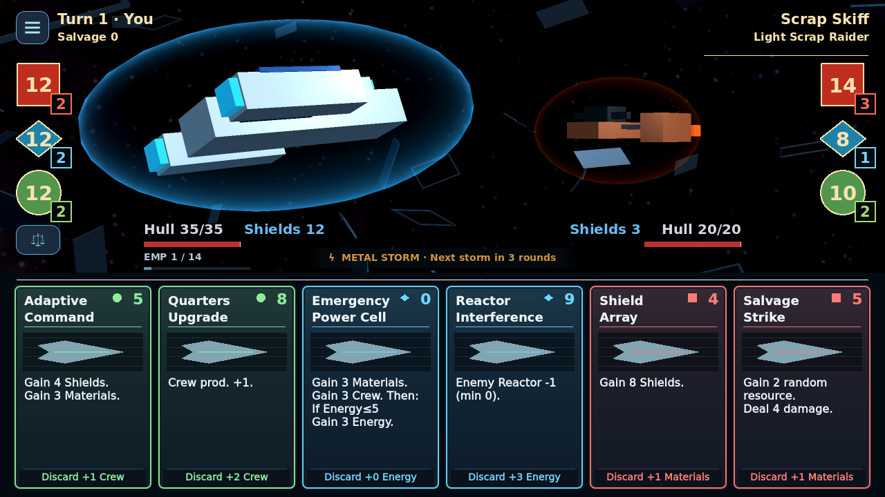 |

### Ion / Metal / Psionic comparison — Mobile Vulkan

| Electrical clouds | Industrial wreckage | Geometric anomaly |
| --- | --- | --- |
| 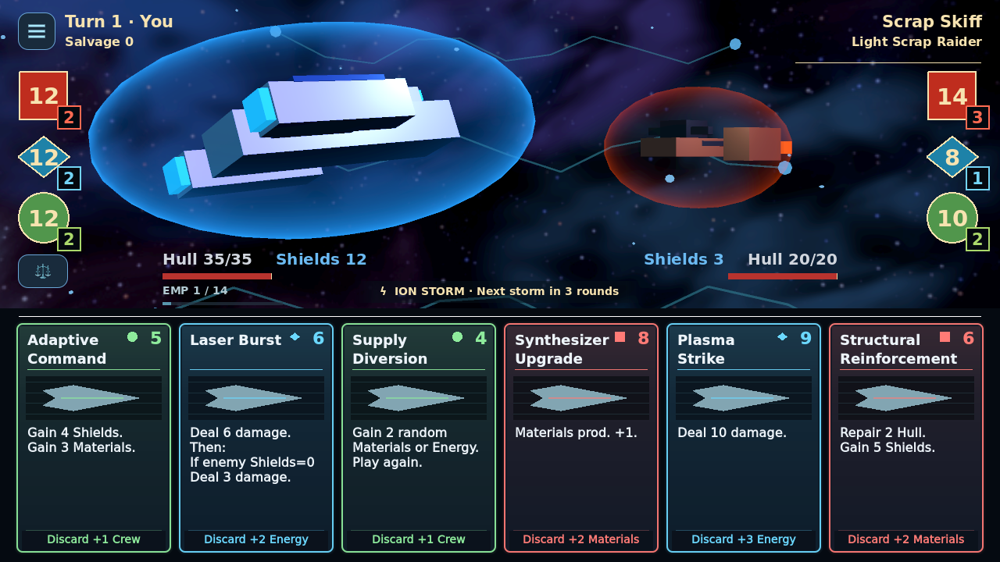 | 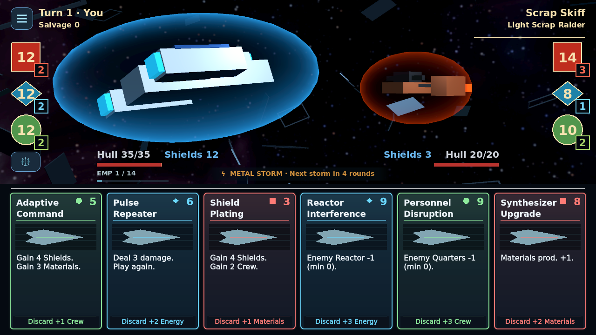 | 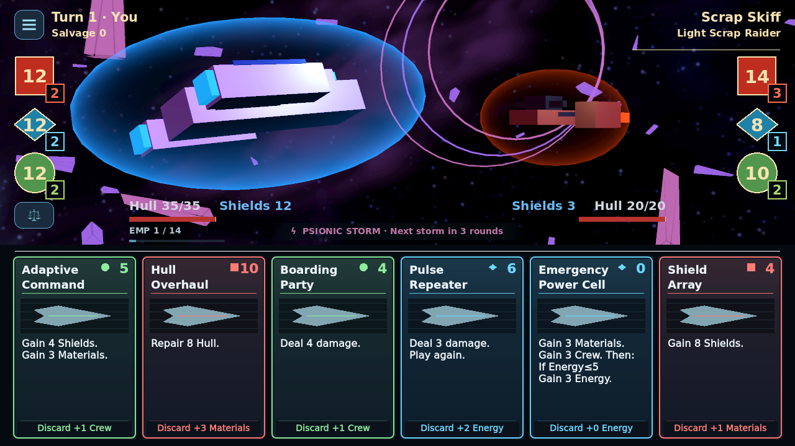 |

### Representative cinematic and Android framing

Close-ups use the production director's authored camera poses. The automated
case separately executes the actual intro, pan, destruction and departure in
motion, with test-only duration compression and unchanged production settings.


| Solar flyby | Rift victim framing |
| --- | --- |
| 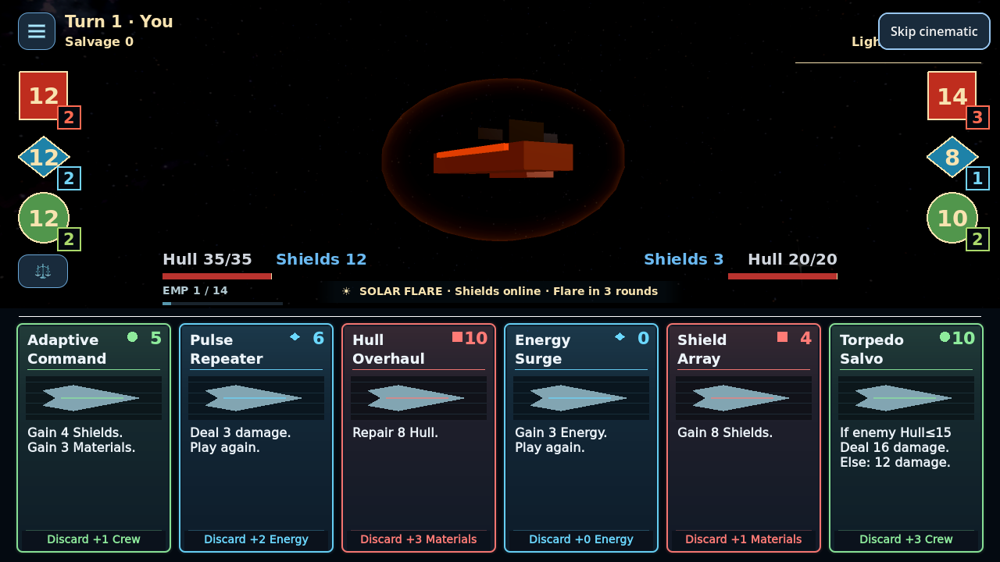 | 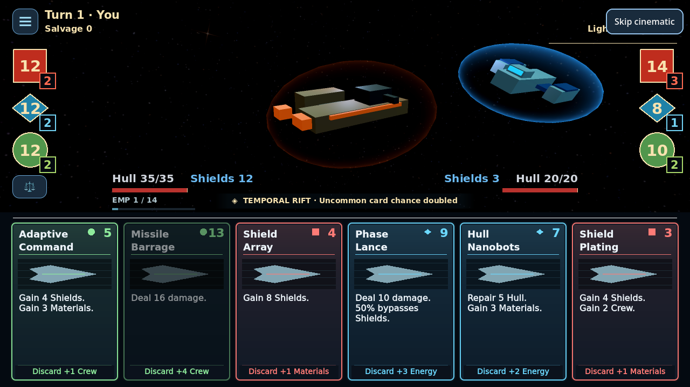 |
| Metal flyby | Psionic victim framing |
| 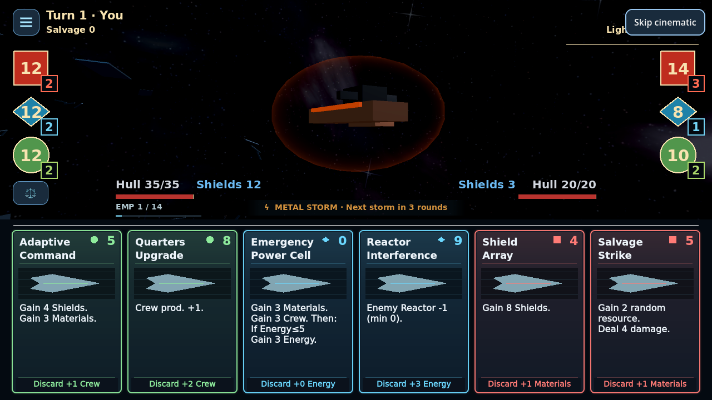 | 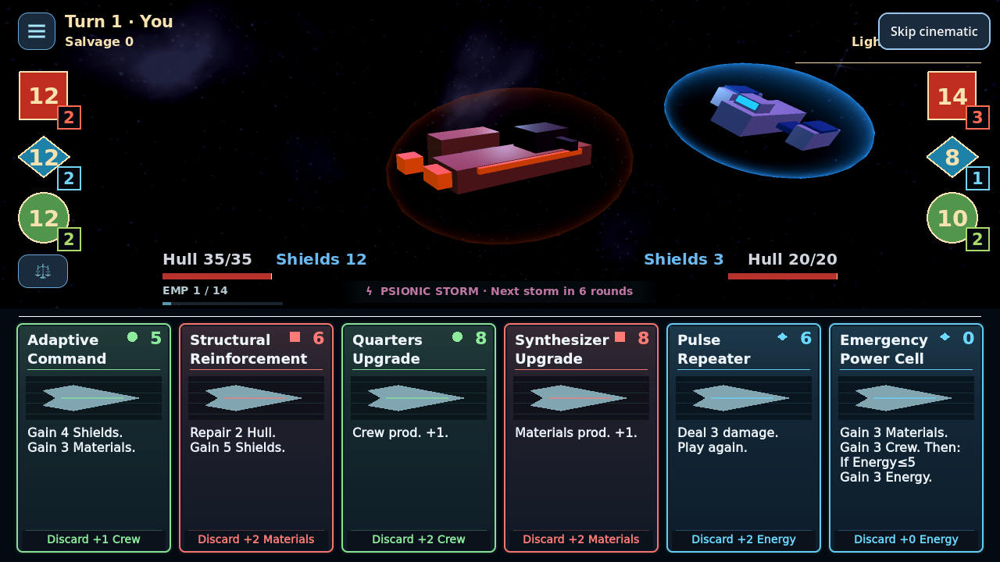 |
| Solar, 960×540 Mobile | Nebula, 1280×573 Mobile |
| 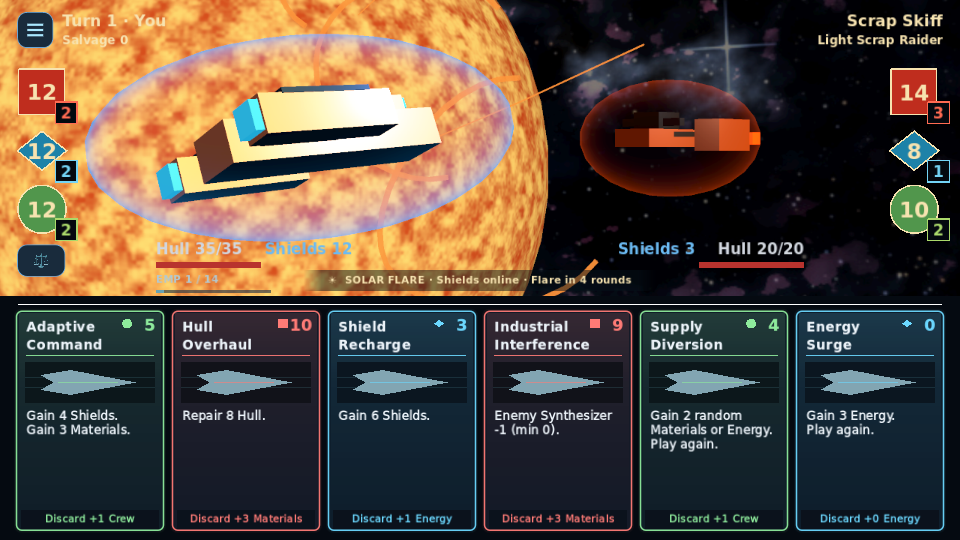 | 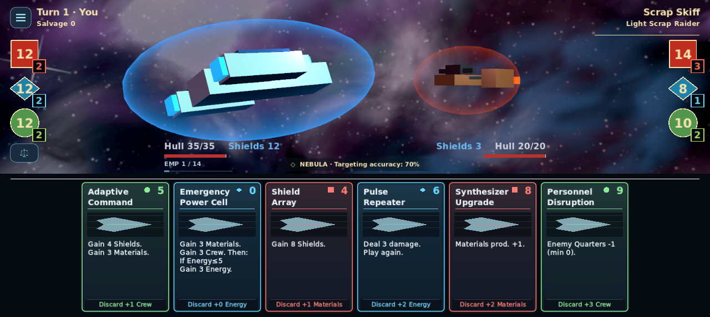 |
