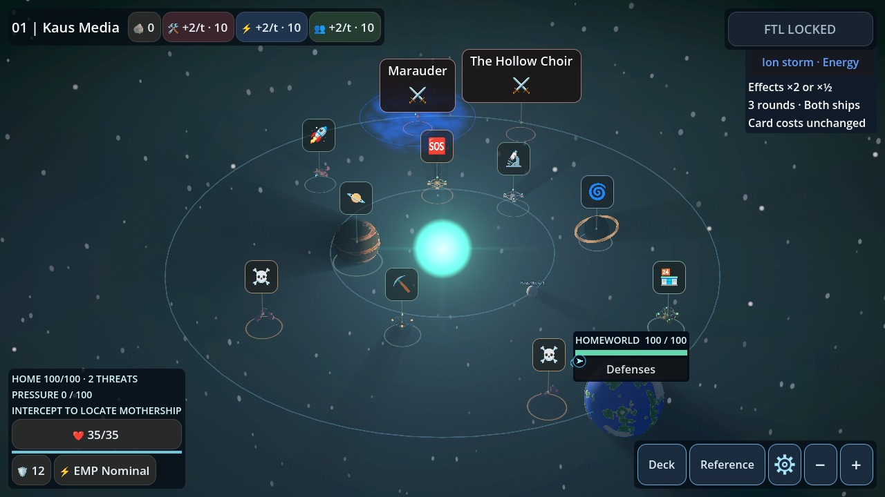
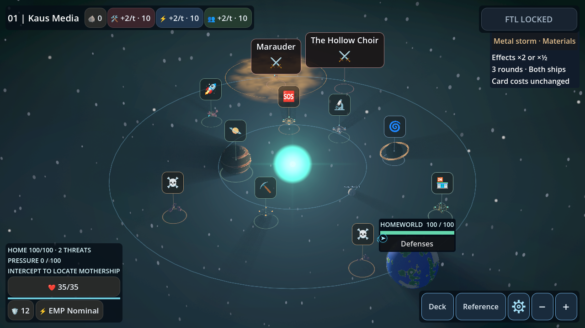
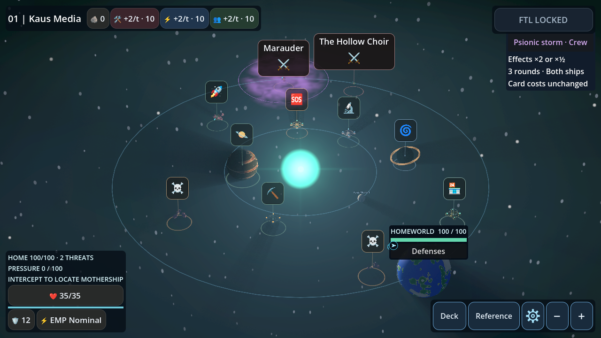
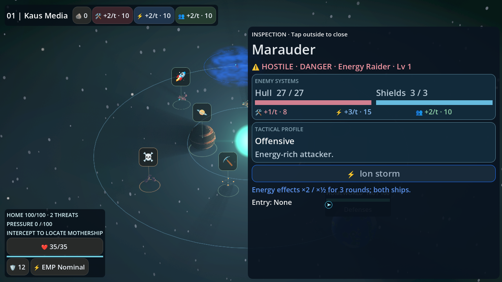
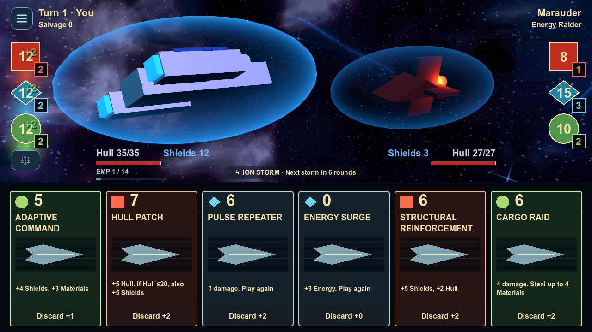

# Physical space storms

New star systems have a configurable 32% chance of spawning one stationary
storm. The generator uses its own stream keyed by run seed and system number,
then selects uniformly among Ion, Metal and Psionic. A storm prefers an
authoritative hostile location clear of higher-priority effects. If no location
qualifies, the generator uses a point in the outer system.

The ellipsoid fits inside the navigable map. Its semi-axes are 5–7.5, 2.4–3.5
and 4.5–7 units in X, Y and Z. The region is continuous and includes its
boundary. Its instance ID, subtype, axes, center, intensity, color, phase and
generation metadata live in the existing environment record.

| Storm | Color | Existing modifier ID | Card family |
|---|---|---:|---|
| Ion | Electric blue | 2 | Energy |
| Metal | Amber | 6 | Materials |
| Psionic | Violet | 7 | Crew |

Battle entry uses the authoritative hostile position and freezes the selected
environment. Explicit legacy modifiers take priority, followed by solar
interference, [Temporal Rifts](physical_temporal_rifts.md), asteroid fields
and storms. The existing modifier scheduler
applies three rounds of guaranteed ×2 matching card effects for both ships. Friendly
Turret Support remains a separate field in the same snapshot.

The map uses one shader and the existing combat palette. Three translucent
cloud sheets sample two scales of animated noise and fit their respective
ellipsoid cross sections. A thin mid-plane ellipse shows the engagement
boundary on the navigation plane. Each storm adds four mesh draws. The shader
uses no texture reads, ray marching, particles or post-processing. The map
legend expands on click or tap and the tactical briefing presents the actual
selected modifier for the enemy.

Existing saves restore their saved environment records as-is. Empty reserved
storm records remain loadable and neutral. The save codec validates new
geometry, subtype and visual data, and the battle checkpoint retains the
frozen storm across reloads. Tune the chance through `space_storm_chance`
on the expedition rules resource.

## Windows Mobile Vulkan captures

The fixture puts the same hostile inside each generated storm variant. Both
GL Compatibility and Mobile Vulkan ran the fixture on Windows. Draw count
and geometry checks validate the bounded rendering design. Android device
frame times have not been measured.

| Ion | Metal | Psionic |
|---|---|---|
|  |  |  |

| Hostile inspection | Battle entered inside Ion Storm |
|---|---|
|  |  |
