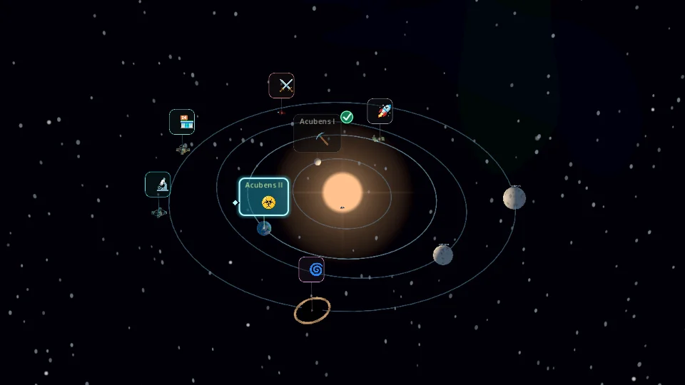
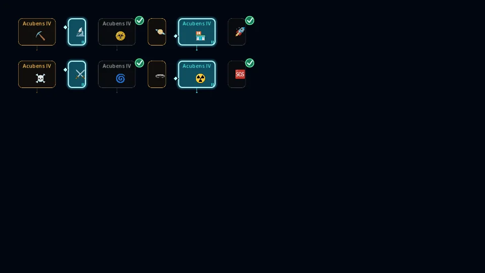

# Star-map PoI iconography

Starting revision: `7df3c13ca1a8309b4b9e1c310a462b7e82e95615`.

Presentation-only polish: no encounter, generation, camera, travel, save, combat, or reward changes. The map retains selected_index; markers receive selected/completed/temporarily blocked state through the existing set_state operation. There is no new state owner.

## Category catalog

| Category | Emoji |
|---|---|
| Mining Operation | ⛏️ |
| Research Station | 🔬 |
| Quarantined Colony | ☣️ |
| Gas Giant | 🪐 |
| Trading Outpost | 🏪 |
| Derelict Starship | 🚀 |
| Pirate Debris Field | ☠️ |
| Enemy Battle | ⚔️ |
| Spatial Anomaly | 🌀 |
| Unstable Wormhole | 🕳️ |
| Radiation Nebula | ☢️ |
| Distress Signal | 🆘 |
| Unknown | ❓ |

The marker owns the catalog; the map delegates category lookup. The pinned Noto Color Emoji subset includes every listed glyph, all 25 original codepoints, and six additional codepoints (31 total). Font size remains 28; the subset grows from 52,532 to 61,828 bytes. Existing OFL license and source revision are unchanged. No system emoji font or new runtime dependency is required. Defensive fallback mappings remain for future incomplete subsets; no requested glyph falls back in this build.

## State presentation

Selection uses a 3px cyan-white border, restrained cyan shadow, brighter half-opacity fill, and a persistent left diamond. Selected priority 3 exceeds hover/focus 2, available 1 and completed 0. Temporary navigation blocking retains selection and never creates a completion badge. Existing nearest-marker hit arbitration, touch gesture suppression and selected-orbit behavior are unchanged.

Completion uses a separate 28px upper-right badge with a geometric white check on teal backing; it does not require a checkmark font glyph. The category emoji remains moderately dimmed. The child badge stays opaque, ignores input, and does not overlap the planet-name rectangle. Background alpha remains 0.5 in every state; text and emoji alpha remain 1. Planet names use the normal UI font above the emoji. State changes do not scale markers or shift projected anchors. No edge clamping is introduced.

## Newly verified results

- Godot 4.7.2: clean import plus all 110 headless regression scripts passed (111 runs). One existing render-only script remains excluded by the shared runner; see poi_iconography_results.json.
- New icon test: 39 checks, 13 supported mappings, zero failures.
- Rendered icon test: Mobile/Vulkan and Compatibility/OpenGL software renderers, at 1280×720, 960×540 and 1680×720; all 39 checks passed on each renderer.
- Rendered map readability: 71 checks passed, including selection during travel, completion/input separation, overlap and stable positions.
- Original gameplay fixtures were not regenerated. Full regression logs verify card-effect, combat, expedition, ownership and save baselines.
- No physical Android or Windows device testing was available. Bundled glyph rendering was verified on Linux software renderers; device performance remains unmeasured. Some existing tests emit ObjectDB shutdown warnings without script failures.

## Screenshots

The screenshot folder includes all three requested sizes and travel selection. Captures are engine renders; the contact sheet uses synthetic states solely for visual QA. Screenshot assets are excluded from export with .gdignore.

## Scope and size

Runtime scripts: poi_marker.gd 163→197 lines; star_map_3d.gd 536→535. Combined runtime 699→732 (+33). Subset tool 22→25. The new focused test adds 72 lines (see actual source for current count). Existing focused assertions were adjusted only for emoji presentation and explicit selection priority. No files removed.

Remaining limits: fixed anchored markers can overlap; selection gets draw priority while nearest-marker touch arbitration remains unchanged. Color emoji retain their authored palette rather than uniform category tint; category identity also remains in borders, names and connectors. Font updates require rerunning the development-only subset tool.

## Emoji centering correction

Removed synthetic FontVariation emboldening from bitmap emoji. In Godot 4.7.2 it changed the microscope's measured advance from 28px to 9px at 28pt, placing the rendered glyph right of its calculated center. Markers now use the bundled font directly; native advances and existing container alignment are preserved. Marker dimensions, anchors and font size remain unchanged.

New verification: 52 icon checks passed under Mobile/Vulkan and Compatibility/OpenGL at all three target sizes, including native-advance checks for every catalog emoji. Transition tests passed 106 checks and map readability passed 71 checks. The full 110-script result above belongs to the prior iconography commit; this narrow correction reran focused tests only. No physical Android test performed.
