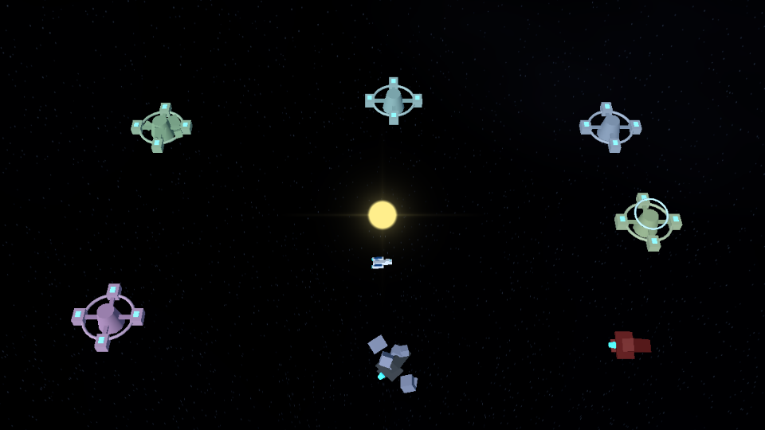
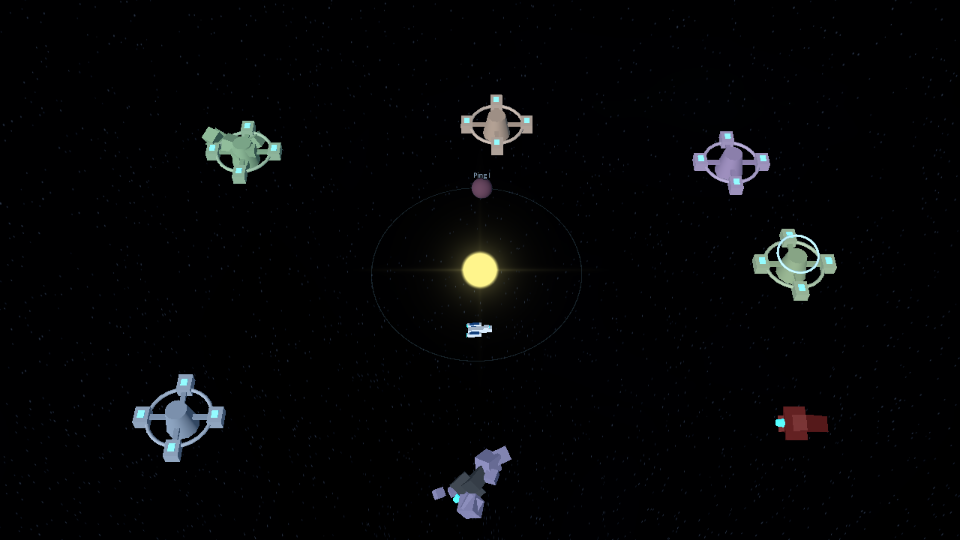
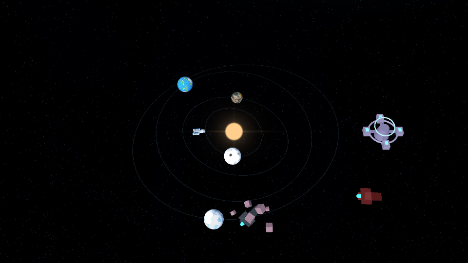
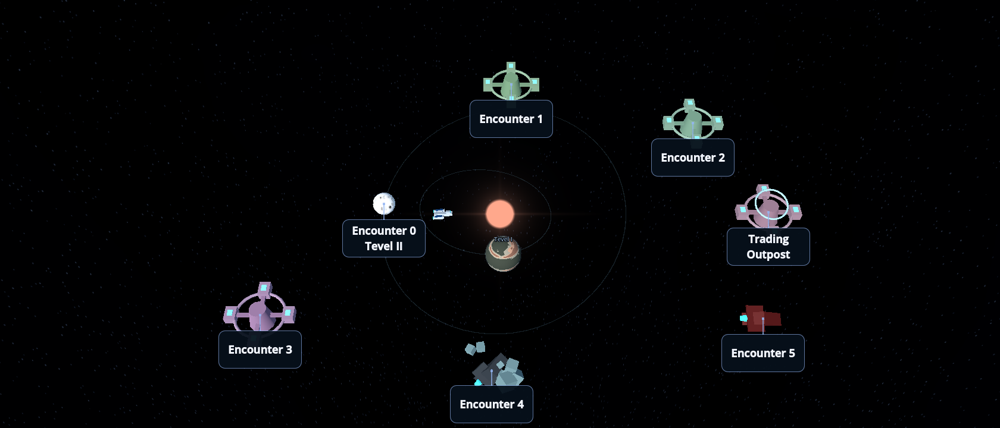
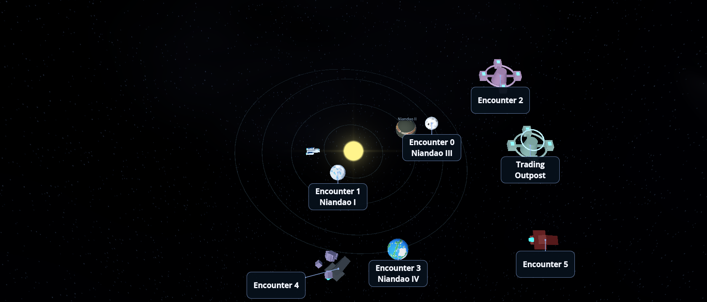
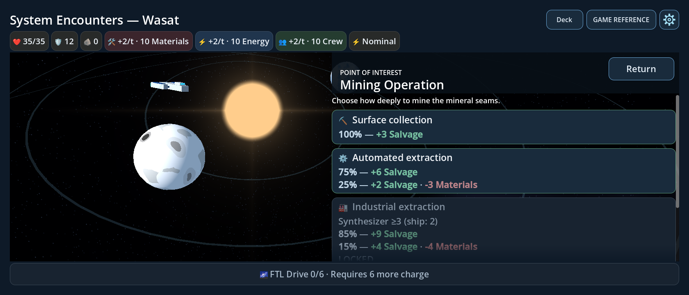
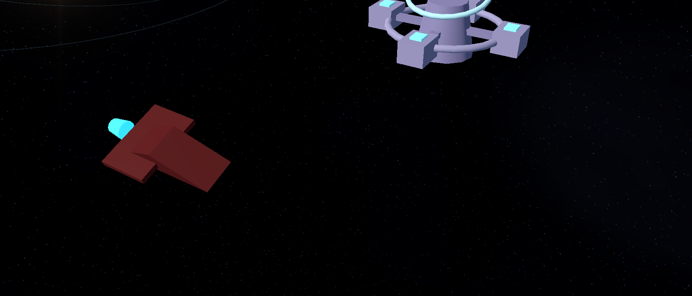
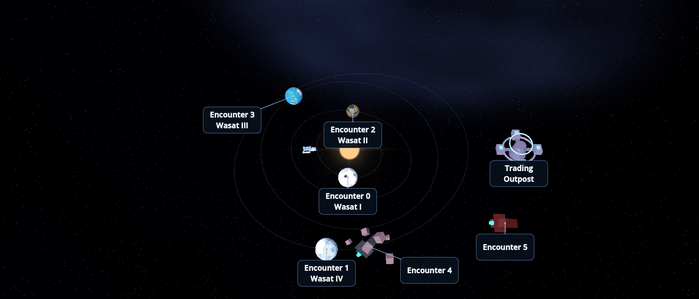

# Procedural star-system visual foundation

Starting revision: `8cded05b5254`. This feature changes presentation, not encounter
composition, travel legality, rewards, FTL, battle rules, RNG streams or saves.

## Ownership and integration

| Layer | Owner | Inputs and output |
|---|---|---|
| Cosmetic system data | `visual_system.gd` | Seed + system number + presentation entries + settings → names, planets, ellipse parameters and anchors |
| Generated geometry | `planet_models.gd`, map's `GeneratedSystem` root | Planet surfaces, orbit strips and noninteractive planet labels |
| Encounter representations | `destination_models.gd`, map's `EncounterRepresentations` root | Existing model_kind/profile → visual nodes; optional PackedScene overrides |
| Background | `space_environment.gd`, map's `BackgroundEnvironment` root | Camera-relative star sphere, replaceable layers and two MultiMeshes |
| Navigation and choreography | Existing `star_map_3d.gd` and `map_camera.gd` | Same markers, destination indices, callbacks, gestures, travel and cinematics |
| Gameplay and persistence | Existing State/Deck/Save | Unchanged; no cosmetic data stored in version 1 saves |

Expedition supplies the existing seed and system number. The existing `visual_seed`
configure argument remains supported for direct/legacy map callers. The 2D map and
original grid remain available. The controller additions pass read-only seed
context and display the cosmetic system name in the existing title.

## Generation and names

Cosmetic RandomNumberGenerators use derived, versioned string seeds for planets,
assignments, individual destination models/anchors, the star, backgrounds and dust.
They never consume State, reward, station, Chasedown, combat or AI random streams.
Changing a background layer does not reshuffle planets or stardust.

Planet count is uniformly drawn from 2 through the configured maximum (default 4,
clamped to 2–4), guaranteeing at least two orbital lines. Count does not depend on encounter count. Each planet records its
index, type, radius, semi-major axis, eccentricity, inclination, orientation, phase,
initial spin, spin speed, material seed and optional encounter index.

Radial shells start at 2.1 world units. Each shell reserves the largest possible
**rendered** planet diameter (including the map's 1.5 size multiplier), the configured
minimum surface clearance (default 1.5), and 0.8 units of placement variation.
Semi-major axes and eccentricities are constrained using rendered radii, so adjacent
radial envelopes remain at least 1.5 units apart even at periapsis/apoapsis. Defaults
extend the four-planet region to 22.1 units. System/pan bounds are now ±24 units;
the overview pulls back to fit this larger region. Counts remain two to four.

For eccentric anomaly E, the unrotated point is:

```
x = a × (cos(E) − e)
z = a × sqrt(1 − e²) × sin(E)
position = yaw(orientation) × pitch(inclination) × (x, 0, z)
```

The star is at one focus. Inclination ranges −15°…+15°, orientation 0…360°, and
eccentricity 0…0.25 subject to clearance. Planets remain on their initial orbital
positions; only surface spin and optional cloud motion animate. One triangle strip
per orbit uses 64 segments by default, rather than many line nodes.

The 100 names are IAU WGSN-approved names with designation, constellation, language,
adoption date and source in [astronomical_names.md](astronomical_names.md). They
were retrieved from the WGSN catalog hosted on exopla.net on 2026-10-25. A seeded
Fisher–Yates permutation supplies unique names for the first 100 systems of an
expedition; the sequence wraps afterward. Planets use I–IV in increasing orbital
order. The stored authoritative `system_name` remains unchanged, preserving the
old name-generation RNG draw order and save compatibility. Map headers use the
new cosmetic display name; this is never written back into State.

## Planetary encounters and navigation

The mapping uses the actual presentation `model_kind`, derived from registered
PoI resource basenames by existing EncounterPresentation, not title substrings:

| Existing kind | Eligible planetary appearance | Standalone fallback |
|---|---|---|
| mining_operation | Rocky | Asteroids + industrial platform |
| research_station | Frozen | Station |
| gas_giant | Gas giant | Collection facility |
| quarantined_colony | Terrestrial | Habitat station |
| Other PoIs / enemies / outpost | Never assigned to planets | Existing category-specific space representation |

Assignments use their own seed and can leave planets decorative. Each planet gets
at most one encounter; no encounter is duplicated. The same six encounter indices
plus an optional separate outpost remain selectable. Decorative planets have only
read-only Label3D names and no interactive marker. Assigned labels retain the real
encounter name and append the planet's name. Label placement separates nearby tags
while retaining dynamic connectors to their exact projected anchors.

The existing ship travels to the same selected index and emits arrival once, using
the original timing/interception callbacks. Orbit/arrival distance has a minimum
planet-radius clearance. Initial ship placement avoids planet surfaces. Camera
focus accepts an optional visual radius to avoid clipping, while keeping the
existing settings, pan/zoom, return pose and cinematic lifecycle. Straight-line
travel remains deliberately simple; there is no obstacle solver or orbital revolution.

## Planet Generator subset and quality

Downloaded directly from https://github.com/remijean/godot-3d-planet-generator .
Pinned source revision: `2d17d1699d7440b17f34e3ae1654084244bd2f7d`.
Godot's Asset Library lists release 1.0 for Godot 4.5; the source project targets
4.5 Forward Plus. Arcospace includes only three shaders, six noise examples and
six extracted body materials under `third_party/naejimer_planets/`.

Both existing export presets explicitly include the third-party LICENSE file, so
it accompanies exported builds as well as the source tree. The full MIT license,
Copyright (c) 2023 Rémi, is preserved, along with upstream
shader provenance comments. No editor plugin, demo scene, demo animation player,
project settings, icon or installation step is imported. See the subset's README
for exact adaptations. In particular, undefined modulo-by-zero animation UVs are
replaced with fract/repeating samples, paths replace demo UIDs, and shared noise
textures are reduced to 128×128. Per-planet detached materials vary coordinates,
scale and palette without modifying the imported presets.

Seven types use six editable sample palettes: rocky/barren, terrestrial, desert,
frozen, volcanic and gas giant. Optional cloud shells and Fresnel atmospheres use
no screen/depth-texture dependency, volumetrics or Forward+-only bloom.
The original `shaders/planet_surface.gdshader` is byte-unchanged and remains the
explicit fallback. `Imported Planets = Off` omits imported cloud/atmosphere shells.

## Model replacement and background artwork

Open **resources/presentation/star_system_settings.tres** in the Inspector.

- **Planet generation / Orbit appearance**: count, clearance, size range, eccentricity,
  inclination, segment count, line color/alpha and thickness.
- **Background and quality**: imported-planet fallback, clouds, atmospheres,
  background strength and Background Layers.
- **Stardust**: enabled state, bounded density, opacity and parallax strength.
- **Replaceable encounter scenes → Destination Scenes**: assign a PackedScene by
  model_kind (for example `research_station`). Author a visual Node3D centered on
  its origin; optional radius metadata controls ship clearance. Enemies continue
  using their existing profile/model_scene path rather than a second registry.

Trading outposts use a hub, rings, docks and emissive windows. Mining sites add
asteroid clusters and machinery. Wrecks reuse a detached, tinted existing enemy
ship plus debris. Pirate battles retain their enemy models. Spatial anomalies use
a dark sphere/accretion ring; wormholes use an animated vertical ring; radiation
nebulae use a restrained billboard cloud. No new lights or physics are introduced. The existing PoI header backing is made
more opaque in 3D focus mode so bright secondary planets cannot wash out its text;
its controls, geometry and the resource bar are unchanged.

To replace a nebula/galaxy with PNG artwork:

1. Import a transparent PNG into the project.
2. Expand a **Background Layers** entry, or open `sky_nebula.tres` / `sky_galaxy.tres`.
3. Assign its **Texture**, adjust tint/opacity, apparent size, rotation and angular
   azimuth/elevation, then save. No shader or gameplay changes are required.

Empty Texture uses the procedural source. Quads sit at a fixed 55-unit camera-relative
radius; Apparent Size is quad size at that distance. Layer parallax defaults to zero.
The map restores its overview before recording the dust reference, so rebuilding
after a cinematic does not inherit the old camera pose. A map-local adaptation of
the existing starfield shader (`map_sky.gdshader`) centers its sphere using the exact
render camera's GPU matrix. It no longer waits for a CPU pre-draw translation.
**Starfield Parallax** defaults to 0.12: distant stars shift gently under pan/zoom,
much less than nearby white points. Set it to zero only for an infinitely distant,
translation-locked sky. The far-depth draw still prevents object occlusion.
Lower angular star density/resolution avoids tiny undersampled highlights. The
shared battle/menu background shader is unchanged. Camera far clipping is unchanged;
there is still exactly one map SubViewport.

Dust uses two MultiMeshInstance3D layers, 64 small **white circular points** total
by default (maximum 160), with antialiased soft edges. No irregular rock silhouettes
or time-driven flicker remain. Shader positioning reads the same render camera as
the sky, with stronger translation response for the near layer (0.8 versus 0.4 by
default). Camera-relative wrapping keeps the field populated through long pans and
focus transitions; depth-boundary fades hide recycling. Billboards face the render
camera. No per-frame CPU dust transforms, per-particle Nodes, physics, texture
generation or runtime Python are required. The initial reference basis keeps the
translation field consistent across camera turns. Stationary camera frames produce
identical pixels.

Tune **Stardust Parallax**, **Opacity**, density and enabled state in the existing
StarSystemSettings resource. Nebula/galaxy/texture background quads also use GPU
camera-relative placement and far-depth drawing, with stable transparency ordering.
There is no background pre-draw callback or CPU camera-follow loop. Map deactivation
hides the background and suspends its viewport. Encounter nebulae use the existing
world-space/billboard branch of the shared shader.
Backgrounds can be reduced through strength or removed by clearing Background Layers;
clouds, atmosphere and dust each have a reduced/disabled setting.

### Parallax/spacing regression update

`space_parallax_test.gd` checks rendered pixels on Mobile and Compatibility: an
isolated distant starfield must move under translation, stationary stars/dots
must be pixel-stable, and pan/zoom must change the white-point image. A separate
zero-parallax calibration check verifies the optional translation-locked setting.
The same test isolates procedural nebulae, galaxies and PNG-style replacement
textures, checking stationary pixels, pan, camera turns and optional layer parallax. Headless runs
explicitly skip these GPU checks. Generation tests now measure shell clearance using
the enlarged visible radius. Existing save schema and gameplay RNG remain unchanged;
cosmetic orbital positions reconstruct using the new spacing rules.

## Verification and limits

Newly verified with Godot 4.7.2:

- Baseline before edits: import plus 3D map, transitions, resume and deck determinism passed.
- Shared `tools/run_regressions.py`: **105 scripts + import, all 106 runs passed**.
- Pure generation: **4,050 checks**, including 300 seeded systems, full 0–4 count
  coverage, ellipse positions, bounds/clearance, assignments and 100 unique names.
- Final focused presentation: **143 checks** (headless and rendered); includes all
  seven planet types, all procedural PoI categories, PNG-compatible texture binding,
  PackedScene replacement, reduced settings, safe arrival, exact save reconstruction
  and a forced full visual rebuild leaving saved state/RNG streams unchanged.
- Rendered **Mobile/Vulkan** and **Compatibility/OpenGL** (llvmpipe): **143 checks
  each passed** at 1280×720, 960×540 and 1680×720. Extra cases cover high inclination/
  eccentricity, a large gas giant, planet/ship focus and dark/bright quality settings.
- After the final PoI-header readability adjustment, Android layout, map, transition,
  resume and zoom/fade suites were rerun successfully. After the dust-reference fix,
  presentation, map, transition, resume and zoom/fade tests were rerun again.
  The resource bar/layout did not change.
- Existing **2,220 card checkpoints, 72 combat traces, 43 ownership checks and 1,044
  expedition/deck checkpoints** matched unchanged fixtures. The last fixture retains
  its established historical six-modifier sampler; it was not regenerated.
- Existing Chasedown, PoI, outpost, save/fresh-process, battle-entry, FTL, card-management,
  music and other shared regressions passed. No original test expectation/fixture changed.
- Web-preset resource-only PCK export succeeded. The complete MIT LICENSE bytes were
  found verbatim in that pack; both Web and Android presets explicitly include it.
- `git diff --check` passed. State, Deck, save codec, combat/card/AI sources, original
  shaders and existing JSON baselines are byte-unchanged from the starting revision.

Earlier development runs exposed a typed-Array assignment in the new test fixture;
that fixture was corrected without changing gameplay or expected baselines. Final
runs contain no shader/import/script errors or failed assertions. Some scene tests
retain ObjectDB shutdown warnings (also present in baseline scene tests); the runner
records them separately. Compatibility software rendering reports unsupported V-Sync
control, which does not prevent rendering or shader compilation.

Representative four-planet, warmed software-render diagnostics (30 frames): Mobile
31.49 ms mean / 101 draw calls; Compatibility 20.26 ms / 129 draw calls. These include
viewport/UI overhead and concurrent host load. No pre-feature GPU benchmark or
physical Android comparison was captured, so these are observations, not device FPS
claims. Defaults limit planets to four, dust to two MultiMeshes/64 instances, orbit
strips to 64 segments, noise to shared 128×128 textures and lighting to one existing
directional light. There are no per-frame mesh rebuilds or new physics objects.

Run checks with:

```sh
godot --headless --path . --script tests/visual_system_test.gd
godot --headless --path . --script tests/planet_presentation_test.gd
python tools/run_regressions.py --godot /path/to/godot --timeout 360
```

The presentation script saves rendered captures under `.godot/testlogs/` when run
with a display. Documentation screenshots below are excluded from Godot import/export.
The bright-nebula capture intentionally calibrates opacity/strength upward to test
the replaceable layer; default systems remain more restrained.

The surfaces and special objects remain stylized placeholders. Exact orbital motion,
physical atmosphere scattering, lensing, volumetric nebulae and advanced ship pathfinding
are intentionally absent. Small decorative planet labels become readable when zooming;
playable markers retain normal interface text and hit areas. Highly packed systems
constrain eccentricity to preserve clearance. Configuration changes that rebuild
materials/models take effect on the next map construction/system, not a new editor plugin.

No physical Android device, Windows build, APK or browser/WebGL gameplay was tested.
The resource-only PCK license check is not a runnable application/export-device test.
Desktop software rendering through Mobile/Vulkan and Compatibility/OpenGL is shader and
layout evidence, not a mobile GPU performance measurement.

## Code size and files

Counts include the cosmetic name catalog and exclude unchanged shared UI/combat code.

| Runtime group | Before | After |
|---|---:|---:|
| Expedition coordinator | 1214 | 1220 |
| Existing map, models, camera and settings | 672 | 783 |
| ExpeditionScreen | 410 | 412 |
| New data/name/planet/background/layer components | 0 | 383 |
| New authored shaders | 0 | 46 |
| Authored combined | 2296 | 2844 |
| Imported/adapted shader code | 0 | 127 |
| Combined including imported shaders | 2296 | 2971 |

New runtime scripts: `visual_system.gd`, `astronomical_names.gd`, `planet_models.gd`,
`space_environment.gd`, `sky_layer.gd` under `scripts/presentation/star_system/`.
Modified: that folder's map, camera, models and settings; `scripts/expedition.gd`;
`scripts/ui/expedition_screen.gd`. New authored shaders: `cosmic_layer.gdshader`,
`anomaly_ring.gdshader`, `stardust.gdshader`. New resources: `sky_nebula.tres`,
`sky_galaxy.tres` and the explicitly licensed third-party subset. New tests:
`visual_system_test.gd`, `planet_presentation_test.gd` plus generated UID files.
`export_presets.cfg` includes the license in both existing presets. Developer/map
documentation, the astronomical catalog and this report are added/updated; eight
actual captures plus `.gdignore` live in `docs/procedural_system_screenshots/`. No existing runtime file
was removed, no plugin was added, and no original regression fixture was changed.

The controller grew by six lines. Generation, models and background synchronization
have focused presentation owners instead of adding gameplay responsibilities to it.
No new global manager, event bus, save data structure or duplicate enemy registry exists.

## Rendered examples

Actual Compatibility/OpenGL captures; the same cases also passed Mobile/Vulkan.

| Zero planets | One planet | Four planets |
|---|---|---|
|  |  |  |

| Tilted/eccentric orbit | Large gas giant |
|---|---|
|  |  |





### Star-map size calibration update

The star-map sun, planet bodies and space phenomena render at 150% of their prior
size. Player/enemy ship models, wrecks and installations render at 50%. These
changes are local to the map: shared battle scenes, ship Resources and shaders are
unchanged. Planet clearance metadata and decorative-label offsets account for the
larger bodies; label text retains its previous size. The later spacing update
expands orbital coordinates while preserving travel timing. Generation now always creates two to four
planets; old saves reconstruct the updated cosmetic layout without schema changes.

Latest spacing/parallax verification: 5,427 generation checks and 172 presentation
checks passed, with nine focused headless scripts plus import passing. The GPU pixel
test passes on Mobile/Vulkan and Compatibility/OpenGL (software llvmpipe). The full
presentation test also passes on Mobile at all three landscape sizes. The headless
pixel-test entry explicitly skips GPU assertions. No physical Android testing.

### Orbit visibility and sun stability

The map sky now draws at the lowest transparency priority (-128). It previously
could paint over orbit lines and compete with the sun during camera movement,
despite being projected to far depth. A rendered with/without-sky comparison
reproduced that loss and now guards against it.

Orbit paths are camera-facing GPU ribbons on their original 3D ellipses. The old
horizontal strips could disappear when viewed edge-on. **Orbit Line Width** is now
a screen-pixel setting (default 2), rather than a world-unit thickness. Opacity is
unchanged. The sun has rotation-safe billboard culling bounds and explicit
transparency priority above distant background layers. Shared menu/battle sun
shader code is unchanged. `orbit_visibility_test.gd` checks 15 rendered combinations
of grazing/overhead angles and near/far camera distances on both renderers, plus
actual map visibility with the sky enabled and 17 sun camera poses.

### Distant-lens / central-sun presentation calibration

Overview now uses a 22-degree perspective FOV, with camera position (0,112,78)
before the existing zoom factor: farther away and slightly steeper than the prior
(0,90,67.5)/29-degree setup. Camera controls and transition timing are unchanged.
A single warm, shadow-free OmniLight3D at the central star replaces the map
directional light. Its 64-unit range covers the system; low blue ambient fill
retains night-side readability. This gives objects sun-facing illumination without
additional models, textures or post-processing. The existing sun shader has a
map-local 2x core/corona setting for a stronger central visual anchor; its default
remains 1x for title/battle materials. The UI is unchanged.

Tune Overview Position / Field Of View and the new **System Lighting** group
(Ambient Light Energy, Sun Core Scale, Sunlight Energy, Sunlight Range) in the existing settings
Resource. Lighting remains local to the map, with no changes to battle/menu lights.
