# Procedural star-system variety

System 1 and historical expanded Defense systems use the version-1 variety
profile described below. Newly generated Starfront Defense systems from
System 3 onward use a version-2 geography record with independent environmental
and military selection. See [Later Starfront geography](balance/starfront_environment.md)
for the current layout weights, recorded geometry, placement rules and validation.

## Ownership and flow

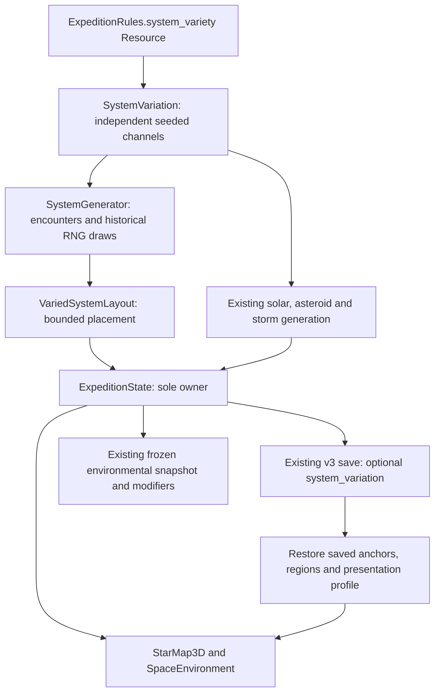

- `system_variety_settings.gd`: Inspector tuning, embedded in ExpeditionRules.
- `system_variation.gd`: compact data and validation, no mutable RNG/state owner.
- `varied_system_layout.gd`: authoritative PoI anchors and initial fleet routes.
- `system_variety_environments.gd`: parameter adapter for existing phenomena.
- `ExpeditionState.system_variation`: the sole saved profile. Presentation receives
  detached data; it cannot regenerate state or advance the strategic clock.

## Controls and distributions

| Inspector control | Default |
| --- | --- |
| `enabled` | true for newly generated expanded Defense v2 systems |
| `layout_weights` | 50 conventional / 30 unusual / 15 extreme / 5 chaotic |
| Unusual choices | scattered, crowded, asymmetric, equally weighted |
| Extreme choices | unstable, storm-dominated, equally weighted |
| `poi_count_weights` | 70 common / 15 sparse / 15 dense |
| PoI ranges | 5–9 / 3–4 / 10–12, clamped to 3–12 |
| `binary_chance` | 12% |
| `background_chance` | 65% for 1–3 distant layers |
| `quasar_chance` | independent 6% additional layer |
| `minimum_arrival_seconds` | 20, evaluated using actual enemy speed |
| Solar radius ranges | 5–8 / 9–14 / 15–21, before existing expanded-map factor |
| Storm horizontal semiaxes | 3–6 / 6–10 / 11–17 |

All styles occur from System 1. Layout, count, formation, environment profile,
companion and backgrounds use independent `system-variety:<channel>:v1` streams.
Intensity is independently weighted 55 subtle / 33 significant / 12 dominant;
unstable and storm-dominated layouts request dominant intensity. Existing storm
chance still applies (zero disables storms); storm-dominated requests a storm
when storms are enabled. Dominant profiles may request two regions. Invalid or
irrelevant optional regions are omitted, so the realized frequency is lower.

Archetypes are placement biases, not prefabs. Crowded systems concentrate angular
and radial placement; asymmetric systems bias one side; scattered installations
favor outer space; chaotic installations use independent Cartesian coordinates.
Nonplanetary destinations are not tied to orbits. Planetary PoIs retain circular,
radially separated orbits, including full visible-radius clearance at every phase.
Extra dense-system destinations use existing nonplanetary PoI Resources, with
repeated location types permitted. Their reward ownership/limits remain existing
Defense PoI rules. No objectives or mandatory motherships are removed.

Formation choices are independent of faction: spread, clustered, staggered,
pincer, vanguard and unstructured. Vanguard biases faster ships forward. Every
candidate uses actual speed for minimum arrival time and rejects stellar-crossing
routes, player overlap and nearby ships/PoIs. The mothership and reinforcement
schedule retain existing behavior. All coordinates stay inside existing map bounds.

Placement has 96 bounded attempts per destination/ship. Fleet candidates also
reject swept interception-course conflicts. A failed formation retries a safe,
widely separated deployment for another 96 attempts per ship. Exhausted installation
placement restores the original deterministic anchors; exhausted ship placement
restores the whole previous deployment rather than mixing partial formations. Archetype biases may therefore
relax to preserve safety. Existing construction-site generation runs afterward.

## Environments and presentation

Solar influence uses the primary star and existing containment/mechanics. Large
optional influence is rejected when gas-orbit feasibility or homeworld clearance
would fail. Storms retain existing modifier IDs and effects. An optional saved
`region.angle` rotates their ellipsoid, visual sheets/boundary, containment, route
intersection and clearance consistently. Old unrotated records retain the exact
original containment arithmetic. New `generation.extended = true` records permit
semiaxes up to 18; old records retain their 9-unit bounds. At most two storms are
accepted by the existing environmental codec. Existing lexical-ID precedence
resolves overlaps; no additional damage or stacked environmental effects exist.

The companion star reuses `menu_sun.gdshader`, with no light, lens dispatch,
collider, target or environmental source. Its surface remains within the clear
inner cavity (center radius 2.8, surface radius 0.30–0.48); planetary surfaces start
outside 4.15. Both stars are static and all mechanics remain primary-centered.

Generated nebulae, galaxies, dust lanes, remnants and rare quasar core/disc/jets
extend `SpaceEnvironment` and `cosmic_layer.gdshader`. At most four far-depth quads
replace the calibrated background layers for new profiles. Their directions stay
fixed on the celestial sphere with 0.015 translation parallax. Saved color, size,
rotation, opacity, direction and variation reproduce the same appearance. No
textures, artwork, volumetrics, shadow maps, lights or viewports were added.
Foreground protection and conservative opacity retain object/HUD contrast.
Legacy backgrounds use their previous shader defaults and configuration.

## Persistence and compatibility

Save version remains 3. `system_variation` is optional; absence means the old
presentation and no retroactive layout generation. Positions and route origins
remain in the existing Defense snapshot; environmental records remain in their
existing field. A future newly generated system opts into current settings.
Existing unfinished battle snapshots and save checkpoint order are unchanged.
Profiles are normalized to the same JSON wire-number representation before commit,
so a fresh process reproduces identical serialized records. The codec validates
profile identifiers, bounds, cardinalities and numeric values.
It does not load arbitrary resources supplied by the profile.

The generator still performs exactly the historical eight PoI selection draws
before applying the independently chosen count. Extra selection uses its own RNG.
No combat/card/loot/reward stream is used by layout, validation or rendering.

## Validation and reproducible examples

`tests/system_variety_test.gd` generates 100 expeditions through Systems 1–6 and
compares against the legacy preset. It checks profiles, rosters, RNG, geometry,
homeworld hazard clearance, actual-speed arrival fairness, rotated boundaries,
map bounds, exact JSON save roundtrips, real movement to every initial attacker,
invalid data and unchanged Exploration. The current sweep passes 55,169 checks, including battle checkpoints after
every initial interception and disk roundtrips for all three storm subtypes.
`tests/system_variety_render_test.gd` runs the production expedition scene with
all seven layouts plus binary, quasar, nebula and large-solar examples, four viewport sizes and real
mouse/touch input. Registered for both GL Compatibility and Mobile Vulkan CI.

The original v2 band/angle, Phase 1 foundation, fixed solar-render and single-storm
tests explicitly use their legacy
preset; every original assertion remains. The new sweeps test the expanded rules.
No baseline fixtures or combat expectations were changed.

Across the initial 600-system comparison against untouched main `b41a5c3`:

| Metric | Main | Variety |
| --- | --- | --- |
| PoI counts | 8 in every system | every count from 3 through 12 |
| Conventional / unusual / extreme / chaotic | fixed layout | 280 / 204 / 83 / 33 |
| Binary systems | 0 | 88 (14.7%) |
| Quasar backgrounds | 0 | 37 (6.2%) |
| Gameplay RNG / enemy records identical | — | 600/600 |
| Entire save records identical with variety disabled | — | 600/600 |

System-one examples: asymmetric 1, conventional 2, crowded 5, unstable 7,
scattered 15, storm-dominated 23; the render test discovers chaotic and binary
seeds deterministically. Seed 4 includes a quasar. Captures are real Godot frames
in `system_variety_screenshots/` and CI artifacts, not mockups.

Useful commands:

```sh
python3 tools/run_regressions.py --godot godot --script system_variety_test
python3 tools/run_rendered_regressions.py --godot godot --renderer gl_compatibility --script system_variety_render_test
python3 tools/run_rendered_regressions.py --godot godot --renderer mobile --script system_variety_render_test
```

Software-rendered GL/Vulkan validation does not establish physical Android device
performance. Manually review dense-map selection, wide-system framing, dominant
storm transparency and companion readability on target phones. Repeated PoI types
and minimum arrival time are initial balance parameters, not new strategic rules.


To reproduce the untouched-main audit without baseline fixtures:

```sh
VARIETY_PROBE_OUTPUT=/tmp/main.json godot --headless --path /path/to/main --script /absolute/path/to/feature/tools/system_variety_probe.gd
VARIETY_PROBE_OUTPUT=/tmp/new.json godot --headless --path /path/to/feature --script /absolute/path/to/feature/tools/system_variety_probe.gd
VARIETY_PROBE_OUTPUT=/tmp/legacy-preset.json godot --headless --path /path/to/feature --script /absolute/path/to/feature/tools/system_variety_probe.gd -- disabled
```

The first and third outputs should be identical. Compare `rng` and battle-kind
encounter records between first and second; PoI counts/anchors/environments and
presentation profiles intentionally differ.


## Rendered examples

These are production GL Compatibility frames at 1280×720, except the labeled
mobile-aspect/size matrix. Corresponding Mobile Vulkan frames are CI artifacts; three are also committed below.

| Conventional (seed 2) | Crowded (seed 5) |
| --- | --- |
| 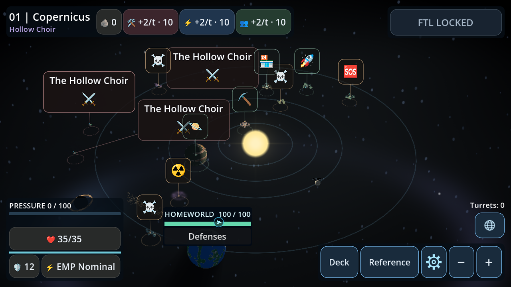 | 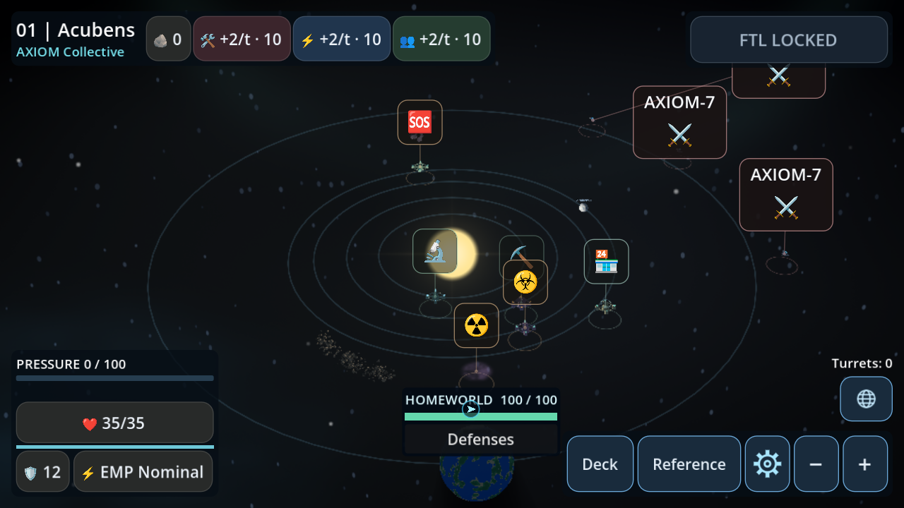 |
| Scattered (seed 15) | Asymmetric (seed 1) |
| 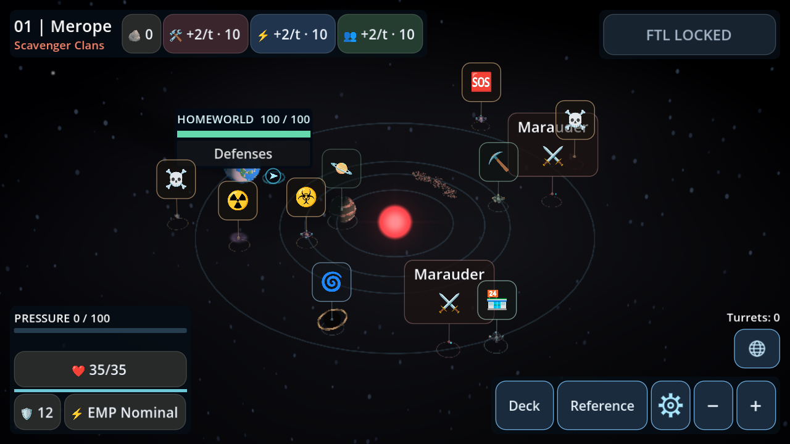 | 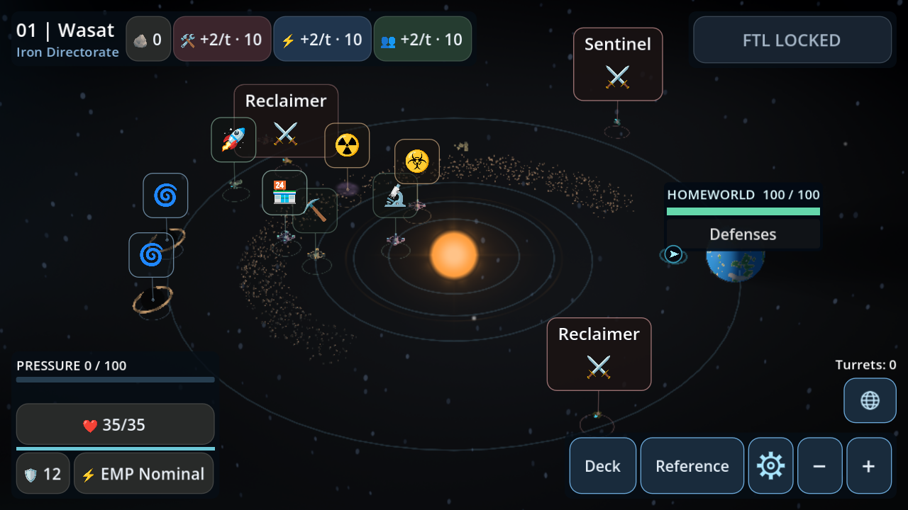 |
| Storm-dominated (seed 23) | Chaotic (seed 18) |
| 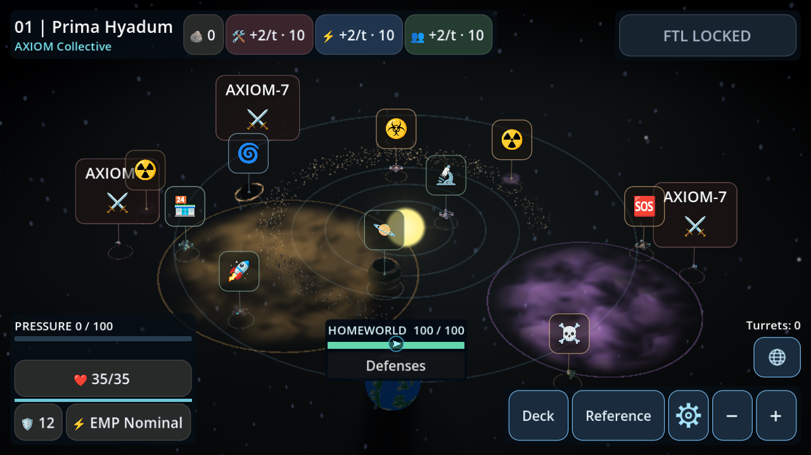 | 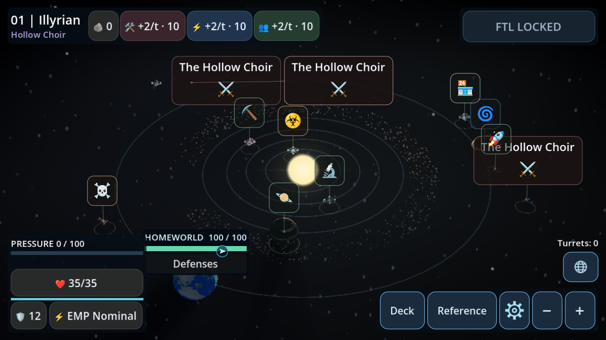 |
| Twin suns / large solar region (seed 7) | Quasar (seed 4) |
| 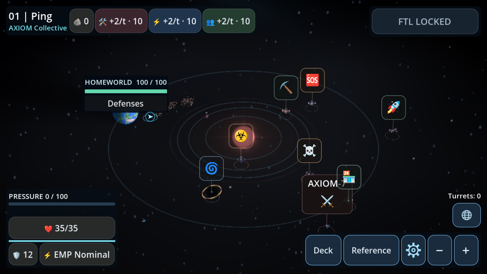 | 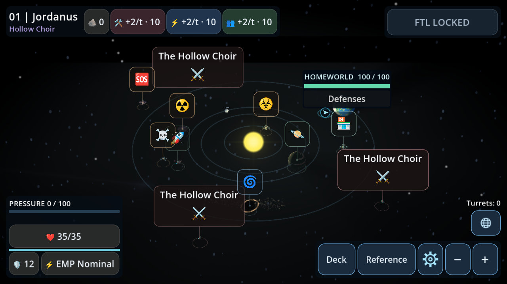 |

### Mobile Vulkan

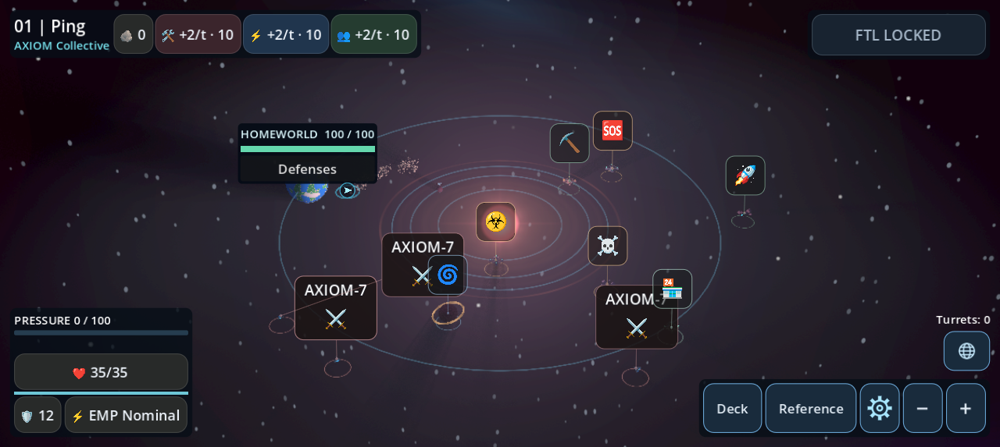
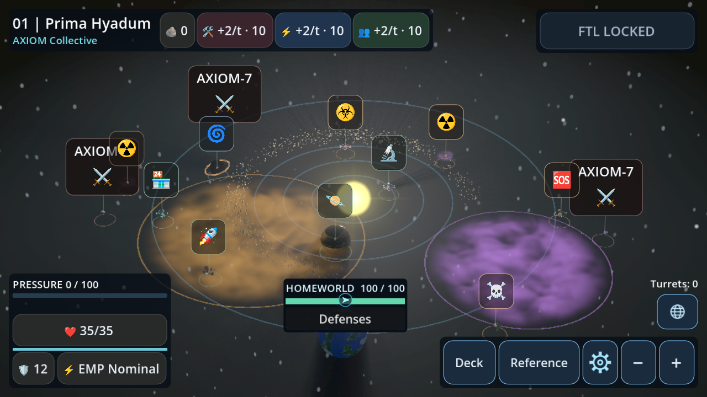
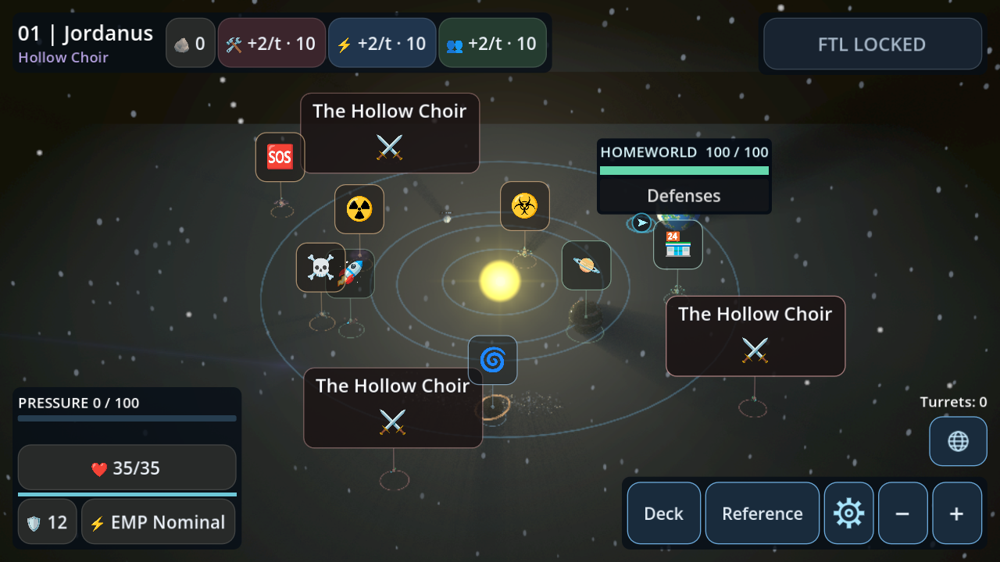

The original production map test passed 155 checks on each renderer; it now also
enters a deterministic extended-storm battle through the real expedition controller. Exporting a Web
pack and running the menu-to-battle startup script with `--main-pack` passes all
84 checks. Python regression-runner checks pass 22/22.

## Validation caveats

The full local 196-script headless run completed: 189 initially passed. Four
failures exposed new compatibility/contact issues and were fixed and rerun:
fresh-process profile normalization, startup contact clearance, Phase 1 fixture
configuration and the fixed solar-render fixture. The hull-flash timing case
passes in isolation on both checkouts. Two unrelated baseline issues remain:

- `trading_outpost_test` times out locally (120 seconds; untouched main also
  exceeded 240 seconds during comparison).
- `star_map_test`: “Service arrival grants no access or pressure” fails on both
  untouched main and this branch in the retained Exploration test.

These assertions/fixtures were not weakened or regenerated. The PR remains a
draft for CI review. The existing GitHub workflow runs the complete headless,
GL Compatibility, Mobile Vulkan and exported-startup matrix on the final branch;
results should be reviewed before merging. No automatic merge is configured.


### CI recheck: extended storm battle-entry fix

The first GitHub matrix passed both headless shards, both Mobile Vulkan shards
and exported startup. GL startup exposed a real snapshot bug: extended storm
world records allowed semiaxes above nine, but the frozen snapshot omitted the
size-permission flag, so battle checkpoint validation rejected those encounters.
The generation/interception-only sweep had not tried creating the checkpoints.
Adding that step reproduced 57 failures across 600 systems before the fix.

`BattleEnvironment.evaluate()` now captures the optional boolean
`configuration.extended` from the chosen storm's generation metadata. Snapshot
validation passes it to the same geometry validator. Historical snapshots omit
it and retain the nine-unit bound; extended snapshots retain the eighteen-unit
bound. Nonboolean flags and oversized geometry remain invalid. No combat effect,
RNG, layout, save version, checkpoint order or result behavior changes.

The expanded suite passes 55,169 assertions, including every reached attacker's
checkpoint, frozen JSON restoration, disk restoration for ion/metal/psionic
storms and retries after the world changes. The production render test now
reaches a known large storm (System 1, seed 23), starts the actual battle and
checks the existing combat modifier. The GL and Mobile aggregate statuses share
a matrix dependency, so the previous GL failure also marked the Mobile aggregate
red despite both Mobile shards passing. The full matrix is rerun on the fix;
this document does not claim that rerun complete.


Local validation of the corrective change: 55,169 generation/checkpoint checks,
GL startup (84 checks), and 159 production map/battle-entry checks on each of
GL Compatibility and Mobile Vulkan pass. Existing storm, Phase 1 foundation,
expedition save and fresh-process resume suites also pass. Full GitHub rerun is
left unmonitored; the PR remains unmerged.
