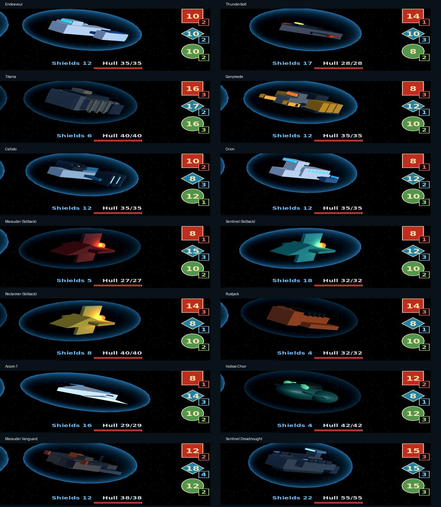

# Combat shield uniformity pass

Combat placement now preserves each custom model's authored root transform. It
previously replaced that transform with the arena pose, ignoring Thunderbolt's
0.76 scale and Titania's 0.885 scale. Arena fallback scaling is stripped before
placing a custom model so the two sizes do not multiply.

All eleven custom model scenes now use a comparable projected shield footprint.
Their authored shield mesh transforms, orientation and shape are preserved;
model root scales set overall size. Body scales/offsets provide clearance inside
the authored shell. Ganymede and Sentinel Dreadnought needed no Body adjustment.
The fallback ship instances in all seven arenas receive the same treatment,
including the optional planetary-orbit scene. No gameplay statistics changed.

## Tuning

- `scenes/ships/*.tscn`: root `Ship` transform sets combat and selection size;
  `Body` transform controls geometry size inside the existing `Shield` transform.
- `scenes/battlefield*.tscn`: root ship instance and Body overrides set fallback
  sizes. These do not multiply into replacement custom models.
- `scripts/board_3d.gd`: combines arena pose with authored custom-model transform.

Target projected footprint area is about 9.89 square world units in the combat
camera plane. Shapes intentionally differ: custom projected widths are roughly
3.88–4.57 units and heights 2.16–2.55 units. This matches visual prominence without
forcing every shield into the same shape.

Conservative enclosure checks transform all eight corners of every Body mesh
AABB into shield-local space. Their radius stays at or below 0.90, including
±0.08 local vertical hit movement. Since each shield is a transformed unit sphere,
this leaves a ten-percent radial margin. Whole-ship hover and critical shake move
ship and shield together. Shader effects do not displace the shield surface.

## Validation

`tests/shield_fit_test.gd` checks all six player and eight enemy profiles, both
combat sides, all six modifier arenas plus planetary orbit, and 1280×720,
1560×720 and 1680×720. It checks enclosure, size consistency and sampled shield
surface visibility inside the viewscreen. Run with a rendering display to save
comparison PNGs under `.godot/testlogs/shield-fit-*.png`.

Godot 4.7.2: **322,224 headless** enclosure/footprint/framing checks and
**46,032 rendered** checks passed in OpenGL Compatibility via Mesa software
rendering. Existing ship_models,
shield_shatter (61), battle_layout (208) and systems_failure (834) regressions
also passed. Rendered
comparisons were inspected. Android hardware and Mobile/Vulkan remain untested.
