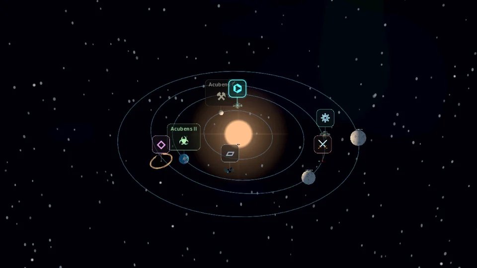
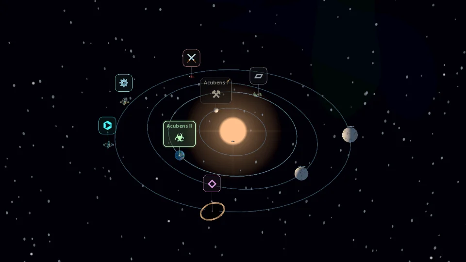
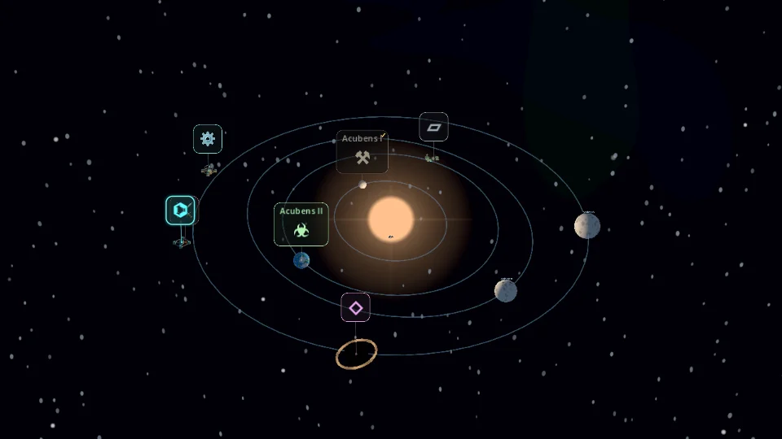
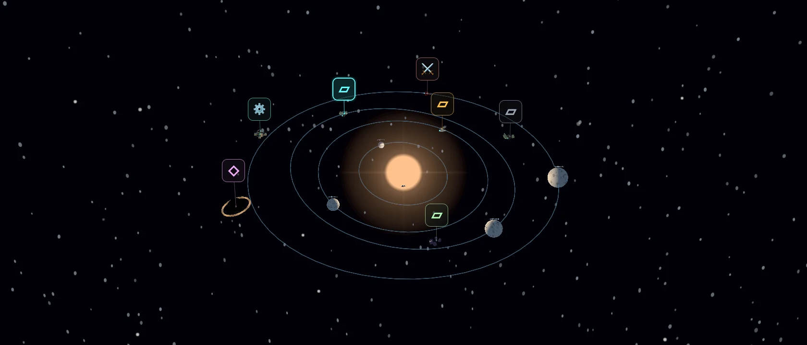

# Star-map readability and composition refinement

Starting revision: `d26d7ac3d8015caf31143117e5ee0a8c3c1d036c`.

## Audit and baseline

The existing marker conflated completion with Button.disabled styling, lacked selected
presentation, and used equally strong connectors for all available encounters. Stable
above-object positioning and nearest-icon/model hit testing already existed. Standalone
positions still used the six ANCHORS plus small jitter. Central solar lighting, 22° lens,
35° overview, independent cosmetic RNG, PNG layers and PackedScene models are retained.

Baseline: six focused headless scripts plus import passed. The baseline Mobile
presentation run passed 193 checks. Screenshots are in `star_map_refinement_screenshots/`.

| Owner | Before / retained responsibility | Refinement |
|---|---|---|
| visual_system.gd | Pure cosmetic data, planets and assignment | Pass 2 replaces standalone placement only |
| star_map_3d.gd | Projection, navigation presentation, scene assembly | Selected marker, bounded overlap emphasis |
| poi_marker.gd | Category style and deterministic hit testing | Explicit completion, unavailable and highlight presentation |
| planet_models.gd | Planet surfaces and orbital ribbons | Pass 2 selection material / surface calibration |
| map_camera.gd | Camera motion | Unchanged |
| space_environment.gd | GPU camera-relative backgrounds | Pass 2 contrast calibration |
| ExpeditionState / save codec | Gameplay and persistence | Unchanged |

## Pass 1: navigation readability

Completion is explicitly supplied from encounter data. Temporary input blocking is a
separate visual flag; native disabled/input guards remain authoritative for input.
Available markers retain category colors. Completed markers desaturate/darken and gain
a small check, without disappearing. Blocking shows a small pause mark and retains
category color. Selection, hover and keyboard focus raise border contrast with a small
static shadow, without scaling or repositioning. Background alpha is 0.5 in every state;
icon and name alpha remain 1. Icons/mappings, fonts and sizes are unchanged.

Selected/focused/hovered markers draw above available markers, then completed markers.
An O(n²) rectangle check (at most seven normal markers) reduces secondary border emphasis
without moving anything. Native styles are modified only when presentation changes;
there are no per-frame node/font/style reconstructions. Nearest-icon/model hit testing
and tie-breaking are preserved. Connectors are thinner and subdued, stronger only for
highlights and weaker for completed encounters. Returning to overview clears selection.

`star_map_readability_test.gd` covers visual state, focus, fixed bounds, overlap priority,
unique model taps and gesture blocking. It captures three landscape resolutions,
crowded four-planet, two-planet, bright/dark and travel cases. Physical Android font
rendering remains unverified; this pass intentionally retains the existing glyph set.

Pass 1 gate: seven focused scripts plus import passed; 58 state/readability checks
passed headlessly and on Mobile/Vulkan and Compatibility/OpenGL. A short-travel timing
regression was traced to redundant theme work on temporary-block changes and fixed by
redraw-only blocking and batched color overrides; travel timers/tests were not changed.

| Before | Pass 1: crowded / selected / completed |
|---|---|
|  |  |

Other Pass 1 captures include states at 1280×720, 960×540 and 1680×720, two planets,
bright/dark environments and active travel. WebP files are QA captures, excluded from
Godot import/export by `.gdignore`, not new game artwork.

## Pass 2: deterministic system composition

The fixed ANCHORS list is removed. Each standalone ID uses its existing independent
`destination-{index}` cosmetic RNG channel. Planets, names, assignments and material
channels are unchanged. Sorted IDs establish stable occupancy order. Each destination
gets 48 radial/angular candidates with vertical offsets limited to ±0.45 units.

| Representation | Loose radial preference |
|---|---|
| Trading Outpost | 0.75× outer orbit to outer orbit +3; bounded to 7–23 units |
| Anomaly / wormhole / radiation | Isolated outer region, typically 0.85× outer orbit through outer +6; bounded to 10–23 |
| Mining | 5 units through the outer planetary region |
| Derelict | Interior/inter-orbit space, 5 through 0.85× outer orbit (at least 10) |
| Ships / other installations | Varied open-space/patrol region, 5 through outer +2 (12–23 upper bound) |

Candidates must clear the sun, enlarged planets and prior destinations by the
**Destination Clearance** setting (default 1 world unit between conservative visible
surfaces). Natural phenomena reserve 2.8-unit radii; ordinary constructions/ships
reserve 1.2. Existing PackedScene radius metadata is respected during assembly.

A pure mathematical projection of the unchanged default camera scores label/body
rectangles at 1280×720, 960×540 and 1680×720. Sun coverage, projected planet coverage,
marker intersections and screen-edge crowding are penalized; spare world clearance
adds a small preference. This is soft composition scoring, not a layout solver.
Positions never regenerate during pan/zoom. If the candidate budget finds no valid
location, a finite 19×19 grid is scored with the same physical clearance checks.
Fallbacks can relax radial preferences. Default bounds and seven destinations have
ample space. Physically impossible manual settings return explicit `valid=false`
rather than looping; arbitrary oversized custom scenes require calibration.

`visual_data.placement` contains cosmetic-only diagnostics (radius, region, fallback
and validity). No field is added to ExpeditionState or the save codec. Old v1 saves
remain loadable; they intentionally receive the improved cosmetic layout. Resume on
this revision reconstructs the same anchors and original destination IDs exactly.

### Orbit, illumination and background

Selection updates `line_color` on existing orbit ShaderMaterials only. The selected
planet gets a gently lighter color and twice the base alpha (0.18→0.36 by default),
with unchanged width and mesh. Overview, another selection and a new system clear
obsolete emphasis. Tests retain mesh instance IDs to verify no reconstruction.

Central solar light, ambient fill, FOV, overview, zoom/pan, travel timing and cinematic
settings are unchanged. Imported planet materials use a 0.55 roughness floor and
0.22 specular strength, reducing hot white highlights while retaining albedo contrast.
A very small cool Fresnel fill improves silhouettes. Existing atmosphere alpha rises
from 0.10 to 0.12 and its intensity from 1.1 to 1.3. All are the existing opaque/shell
passes: no extra light, shadow map, volumetric effect or bloom requirement. The vendor
shader's default response remains unchanged unless these optional uniforms are set.
MIT attribution remains intact; adaptations are recorded in its README.

Nebula/galaxy layers attenuate contrast only over the central navigation corridor,
leaving outer sky detail and per-system variation. **Foreground Protection** is a
per-layer Resource setting (default 0.6); source texture, tint, opacity, angular
placement and parallax retain their previous Inspector workflow. PNG alpha follows
the same rule. World-space encounter nebulae default to zero protection. GPU camera
positioning is untouched, so no CPU following/jitter is reintroduced.

## Verification (newly run for this refinement)

- Starting main verified against origin: `d26d7ac3d8015caf31143117e5ee0a8c3c1d036c`.
- Pass 1 commit: `8b5413e5d9c97cf8a1177ec0b663b5a1cbc5dd26` (published history).
- Pass 2 is the following `Refine procedural star-system composition and lighting` commit.
- Full `tools/run_regressions.py`: **109 scripts + import = 110 passing runs**.
- Marker state/selection/orbit checks: **71**, passing headlessly and rendered.
- Composition stress: **10,281 checks**, **300 seed/system combinations**, balanced,
  mostly standalone and all-anomaly fixtures. No natural fallback was required;
  a forced zero-budget case verifies the grid fallback's clearance and determinism.
- Existing generation suite: **6,392 checks**, unchanged planet/name/RNG invariants.
- Existing presentation suite: **193 checks**, including codec-based exact reconstruction,
  unchanged saved state/RNG, all planet materials, PackedScene and texture replacements.
- Gameplay fixtures preserved: **2,220 card-effect checkpoints**, **72 combat traces**,
  **1,044 expedition/deck checkpoints**, **43 deck ownership checks**.
- Mobile/Vulkan and Compatibility/OpenGL on software llvmpipe: state/orbit and pixel
  parallax checks passed. Pixel checks isolate stars, nearby dots, procedural nebulae,
  galaxies, PNG-style textures and world-space celestial objects.
- Three rendered landscape sizes: 1280×720, 960×540, 1680×720. Cases include two/four
  planets, large gas giant, multiple planetary encounters, mostly standalone encounters,
  forced projection crowding, completed/selected destinations, bright/dark sky and travel.
- Chasedown, touch/zoom, FTL/battle cinematics, save/resume, mandatory upgrades and
  expedition progression remain covered by the shared suite. Expected fixtures were
  not regenerated. There was **no physical Android or packaged-export testing**.
- Some existing scene tests emit ObjectDB shutdown warnings, recorded separately by
  the runner; the final run has no script, shader or assertion failures.

### Performance / code size / remaining limits

The 300-system stress run measured about 4.2–4.7 ms per system **including two complete
generations and assertions**, on this host under test load. Placement is generation-only;
no per-frame candidate solving occurs. This is not an Android GPU/FPS benchmark.
The small marker set uses bounded O(n²) overlap emphasis. Styles/fonts/nodes are reused,
temporary blocking only redraws, and color overrides are batched. Inactive map viewport
suspension remains unchanged. No additional render passes, viewports or autoloads. The final four-planet Mobile
software-render sample averaged 26.63 ms / 123 draw calls over 30 warm frames; this
is diagnostic only, not a controlled GPU comparison or Android benchmark.

Logical line counts (`splitlines`, including blank/comment lines), for all star-system
GD scripts plus orbit/cosmic shaders and imported body shader:

| Scope | Before | Pass 1 | Final |
|---|---:|---:|---:|
| Runtime subset (14 files) | 1,475 | 1,567 | 1,688 |
| New focused tests | 0 | 106 | 182 |
| Combined | 1,475 | 1,673 | 1,870 |

The added runtime code is explicit marker state/priority and pure bounded placement,
not a manager or duplicate gameplay owner. No runtime file was removed. Icons remain
Unicode/emoji using existing fonts; native Android glyph appearance is unverified.
Screen composition is a soft default-overview preference, so extreme pan/zoom, very
wide views or replacement models can still produce overlaps. Fixed labels are not
relocated; nearest hit testing and normal zoom/pan remain the escape path. Screenshots
are software-rendered QA images, not a promise of device performance.

## Before / after captures

| Baseline | Pass 1: state hierarchy | Pass 2: composition / selected orbit |
|---|---|---|
|  |  |  |

| Crowded markers | Mostly standalone encounters |
|---|---|
|  |  |

Additional captures in the same folder: 1280 / 1680 states, two planets, gas giant,
bright/dark background and active travel. `.gdignore` excludes QA images from exports.

## File inventory

Pass 1 changes `poi_marker.gd`, `star_map_3d.gd`; adds `star_map_readability_test.gd`
(and UID), this report and before/after QA captures.

Pass 2 changes `poi_marker.gd` (outline-only native focus), `visual_system.gd`, `map_settings.gd`, `planet_models.gd`,
`star_map_3d.gd`, `sky_layer.gd`, `space_environment.gd`, `cosmic_layer.gdshader`,
the vendored `body.gdshader` / README and the readability test; adds
`star_system_composition_test.gd` (and UID), Pass 2 captures, and documentation links.
No gameplay, AI, card, audio, authoritative expedition, save-format or camera-controller
source changed. No existing regression fixture changed. Per-script results are recorded in
[the verification summary](star_map_refinement_results.json).

Final native-focus review made the focus style outline-only, preventing its fill
from stacking over the normal 0.5-alpha box. The full suite was followed by focused
state/navigation/composition and rendered checks for this last presentation-only fix.
