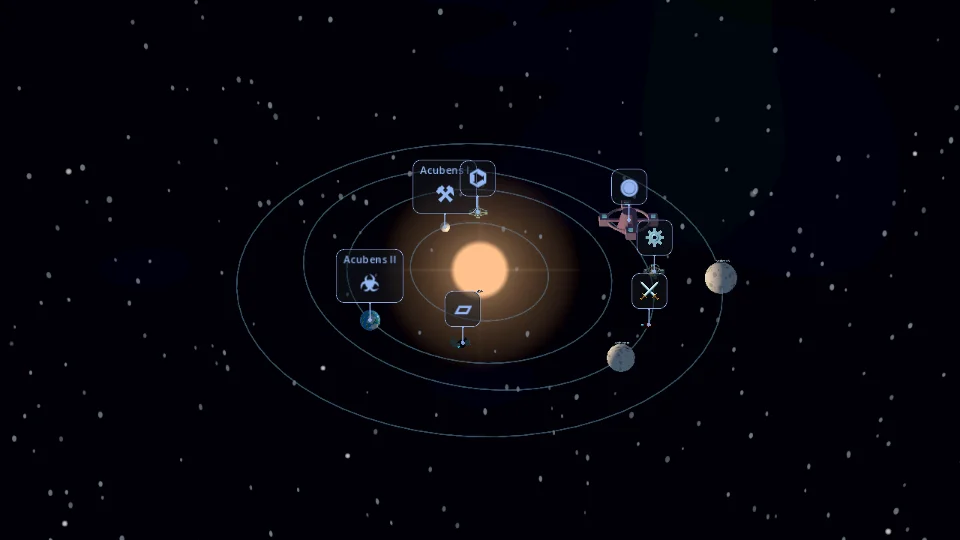
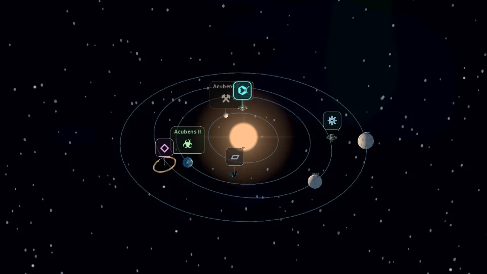

# Star-map readability and composition refinement

Starting revision: `d26d7ac3d8015caf31143117e5ee0a8c3c1d036c`.

## Audit and baseline

The existing marker conflated completion with Button.disabled styling, lacked selected
presentation, and used equally strong connectors for all available encounters. Stable
above-object positioning and nearest-icon/model hit testing already existed. Standalone
positions still used the six ANCHORS plus small jitter. Central solar lighting, 22° lens,
35° overview, independent cosmetic RNG, PNG layers and PackedScene models are retained.

Baseline: six focused headless scripts plus import passed. The baseline Mobile
presentation run passed 193 checks. Screenshots are in `star_map_refinement_screenshots/`.

| Owner | Before / retained responsibility | Refinement |
|---|---|---|
| visual_system.gd | Pure cosmetic data, planets and assignment | Pass 2 replaces standalone placement only |
| star_map_3d.gd | Projection, navigation presentation, scene assembly | Selected marker, bounded overlap emphasis |
| poi_marker.gd | Category style and deterministic hit testing | Explicit completion, unavailable and highlight presentation |
| planet_models.gd | Planet surfaces and orbital ribbons | Pass 2 selection material / surface calibration |
| map_camera.gd | Camera motion | Unchanged |
| space_environment.gd | GPU camera-relative backgrounds | Pass 2 contrast calibration |
| ExpeditionState / save codec | Gameplay and persistence | Unchanged |

## Pass 1: navigation readability

Completion is explicitly supplied from encounter data. Temporary input blocking is a
separate visual flag; native disabled/input guards remain authoritative for input.
Available markers retain category colors. Completed markers desaturate/darken and gain
a small check, without disappearing. Blocking shows a small pause mark and retains
category color. Selection, hover and keyboard focus raise border contrast with a small
static shadow, without scaling or repositioning. Background alpha is 0.5 in every state;
icon and name alpha remain 1. Icons/mappings, fonts and sizes are unchanged.

Selected/focused/hovered markers draw above available markers, then completed markers.
An O(n²) rectangle check (at most seven normal markers) reduces secondary border emphasis
without moving anything. Native styles are modified only when presentation changes;
there are no per-frame node/font/style reconstructions. Nearest-icon/model hit testing
and tie-breaking are preserved. Connectors are thinner and subdued, stronger only for
highlights and weaker for completed encounters. Returning to overview clears selection.

`star_map_readability_test.gd` covers visual state, focus, fixed bounds, overlap priority,
unique model taps and gesture blocking. It captures three landscape resolutions,
crowded four-planet, two-planet, bright/dark and travel cases. Physical Android font
rendering remains unverified; this pass intentionally retains the existing glyph set.

Pass 1 gate: seven focused scripts plus import passed; 58 state/readability checks
passed headlessly and on Mobile/Vulkan and Compatibility/OpenGL. A short-travel timing
regression was traced to redundant theme work on temporary-block changes and fixed by
redraw-only blocking and batched color overrides; travel timers/tests were not changed.

| Before | Pass 1: crowded / selected / completed |
|---|---|
|  |  |

Other Pass 1 captures include states at 1280×720, 960×540 and 1680×720, two planets,
bright/dark environments and active travel. WebP files are QA captures, excluded from
Godot import/export by `.gdignore`, not new game artwork.
