# Restrained star-system atmospheric accents

The existing star-system renderer occasionally references battlefield assets. This
is presentation only: it does not create destinations or environmental regions.
`ExpeditionState`, system generation, navigation, encounters, factions, battle
snapshots and save codecs are unchanged.

## Ownership and integration

- `scripts/presentation/star_system/atmospheric_accents.gd` produces a small recipe
  using `VisualSystem.random_for(seed, system, "atmospheric-accents-v1")`. It builds
  optional world scenery using the existing `environment_meshes.gd` helpers.
- `atmospheric_settings.gd` and `resources/presentation/atmospheric_accents.tres`
  expose composition weights, intensity and Android instance budget. The existing
  `MapSettings.atmospheric_accents` property references this resource.
- `star_map_3d.gd` supplies final visual positions, saved variation/environment
  records and object exclusions after ordinary generation and placement finish.
  `atmospheric_recipe`/`atmospheric_nodes` are disposable presentation data only.
- `space_environment.gd` adds at most one accent through its existing sky-layer
  pipeline. It retains the starfield, existing generated layers and their settings.
- `cosmic_layer.gdshader` adds an opt-in `panorama_patch` branch. Defaults preserve
  existing encounter/background materials. No battlefield asset is modified.

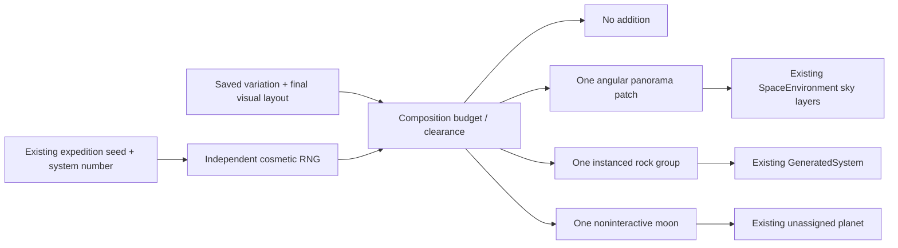

## Distribution and controls

Weights form **exclusive** intervals; they are not independent coin flips. Keep
their sum at or below 1.0; the remaining probability is quiet. Only one optional
accent is chosen, with no additional supporting feature stacked on top.

| Inspector setting | Default |
| --- | ---: |
| `enabled` | true |
| `panorama_chance` | 0.30 (65% nebula / 35% galaxy) |
| `rocks_chance` | 0.20 |
| `moon_chance` | 0.15 |
| `anomaly_chance` | 0.05 |
| `busy_system_multiplier` | 0.30 |
| `image_opacity` | 0.26, further scaled by existing background strength |
| `image_brightness` | 0.62 |
| `rock_count` | 16 |
| `android_fraction` | 0.50 (eight visible rocks) |

Twin suns, dominant intensity, crowded/storm-dominated/chaotic layouts, multiple
existing background features or a solar region of radius >=12 reduce the budget.
Multiple existing sky features or a quasar veto any additional panorama/anomaly.
Rejected geometry becomes quiet rather than relocating gameplay objects.

Measured deterministic samples:

| Context | Quiet | Panorama | Rocks | Moon | Anomaly |
| --- | ---: | ---: | ---: | ---: | ---: |
| 4,000 quiet-context recipes | 1,190 | 1,185 | 823 | 597 | 205 |
| Same seeds, busy context | 3,161 | 381 | 227 | 176 | 55 |
| 600 actual Defense systems (100 seeds, Systems 1–6) | 430 | 70 | 56 | 36 | 8 |

Actual systems receive fewer additions than the unsuppressed targets. This is
intentional: existing environmental/background variety takes priority.

## Reused assets and construction

| Accent | Existing source | Treatment |
| --- | --- | --- |
| Nebula | `third_party/willosuna_space/nebula_rose_blue/nebula_rose_blue_panorama_4096.jpg` | Soft localized angular window around its gas formations |
| Galaxy | `third_party/willosuna_space/galaxy_spiral_blue/galaxy_spiral_blue_panorama_4096.jpg` | Small, faint spiral landmark |
| Rare anomaly | `third_party/willosuna_space/black_hole_gold/black_hole_gold_panorama_4096.jpg` | Distant golden accretion structure; no rift or gravity mechanics |
| Rocks | `scripts/presentation/environment_meshes.gd`, used by modifier battlefields | Shared seven-segment low-poly rock mesh and rough material, one MultiMesh |
| Moon | Planetary Orbit's low-poly sphere technique and `shaders/planet_surface.gdshader` | One small opaque moon, no atmosphere or selection marker |

The ring/planet assets were reviewed; no extra ring is added because current
planetary/destination representations already provide that visual vocabulary.
Neither an entire arena nor any ship/camera setup is instantiated for decoration.
No images, meshes from external packages, icons or generated artwork are added.

### Projection and ordering

Panoramas are not stretched wholesale across flat quads. One 6×6 angular cap
(72 triangles) maps a cropped equirectangular longitude/latitude window to curved
geometry. Galaxy/anomaly crop scales retain recognizable silhouettes at small
apparent sizes. UV2 carries angular distance for the soft boundary. Sampling wraps
longitude with unwrapped derivatives and clamps latitude away from poles.

The cap keeps a fixed world direction while following camera translation at sky
distance. Camera rotation reveals it naturally; it has no translation parallax.
The initial placement fits the production map's narrow **22-degree FOV**, not a
battle-camera assumption. It remains fixed when panning, zooming or resizing.

The existing shader draws at far depth; the opt-in cap uses a tiny far-plane
inset and normal depth testing, with no depth writes. Opaque bodies occlude it.
Negative render priority keeps it behind normal transparent map objects. Existing
central foreground protection further restrains imagery around the main scene.

Rock centers lie beyond the navigable X/Z rectangle and below the gameplay plane;
this keeps purely decorative clusters distinct from physical asteroid regions.
They use final object exclusions with an additional clearance margin. Moons are
attached only to unassigned planets and rejected if they overlap another final
body/exclusion. They follow the parent's existing transform, without simulation.
Neither decoration has a collider, input handler, route or environmental snapshot.

### Performance

Build once per system, at most one extra draw node. There are no new lights,
shadow maps, particles, physics, full-screen passes, viewports or per-frame mesh/
material allocations. Textures reference the original imported Resources and load
only for the selected accent. Android changes visible rock count, not placement;
its transforms are the deterministic desktop prefix. The sky and moon retain
identical geometry on both platforms.

## Persistence and compatibility

No save fields, migrations or new authoritative state are required. Seed, system
number, saved variation, environmental records and unchanged final layout fully
reconstruct the recipe. Resume does not consume gameplay RNG. Existing saves can
gain purely cosmetic scenery; their generated encounters/layouts and unfinished
battle environments remain unchanged. Existing saves with empty variation use the
same independent cosmetic channel. Inspector art tuning can change future visual
reconstruction; it never changes saved gameplay.

## Validation and reproduction

`tests/atmospheric_accents_test.gd` audits 4,000 recipes, busy-system suppression,
clearance rejection, native geometry, Android counts, global RNG isolation and
600 real Defense systems through six systems. It checks legacy Exploration and
Defense saves and restored recipes. A local pre-edit main comparison used all
600 complete serialized save SHA-256 signatures; **every signature matched**.
The reference was captured before implementation, outside the repository; no
baseline fixtures were changed or regenerated.

`tests/atmospheric_accents_render_test.gd` uses real expedition scenes, including
real save/resume, at 1280×720, 960×540 and 1280×573. It checks actual landmark
framing, directional pixel response, translation invariance, visibility over the
production sky, foreground occlusion, original texture identity, bounded draw
nodes and unchanged state/RNG. It captures matching enabled/disabled comparisons
using identical seeds, renderer, camera and viewport size. Scene animation may
advance between frames; disabled comparisons remove only the new accents.

Representative System 1 seeds: quiet **1**, dense **5**, twin-sun **7**, nebula
**8**, rocks **12**, scattered **15**, storm-dominated **23**, galaxy **25**, moon
**44**, rare anomaly **85**. GL Compatibility and Mobile Vulkan use the same
selection. Full captures are written to `.godot/testlogs/atmospheric-accents/`.

```sh
python3 tools/run_regressions.py --godot godot --script atmospheric_accents_test --script atmospheric_accents_render_test
python3 tools/run_rendered_regressions.py --godot godot --renderer gl_compatibility --script atmospheric_accents_render_test
python3 tools/run_rendered_regressions.py --godot godot --renderer mobile --script atmospheric_accents_render_test
```

The local baseline comparison additionally sets `ARCOSPACE_ATMOSPHERE_BASELINE`
to the external 600-signature JSON file. Normal CI does not require that artifact.
Existing generation, visual-system, persistence, gesture, storm, lighting and
modifier-environment suites also run unchanged. Full CI is triggered by the PR;
pending results are not claimed passing. No physical Android/Windows hardware
performance validation is claimed: local GL/Vulkan captures use Mesa software
rendering. Target-phone checks should review texture memory, very dark display
visibility and destination readability. Decorative rocks may be outside the
initial framing; camera panning/zooming reveals them naturally.

## License verification

The existing [Willosuna license](../third_party/willosuna_space/LICENSE.txt)
explicitly permits personal/commercial game use, modification and renders; it
forbids repackaging/distributing the images as a texture library or collection.
This pass references the existing licensed files in-game and adds only rendered
gameplay screenshots. Attribution is optional; the existing license/README and
[author source](https://willosuna.itch.io/space-skyboxes) are retained. No third-party
files are moved, copied, edited or relicensed. Native mesh helpers/surface shader
remain covered by the project's existing MIT license.

## Actual Godot captures

These are production expedition captures, not mockups. Each comparison uses the
same seed, camera, renderer and viewport dimensions; only the new accent is
hidden for the “before” frame. Original sky/environment features remain visible.

| GL Compatibility, 960×540 — before | After |
| --- | --- |
| 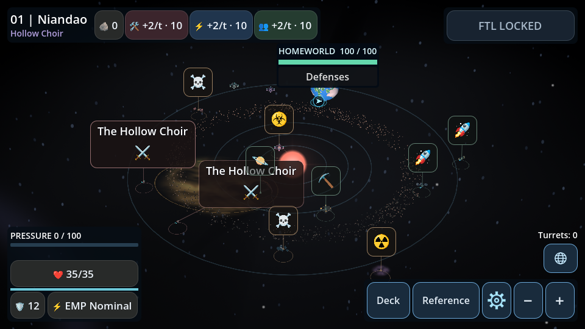 | 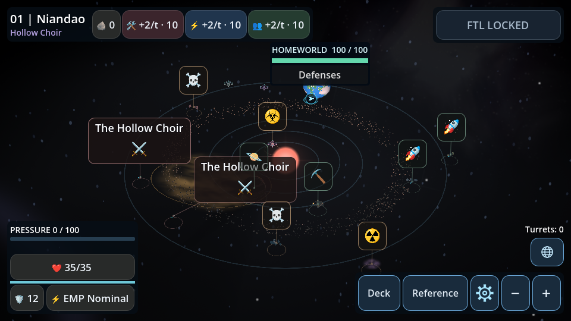 |
| 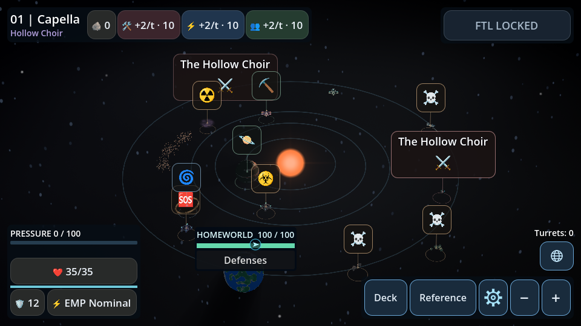 | 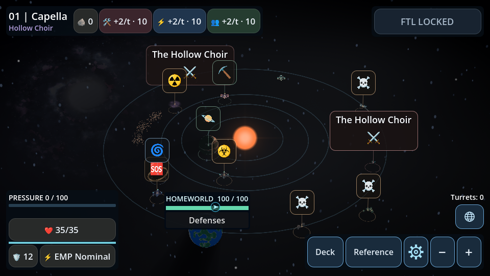 |
| 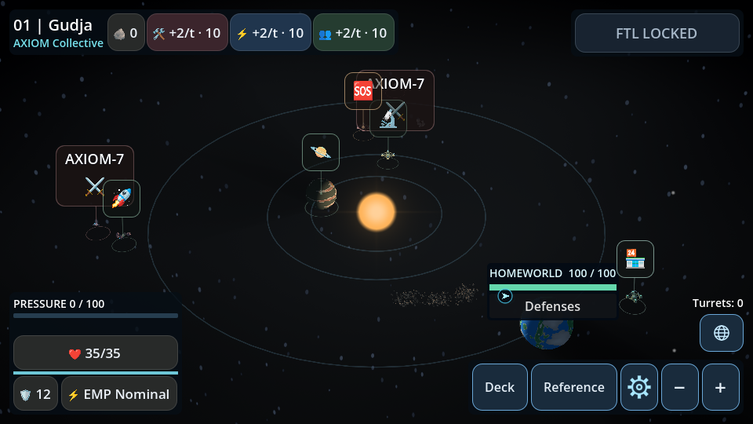 | 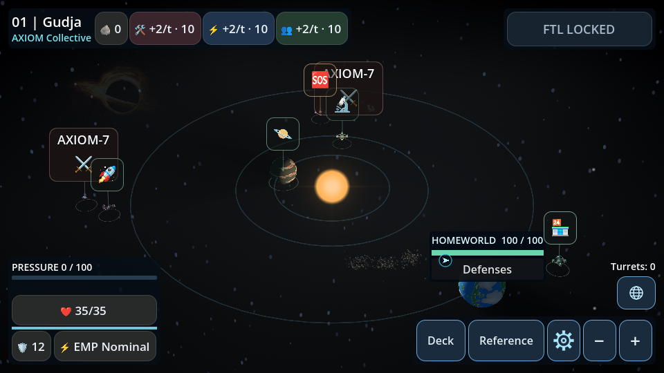 |

| Mobile Vulkan, 1280×573 — before | After |
| --- | --- |
| 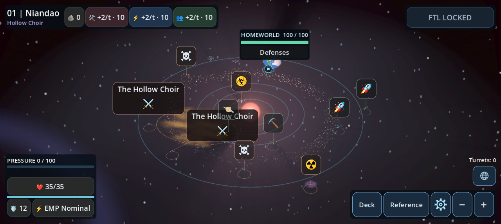 | 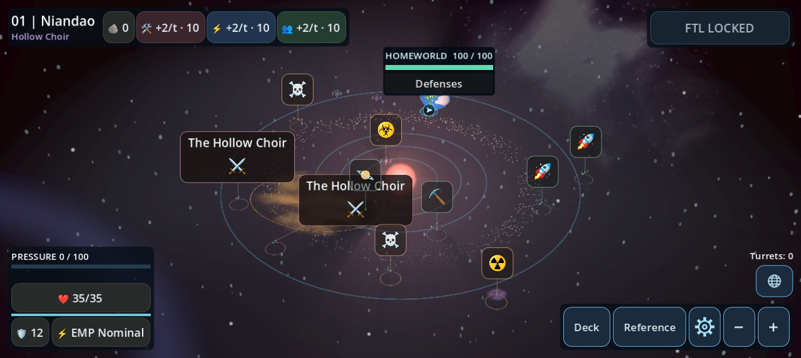 |
| 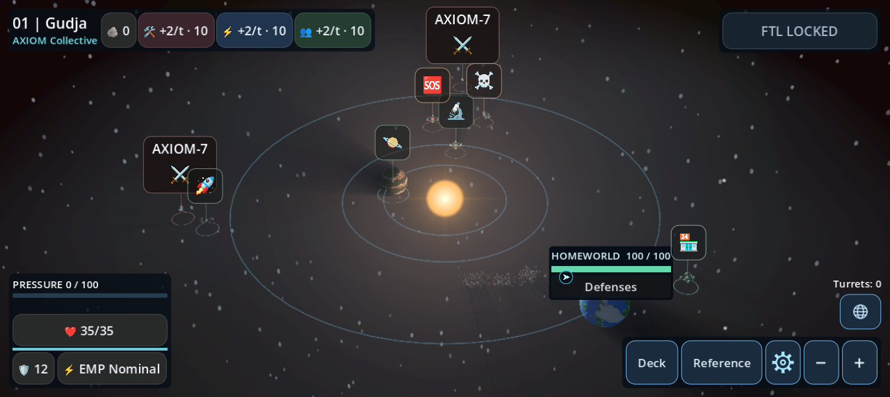 | 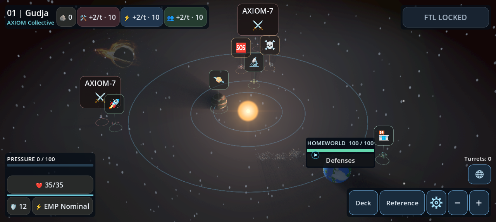 |

Mobile's existing exposure/corona presentation is brighter than Compatibility;
compare within a row. This pass does not tune global lighting or exposure.

| Quiet single star | Twin suns |
| --- | --- |
| 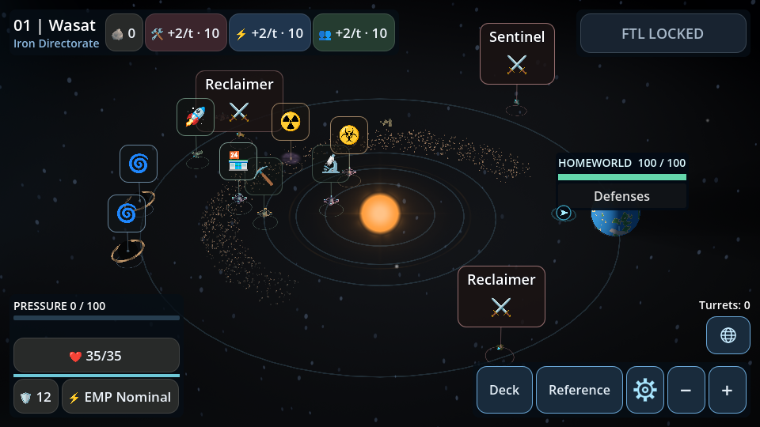 | 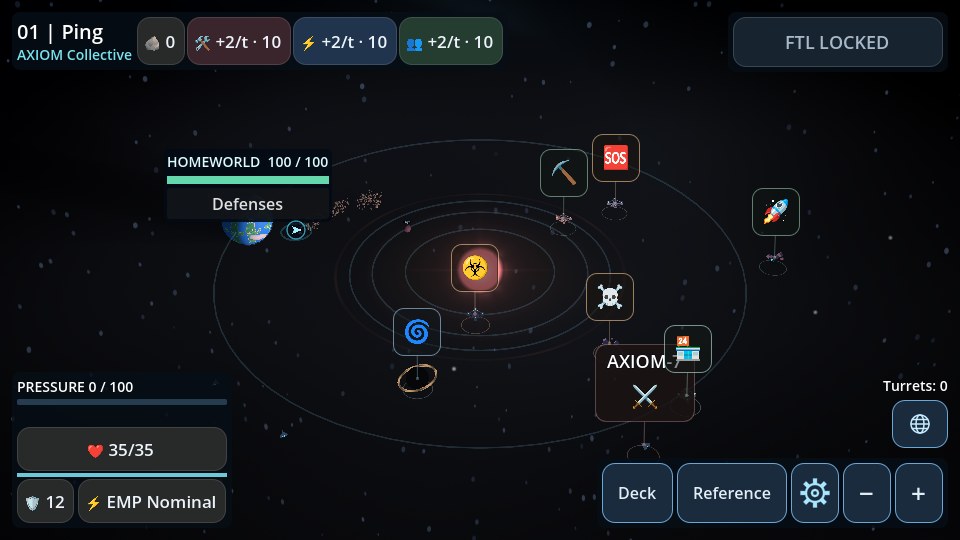 |
| Dense planetary layout | Scattered frontier |
| 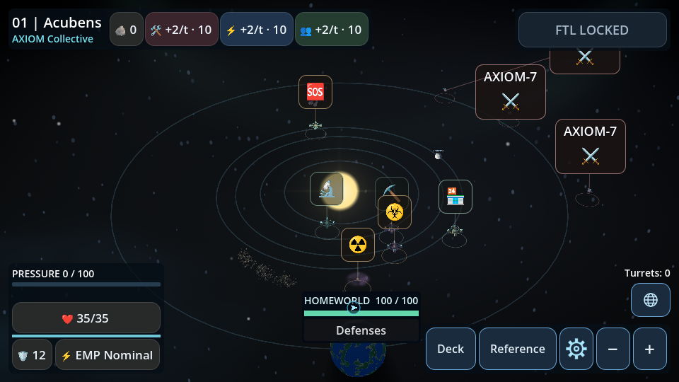 | 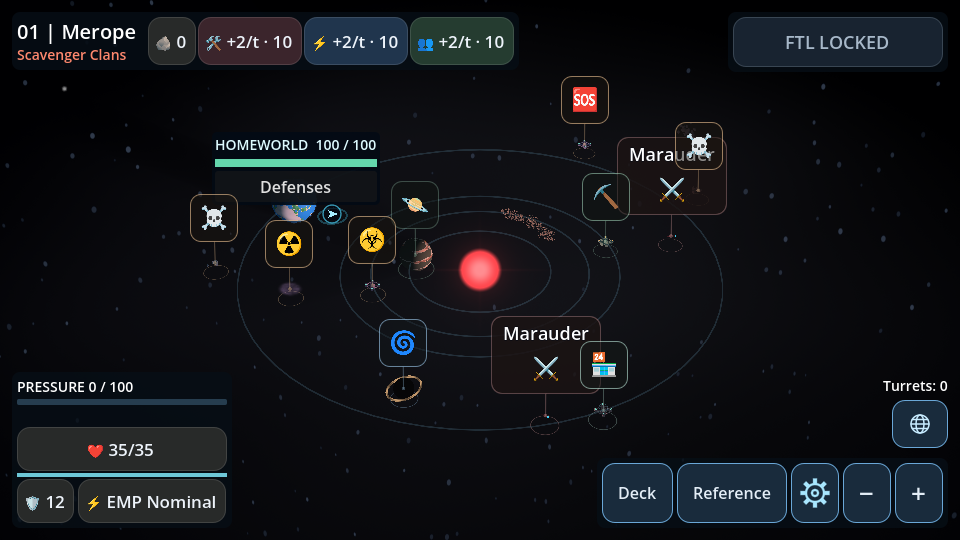 |
| Existing storm remains dominant | Mobile twin suns |
| 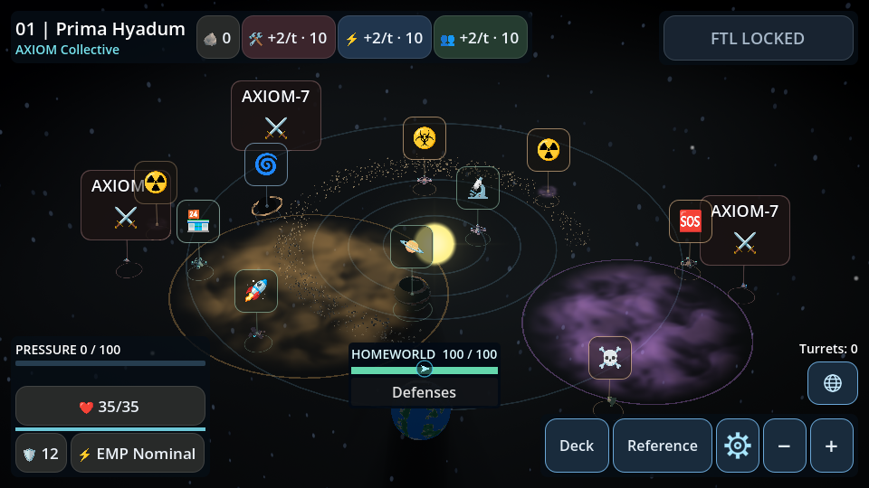 | 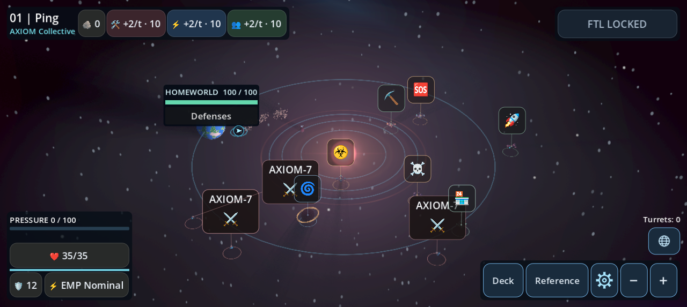 |

World decorations use deliberately small scales in overview. The additional
1280×720 detail views below use the existing production map camera's focus motion
at those same generated objects. They demonstrate geometry, not a new inspection
interaction or a selectable destination.

| Sparse rock group, focused view | Small moon beside an unassigned planet |
| --- | --- |
| 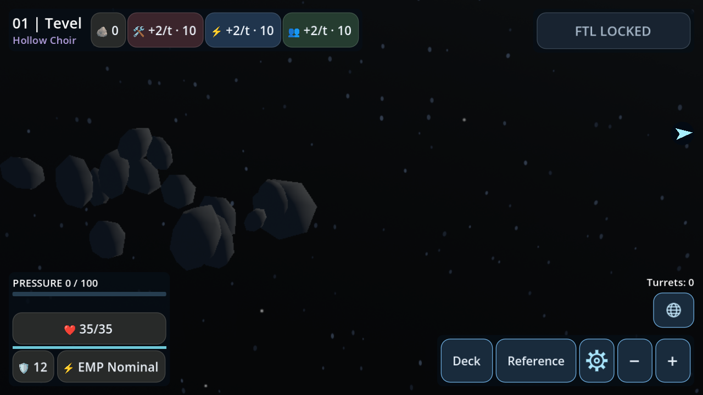 | 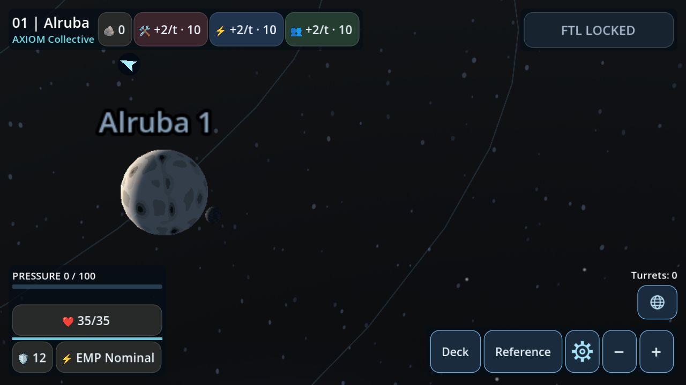 |

Overview before/after pairs for both world decorations are also retained in the
screenshot folder, alongside 1280×720 panorama views. The default overview can
leave edge scenery out of frame; decorations never change the system camera fit.
