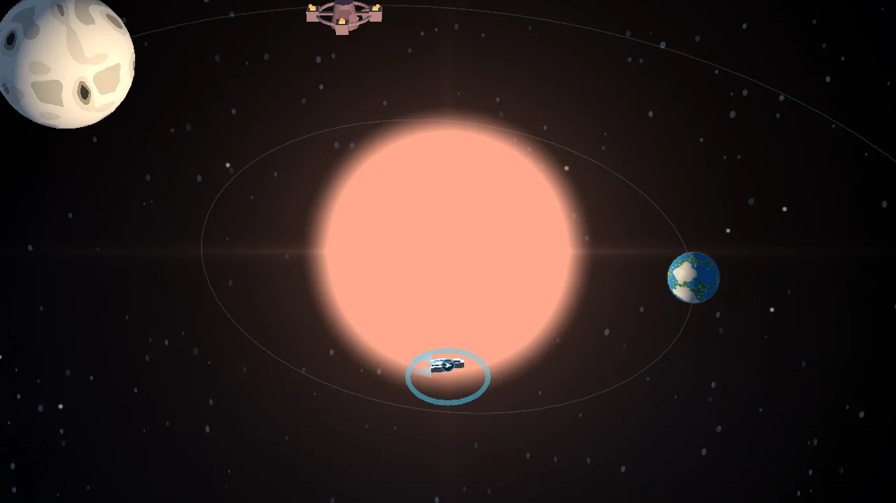
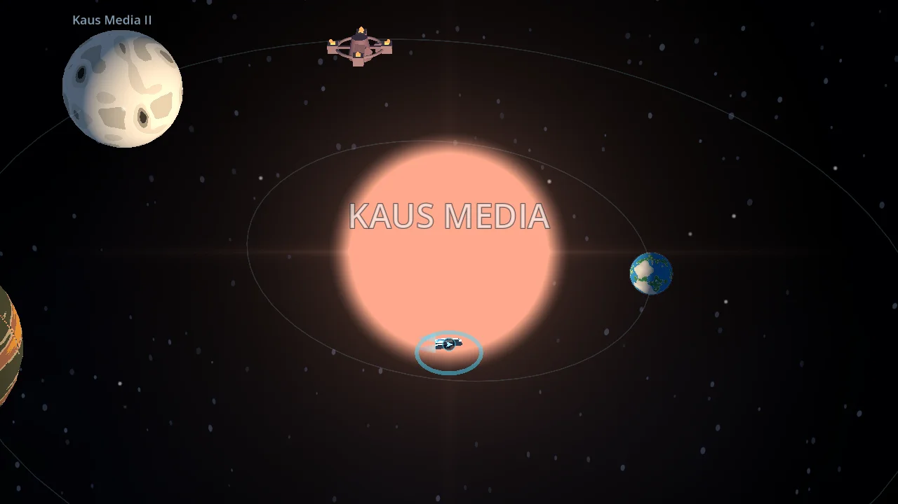
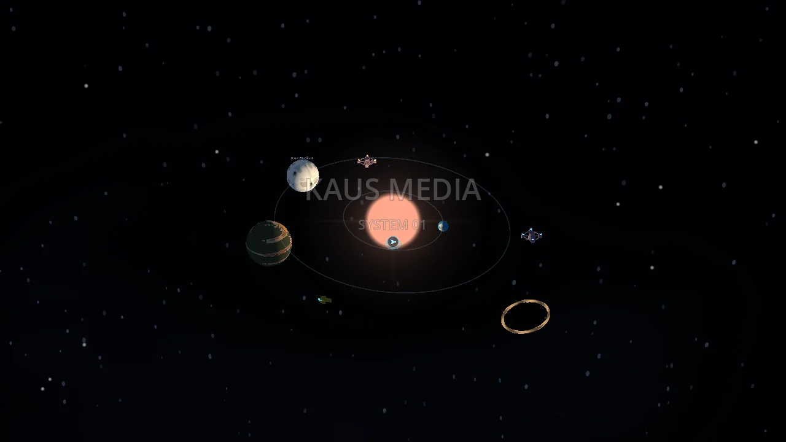
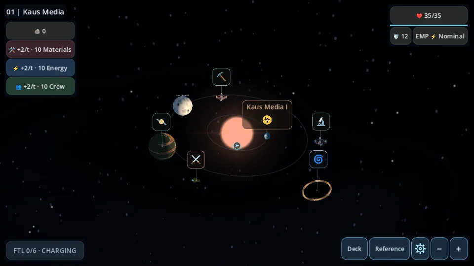

# Full-screen star-system HUD and arrival introduction

Starting revision: `0b9f58953f28edcf2629dda6646f518ac2189684`. This pass changes the 3D overview and its arrival presentation. ExpeditionState, save codec/schema, cards, combat, procedural generation, travel, Chasedowns and audio are unchanged.

## Overview controls

The existing star-map viewport now occupies the whole screen. `ExpeditionScreen` hosts a scene-local `star_system_hud.gd` which reparents the existing controls for overview and restores their original parent and sibling order for focused PoIs, rewards and battle. There is one resource-button set, one settings button and one FTL action; no new gameplay owner or autoload.

| Position | Contents |
|---|---|
| Upper left | Compact `01 | Kaus Media` cosmetic identifier; separate vertical Salvage/Materials/Energy/Crew panel |
| Upper right | Existing Hull repair button and thin Hull bar; existing Shields and explicitly labelled EMP side by side |
| Lower left | Existing FTL charge, progress strip, Charging/Ready/Boss Lock and Jump action |
| Lower right | Existing Deck, Reference, Settings, minus and plus buttons in that order |

Existing tooltips, colored adjustments, next-battle bonuses/penalties, temporary plating and Hull heartbeat are retained. Reparenting the actual ResourceBar owner keeps its info overlay and heartbeat active. Android safe-area insets are converted from window pixels to logical viewport units. Corner panels remain compact; the center has no permanent UI panel.

The old map zoom group is empty/hidden while its two buttons live in the utility row. They retain their camera callbacks. The map excludes cached HUD rectangles from gesture starts and marker hit testing. Markers, outlines and badges intersecting those regions are hidden as a unit, with no coordinate relocation or clamping. Pan/zoom can bring obscured markers into open space. The map clips at its full-screen bounds. Focused PoI views restore the previous header/sidebar layout and suspend the corner HUD. Battle entry hides it completely; exactly one settings gear remains visible in battle.

## Cinematic ownership and timing

`Expedition` coordinates a guarded `INTRO` presentation phase. `map_camera.gd` owns the single camera pullback; `star_system_hud.gd` owns text, corner fades and temporary HUD input locks. The existing white curtain is reused after FTL. The ship-selection handoff supplies an ephemeral `new_system` launch flag, never stored in the save. Continue has no flag and reconstructs overview immediately. New expeditions, restarts from a fresh game and successful 3D FTL jumps introduce their new systems; reopening a PoI or ordinary overview never replays it.

Default timing, in seconds from reveal start:

| Time | Presentation |
|---|---|
| 0.0 | Camera already 22 world units from the sun; pullback begins as white fades |
| 0.4–1.0 | System name fades in |
| 1.4–1.9 | `SYSTEM 01` subtitle fades in |
| 3.9–4.5 | Centered text fades out |
| 4.5 | Camera reaches fitted overview |
| 4.5–5.05 | Five corner panels fade in, staggered by about 0.063 seconds |
| 5.05 | HUD input and normal navigation unlock once |

Tune `resources/presentation/star_system_settings.tres` → **System Introduction** → **Introduction Duration** (default 5.0) and **Introduction Margin** (1.18). Timings scale together; total duration is approximately 1.01× the configured duration. The camera retains the existing 22° FOV and calibrated overview direction. No extra sky viewport, particles, generated artwork, text shader or audio change was added.

Buttons and keyboard focus are disabled during intro; destination labels and map gestures are blocked. The camera's final zoom and target are synchronized before normal processing resumes. There is no second overview tween. Cancellation invalidates pending callbacks, stops tweens, restores HUD opacity/input and places the camera in a valid overview. App pause/back and scene departure cancel an active introduction. Resume never depends on a temporary camera transform.

## Framing calculation

For each new visual system, sample the actual inclined elliptical orbits (64 positions per orbit) and include bounding-box corners around the sun, planets and standalone destinations with modest label/model clearance. Transform those points into the calibrated camera basis.

With vertical half-FOV tangent `t`, reference aspect `a = min(actual_aspect, 16/9)` and margin `m`, choose the maximum required camera distance over all points:

`distance >= local.z + m * max(abs(local.x)/(t*a), abs(local.y)/t)`.

The resulting distance determines synchronized overview zoom. This makes wide screens use the 16:9 design box while narrower landscapes use their available width. No procedural position is changed. Final framing is computed on fresh construction/resume and generation; ordinary PoI returns retain the player's pan and zoom. Existing wheel/pinch functions and calibrated bounds remain active afterward.

## Verification

The shared runner executed 114 scripts plus import (115 runs). Three initial failures were investigated: an old fixed-default-zoom assertion, settings visibility/intro timing, and a native error from returning moved zoom buttons to an explicitly freed map. The assertion was adapted to fitted zoom, battle HUD hiding and settings timing were fixed, and map teardown now releases controls whose original parent no longer exists. All three focused reruns passed. There was no second complete shared-suite invocation after those fixes; the JSON preserves initial statuses and focused results explicitly.

Release-focused checks:

- New HUD/intro test: 4,774 checks passed. It covers 45 generated-system/aspect framing combinations, title/subtitle order, close initialization, synchronized final camera, input locking, control reuse/order, cancellation, map replacement and defeat-screen restoration.
- The complete encoded save payload, gameplay RNG and ship position remain unchanged through the introduction.
- Settings: 79 checks passed; map transition/FTL: 106 checks passed; expedition lifecycle: 26 checks passed.
- Card management: 107 checks passed; existing map zoom/fade, 3D navigation, initialization and compact UI checks passed after adapting overview-only expectations.
- Existing baseline fixtures matched 2,220 card-effect checkpoints, 72 combat traces and 1,044 expedition checkpoints. No gameplay fixture was regenerated.
- Rendered Mobile/Vulkan and Compatibility/OpenGL checks passed at 960×540, 1280×720 and 1680×720 output sizes. The existing canvas stretch uses a 1280×720 logical layout at the smallest output size.

## Representative renders

The screenshot folder also contains subtitle and larger/wide HUD captures. It is excluded from export with `.gdignore`.

## Scope and limitations

Main files: `scripts/ui/star_system_hud.gd` (new overview layout and text animation), `expedition_screen.gd` (mode switching and viewport rectangle), `expedition.gd` (guarded introduction), `battle_setup.gd` (new-run launch flag), `star_map_3d.gd` (framing points and HUD exclusion), `map_camera.gd` (fit/pullback), `map_settings.gd` (two tuning values), `poi_marker.gd` (reserved input regions). Focused tests and existing presentation tests were updated; no source files were removed.

Tests used Godot 4.7.2 and Linux Mesa/llvmpipe software rendering. No physical Android or Windows hardware testing was performed. Native Android cutouts and real GPU frame rates remain unverified. Existing ObjectDB shutdown warnings occur in several tests and are retained in logs.

Fixed projected markers can be concealed behind a corner panel; they are not relocated and can be revealed by panning or zooming. Corner geometry is cached and recomputed on layout changes. Runtime uses the same viewport, meshes, resource buttons and camera; added work is bounded marker/rectangle checks and short scene-owned tweens. Focused PoI, card management, battle and menu layouts retain their established owners.
