# Star-system lighting and lens polish

Baseline: main including PR #51 (0dead4b). This is presentation-only. No state,
generation, environmental geometry, saves, combat, navigation or input code changes.

## Architecture and calibration

The existing shadow-free OmniLight provides real sunward illumination. Ambient
light provides reflected fill. Planet surfaces use procedural PBR materials;
clouds are lit shells, while atmospheres previously emitted a camera-facing Fresnel
halo. Ships use StandardMaterial3D with authored colors, metallic/roughness values,
engines and existing effect passes. Asteroids retain their shared low-poly MultiMesh
material. Sun, solar interference, sky, icons and selection rings have independent
unshaded/emissive presentation. There are no separately generated moons currently;
the rocky/spherical material path supports the same lighting response.

Baseline probe measurements confirmed that actual illumination already survives
camera panning. The perceived drop was largely the missing screen-space lens lift.
This change improves underlying material contrast rather than faking offscreen flare.

Central settings in map_settings.gd:

| Parameter | Before | After |
|---|---:|---:|
| sunlight_energy | 2.8 | 3.2 |
| ambient_light_energy | 0.28 | 0.28 |
| dark_side_fill (material ambient response) | 1 | 0.72 |
| day_night_contrast | 1 | 1.18 |
| directional_rim_intensity | camera emission | 0.12, light-dependent |
| lens_flare_multiplier | 0.32 | 0.32 |
| lens_edge_fade_range | 0.02-0.10 | 0.00-0.035 |

A small opt-in shader include derives sun direction in view space from the actual
world-space star position. It softens the terminator response, retains dark-side
ambient detail and gates the native rim toward the sun. The original planet noise,
colors, roughness, lava emission and textures remain intact. Atmosphere emission
is gated sunward rather than brightening the entire dark silhouette. Clouds and
the fallback planet shader share the calibration. All shared shaders default to
legacy response; only map-owned material instances opt in.

Ship and station materials use Godot's native light-dependent rim, with no extra
pass, preserving their PBR and existing damage/repair chains. Shared authored
resources are duplicated before tuning; ship-owned instances retain their references.
Asteroid materials are not modified. Map initialization and temporary tactical ship
creation apply tuning once, with no new per-frame material traversal.

Native rim behavior and shader coordinate conventions follow the official docs:
[material rim](https://docs.godotengine.org/en/stable/tutorials/3d/standard_material_3d.html#rim),
[spatial shader reference](https://docs.godotengine.org/en/stable/tutorials/shaders/shader_reference/spatial_shader.html).

## Lens borders and compatibility

The addon already clamps the eight surrounding depth taps and uses clamp-to-edge
sampling for the radial rays. No addon changes are required. The adapter retains
its sample count of 20, centered multiplier, anamorphic calibration, visibility,
depth occlusion, RenderingDevice safeguards and GL fallback. Only edge attenuation
moves to the final 3.5 percent of the viewport. The smooth curve reaches zero at
the actual border; offscreen and behind-camera sources never dispatch. The source
is always projected from its actual position, never pinned to screen center.

No lights, shadow maps, geometry, textures or compositing passes are added. The
same lightweight material path works on GL and Mobile. Windows Mobile captures use
D3D12; Linux CI exercises Mobile Vulkan. Physical Android device performance has
not been measured. GL has the existing procedural sun fallback without the RD lens
compositor. Existing lens occlusion is approximate nine-tap depth visibility, not
new temporal antialiasing; its safeguards remain unchanged.

## Validation and comparisons

star_system_lighting_test.gd captures seven representative views and checks edge
attenuation, projected near-edge strength, behind/offscreen suppression, actual GPU
depth occlusion, planetary sun position, asteroid/PoI presence and unchanged saved
state/RNG. Neutral opaque probes compare the same world-space surface patches with
the source centered and completely outside the frustum, with the compositor off.
star_system_lighting_material_test.gd checks preset isolation, every planet family,
fallback rendering, translated stars, ship colors/effect passes and untouched battle
materials. The rendered test is registered in both existing CI suites.

Local neutral probe results (display-image luminance, not physical radiometry):

| Renderer | Before day/night | After day/night | After night luminance |
|---|---:|---:|---:|
| GL Compatibility | 2.54 | 4.13 | 0.079 |
| Mobile D3D12 | 2.58 | 3.81 | 0.085 |

Visible/offscreen source measurements agree within 0.001 in these captures. Overview
draw calls remain 326 on GL and 231 on Mobile in the local fixture. These are
comparative observations, not device-independent performance thresholds.

Before captures ran the actual parent revision's rendering files, restored afterward.
The same seed, geometry and camera fixtures are used before/after. Close-up fixtures
hide labels/orbit guides/player feedback to inspect surfaces and position the visual
ship near the planet; these are test-only arrangements. Cosmetic animation clocks
and background effects can vary. Full overview views retain production PoIs, asteroid
formations and solar interference. Complete CI results are recorded in the PR.

| View | Before | After |
|---|---|---|
| Centered Mobile | 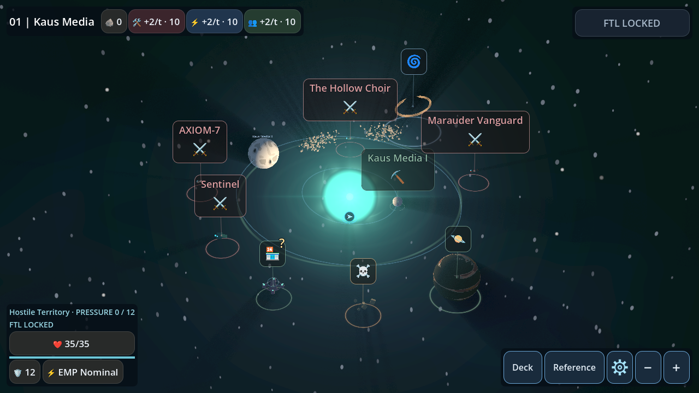 |  |
| Near edge Mobile | 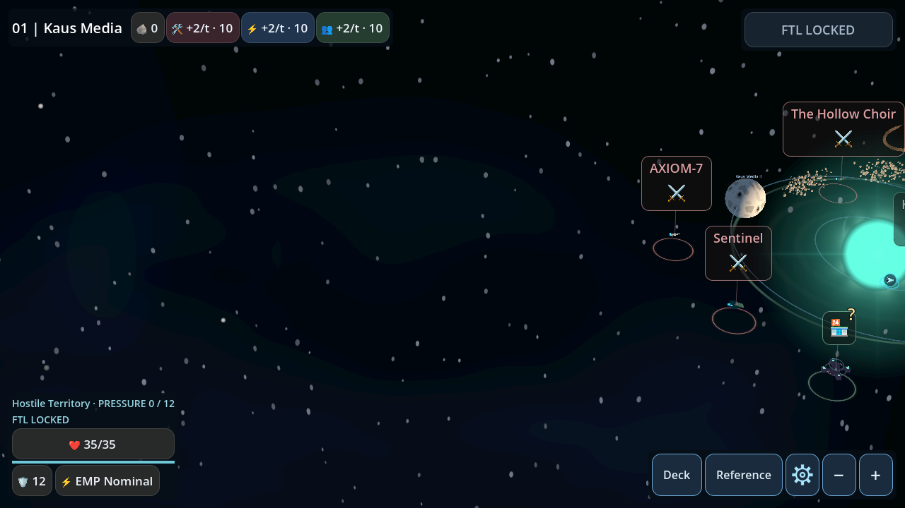 | 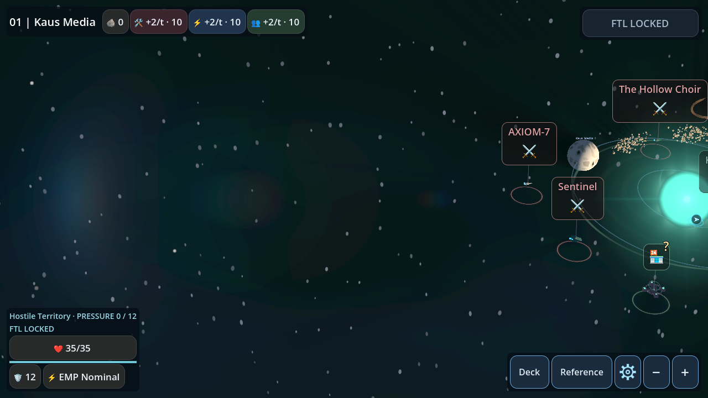 |
| Offscreen GL | 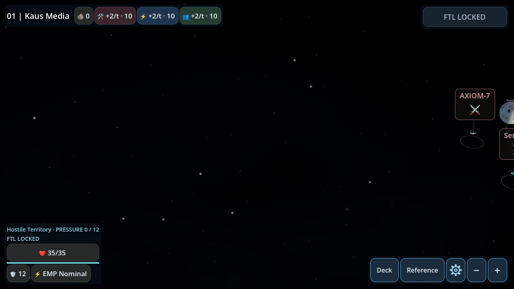 | 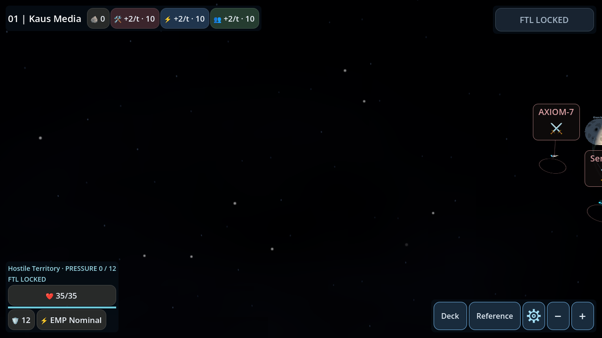 |
| Terminator GL | 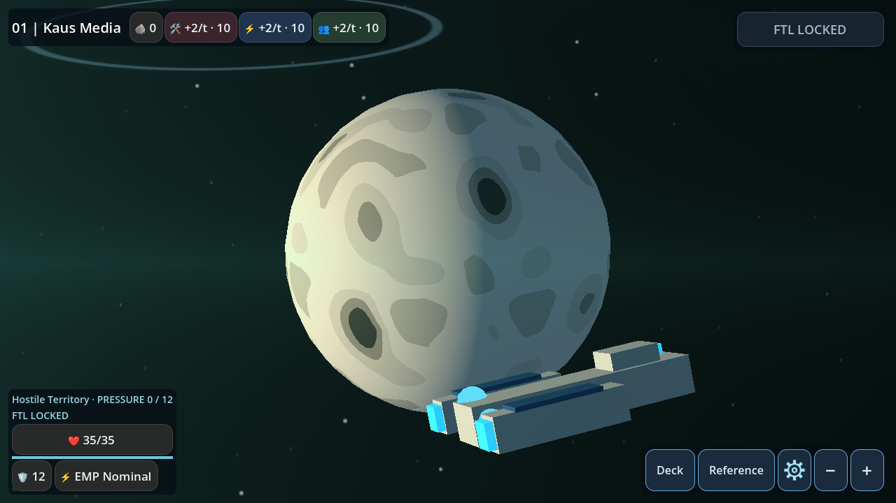 | 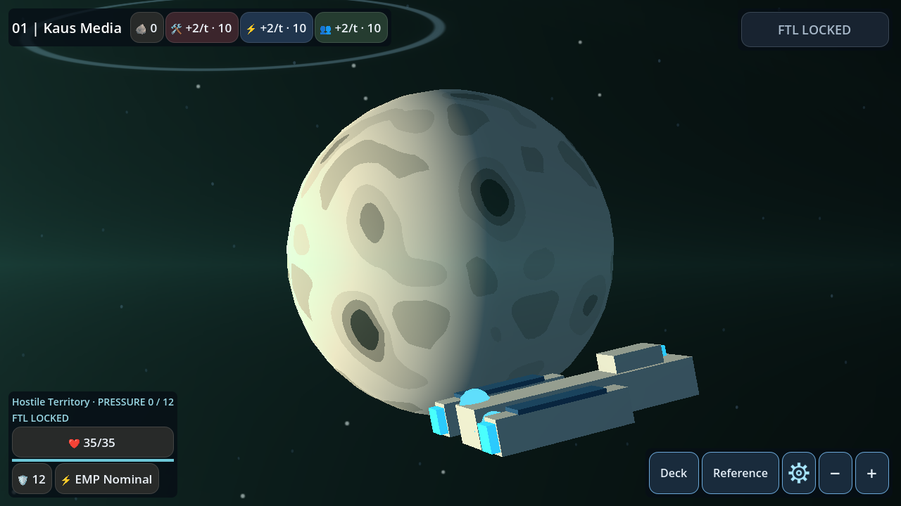 |
| Dark side GL | 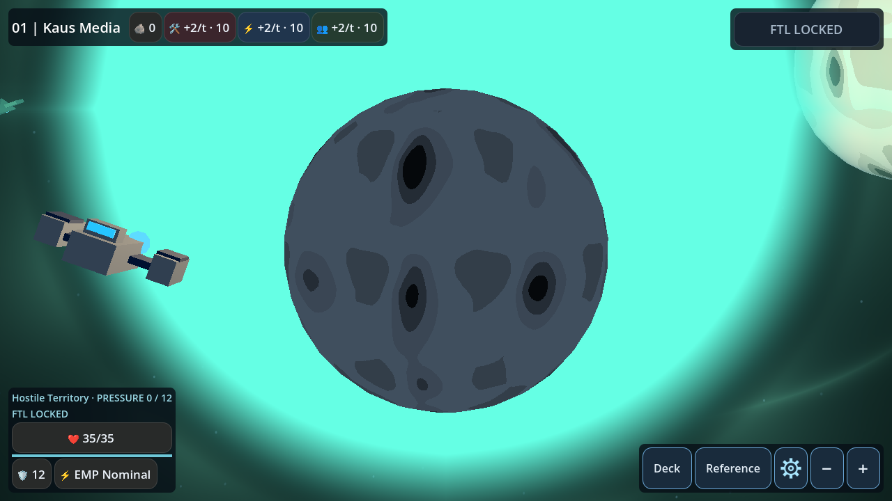 | 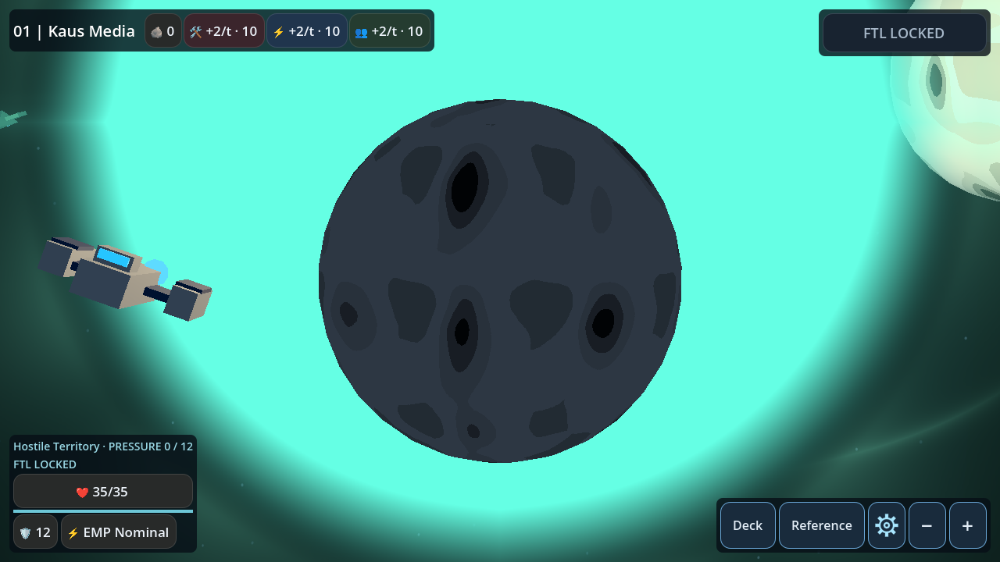 |
| Spacecraft GL | 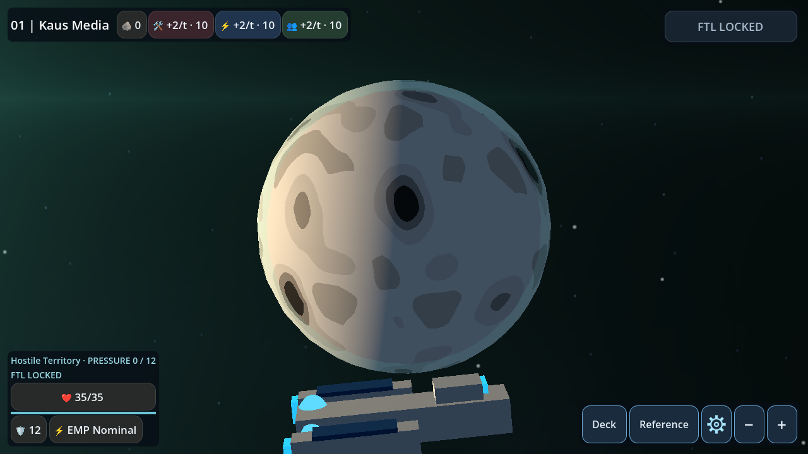 | 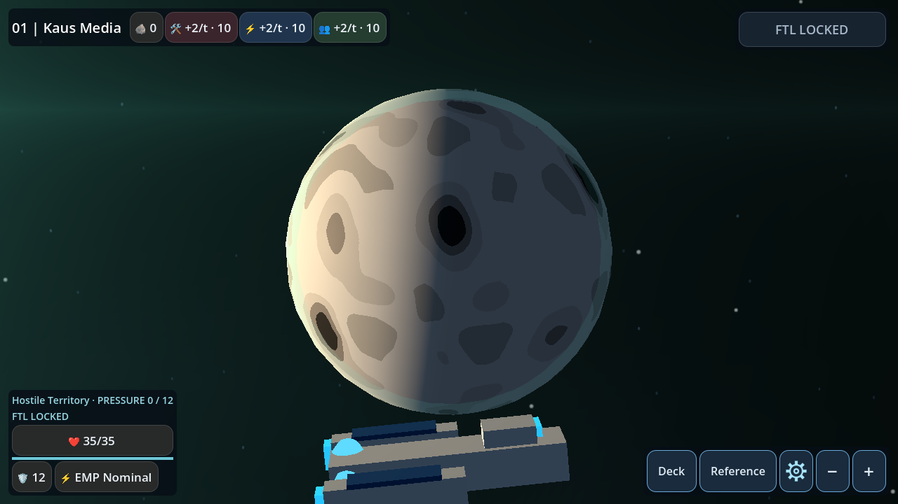 |
