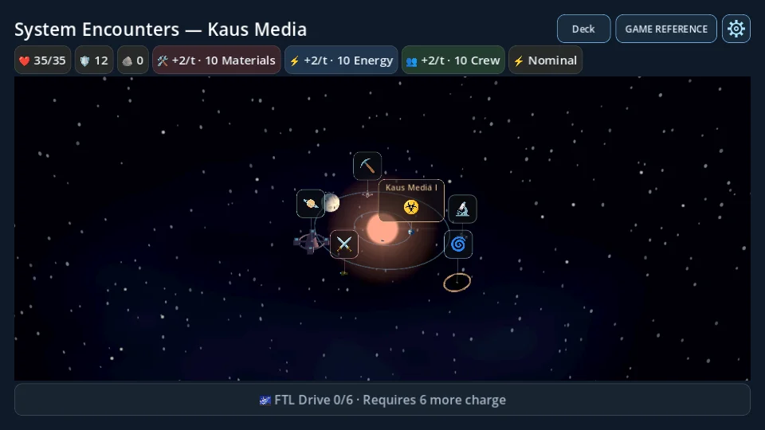
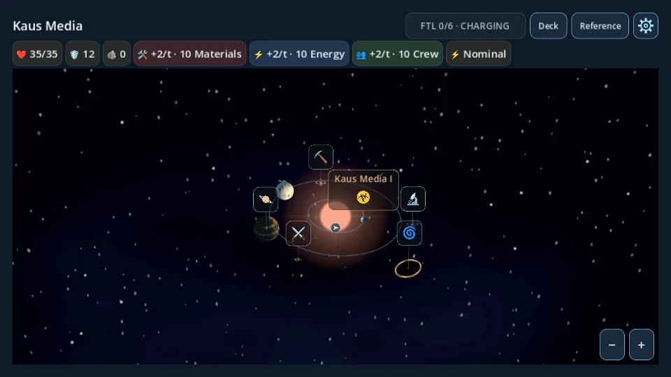
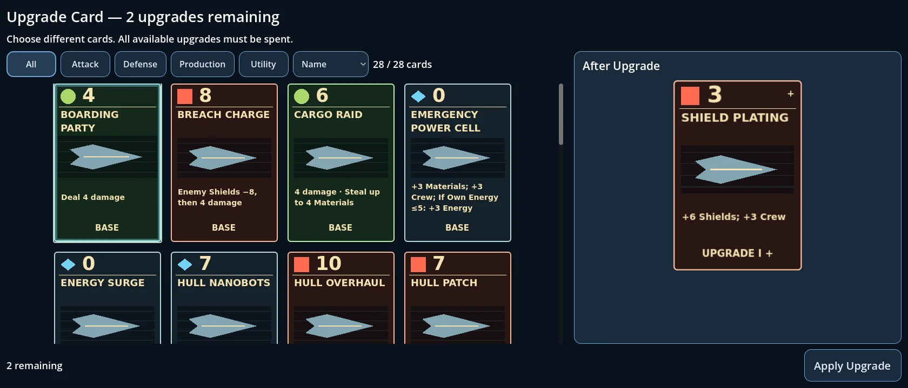

# Star-system polish and flourish

Starting revision: `f79c5214c06d4e32e65a5fb85017c90f195da448`. Three implementation stages: correctness, map feedback, compact UI. The camera's angle, FOV, zoom calibration, planet/encounter placement and uninterrupted travel timing are unchanged.

## Correctness and travel ownership

The screen now establishes the map rectangle when mounting it and whenever the body rectangle changes. The map starts with its actual viewport dimensions and synchronous default camera transform, instead of temporarily inheriting the full-screen anchors and waiting for the screen's process callback. No extra transition or concealment animation was added. Tests compare the initial camera transform and map/viewport bounds on the first twelve frames.

Standalone `gas_giant` models now explicitly build a sphere with the existing gaseous planet material. Assigned giants still use PlanetModels. No encounter or cosmetic-generation logic changed.

### Chasedown cancellation

`travel_destination` is the only resumable movement command. Interception clears it immediately; the interrupted map tween cannot emit arrival. The former `pending_destination` remains historical context for the Chasedown and existing deterministic save fixtures, but completion makes it nonblocking. It is never used to resume movement. A fresh explicit travel command clears that historical value before checking a new trip. No interception probabilities, reward handling or RNG draws were added.

At the stopped presentation boundary the controller records the actual coordinates through `ExpeditionState.stop_intercepted_travel()`. The existing Chasedown encounter may contain an optional `intercept_position` array (three coordinates for the 3D map, two for the fallback). This is the minimum backward-compatible persistence extension needed to preserve the real stop, which cannot be reconstructed exactly from destination indices after arbitrary orbiting. The version remains 1; old saves without coordinates load normally, and old continuation commands are cancelled on decode. Coordinates are finite, bounded and validated. Old binaries do not understand this new optional field.

After resolution the controller reconstructs a stationary ship at that position, clears selection/orbit, and presents overview. The former destination remains unvisited. New travel, including selecting that same destination again, requires player intent. Ordinary arrival removes the historical coordinates. Legacy saves lacking exact coordinates use the existing last-arrival location and remain stationary. The grid fallback has no physical stop coordinates but also never automatically travels onward.

## Scene-local feedback

`map_feedback.gd` owns reusable presentation nodes, never navigation or authoritative state:

- A small, fixed screen-space cyan ship locator, faint world-space identification ring, two low-poly engine jets and one short-range, shadowless engine light.
- Engine intensity and exhaust length ease up on departure and down on arrival/interception. Existing directional turning and banking are unchanged.
- One pooled torus creates a category-tinted selection pulse over 0.5 seconds. Arrival reuses it; retrigger kills the old tween rather than creating more nodes.
- A single scene-local AudioStreamPlayer supplies quiet engine sustain with approximately 0.2-second fades. It uses the existing SFX bus and catalog, with a detached looping stream. Cancellation, hidden-map suspension and scene teardown stop it and scoped one-shots.

Catalog events `map_departure`, `map_engine`, and `map_arrival` reuse existing ship_departure/ui_confirm WAVs. Levels are −16, −30, and −16 dB before the existing SFX mix attenuation; the engine uses pitch 0.65. No music logic or audio assets changed. Replacement remains through `resources/audio/sound_catalog.tres`.

Map-only ship materials have slightly lighter hull colors and small emissive engine details. Stations gain dock lights, research details use cool blue, mining work lights use amber and wrecks have a weak warning lamp. No new dynamic station/enemy lights, particle systems or postprocessing. Existing wormhole/anomaly emissive materials are retained.

Selected orbital paths use alpha 0.70 and 1.25× the existing screen-pixel width. Overview restores the normal material parameters without rebuilding geometry. Decorative planet names grow from 18 to 24; planetary marker names from 14 to 18 with matching padding. Native emoji metrics remain unchanged.

## Compact UI

The header displays only the generated astronomical name. One compact FTL button and embedded progress strip occupy a reserved slot beside it. The button shows charge, readiness or BOSS LOCK and preserves authoritative `can_jump()` eligibility and explanatory tooltips. The reserved slot avoids title/reference movement when other screens hide FTL. No bottom FTL action remains. Deck, Reference, Settings and the resource bar remain accessible.

The map clips its own contents to the usable body rectangle. Projected marker coordinates do not move or clamp to edges; clipped portions cannot receive input. Existing touch/pinch/pan suppression and nearest-marker arbitration remain intact. Compact +/− controls use `camera.zoom_by()` and retain all calibrated bounds. They appear only when overview zoom is available; pointer presses on them do not begin a camera drag.

The PoI TextBacking is transparent and headline text has a subtle dark outline. Other panels are unchanged.

Upgrade mode now shows only “After Upgrade” and the real next-level CardPortrait. It targets 1.2× the previous preview, fitting down only when space requires. Its layout waits for container sizing with a revision guard. Confirmation, mandatory spending, acquisition and replacement transactions are unchanged; Acquire/Replace details retain their existing layouts.

## Verification

Shared regression runner: all 113 scripts plus clean import were executed (114 runs). The initial run found four affected UI tests: old FTL wording, old black headline backing, a header-width shift and the old upgrade-comparison RichTextLabel. The first, second and fourth expectations were updated to the requested presentation; the header shift was fixed by reserving the FTL slot. All four focused reruns passed (3,187 milestone checks, 193 planet checks, 80 confirmation checks and 910 UI overhaul checks). There was no second full-suite invocation after these corrections. Every script has a passing final result through shared coverage or focused rerun; the JSON retains initial failures explicitly.

Release-focused checks passed: 35 initialization/gas/Chasedown/save checks, 58 compact-UI checks, 107 card-management checks, engine/pulse cleanup checks, original Save & Quit and 3D interception resume tests. Unchanged baseline fixtures matched all 2,220 card-effect checkpoints, 72 combat traces and 1,044 expedition checkpoints. Final clean import had no script errors. See `star_system_polish_results.json` for full shared/focused results. New focused scripts cover initial framing and gas geometry, actual intercepted coordinates and v1 compatibility, pooled pulse/engine cleanup and RNG isolation, compact header/FTL, clipping, zoom bounds and upgrade fitting. Existing Chasedown tests now assert stationary return and explicit reselection instead of the intentionally removed automatic continuation. No gameplay fixture was regenerated.

Rendered UI checks use Godot 4.7.2 Mobile/Vulkan and Compatibility/OpenGL through software Mesa/llvmpipe at output resolutions 960×540, 1280×720 and 1680×720. The project's existing canvas stretch maps the smallest output to a 1280×720 logical layout. Before/after captures use the same seed (1042), ship and actions; the original revision is rendered in a separate checkout. `tools/star_system_polish_capture.gd` can regenerate the captures. Screenshot folders are excluded from export.

## Limitations and performance

No physical Android/Windows testing or speaker listening test was performed. Automated audio checks verify routing, start/fade/stop and ownership; perceived levels still need device listening. Software renderer timing is not representative of mobile GPU performance. The map adds one shadowless local light, a few primitive meshes, one locator and one reusable audio voice; there are no per-frame node creation, physics, new viewports or gameplay RNG use. Inactive maps suspend rendering and feedback processing.

Existing fixed marker overlap remains possible; clipping can hide labels beyond the map edge, and pan/zoom brings them back. Ship meshes remain deliberately small; the locator supplies overview recognition. The retained engine asset is a quiet placeholder, with a noticeable loop seam possible on longer, custom travel durations. Planet shaders and procedural placements remain the existing implementation.

## Code size

Across changed runtime scripts, 4214→4486 lines including the new scene-local feedback component. Tests and documentation are additional. The added code owns feedback, validation of optional stop coordinates and responsive layout; no global managers were introduced.

## Main files

| File | Scope |
|---|---|
| expedition.gd | Actual stop capture, stationary reconstruction, cosmetic display name |
| expedition_state.gd | Cancelled movement command and optional historical stop access |
| persistence/expedition_save.gd | Validate/copy optional coordinates and normalize old continuation commands |
| star_map_3d.gd | Viewport sizing, pooled feedback hooks, orbit emphasis, clipping and zoom controls |
| map_feedback.gd | Scene-local engine/locator/pulse/audio presentation |
| destination_models.gd | Gas sphere, emissive construction/ship details |
| poi_marker.gd | Larger planet names, clipped hit-area guard |
| expedition_screen.gd | Stable compact header/FTL slot, map rectangle synchronization |
| card_management_screen.gd | Upgrade portrait-only details and adaptive fitting |
| poi_header.tscn | Transparent backing and headline outline |
| sound_catalog.tres | Three replaceable map events using existing streams |

Focused tests, the capture tool, developer links and exported-excluded screenshots are also included. No source files were removed.
