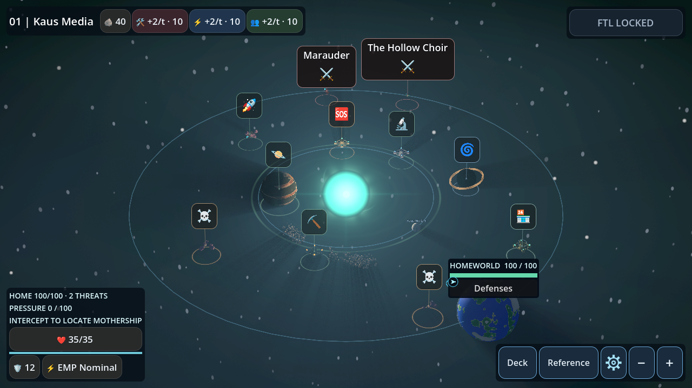
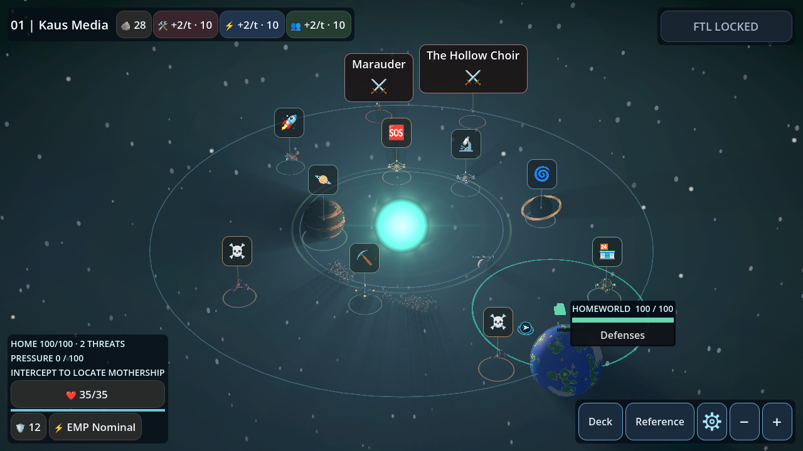
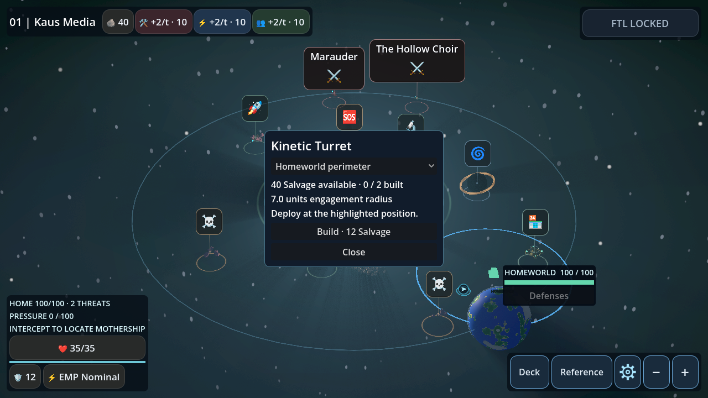
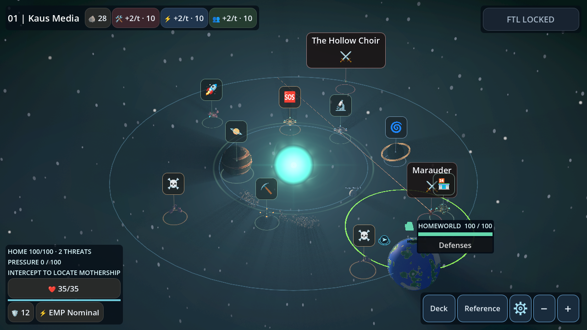
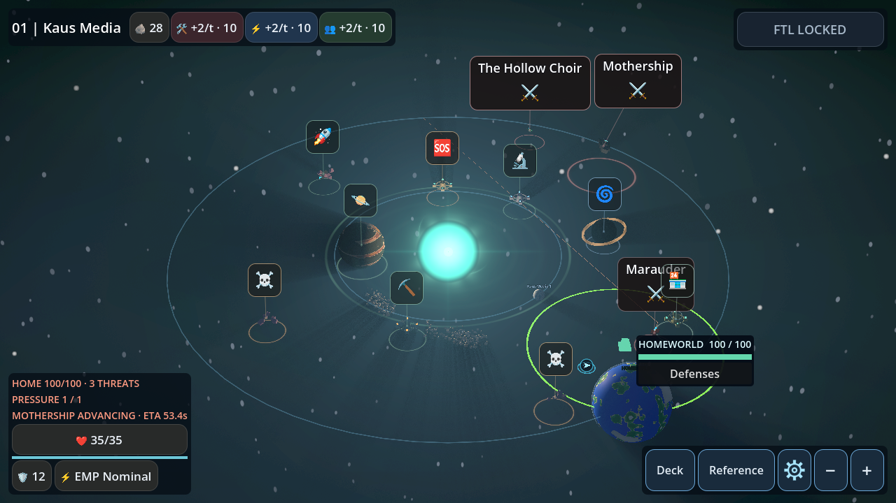

# Starfront pressure and Kinetic Turrets

System Pressure starts at zero in each Starfront Defense system. It rises by
2 points per strategic second to a maximum of 100. Movement samples and
committed activity costs use the existing strategic event loop. Idle time,
menus, saving and loading do not advance the clock.

Neutralizing the first attacker still triggers the normal mothership reveal.
At maximum Pressure, the same event loop starts moving the mothership at
0.65 map units per strategic second toward the homeworld. If it was hidden,
it becomes visible immediately and starts the normal reinforcement countdown.
The warning shows the remaining travel time in strategic seconds. The pressure
threshold splits the current movement step, so only time after the threshold
can move the mothership. Lower pressure cannot undo the escalation.

The player can intercept and disable the moving mothership through the existing
contact and battle flow. Arrival ends the expedition through the homeworld-loss
flow. It is a terminal event separate from the integrity damage of ordinary
arrivals. Defeating the mothership still unlocks voluntary FTL.

## Construction and support

Open **Defenses** from the homeworld panel in the overview. The dialog shows
Salvage, the construction cost, available sites and installed turrets. Select a
site to preview its position and range. Build costs 12 Salvage and a system
allows two installations by default. Construction requires an idle expedition
with a valid, unoccupied site. The site list comes from the homeworld perimeter,
two approach relays and clear positions near selected celestial PoIs. The
positions are derived from existing anchors without drawing from an RNG stream.
Each installation has a default radius of 7 map units. Its circle turns bright
green when an active hostile enters the same three-dimensional range used by
the combat rule.

At entry, the enemy's authoritative position determines whether the battle
receives Friendly Turret Support. This works for a player intercept and for
contact caused by enemy motion. The battle-entry snapshot stores one friendly
effect alongside the existing environmental modifier. When two sites cover the
same enemy, the first covering site by stable site ID supplies the single
effect. Construction and enemy motion after entry do not change that snapshot.

The first shot fires at the beginning of round 3, after two complete rounds.
Subsequent shots fire at the beginning of rounds 5, 7 and so on. The existing
environmental event resolves first. If combat is still active, the turret
deals 5 guaranteed damage to the enemy, using the same shield-first damage
calculation as an asteroid hit. The shot consumes no RNG, cards or resources.
A per-battle round latch prevents duplicate activation. The existing impact,
sound and victory paths handle the result, including lethal shots. Turrets
never attack on the strategic map.

## Save compatibility and tuning

Defense snapshots store Pressure, the escalation flag, unit positions and
owned installations. Old saves start with zero Defense Pressure and no
installations. An active battle marker retains its entry support and seed
when reloaded through the existing battle restart behavior. FTL starts a new
system with fresh sites, zero Pressure and no installations.

The defaults live in `resources/starfront_defense_tuning.tres`. Turret cost,
capacity, range, damage and round interval can be tuned there. Existing
installations retain their saved range and weapon configuration.

## Validation captures

These images come from the Mobile Vulkan regression fixture on Windows.
The fixture stages hostile contact and the pressure threshold to show both
states. The same regression runs in headless, GL Compatibility and Mobile
Vulkan CI.

| Overview before construction | Deployed turret and range |
|---|---|
|  |  |

| Construction preview | Hostile within range |
|---|---|
|  |  |

