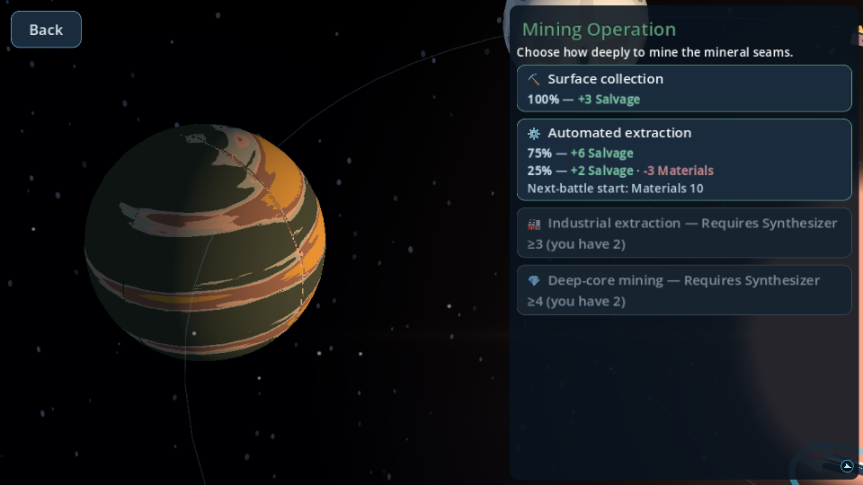
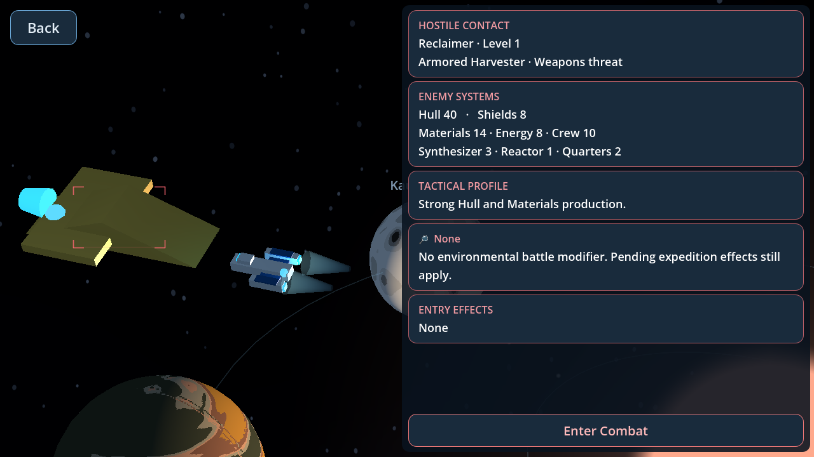
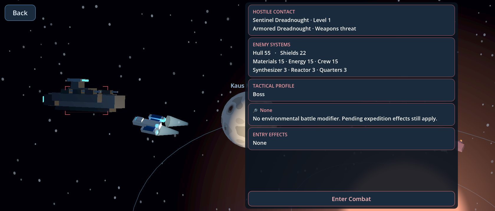
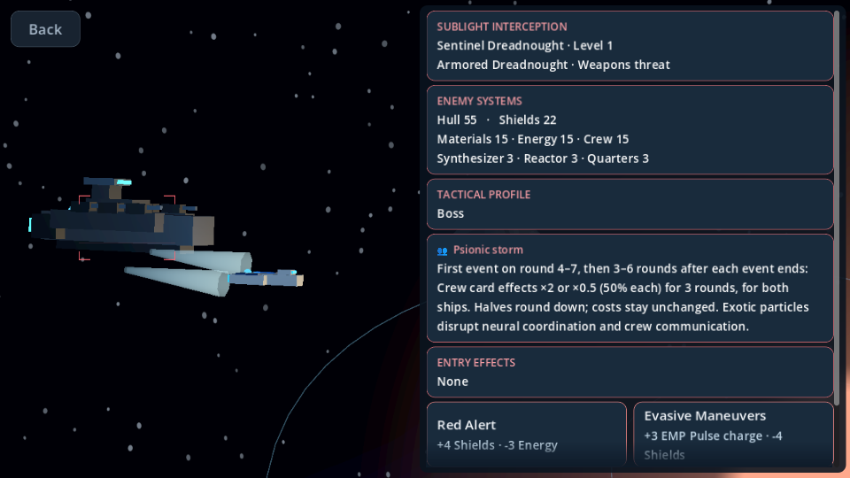

# PoI interface and tactical encounter polish

Starting revision: `4d0393cf115ae0715c8c2127829215b6089b2e8f`.

## Ownership and layout

The existing ExpeditionScreen, frameless StarSystemHUD, map SubViewport, map camera and confirmation components remain the owners. No autoload, additional viewport, gameplay state or persistence fields were added.

Normal focus uses 60/40 model/panel proportions inside the existing centered, maximum-1440-wide composition. Tactical focus uses 50/50. Wide displays therefore have a narrower absolute panel; all views retain independently scrollable content. Normal titles are 27 points, category tinted, without a redundant category caption. Compact actions have a 60-point baseline instead of 72. Probability/outcome formatting continues to use ExpeditionText and authoritative descriptions, including contextual balances.

Locked normal approaches retain their title and the exact `ExpeditionState.locked_reason()` text in one collapsed row. Their description/probability/outcome controls are hidden, and they remain disabled. Long requirements can wrap rather than clip. Confirmation, costs and reward mutations are unchanged.

## Normal camera orbit

Drag within the left viewing area below Back to orbit around the stationary object. Mouse and a single touch use the same velocity-based control; exponential damping supplies restrained inertia. Elevation stays between safe bounds and the existing focus distance is preserved. The existing overview camera restores its saved pan/zoom. Modal confirmation, settings, resource/deck/card overlays and transition input guards suppress orbit input. Tactical views and interceptions disable it.

## Tactical presentation

The briefing contains Hostile Contact, Enemy Systems, Tactical Profile, Battle Modifier and Entry Effects sections. Values come from the existing scaled enemy profile, difficulty, modifier description and pending-effect description. Profiles use authored summaries/roles, not inferred AI policy. All eight current modifiers retain their exact rules/timing descriptions. Enter Combat is a red-accented button outside the briefing scroll area.

The existing enemy destination model is reused, not rendered into another viewport. The player is temporarily placed opposite it, facing it. Uniform temporary scale emphasis (enemy ×1.45, player ×0.85) prioritizes the contact without changing model proportions or overview scale. A bounded model-extent calculation adjusts separation/framing for different hull sizes. The composition is lifted above nearby planetary geometry, with a single reusable, shadowless cool fill light. A scene-local drawing control places restrained red brackets/scan line around the actual enemy. The map identification ring is suppressed in this close shot.

Chasedowns use the same briefing with SUBLIGHT INTERCEPTION. Because an interceptor has no destination model, exactly one temporary model is instantiated from its authoritative enemy profile in the same 3D world. Both vessels face the travel direction, the enemy behind the player. Restrained engine emission implies pursuit. Existing response choices still enter combat through the existing state path. Back remains visible but disabled until this mandatory interception is resolved.

The map stores only temporary node transforms and orbit presentation. Overview/focus restoration puts both ships back, removes the temporary interceptor, hides the fill light/brackets and restores normal ship feedback. No authoritative pending-travel command is created; stationary post-interception behavior remains unchanged.

## Verification

See `tactical_poi_results.json` for measured results. The focused tactical script checks three requested resolutions, hidden locked outcomes, normal orbit, actual-model reuse, restoration, all registered enemy hulls plus both elite models, every modifier, fixed combat action visibility, pursuit alignment/cleanup and expedition RNG isolation. The earlier compact-focus test continues exercising confirmations, repairs, mandatory rewards, version-1 pending-choice resume and repeated visits.

Screenshots in `tactical_focus_screenshots/` are excluded from exports by `.gdignore`. Testing uses Godot 4.7.2, Linux Mesa llvmpipe, Mobile/Vulkan and Compatibility/OpenGL; it is not physical Android or Windows GPU testing.

## Limitations

Briefings and Chasedown response options scroll when necessary. Locked requirements may occupy two lines on small displays. The underlying model art is unchanged. Orbital controls deliberately offer neither focus zoom nor full unrestricted pole rotation. No new enemy behavior or hidden AI information is exposed. Existing ObjectDB shutdown warnings are reported separately from assertions/script failures.

## Runtime size

Across the six touched existing runtime scripts: 2,753 lines before; 2,926 after. The increase is presentation code (orbit input, temporary tactical choreography, targeting and structured briefing); gameplay/save/AI scripts and fixtures are unchanged.

## Modified files

- `scripts/expedition.gd`: authoritative read-only briefing assembly, existing combat intent, locked-option presentation and confirmation input guard.
- `scripts/ui/expedition_screen.gd`: mode proportions, pinned combat-action ownership and cleanup.
- `scripts/ui/poi_header.gd`: compact title, category tint and caption suppression.
- `scripts/ui/encounter_tile.gd`: tighter compact sizing and collapsed requirement-only rows.
- `scripts/presentation/star_system/star_map_3d.gd`: temporary real-ship choreography, focus orbit input, targeting, extent-based framing and pooled fill light.
- `scripts/presentation/star_system/map_feedback.gd`: suppress overview locator in tactical views and restrain pursuit exhaust.
- `tests/tactical_focus_test.gd` and `.uid`: new focused coverage.
- `tests/compact_poi_focus_test.gd`: updated requested panel/font expectations.
- `tests/expedition_test.gd`, `tests/star_map_test.gd`, `tests/status_bar_test.gd`: find the actual combat control/briefing content rather than legacy child indices.
- `docs/DEVELOPER_GUIDE.md`, this report, results JSON and screenshot directory.

No files removed. `project.godot`, camera calibration, StarSystemHUD, ship assets, ExpeditionState, ExpeditionDeck, save codec, combat, AI, music and sound catalogs remain unchanged.

## Rendered examples

Measured results: 84 focused tactical checks passed headlessly and under both rendered backends. The shared runner completed all 116 scripts plus import. Its fresh pass recorded one obsolete normal-panel-width assertion; the corrected transition test then passed all 106 checks. The initial run also exposed two legacy child-index assumptions, fixed before the fresh pass. Results JSON preserves both raw runs and focused reruns. Exact baselines matched: 2,220 card-effect checkpoints, 72 combat traces and 1,044 expedition checkpoints. No expected gameplay fixture was regenerated.
