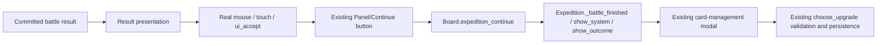
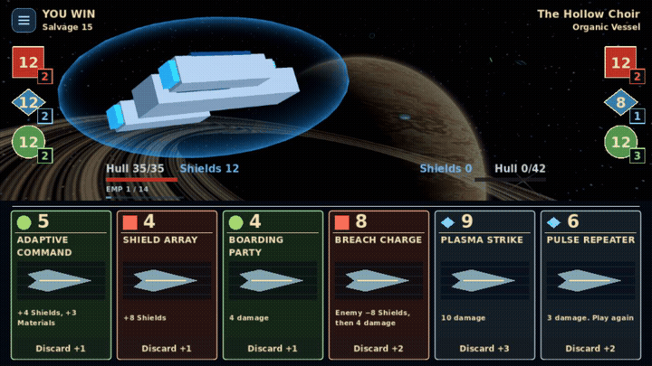
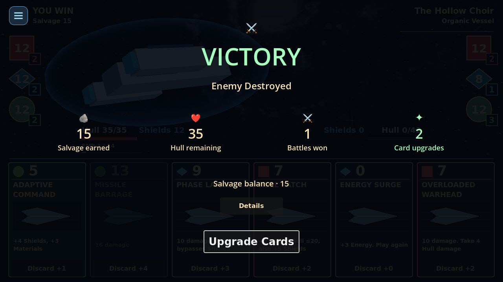
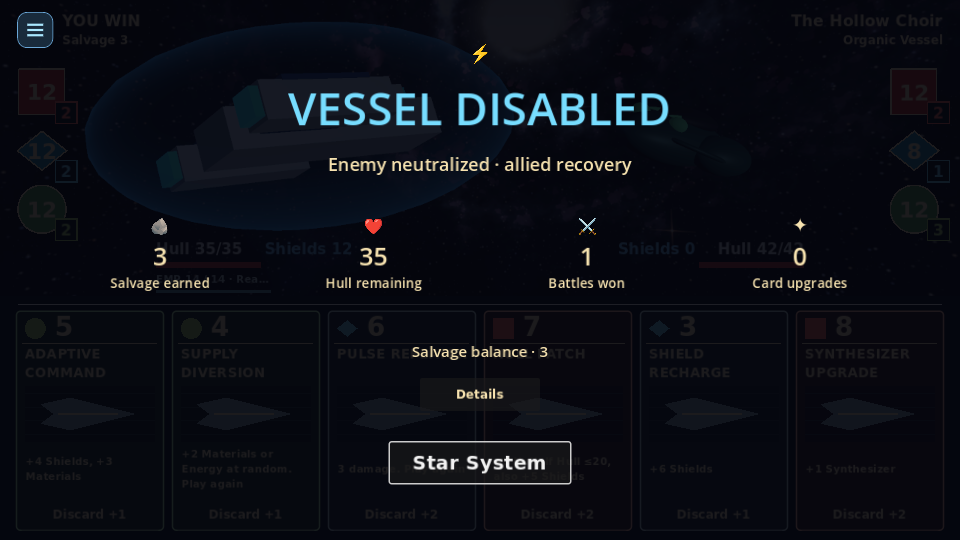

# Victory result input and animation

Base: main `2dd340c` (weekend polish / PR68).

## Reproduced input failure

A real expedition battle produced a committed pending upgrade event and an enabled
Upgrade Cards button. Simulated pointer movement identified the later-added
results VBoxContainer as the hovered control instead of the button. Wrapped labels
initially computed narrow-width minimum heights; the containers retained heights
around 550 pixels even after layout widened them. Their default PASS mouse filter
sent input to the result root, never to the button's earlier sibling Panel.

The initial regression reproduced two failures: no button press and no upgrade
modal. The input fix makes all decoration explicitly IGNORE pointer input and
refits when minimum sizes settle. The exact same real click then reached Continue,
emitted Board.expedition_continue, reached Expedition._battle_finished, and opened
the existing card-management upgrade modal without changing pending upgrades.

## Existing workflow retained

The fix deliberately stays before Board's existing Continue handler. It does not
replace card management or call the controller from a new widget:



Upgrade counts remain authoritative. The display adapter counts only remaining
eligible upgrades; the HUD labels the action Upgrade Cards only for a real,
nonempty upgrade event. An exhausted pool uses Star System. Mandatory upgrades
remain mandatory under the existing rules; no new skip-upgrades path was added.

## Presentation

Before PR68 the title moved from the center toward its final position and details
revealed in a staggered sequence. PR68 replaced that with an 8-pixel movement and
roughly half-second reveal, and disabled it entirely with Battle VFX off.

The new default timeline lasts 1.55 seconds after the existing combat-ending effects:

| Time | Presentation |
| --- | --- |
| 0.00 | Large title fades/zooms from 122% and moves into position; restrained radial pulse |
| 0.20–0.30 | Outcome symbol and actual cause reveal |
| 0.42–0.81 | Four reward columns pop in separately; genuine committed values count upward |
| 1.05 | Salvage balance appears |
| 1.22–1.55 | Primary action fades/scales in, enables and receives keyboard focus |

The existing `VisualEffects.reveal/reset` helpers own lightweight pop/fade tweens.
The sequence owns their lifecycle and resets/kills every helper on normal completion,
Skip or scene exit. Skip restores final numbers, opacity, scale, title position,
button states and focus without invoking Continue or changing expedition state.
Details keeps its own modal focus if open. Repeated play/refresh/skip is harmless.

The radial decoration is a small CanvasItem drawing arcs/lines, with no particle
emitters, textures, lights, colliders or RNG. EMP uses cyan electronic arcs and its
neutralization identity, not explosion rays. Systems Failure, ordinary destruction,
mothership neutralization, defeat and draw retain distinct actual headings/causes.
Existing tier-based victory music, EMP sounds and result accents remain unchanged.
Upgrade availability gets the existing victory accent color.

All decorative Labels, Grid/VBox containers and the pulse explicitly IGNORE input.
Only the existing primary button, Details and Skip intentionally receive input.
Minimum-size updates trigger a coalesced layout pass; compact stat labels avoid
initial narrow-width wrapping. Title position is driven by normalized animation
progress so resizing does not retain an obsolete pixel destination. The reward
layout supports four columns or two columns in narrow logical viewports.

## Preferences and compatibility

Battle VFX now governs combat effects only. Lightweight result animation continues
with Battle VFX off. There is no separate UI reduced-motion setting in the project;
the existing Skip Cinematics preference retains the immediate, fully visible,
interactive summary without zoom, pulse or counters. No accessibility preference
is silently reset and no new settings menu is introduced.

No reward calculations, card definitions, upgrade counts, combat/EMP mechanics,
strategic rules or save schema changed. Animation reads a frozen presentation
summary. Save & Quit, pending upgrades and resume remain in the existing owners.

## Motion evidence



[Full 5.4-second production recording with audio](media/victory.mp4) includes the
existing combat-ending presentation and the new result sequence. The GIF is a
2.4-second excerpt from that recording, not animation synthesized from static
mockups. Godot Movie Maker captured 162 real rendered frames at fixed 30 FPS with
Battle VFX disabled, demonstrating that ordinary UI animation remains active.
The production board uses a seeded real expedition, committed victory rewards,
and existing shaders/assets. The staged title, intermediate counters, icons and
final Upgrade Cards action were reviewed in the rendered frame sequence.

Reproduce in an isolated development user directory:

```sh
XDG_DATA_HOME=/tmp/arcospace-result-capture godot --path . --rendering-method gl_compatibility --write-movie /tmp/victory.avi --fixed-fps 30 --script res://tools/capture_result_motion.gd
```

The MP4/GIF are documentation evidence, excluded from Godot import/export by the
media directory's `.gdignore`.

| Completed victory / upgrade action | EMP at mobile resolution |
| --- | --- |
|  |  |
