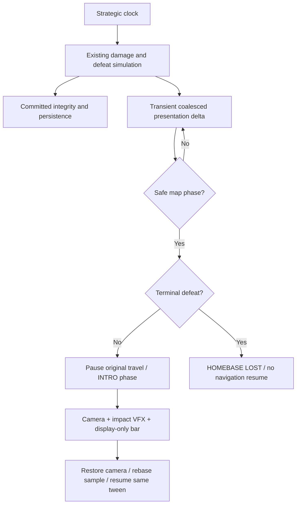
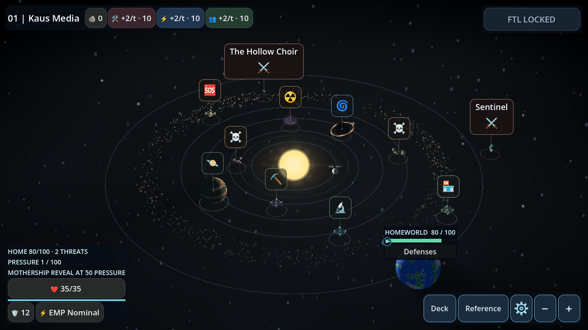
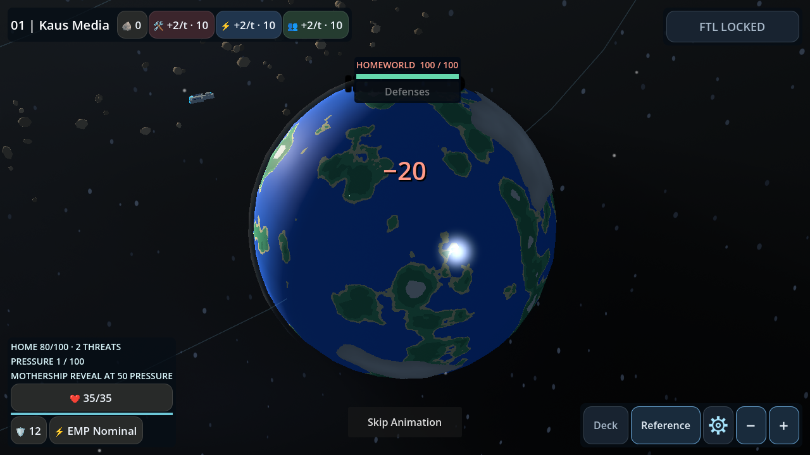
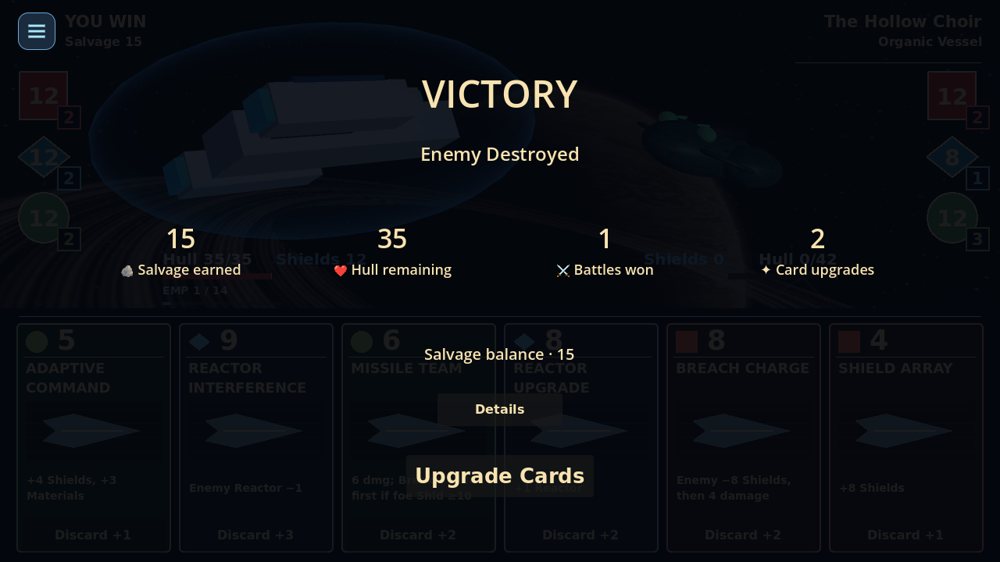
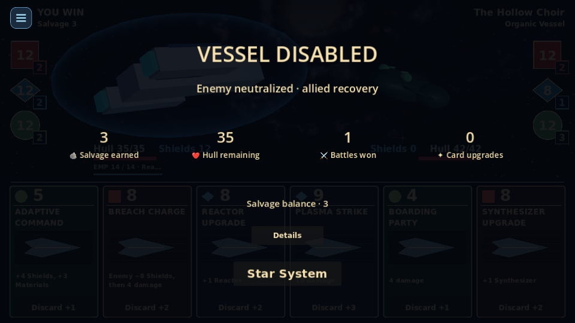
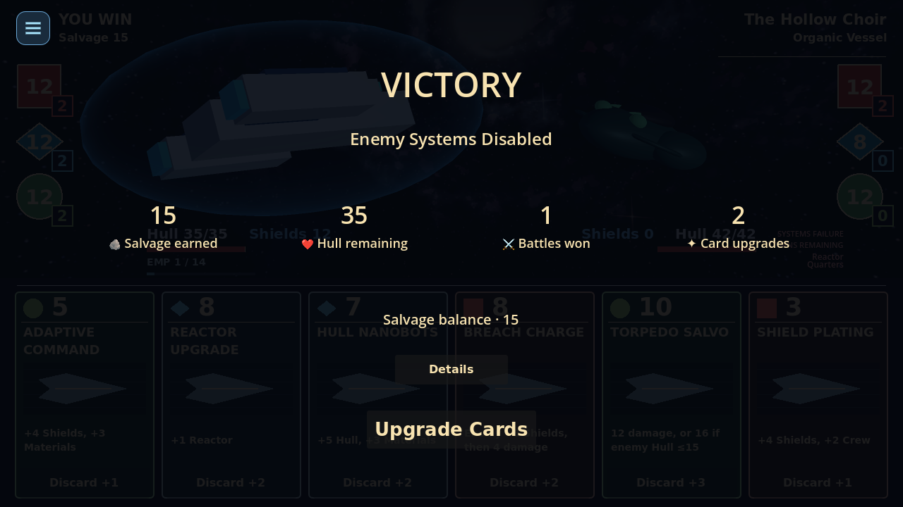
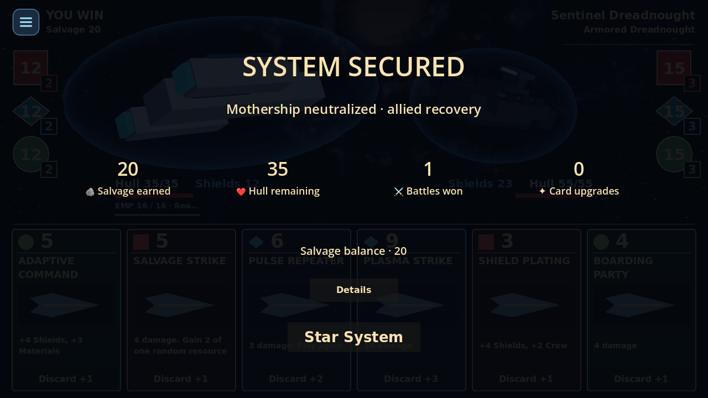
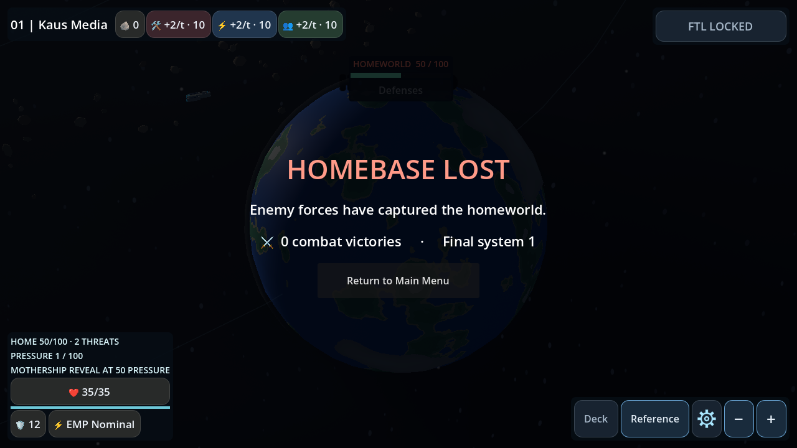

# Weekend polish

Base: main `59d24f3` (including the committed Salvage economy from PR67).
The original assignment is in [request.md](request.md).

## Environmental clearance

`EnvironmentClearance` supplies scene-free sphere/ellipsoid distance, annular belt
and localized-pocket exclusion. New Defense regions protect the homeworld's full
render envelope (`1.8 × 1.5 × 1.035`) plus the configurable
`DefenseTuning.environment_visual_margin` (default 0.6). Existing valid records
remain unchanged. Intersecting regions use at most 32 deterministic private-stream
retries. Retries also satisfy the existing fleet-deployment/route constraints.
Impossible optional regions are omitted; the homeworld never moves.
Temporal-rift placement shares the same protected radius.

New Solar records contain additive generation metadata `celestial_clearance` and
`visual_margin`. The pure visual layout retries **only invalid gas giant orbits**,
checking their full periapsis/apoapsis envelope, visible radius, neighboring shells
and system bounds. It preserves planet count, size, material seeds, eccentricity
and existing valid orbits. Gas PoI placement likewise checks the full circular
orbit. Defense's authoritative gas PoI anchors are retained; if a fixed anchor or
bounded cosmetic layout has no feasible solution, the optional Solar influence
is omitted instead of moving that gameplay location, shrinking a planet or
changing a combat multiplier. Solar radius comes from the actual generated record.
The resulting layout is checked before committing exploration battle coordinates.

Saved Solar records without this opt-in metadata retain the old visual layout.
Loading never runs the new-region clearance filter. Version-3 saves retain their
schema and migrations. Region records and retry metadata use canonical JSON wire
types. Final collision bodies and rendering use the same saved region definitions.
No gameplay, reward, enemy or combat RNG stream is used by placement or visuals.

## Locator and storm HUD

The existing `MapFeedback` owns the pulsing cyan player ring and screen-edge arrow.
The ring follows actual ship position and scales for camera depth. The arrow uses
boundary hysteresis, viewport/safe-area insets and HUD exclusion rectangles. It has
no input hitbox or gameplay collider. Existing cinematic state suppresses it.
The permanent storm-family legend is removed; regions, encounters, modifier
inspection and Details remain available.

## Battle results

`Board._record_result` captures the Salvage balance delta after the existing result
transaction. It passes that committed delta, balance, Hull, victories and actual
pending upgrades to the existing HUD/result sequence. The widget never calculates
or grants rewards. Existing destruction, Systems Failure, EMP recovery and secured
system payouts remain unchanged.

Headings distinguish VICTORY, VESSEL DISABLED and SYSTEM SECURED. Supporting text
preserves the actual cause, including Systems Failure and mothership EMP recovery.
Four compact icon/stat columns reveal briefly; Skip Animation and existing reduced
cinematic/VFX preferences finish immediately. Existing Continue/Upgrade/Main Menu
signals remain in use. Technical information stays behind Details. Resize tests
cover 1920×1080, 1280×720, 960×540 and 900×600.

## Homeworld damage and terminal presentation

`ExpeditionState._advance_strategy` records integrity before/after the existing
simulation call and emits the actual committed damage. No damage rule, strategic
scheduler, missile calculation or failure condition is changed.

`HomeworldSequence` owns only transient presentation records, camera/overlay state
and short-lived VFX. It coalesces pending deltas per expedition identity/system.
Battle, reward, PoI and modal phases defer playback. The controller starts it only
in a safe overview/travel phase after navigation sampling and event routing.

During playback the controller's existing INTRO phase gates strategic sampling,
cooldowns and map actions. The component pauses the **same travel tween**, captures
camera transform/pan/zoom/view mode, frames the homeworld, reuses three bounded
imported hull-impact effects without lights, shows a floating damage number and
animates a display-only integrity override. It restores framing and resumes that
same tween. Navigation sampling rebases at the already-committed position. No
travel restart, encounter reroll or strategic-time catch-up occurs. Skip/reduced
settings shorten playback; scene cancellation kills effects/tweens safely.

**Save/load policy:** unshown impact cinematics are intentionally transient and
are discarded when leaving the scene, saving/quitting or loading. Authoritative
integrity, fleet/missile outcomes and terminal cleanup are committed independently
and saved through existing persistence. Loading never reapplies damage or replays
a stale camera interruption. This avoids an additional gameplay/persistence queue.

Terminal failure takes priority over ordinary damage: pending hits are consumed
into a single HOMEBASE LOST presentation, the rendered map remains behind a dark
overlay, and navigation never resumes. Conquest and integrity depletion have
different subtitles. Displayed totals use only existing persisted victories and
final system number; no lifetime earnings/spending are inferred from balances.
The existing terminal save tombstone/cleanup remains authoritative.

## Validation and limits

Focused Godot 4.7.2 tests cover geometry, determinism, canonical save roundtrips,
old-layout opt-out, full gas orbits, locator/input behavior, committed result
summaries, duplicate reveals, immediate damage, coalescing, paused travel/clock,
unchanged gameplay RNG, camera restoration and terminal precedence.
New UI tests are registered in both GL Compatibility and Mobile Vulkan matrices.
Production captures are generated by the tests under `.godot/testlogs/weekend`.

Software-rendered captures are visual evidence, not physical Android-device
certification. Manual Android checks should cover safe areas, touch/skip controls,
app background/resume mid-impact, repeated modal entry and travel interruption on
a low-end device. The previous material/lighting, combat VFX, camera controls,
combat modifiers, prices and reward values are unchanged.

## Production gallery

GL Compatibility on software Mesa, seed 1042 for the map; deterministic combat
fixtures from seed 31025. Rendering uses existing production scenes and shaders.
These images are review evidence, not replacement baseline fixtures.

| Overview / locator | Homeworld impact |
| --- | --- |
|  |  |

| Victory | EMP recovery at 960×540 |
| --- | --- |
|  |  |

| Systems Failure | Mothership EMP |
| --- | --- |
|  |  |

