# System-wide stellar scattering and shadow corridors

Baseline: main 6d3aa8e, including PR #53. This supersedes the initial PR #54
prototype of localized dust volumes: the production effect is now one continuous
medium centered on the physical star, including when the star is offscreen.

## Distribution and shadows

The field is a broad ellipsoid with an exact quadratic density integral. Its
horizontal radius is at least 1.65 times the navigable corner distance (about 65
units with current bounds), and its half-height is 14 units. Thus density fades
far beyond navigable planets, encounters and PoIs rather than ending at them.
This is deliberately gradual stylized attenuation, not inverse-square lighting.
World-coordinate, low-frequency sinusoidal variation adds faint dust structure.
The camera-relative `map_sky.gdshader` remains unchanged: spatial shadowing belongs
in this world-space medium, not the sky.

Up to six largest substantial celestial bodies supply physical positions and
radii. Each obstructs the shared medium using the existing analytical finite-cone
intersection method. The umbra slope is `(body_radius-star_radius)/distance`;
the surrounding penumbra uses `(body_radius+star_radius)/distance`. Integrated
shadow paths subtract illumination instead of adding bright per-planet plumes.
Converging umbras end at their physical tip; penumbras continue through the field.
Cone chord integration softens projected boundaries, and the remote field boundary
fades continuously without a bright cap. Larger bodies cover more of the medium.
Overlapping occluders use the strongest obstruction, avoiding excessive blackening.

The star radius comes from the existing core-scale definition. Four procedural
planets plus substantial gas-giant PoIs share a six-occluder budget, prioritizing
larger bodies; additional bodies beyond this budget do not cast medium shadows.
Bodies smaller than radius 0.5 are skipped. There are no separately generated moons
currently. This represents shadows in dust, not eclipses on other solid surfaces.

## Rendering and performance

`stellar_shafts.gd` owns one unit box mesh, one material and **one transparent draw**.
The vertex shader expands the proxy to the field bounds; CPU culling uses matching
bounds. A maximum-six-body transform/radius comparison updates packed uniforms only
when geometry changes. Camera motion neither rotates nor rebuilds the field.

`stellar_dust_volume.gdshader` intersects the ellipsoid and shadow cones in closed
form. It uses one resolved scene-depth sample to stop scattering at opaque surfaces,
with separate GL and Mobile depth reconstruction. There is no ray marching, global
illumination, shadow map, texture noise, additional light or per-frame material
allocation. Tiny static alpha dither reduces gradient banding. Transparent priority
-20 keeps atmospheric and PoI ribbons legible.

Defaults: `stellar_shafts_enabled=true`, `stellar_dust_density=0.007`; opacity is
capped at 0.42. The single field may cover the full viewport, so analytical fragment
work and depth resolving are real costs despite the single draw. Physical Android
thermal/frame-time measurements remain outstanding. Mobile Vulkan and GL are both
tested; their tone mapping yields different apparent brightness.

## Validation

`stellar_shafts_prototype_test.gd` covers centered, fully offscreen, oblique,
backlit and **outer-system offscreen** views. It verifies the full physical sun
disc is offscreen and compares the same outer-field pixels with occlusion enabled
and disabled: shadows must darken a persistently illuminated medium. Forty camera
transition frames check fixed world transforms and mesh identity.

Local outer-field luminance (linear image luminance, same nine-by-nine patch):

| Renderer | Unobstructed medium | Shadow corridor |
|---|---:|---:|
| Mobile Vulkan | 0.158933 | 0.145540 |
| GL Compatibility | 0.073431 | 0.068880 |

`stellar_shafts_render_test.gd` covers production seed 1042, matched enabled/disabled
captures, one field draw, physical shadow direction, static resource reuse, moved
body updates, collider-free effects and unchanged persisted state/RNG. The existing
solar, lighting, asteroid, input, navigation and save suites remain in the CI matrix.
The full HUD presentation matrix (four resolutions, every enemy/modifier preview,
24 settling frames per transition) has a 300-second software-rendering budget,
matching the existing long power-allocation matrix. Its initial GL CI run reached
the former 120-second timeout without assertion errors; the unchanged test passes
locally in 30.918 seconds. This budget change does not establish Android performance.
Final CI results are recorded on PR #54.

Combat, environmental selection/snapshots, saves, procedural positions, RNG streams,
camera controls, hitboxes, PoI interaction and the existing lens addon are unchanged.

## Original renderer captures

Before/after differ only by field visibility; no image postprocessing. Shader TIME
remains live. Prototype cameras are test fixtures, not production control changes.
Mobile screenshots use Vulkan explicitly. No encoded motion video was recorded.

| Production view | Before | After |
|---|---|---|
| Centered sun |  | 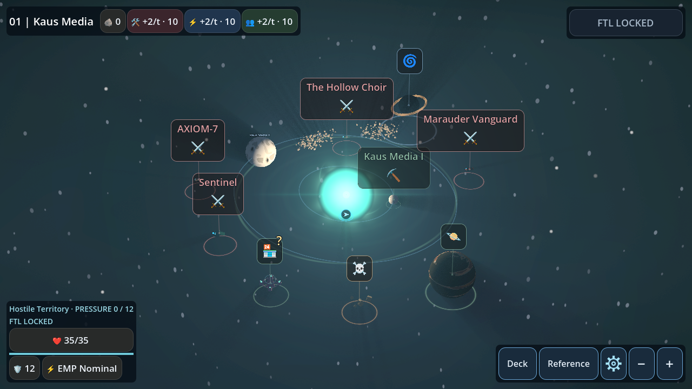 |
| Offscreen sun | 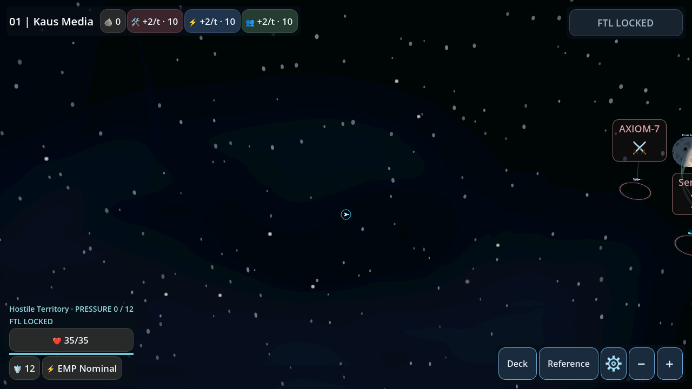 | 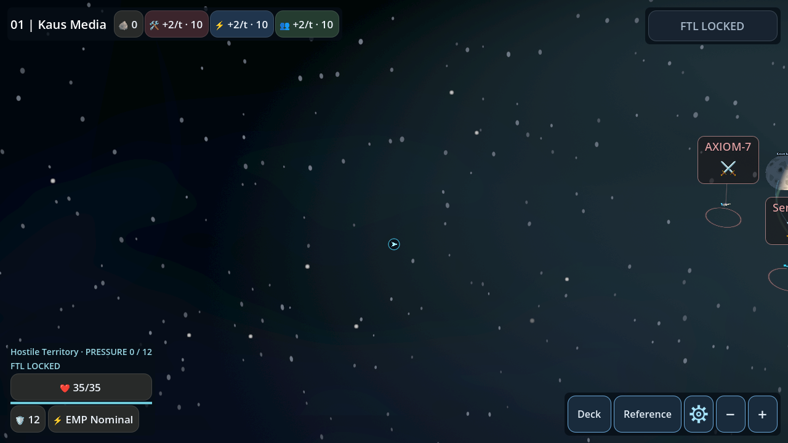 |
| Multiple bodies, PoIs and asteroids | 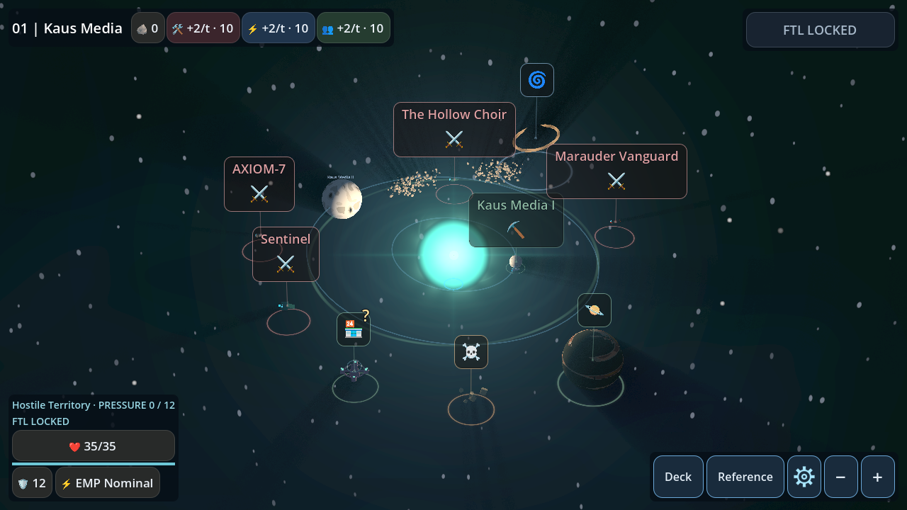 | 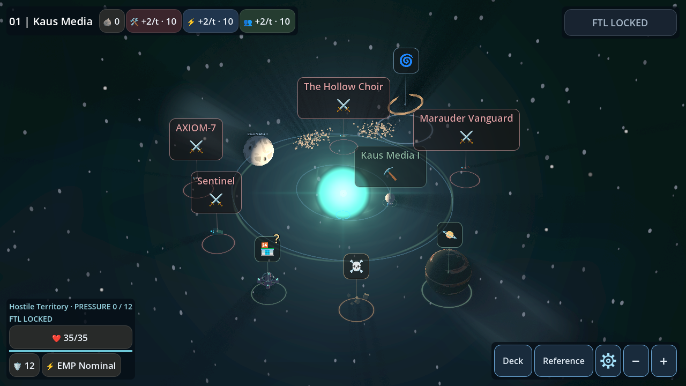 |

| Controlled prototype | Before | After |
|---|---|---|
| Fully offscreen source | 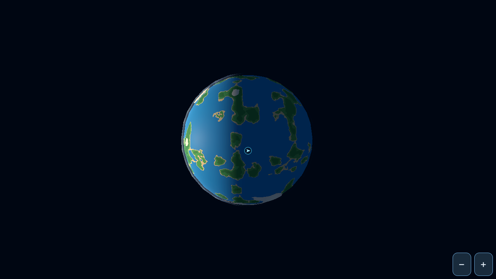 | 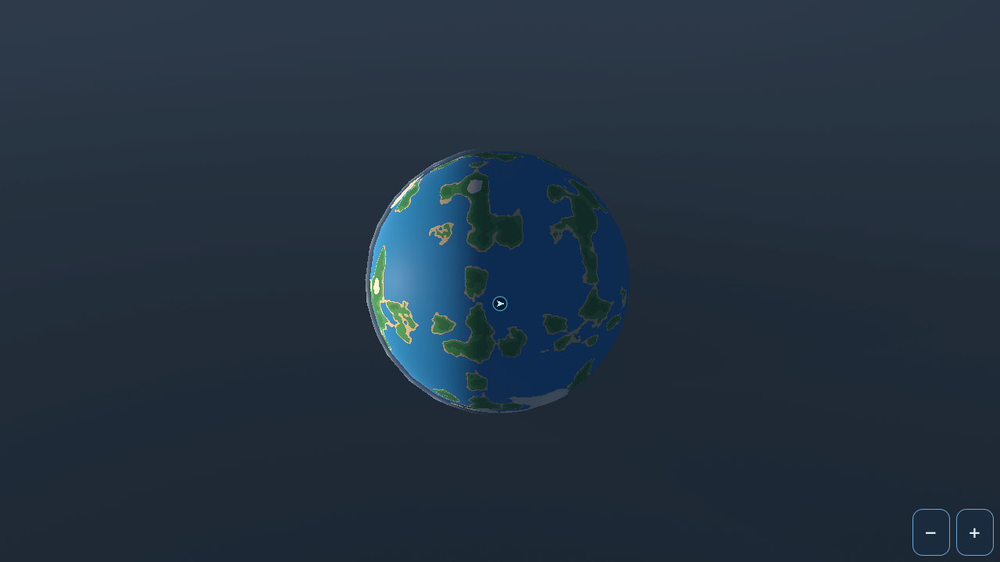 |
| Outer-system, offscreen source | 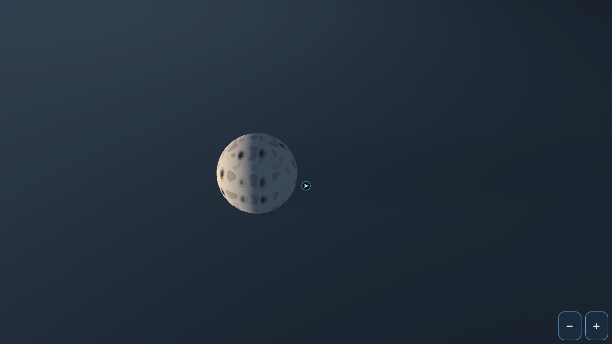 | 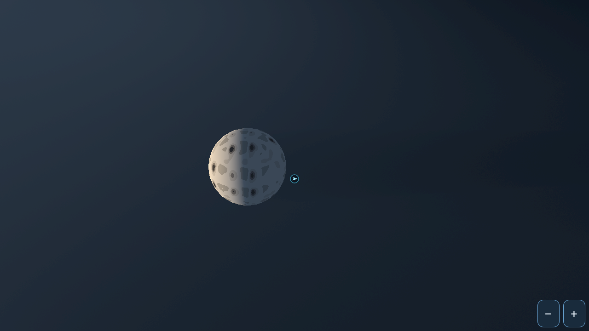 |
| Oblique | 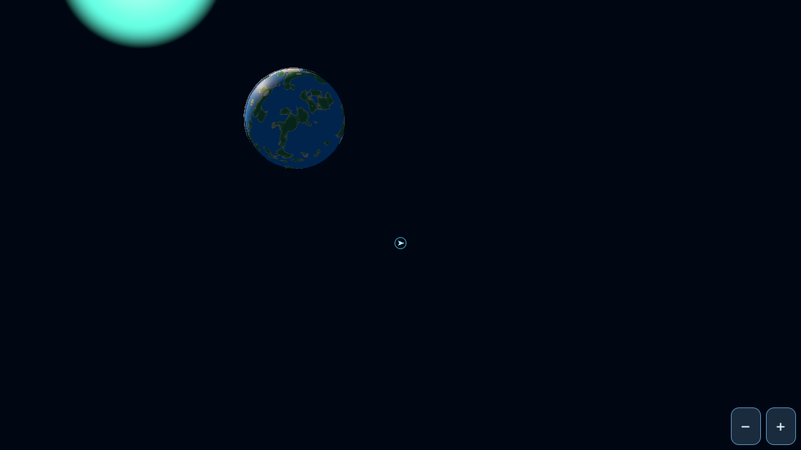 | 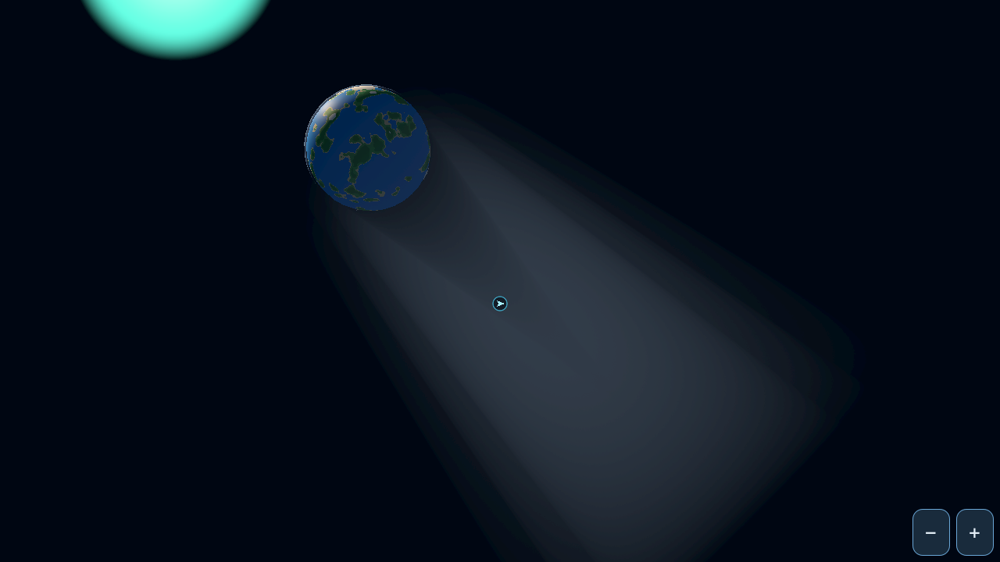 |
| Backlit |  | 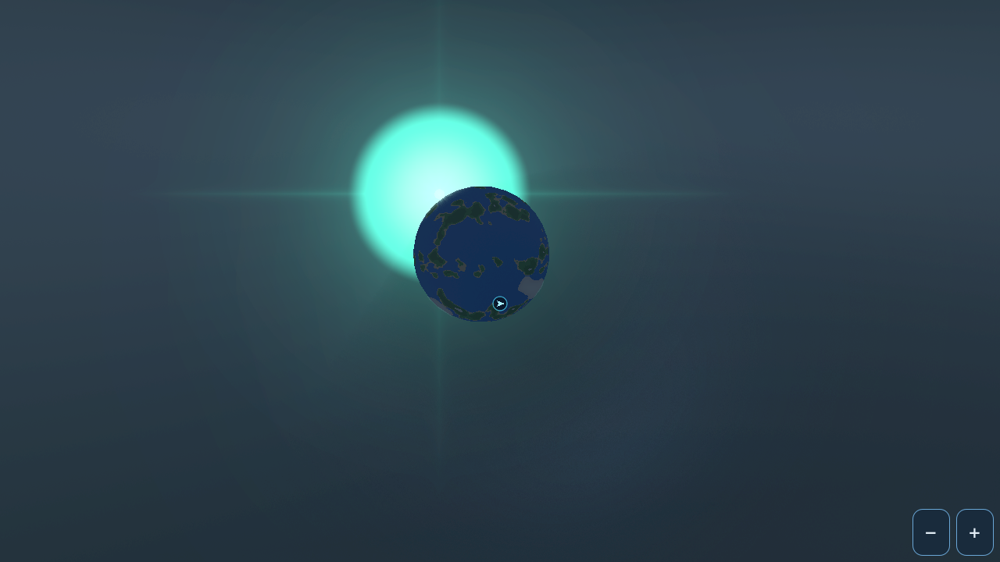 |

GL equivalents and remaining production close-ups are in the gallery folder.
Art-direction acceptance still needs visual review; numeric checks establish
coverage and obstruction, not subjective quality.
