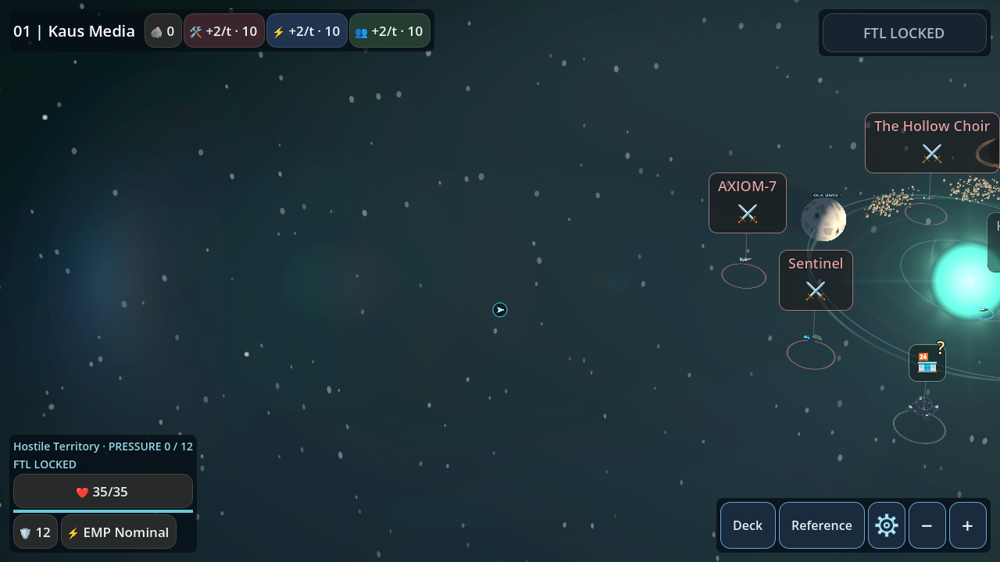
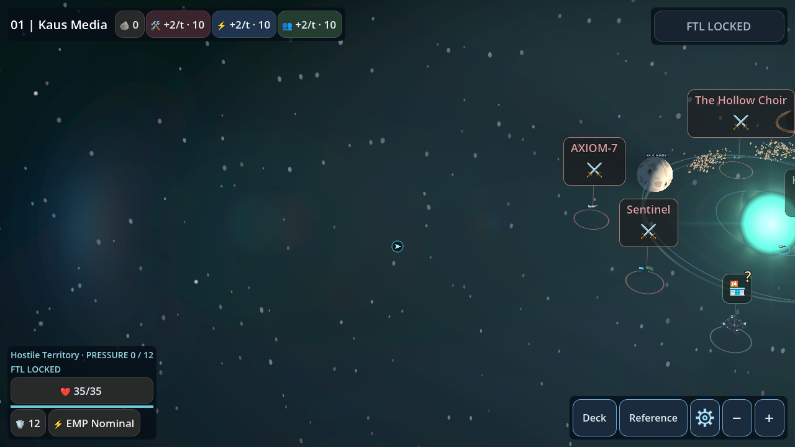
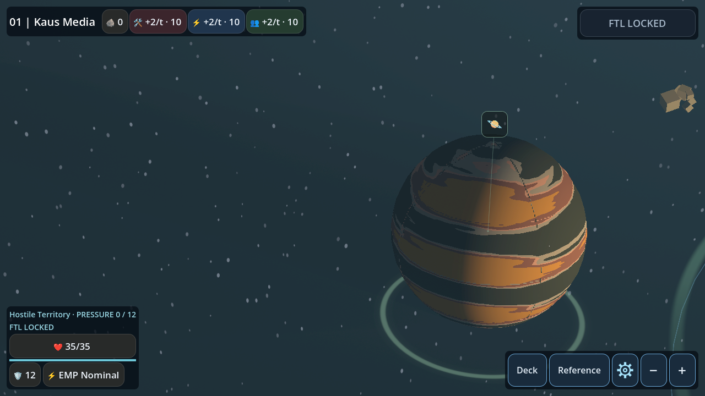

# System-wide stellar scattering and shadow corridors

Follow-up baseline: merged PR #54, main faab22e. The existing continuous star-centered
medium and analytical shadow architecture are preserved. This pass strengthens
shadow attenuation and gently tightens the radial envelope; it adds no gameplay
behavior and leaves density, tint and the opacity cap unchanged.

## Distribution and shadows

The field is a broad ellipsoid with an exact quadratic density integral. Its
horizontal radius is at least 1.40 times the navigable corner distance (about 55
units with current bounds, previously about 65), and its half-height is 14 units.
Thus density fades
beyond navigable planets, encounters and PoIs rather than ending at them, but
contributes less light beyond the useful rim. At the navigable diagonal corner,
the radial density factor is about 0.49 instead of 0.63; it remains substantial.
The minimum radius is 44 units, and a distant substantial body can extend the
radius to 1.40 times its outer surface distance. The standalone fixture uses 56.
This is deliberately gradual stylized attenuation, not inverse-square lighting.
World-coordinate, low-frequency sinusoidal variation adds faint dust structure.
The camera-relative `map_sky.gdshader` remains unchanged: spatial shadowing belongs
in this world-space medium, not the sky.

Up to six largest substantial celestial bodies supply physical positions and
radii. Each obstructs the shared medium using the existing analytical finite-cone
intersection method. The umbra slope is `(body_radius-star_radius)/distance`;
the surrounding penumbra uses `(body_radius+star_radius)/distance`. Integrated
shadow paths subtract illumination instead of adding bright per-planet plumes.
Converging umbras end at their physical tip; penumbras continue through the field.
Cone chord integration softens projected boundaries, and the remote field boundary
fades continuously without a bright cap. Larger bodies cover more of the medium.
Overlapping occluders use the strongest obstruction, avoiding excessive blackening.
Umbra weight increases from 0.78 to 0.95 and penumbra weight from 0.50 to 1.20;
removal is capped at 90% of the integrated medium, retaining at least 10% even
along a fully shadowed ray. Partial cone chords and the existing penumbral spread
retain soft edges. Contrast comes from reduced scattered light, not a dark overlay
or increased opacity. No additional cone intersections, texture samples, draws or
per-frame allocations are added.

The star radius comes from the existing core-scale definition. Four procedural
planets plus substantial gas-giant PoIs share a six-occluder budget, prioritizing
larger bodies; additional bodies beyond this budget do not cast medium shadows.
Bodies smaller than radius 0.5 are skipped. There are no separately generated moons
currently. This represents shadows in dust, not eclipses on other solid surfaces.

## Rendering and performance

`stellar_shafts.gd` owns one unit box mesh, one material and **one transparent draw**.
The vertex shader expands the proxy to the field bounds; CPU culling uses matching
bounds. A maximum-six-body transform/radius comparison updates packed uniforms only
when geometry changes. Camera motion neither rotates nor rebuilds the field.

`stellar_dust_volume.gdshader` intersects the ellipsoid and shadow cones in closed
form. It uses one resolved scene-depth sample to stop scattering at opaque surfaces,
with separate GL and Mobile depth reconstruction. There is no ray marching, global
illumination, shadow map, texture noise, additional light or per-frame material
allocation. Tiny static alpha dither reduces gradient banding. Transparent priority
-20 keeps atmospheric and PoI ribbons legible.

Defaults: `stellar_shafts_enabled=true`, `stellar_dust_density=0.007`; opacity is
capped at 0.42. The single field may cover the full viewport, so analytical fragment
work and depth resolving are real costs despite the single draw. Physical Android
thermal/frame-time measurements remain outstanding. Mobile Vulkan and GL are both
tested; their tone mapping yields different apparent brightness.

## Validation

`stellar_shafts_prototype_test.gd` covers centered, fully offscreen, oblique,
backlit and **outer-system offscreen** views. It verifies the full physical sun
disc is offscreen and compares the same outer-field pixels with occlusion enabled
and disabled: shadows must darken a persistently illuminated medium. Forty camera
transition frames check fixed world transforms and mesh identity.

Local outer-field luminance and relative corridor contrast, same nine-by-nine
patch and identical geometry/camera (standalone field radius 66 vs 56):

| Renderer | PR54 lit / shadow | Revised lit / shadow | PR54 / revised contrast |
|---|---:|---:|---:|
| Mobile Vulkan | 0.158933 / 0.145540 | 0.143496 / 0.125017 | 8.43% / 12.88% |
| GL Compatibility | 0.073431 / 0.068880 | 0.064958 / 0.054131 | 6.20% / 16.67% |

Relative contrast is `(lit-shadow)/lit`. Revised outer-medium brightness is about
10% lower on Mobile and 12% lower on GL, while its relative shadow contrast rises
by about 53% and 169% respectively. These are matched rendered patch measurements,
not whole-frame averages or a claim about every view.

Translated identical cameras with occlusion disabled also verify radial falloff:

| Renderer | Inner (radius 14) | Outer (radius 34) | Beyond rim (radius 50) |
|---|---:|---:|---:|
| Mobile Vulkan | 0.195199 | 0.143496 | 0.063195 |
| GL Compatibility | 0.100747 | 0.064958 | 0.031229 |

The Mobile inner patch dims only about 3% (0.200822 to 0.195199), versus about
10% in the outer patch. The baseline/revised outer-to-inner ratio is also checked.

Regression assertions require stronger relative contrast than PR54, a moderate
outer brightness reduction, readable light remaining in the corridor, a dimmer
outer field than the inner field, and less scattering beyond the useful rim.
The existing forty-frame camera transition and mesh-identity checks remain.

`stellar_shafts_render_test.gd` covers production seed 1042, matched PR54/revised-tuning
captures, a selectable outer celestial PoI, one field draw, physical shadow
direction, static resource reuse, moved
body updates, collider-free effects and unchanged persisted state/RNG. The existing
solar, lighting, asteroid, input, navigation and save suites remain in the CI matrix.
The full HUD presentation matrix (four resolutions, every enemy/modifier preview,
24 settling frames per transition) has a 300-second software-rendering budget,
matching the existing long power-allocation matrix. Its initial GL CI run reached
the former 120-second timeout without assertion errors; the unchanged test passes
locally in 30.918 seconds. This budget change does not establish Android performance.
Final follow-up CI results are recorded on the follow-up PR.

Combat, environmental selection/snapshots, saves, procedural positions, RNG streams,
camera controls, hitboxes, PoI interaction and the existing lens addon are unchanged.

## Original renderer captures

Before is the merged PR54 tuning, including its larger field and weaker shadow
weights; after is revised tuning on the same world, camera and renderer. Both
include scattering. `stellar_scattering_fixture.gd` only overrides shader uniforms
for these comparisons; it does not change production settings or interaction.
No image postprocessing. Shader TIME
remains live. Prototype cameras are test fixtures, not production control changes.
Mobile screenshots use Vulkan explicitly. No encoded motion video was recorded.

| Production view | PR54 | Revised |
|---|---|---|
| Centered sun |  |  |
| Near-edge sun |  |  |
| Offscreen sun |  |  |
| Outer celestial PoI |  |  |
| Multiple bodies, PoIs and asteroids |  |  |

| Controlled prototype | PR54 | Revised |
|---|---|---|
| Fully offscreen source |  |  |
| Outer-system, offscreen source |  |  |
| Oblique |  |  |
| Backlit |  |  |

GL equivalents and remaining production close-ups are in the gallery folder.
Art-direction acceptance still needs visual review; numeric checks establish
coverage and obstruction, not subjective quality.
